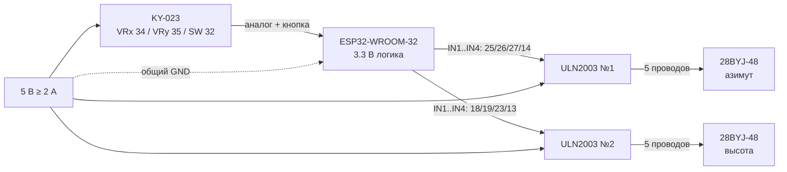

# Аппаратная часть монтировки

- Статус: описано по фактическому стенду; драйверы в прошивке ещё не реализованы
- Дата: 2026-11-14
- Контроллер: ESP32-WROOM-32 (классический DevKit)
- Карта GPIO: [`pinmap.md`](pinmap.md) — единственный источник истины по номерам пинов

## 1. Состав

| № | Компонент | Кол-во | Роль в системе | Примечание |
|---|---|---|---|---|
| 1 | ESP32-WROOM-32 DevKit | 1 | контроллер прошивки | логика 3.3 В, FreeRTOS |
| 2 | 28BYJ-48, 5 В, 4-фазный униполярный ШД | 2 | привод осей | встроенный редуктор ~1:64 |
| 3 | ULN2003 (модуль с разъёмом и 4 LED) | 2 | драйвер ШД | 4 канала на двигатель |
| 4 | Джойстик KY-023 / HW-504 | 1 | ручное наведение | 2 потенциометра + кнопка |
| 5 | Источник 5 В, ≥ 2 А | 1 | питание приводов и джойстика | общий GND с ESP32 |

Что отсутствует и появится позже: концевые выключатели, энкодеры осей, GPS, компас,
дисплей, связь с хостом. Линии под GPS (UART2) и компас (I2C) уже разведены как
резерв — см. [`pinmap.md`](pinmap.md).

## 2. Тип монтировки и оси

В схеме подключения оси названы **азимут** и **высота**, то есть реализуется
**альт-азимутальная** схема с двумя ортогональными осями:

| Ось | Двигатель | Драйвер | Диапазон |
|---|---|---|---|
| Азимут | 28BYJ-48 №1 | ULN2003 №1 | по механике; при непрерывном вращении нужен токосъёмник |
| Высота | 28BYJ-48 №2 | ULN2003 №2 | ограничен механически (обычно 0…90°) |

Следствия для прошивки:

- наведение выполняется в координатах «азимут/высота»; при работе по объектам
  звёздного неба нужен слой преобразования координат и учёт вращения поля зрения;
- ведение объекта требует движения **обеих** осей одновременно;
- ограничений хода нет: механика стенда позволяет обеим осям вращаться на 360°
  и делать неограниченное число оборотов, поэтому программные лимиты и
  токосъёмник не требуются. Точные углы появятся на верхнем слое через
  калибровку «полушагов на градус».

Если механика окажется экваториальной (RA/DEC), имена осей в документации и коде
следует привести к RA/DEC — это открытый вопрос, см. раздел 8.

## 3. Схема соединений

| Устройство | Контакт | GPIO ESP32 |
|---|---|---|
| Джойстик | VRx | 34 |
| Джойстик | VRy | 35 |
| Джойстик | SW | 32 |
| ULN2003 азимута | IN1 / IN2 / IN3 / IN4 | 25 / 26 / 27 / 14 |
| ULN2003 высоты | IN1 / IN2 / IN3 / IN4 | 18 / 19 / 23 / 13 |
| Резерв GPS | RX ESP32 / TX ESP32 | 16 / 17 |
| Резерв компаса | SDA / SCL | 21 / 22 |

## 4. Питание

- ESP32 питается от USB (5 В → 3.3 В на плате) либо от того же источника 5 В.
- Двигатели питаются от **отдельного** 5 В источника, а не от 5 В/USB платы:
  два двигателя могут потреблять до ~0.8 А при одновременной работе.
- Общий провод (GND) источника, платы ESP32 и модулей ULN2003 обязателен.
- Рекомендуется электролитический конденсатор 100–470 мкФ по питанию каждого
  модуля ULN2003 рядом с разъёмом двигателя: импульсные токи обмоток дают
  просадки, которые приводят к перезагрузкам ESP32.
- Джойстик питается от 3.3 В (см. [`pinmap.md`](pinmap.md), раздел
  «Электрические замечания»).
- WiFi-радио при передаче даёт пики тока порядка сотен миллиампер. При
  одновременной работе приводов и активном WiFi проверяются источник 5 В,
  регулятор платы, проводка, общая земля и развязка. Конденсатор
  100–470 мкФ — один из вариантов исправления просадок, а не единственное
  предписание.

## 5. Привод: 28BYJ-48 + ULN2003

28BYJ-48 — униполярный 4-фазный шаговый двигатель со встроенным редуктором.
Управление — четырьмя линиями через сборку Дарлингтона ULN2003. Микрошаг
недоступен: реализуемы только full-step и half-step.

| Параметр | Значение | Комментарий |
|---|---|---|
| Номинальное напряжение | 5 В | существуют 12 В варианты — проверить маркировку |
| Ток обмотки | ~0.24 А | до ~0.4 А на двигатель при двух включённых фазах |
| Шаг на выходном валу (half-step) | 5.625° / 64 = **0.0879°** | ~316 угловых секунд |
| Полушагов на оборот вала | 4096 (номинал) | фактически ~4076 из-за редуктора 1:63.68 |
| Полных шагов на оборот вала | 2048 (номинал) | фактически ~2038 |
| Передаточное отношение | 1:64 номинал (реально ~1:63.68) | требует калибровки по факту |
| Скорость без нагрузки | до ~15 об/мин (~90 °/с) | при частоте шагов ~800–1000 Гц |
| Момент | малый, ~0.3 кг·см на выходе | при нагрузке нужен разгон/торможение |

Последовательность half-step (8 состояний, IN1…IN4):

| # | IN1 | IN2 | IN3 | IN4 |
|---|---|---|---|---|
| 1 | 1 | 0 | 0 | 0 |
| 2 | 1 | 1 | 0 | 0 |
| 3 | 0 | 1 | 0 | 0 |
| 4 | 0 | 1 | 1 | 0 |
| 5 | 0 | 0 | 1 | 0 |
| 6 | 0 | 0 | 1 | 1 |
| 7 | 0 | 0 | 0 | 1 |
| 8 | 1 | 0 | 0 | 1 |

Практические ограничения:

- **Разгон и торможение обязательны.** При старте с максимальной частоты двигатель
  «срывается» и теряет шаги; нужен профиль (трапеция) в `motion`/`motor_hal`.
- **Открытый контур.** Энкодеров нет, поэтому позиция считается по числу шагов и
  теряется при срыве. Нужна процедура парковки/обнуления после появления
  концевиков.
- **Нагрев.** ULN2003 и обмотки греются, если фазы включены постоянно. В простое
  следует обесточивать обмотки (все INx = 0).
- **Люфт редуктора.** Паразитный ход редуктора даёт ошибку позиционирования при
  реверсе; при наведении желательно подходить к точке с одной стороны.
- **Разрешение для ведения.** Звёздная скорость 15.04″/с; при шаге 0.0879° это
  один полушаг примерно за 21 с. То есть ведение возможно одиночными редкими
  шагами, но выглядит ступенчато — для астрофотографии такой привод слаб, для
  визуальных наблюдений приемлем.

## 6. Джойстик KY-023 / HW-504

- Два потенциометра (VRx, VRy) на каналы ADC1 (GPIO 34, 35) и кнопка на GPIO 32.
- Питание 3.3 В, выходы 0…3.3 В, среднее положение ≈ 2048 отсчётов АЦП (12 бит).
- Обработка реализована в компонентах `input` и `input_hal`: калибровка центра
  при старте (пользователь обязан отпустить стик), EMA, нормализация,
  радиальная мёртвая зона с гистерезисом, антидребезг кнопки.
- Джойстик пока не связан с управлением моторами: наружу отдаются снимок
  положения стика и события кнопки. Преобразование в уставки скорости —
  следующий этап.
- Кнопка замыкает на GND, активный низкий уровень, антидребезг 40 мс.
  Двойное нажатие переключает точку доступа WiFi (выключает и включает её).
  Одиночное нажатие и удержание действия не имеют: события `Pressed`,
  `Released`, `Click`, `LongPress` только считаются и попадают в
  периодический лог.

## 7. WiFi точка доступа

- Режим только точки доступа (AP), WPA2-PSK, встроенная антенна; GPIO не
  занимаются.
- Значения по умолчанию: SSID `mount_01`, тестовый пароль `12345678`
  (подлежит смене перед эксплуатацией), канал 1, один клиент. Задаются в
  `idf.py menuconfig`, раздел `Telescope mount WiFi`, и переопределяются
  валидными ключами NVS (namespace `wifi`).
- Автозапуск при включении — настройка `WIFI_AP_START_ON_BOOT`.
- Двойное нажатие кнопки джойстика выключает точку доступа, повторное —
  включает. Состояние переключения не сохраняется: после перезагрузки
  действует `start_on_boot`.
- Каналы ограничены 1–11 (world-safe); каналы 12–13 требуют явной
  настройки страны.
- Конфигурация AP хранится в RAM драйвера (`WIFI_STORAGE_RAM`), а
  RF-калибровка не сохраняется
  (`CONFIG_ESP_PHY_CALIBRATION_AND_DATA_STORAGE=n`): переключение точки
  доступа не пишет в flash.
- ADC2 с включённым WiFi недоступен, поэтому джойстик использует ADC1
  (GPIO 34/35).

## 8. Резервные интерфейсы

| Интерфейс | Пины | Назначение | Состояние |
|---|---|---|---|
| UART2 | 16 (RX), 17 (TX) | GPS / NMEA-приёмник | разведён, код отсутствует |
| I2C0 | 21 (SDA), 22 (SCL) | магнитный компас | разведён, код отсутствует |

## 9. Что осталось уточнить

1. Тип механики окончательно: альт-азимутальная или экваториальная (влияет на
   кинематику и имена осей).
2. Направление вращения каждой оси и порядок фаз (зависит от разводки разъёма
   двигателя) — определяется при первом запуске.
3. Фактическое передаточное отношение и шаги на оборот — калибровка по метке на
   валу.
4. Наличие и способ установки концевых выключателей (нужны для безопасной
   парковки и обнуления).
5. Кнопка джойстика: двойное нажатие назначено переключению точки доступа.
   Одиночное нажатие и удержание пока без действия; назначение появится на
   следующем этапе.
6. Лимиты хода не нужны: обе оси вращаются неограниченно (решение принято,
   см. раздел 2).
7. Прикладной протокол связи с хостом не определён: точка доступа WiFi уже
   поднимается, но TCP/HTTP-сервера, режима станции и телеметрии нет.
8. Границы хода потенциометра и нелинейность у краёв требуют стендовых
   измерений; калибровка краёв пока не реализована.

## 10. Связь с архитектурой прошивки

| Компонент | Что берёт из этого описания |
|---|---|
| `board` | номера GPIO, активные уровни, тайминги, таблицы фаз |
| `motor_hal` | half-step последовательность, лимит частоты шагов, разгон/торможение |
| `input` | ADC1-каналы, центр стика, мёртвая зона, антидребезг кнопки |
| `motion` | шаги на оборот, лимиты осей, разрешение и максимальная скорость |
| `wifi` | параметры точки доступа, правила валидации, координатор операций |
| `wifi_hal` | NVS-настройки, радио AP, переключение без записи в flash |
| `sensors` | зарезервированные I2C/UART и будущие концевики |

Правила разделения ответственности — в
[`docs/plans/0001-initial-skeleton.md`](../plans/0001-initial-skeleton.md).
