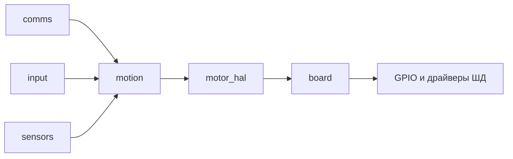
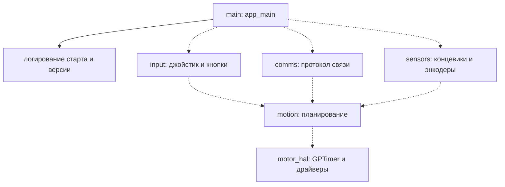

# 0001 — Минимальный каркас прошивки ESP-IDF

- Статус: каркас создан; сборка не проверена — ESP-IDF на машине не установлен
- Дата: 2026-11-14
- Стек: ESP-IDF + CMake, C++, без Arduino и PlatformIO
- Целевой чип: `esp32` (ESP32-WROOM-32, классический DevKit)

> План — исторический документ: разделы 2 и 6 описывают состояние на момент
> создания каркаса. Распиновка подтверждена позже (см. журнал в разделе 10);
> актуальная карта GPIO — [`docs/hardware/pinmap.md`](../hardware/pinmap.md),
> состав железа — [`docs/hardware/overview.md`](../hardware/overview.md).

## 1. Цель этапа

Получить минимальный, но **собираемый** проект ESP-IDF со стандартной компонентной
структурой, в котором есть только точка входа `app_main()`. Драйверы двигателей,
логика управления движением и обработчики прерываний на этом этапе не реализуются.

Соглашения по именованию планов: `docs/plans/NNNN-короткое-имя.md`, номер
инкрементальный.

## 2. Что создаётся на этапе 1

| Файл | Назначение |
|---|---|
| `CMakeLists.txt` | Корневой проект: `project.cmake`, `project(telescope_mount)` |
| `main/CMakeLists.txt` | Регистрация компонента `main` через `idf_component_register` |
| `main/main.cpp` | `extern "C" void app_main(void)` — только логирование старта |
| `.gitignore` | Игнор `build/`, `sdkconfig`, `sdkconfig.old`, `managed_components/`, артефактов IDE |
| `README.md` | Команды окружения, сборки, прошивки, мониторинга, структура проекта |
| `docs/plans/0001-initial-skeleton.md` | Этот план |
| `docs/hardware/pinmap.md` | Заготовка карты GPIO со статусом «не подтверждено» |

Существующие `README.md` (расширяется, а не перезаписывается) и `LICENSE` (MIT)
сохраняются.

## 3. Целевая структура репозитория

```text
telescope_mount/
├── CMakeLists.txt
├── sdkconfig.defaults            появится при необходимости
├── .gitignore
├── README.md
├── LICENSE
├── docs/
│   ├── plans/
│   │   └── 0001-initial-skeleton.md
│   └── hardware/
│       └── pinmap.md
├── main/
│   ├── CMakeLists.txt
│   └── main.cpp
└── components/                   создаётся по мере реализации
```

## 4. Архитектурные границы

Главное требование: **управление движением не зависит от джойстика, датчиков и
коммуникаций**. Ввод и связь только формируют уставки и команды, а `motion`
оперирует собственными структурами данных и не знает о конкретном железе.

| Компонент | Ответственность | Зависит от |
|---|---|---|
| `main` | Точка входа, инициализация, сборка графа задач и очередей | `app`, `board` |
| `board` | Конфигурация платы, единственное место с номерами GPIO, тайминги | ESP-IDF |
| `motion` | Кинематика, планирование скоростей, состояние монтировки, лимиты, стоп | только стандартная библиотека C++ |
| `motor_hal` | Абстракция драйверов ШД, генерация шагов, GPTimer | `board`, `motion` (типы уставок) |
| `input` | Джойстик, кнопки, энкодеры — преобразование в уставки | `motion` (типы) |
| `sensors` | Концевики, энкодеры осей, позже IMU — обратная связь | `motion` (типы) |
| `comms` | Протокол по UART/USB, позже WiFi/BLE, телеметрия | `motion` (типы) |

Разрешённое направление зависимостей:



Запрещено: `motion` включает заголовки драйверов ESP-IDF, напрямую пишет в GPIO или
читает джойстик. Такое разделение позволяет позже покрыть `motion` юнит-тестами на
хосте без железа.

Схема потоков данных этапа 1 (только каркас, реализации нет):



## 5. Двигатели: GPTimer как временная основа

На этапе 1 драйвер двигателей **не реализуется**. Зафиксированные решения на будущее:

- Источник шагов — GPTimer (`driver/gptimer.h`), периодический аларм с частотой шагов;
- в обработчике прерывания допускается только установка флага или
  `xQueueSendFromISR`/`xTaskNotifyFromISR`, никакой логики и никаких блокирующих вызовов;
- прикладная логика (профили скоростей, разгоны) выполняется в задаче, а не в ISR;
- интерфейс `MotorDriver` (`enable`, `disable`, `setDirection`, `step`, `setMicrostep`)
  вводится в `motor_hal`, первая реализация — заглушка с логированием;
- если GPTimer окажется недостаточно для двух осей одновременно или будет конфликтовать
  с WiFi по приоритетам, рассматривается RMT как альтернатива (решение позже).

## 6. Ограничения и риски

- **GPIO не назначаются** до подтверждения распиновки. Единственный источник номеров
  пинов — компонент `board`; в `docs/hardware/pinmap.md` все пины помечены как
  `TBD / не подтверждено`.
- ESP32-WROOM-32: GPIO 6–11 заняты flash, GPIO 34–39 только вход, strapping-пины
  0, 2, 12, 15 требуют осторожности при выборе функций.
- Точная версия ESP-IDF фиксируется после настройки окружения; API GPTimer в 5.x
  отличается от 4.x.
- Сборка не считается проверенной, пока не выполнен `idf.py build` на чистом окружении.

## 7. Критерии готовности этапа 1

1. `idf.py set-target esp32` и `idf.py build` проходят без ошибок и предупреждений
   уровня `-Werror` для файлов проекта.
2. Прошивка стартует, в мониторе видно сообщение о запуске `app_main`.
3. В репозитории нет назначенных GPIO и нет кода драйверов двигателей.
4. `README.md` содержит рабочие команды настройки, сборки, прошивки и мониторинга.
5. Каталог `docs/plans/` существует и содержит этот план.

## 8. Открытые вопросы

1. Тип монтировки: немецкая экваториальная или альт-азимутальная — влияет на модель
   кинематики и необходимость компенсации вращения Земли.
2. Тип драйверов ШД: A4988 / DRV8825 / TMC2209 — step-dir или UART-управление.
3. Наличие энкодеров на осях и концевиков (датчиков парковки).
4. Протокол связи с хостом: собственный текстовый, LX200-совместимый, Alpaca.
5. Требуется ли автономный режим без хоста и сценарии наведения.

## 9. Следующие шаги

- Этап 2: компонент `board` с pinmap после подтверждения распиновки.
- Этап 3: `motion` как чистая логика + юнит-тесты на хосте.
- Этап 4: `motor_hal` с GPTimer и первой реализацией `MotorDriver`.
- Этап 5: `input` (джойстик) и `comms` (протокол).

## 10. Журнал выполнения

- 2026-11-14 — созданы `CMakeLists.txt`, `main/CMakeLists.txt`, `main/main.cpp`,
  `.gitignore`, `docs/hardware/pinmap.md`; `README.md` расширен разделами о среде,
  сборке и диагностике.
- 2026-11-14 — проверка тулчейна: `idf.py`, `cmake`, `ninja` в PATH отсутствуют,
  переменная `IDF_PATH` не задана, каталоги `%USERPROFILE%\esp\esp-idf` и
  `C:\Espressif` отсутствуют. Сборка `idf.py build` не выполнялась.
- 2026-11-14 — **распиновка подтверждена** по фактической схеме стенда: ESP32 +
  2 × 28BYJ-48 с ULN2003, джойстик KY-023 / HW-504, резерв UART2 (16/17) под GPS и
  I2C (21/22) под компас. Заполнен
  [`docs/hardware/pinmap.md`](../hardware/pinmap.md), добавлен
  [`docs/hardware/overview.md`](../hardware/overview.md) с составом железа,
  питанием и характеристиками приводов. Открытый вопрос №1 закрыт частично (оси
  названы «азимут»/«высота»), вопрос №2 закрыт: драйверы ULN2003, управление
  4-фазное (full-step/half-step), step/dir не применяется.
- Требуется: установить ESP-IDF, выполнить `export.bat`, затем
  `idf.py set-target esp32` и `idf.py build`.
