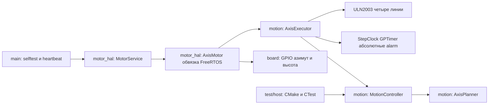

# 0002 — Модуль управления двигателями: разгон, останов, удержание

- Статус: реализация в работе — код и host-тесты готовы, сборка ESP-IDF и
  стендовые проверки не выполнены
- Дата: 2026-11-14
- Стек: ESP-IDF 5.2.x + CMake, C++17, FreeRTOS
- Целевой чип: `esp32` (ESP32-WROOM-32)
- Железо: 2 × 28BYJ-48 + ULN2003, half/full-step, открытый контур
- Предыдущий этап: [`0001-initial-skeleton.md`](0001-initial-skeleton.md)

## 1. Цель

Реализовать **полный слой движения**: от уставки («крутись со скоростью V»,
«пройди N шагов», «стоп») до физического переключения фаз обмоток ULN2003, с
разгоном, торможением, удержанием и безопасным обесточиванием.

| Слой | Компонент | Природа | Тестируемость |
|---|---|---|---|
| Решения: профиль, состояние, позиция | `motion` | чистая логика C++17, без ESP-IDF | юнит-тесты на хосте |
| Исполнение: события, ожидание, фазы | `motion::AxisExecutor` | чистый C++17, зависимости через интерфейсы | юнит-тесты на хосте с FakeClock и FakeCoil |
| Обвязка: GPIO, GPTimer, FreeRTOS | `motor_hal` | ESP-IDF, FreeRTOS, `driver/gpio.h` | проверка на железе |

`motion` не знает ни о GPIO, ни о джойстике, ни о коммуникациях и не владеет
часами. Всё, что связано со временем, передаётся ему явными значениями
или событиями.

## 2. Принятые решения

1. **Лимитов хода нет.** Обе оси вращаются неограниченно; концевых
   выключателей и программных границ в `motion` нет. Позиция — знаковый
   счётчик `int64_t`.
2. **Нет парковки и хоуминга.** При старте позиция = 0, `homed = false`.
   Абсолютные углы — на верхнем слое через калибровку «полушагов на градус».
3. **Единица счёта — полушаг.** Позиция, дистанции и целевые точки — в
   полушагах: 4096 на оборот вала (номинал). Режим обмоток влияет только на
   шаг переключения `delta_half_steps` (1 для `Half8`, 2 для full-step).
4. **Источник шагов — GPTimer с непрерывным счётчиком и одноразовыми alarm
   на абсолютные тики.** Счётчик не сбрасывается и не перезапускается на
   каждом шаге, `gptimer_stop()` в рабочем цикле не вызывается, взвод — только
   `gptimer_set_alarm_action()` с `alarm_count`. Разрешение 1 мкс — это
   дискретность счётчика, а не точность фронта на INx. RMT отклонён: один его
   канал управляет одной линией, для 4-фазной последовательности понадобилось
   бы 8 каналов и синхронизация фронтов. `esp_timer` остаётся отладочной
   реализацией за интерфейсом `StepClock`.
5. **Планировщик двухфазный.** `prepareNextStep()` не меняет позицию,
   `commitPending()` подтверждает событие после фактического переключения фаз и
   только для `is_step = true` сдвигает позицию, `cancelPendingStep()` отменяет
   план без побочных эффектов. Позиция — счётчик **выданных** шагов, а не
   измеренная позиция ротора.
6. **Дедлайн текущего шага и дедлайн следующего — разные проверки.** Первая
   решает, исполнять ли уже наступивший шаг; вторая — можно ли назначить
   следующий alarm. После штатного прерывания `now >= deadline`, поэтому
   проверка «дедлайн в будущем» к текущему шагу не применяется.
7. **Два разных минимальных интервала:** `min_phase_interval_us` — между
   физическими переключениями фаз, `min_alarm_lead_us` — запас между чтением
   времени и будущим alarm. Гарантии «просрочек не будет» нет: задача может
   быть вытеснена после проверки до вызова `armAt()`, поэтому просрочка
   обрабатывается, а не отрицается.
8. **Единый механизм пробуждения — биты уведомления задачи.** Все источники
   используют `xTaskNotify`/`xTaskNotifyFromISR` с `eSetBits`: `TimerEvent`,
   `CommandPending`, `EmergencyStop`. Очередь хранит команды, но не будит
   задачу. Шаг порождает **только** подтверждённое событие таймера.
9. **Удержание — политика оси.** `hold_enabled` + `hold_timeout_ms`; по
   умолчанию автообесточивание, потому что ULN2003 и обмотки греются. Таймаут
   отсчитывает `motor_hal`, а в `motion` приходит явный вызов
   `forceReleased(ReleaseReason::HoldExpired)`: планировщик шага не владеет
   временем и не меняет состояние присваиванием полей статуса.
10. **Открытый контур.** После аварийного останова `position_trusted = false`.
11. **Номера GPIO — только в `board`.** `motor_hal` получает четыре логические
    линии на ось.
12. **Версия ESP-IDF и чип фиксируются:** `esp32`, ESP-IDF 5.2.x. Имена
    Kconfig-опций IRAM-безопасности драйверов и поля `gptimer_config_t`
    уточняются по установленной версии при настройке окружения.

## 3. Структура компонентов

```text
components/
├── board/                     конфигурация платы (единственное место с GPIO)
│   ├── CMakeLists.txt
│   ├── include/board/board.hpp
│   └── src/board.cpp
├── motion/                    чистая логика, без ESP-IDF
│   ├── CMakeLists.txt
│   ├── include/motion/types.hpp
│   ├── include/motion/axis_config.hpp
│   ├── include/motion/axis_command.hpp
│   ├── include/motion/axis_planner.hpp
│   ├── include/motion/deadline_policy.hpp
│   ├── include/motion/executor_io.hpp
│   ├── include/motion/axis_executor.hpp
│   ├── include/motion/motion_controller.hpp
│   ├── src/axis_planner.cpp
│   ├── src/deadline_policy.cpp
│   ├── src/axis_executor.cpp
│   └── src/motion_controller.cpp
└── motor_hal/                 исполнение: GPIO, таймер, задачи FreeRTOS
    ├── CMakeLists.txt
    ├── Kconfig.projbuild
    ├── include/motor_hal/coil_pattern.hpp
    ├── include/motor_hal/coil_driver.hpp
    ├── include/motor_hal/step_clock.hpp
    ├── include/motor_hal/gptimer_step_clock.hpp
    ├── include/motor_hal/axis_motor.hpp
    ├── include/motor_hal/motor_service.hpp
    ├── src/coil_driver.cpp
    ├── src/gptimer_step_clock.cpp
    ├── src/axis_motor.cpp
    └── src/motor_service.cpp

test/host/                     сборка тестов обычным CMake, без idf.py
├── CMakeLists.txt
├── check.hpp                  микро-фреймворк на assert, без внешних зависимостей
├── fakes.hpp                  FakeClock и FakeCoil для AxisExecutor
├── test_axis_planner.cpp
├── test_deadline_policy.cpp
├── test_axis_executor.cpp
└── test_motion_controller.cpp
```



## 4. Типы и конфигурация (`motion`)

`include/motion/types.hpp`:

```cpp
enum class AxisId : std::uint8_t { Azimuth = 0, Altitude = 1, Count = 2 };

enum class Direction : std::int8_t { Backward = -1, Forward = +1 };

enum class StepPattern : std::uint8_t {
    Half8,        // 8 состояний, 1 полушаг на переключение
    Full4Double,  // 2 фазы включены, 2 полушага на переключение
    Full4Wave,    // 1 фаза включена, 2 полушага на переключение
};

/// Сколько полушагов даёт одно переключение фаз.
constexpr std::int32_t deltaHalfSteps(StepPattern p) noexcept
{
    return p == StepPattern::Half8 ? 1 : 2;
}

enum class AxisState : std::uint8_t {
    Disabled,      // ось выключена, команды скорости игнорируются
    Idle,          // стоит, обмотки обесточены
    Accelerating,
    Cruising,
    Decelerating,
    Holding,       // стоит, обмотки под током
    Released,      // стоит, обмотки обесточены после удержания
    Fault,         // ошибка расписания или исполнения
};

enum class StopMode : std::uint8_t {
    Smooth,     // торможение с decel, затем политика удержания
    Immediate,  // аварийный: ожидающий шаг отменяется, обмотки выключаются
};

/// Что делать, когда просрочка уже не позволяет выдать шаг вовремя.
enum class DeadlineMissPolicy : std::uint8_t {
    Replan,  // пересчитать график от текущего момента
    Fault,   // обесточить ось, position_trusted = false
};
```

`include/motion/axis_config.hpp`:

```cpp
struct HoldPolicy {
    bool hold_enabled = false;  // false = обесточивать сразу после останова
    // Действует только при hold_enabled = true.
    // 0 = удерживать бессрочно до Release, Disable или новой уставки.
    std::uint32_t hold_timeout_ms = 0;
};

struct AxisConfig {
    AxisId id = AxisId::Azimuth;
    StepPattern pattern = StepPattern::Half8;

    // Скорости в полушагах/с на границе шага.
    float start_rate_steps_s = 100.0F;  // скорость первого шага, НЕ нижний предел уставки
    float max_rate_steps_s = 800.0F;
    float accel_steps_s2 = 800.0F;
    float decel_steps_s2 = 800.0F;

    std::uint32_t reversal_pause_us = 0;      // пауза между торможением и реверсом
    std::uint32_t min_phase_interval_us = 600; // между физическими переключениями фаз
    std::uint32_t min_alarm_lead_us = 50;      // запас до будущего alarm
    std::uint32_t late_tolerance_us = 200;     // допуск коррекции графика
    std::uint32_t max_step_lateness_us = 2000; // порог, после которого действует политика

    bool invert_direction = false;
    HoldPolicy hold{};                         // по умолчанию автообесточивание
    DeadlineMissPolicy deadline_miss = DeadlineMissPolicy::Replan;
    std::int32_t backlash_steps = 0;           // резерв, компенсация люфта, пока 0
};
```

Конфигурация валидируется в `configure()`: все скорости и ускорения конечны
(`std::isfinite`), `accel > 0`, `decel > 0`, `start_rate > 0`, `max_rate > 0`,
интервалы больше нуля. Невалидная конфигурация — ошибка инициализации, а не
молчаливая коррекция.

`include/motion/axis_command.hpp`:

```cpp
enum class CommandKind : std::uint8_t {
    Enable, Disable,
    SetTargetRate,   // value = полушагов/с, знак задаёт направление
    MoveSteps,       // steps = относительный ход в полушагах, кратный delta
    StopSmooth, StopImmediate,
    Release,         // обесточить, позиция сохраняется
    Energize,        // снова подать фазы в текущей позиции
    SetHoldPolicy,
    ResetFault,      // сброс ошибки, разрешает движение после enterFault
};

struct AxisCommand {
    CommandKind kind = CommandKind::Enable;
    float value = 0.0F;
    std::int64_t steps = 0;
    HoldPolicy hold{};
};
```

`include/motion/motion_controller.hpp` — результат подготовки шага и статус:

```cpp
struct StepPlan {
    Direction direction = Direction::Forward;
    std::uint32_t interval_us = 0;  // мкс до следующего события; HAL переводит в тики
    bool is_step = true;            // false = пауза реверса, фазы не меняются
};

struct AxisStatus {
    AxisState state = AxisState::Disabled;
    std::int64_t position_step = 0;   // полушаги, меняется только на commitPending
    float rate_steps_s = 0.0F;
    float target_rate_steps_s = 0.0F;
    bool energized = false;           // заполняется исполнителем через publish
    bool homed = false;
    bool position_trusted = true;
    std::uint64_t late_corrections = 0;
    std::uint64_t late_replans = 0;
    std::uint64_t stale_events = 0;
    std::uint64_t rejected_commands = 0;  // отказы apply(), например нечётный MoveSteps
};
```

`include/motion/deadline_policy.hpp` — две независимые проверки и планирование
следующего alarm. Обе функции чистые, покрываются host-тестами:

```cpp
/// Решение по уже наступившему событию таймера.
enum class StepDue : std::uint8_t {
    ExecuteNow,      // ожидающий шаг исполняется
    IgnoreSpurious,  // событие пришло раньше дедлайна, шаг не исполняется
    IgnoreStale,     // ожидающего шага нет, событие устарело
    MissedTooFar,    // опоздание больше max_step_lateness, действует политика
};

StepDue classifyWakeup(std::uint64_t now_ticks,
                       std::uint64_t pending_deadline_ticks,
                       bool has_pending,
                       std::uint64_t max_lateness_ticks) noexcept;
```

Правила `classifyWakeup()`:

| Условие | Результат |
|---|---|
| `has_pending == false` | `IgnoreStale` |
| `now < pending_deadline` | `IgnoreSpurious`: шаг **никогда** не исполняется раньше дедлайна |
| `0 <= now − pending_deadline <= max_lateness` | `ExecuteNow` |
| `now − pending_deadline > max_lateness` | `MissedTooFar` |

`late_tolerance` в `classifyWakeup()` не участвует: допуск служит только для
оценки опоздания при планировании следующего alarm и не даёт права исполнить
шаг раньше дедлайна. Поэтому устаревшее уведомление, пришедшее незадолго до
нового дедлайна, даёт `IgnoreSpurious` и шаг нового движения не исполняет.

```cpp
/// Решение по следующему alarm.
enum class DeadlineAction : std::uint8_t { ArmAtDeadline, ReplanFromNow, Fault };

struct DeadlineDecision {
    DeadlineAction action = DeadlineAction::ArmAtDeadline;
    std::uint64_t deadline_ticks = 0;  // используется вызывающим всегда
    bool count_correction = false;
    bool count_replan = false;
};

DeadlineDecision planNextStep(std::uint64_t now_ticks,
                              std::uint64_t next_deadline_ticks,
                              std::uint64_t last_switch_ticks,
                              std::uint32_t interval_ticks,
                              std::uint32_t min_phase_interval_ticks,
                              std::uint32_t min_alarm_lead_ticks,
                              std::uint32_t late_tolerance_ticks,
                              DeadlineMissPolicy policy) noexcept;
```

Правила `planNextStep()`:

| Условие | Действие и дедлайн |
|---|---|
| `desired = max(next_deadline, last_switch + min_phase_interval, now + min_alarm_lead)` равно `next_deadline` | `ArmAtDeadline`, график сохраняется |
| `desired` позже `next_deadline` не более чем на `late_tolerance` | `ArmAtDeadline` на `desired`, `count_correction` |
| сдвиг больше допуска при политике `Replan` | `ReplanFromNow` на `max(now + interval, last_switch + min_phase_interval, now + min_alarm_lead)`, `count_replan` |
| сдвиг больше допуска при политике `Fault` | `Fault`, `armAt()` не вызывается |

Разница между коррекцией и полноценным Replan существенна: коррекция сдвигает
график на минимально необходимую величину, а Replan гарантирует, что следующий
шаг будет не раньше штатного интервала от текущего момента, иначе при сильной
задержке шаг мог бы уйти всего через `min_phase_interval_us`, хотя профиль
задавал куда больший интервал.

Ветка `MissedTooFar` + `Replan`: ожидающий шаг ещё не выполнен, поэтому он
**переносится** — `pending.deadline` заменяется дедлайном из решения,
`cancelPendingStep()` и `commitPending()` не вызываются, шаг не теряется и не
засчитывается дважды.

`deadline_ticks` из результата используется всегда; возвращать значение,
которое вызывающий игнорирует, запрещено контрактом.

## 5. `AxisPlanner`: профиль и контракт исполнения

Планировщик пошаговый и не зависит от часов: он оперирует полушагами и
интервалами в микросекундах, а «сейчас» получает от исполнителя только для
решений о просрочке (через отдельные функции, а не внутри `prepareNextStep`).

### 5.1 Двухфазный контракт

```cpp
enum class ReleaseReason : std::uint8_t {
    HoldExpired, EmergencyStop, Disable, Explicit,
};

enum class FaultReason : std::uint8_t {
    DeadlineMiss, ArmFailure, WatchdogTimeout, InvalidState,
};

class AxisPlanner {
public:
    bool configure(const AxisConfig& config);   // валидация конфигурации
    bool apply(const AxisCommand& cmd);         // false = команда отклонена
    bool hasPending() const;
    bool prepareNextStep(StepPlan& out);        // позицию НЕ меняет
    void commitPending();                       // подтверждение события
    void cancelPendingStep();                   // отмена без побочных эффектов
    void forceReleased(ReleaseReason reason);   // переход в Released
    void enterFault(FaultReason reason);        // переход в Fault
    void resetFault();                          // сброс ошибки до Disabled
    std::uint32_t planKey() const;              // ключ подготовленного плана
    const AxisStatus& status() const;
};
```

Правила:

- `prepareNextStep()` только вычисляет и запоминает план: направление,
  `interval_us`, `is_step`. Повторный вызов возвращает тот же план, пока нет
  `commitPending()` или `cancelPendingStep()`. Пауза нулевой длительности не
  готовится вовсе — alarm на неё не взводится.
- `commitPending()` подтверждает подготовленное событие. Для `is_step = true`
  это `position_step += direction * deltaHalfSteps(pattern)` и рост числа
  выданных шагов; для `is_step = false` пауза завершается, состояние
  обновляется, **позиция не меняется**. Вызов без подготовленного плана —
  ошибка программирования, в отладочной сборке `assert`.
- `cancelPendingStep()` сбрасывает план, не трогая позицию и скорость. Это
  единственный способ отменить ожидающий шаг при команде, останове и
  watchdog-просрочке.
- `forceReleased(reason)` — единственный путь перевода оси в `Released`;
  `EmergencyStop` дополнительно снимает доверие к позиции. Поля статуса
  извне не присваиваются.
- `enterFault(reason)` — единственный путь перевода в `Fault`: отменяет
  подготовленное событие, обнуляет скорость и активную цель,
  выставляет `position_trusted = false`, блокирует команды движения.
  Обесточивание обмоток выполняет исполнитель, а не `motion`.
- `resetFault()` — явная процедура сброса: ось переходит в `Disabled`,
  движение не возобновляется само, нужна новая команда `Enable`.
  Сброс возможен только при отсутствии подготовленного события.
- `planKey()` — дешёвый идентификатор подготовленного события. Исполнитель
  сравнивает ключ до и после применения команд: если он не изменился, команда
  считается идемпотентной и ожидающий alarm не отменяется.
- `rollbackStep()` не вводится: откат больше не нужен.

### 5.2 Математика профиля

Скорость `v_k` — скорость на границе k-го переключения, полушагов/с. Профиль
дискретный: интервал считается по граничным скоростям участка,

\[
\Delta t_k = \frac{2\,\Delta s}{v_k + v_{k+1}} \cdot 10^6\ \text{мкс},\quad
\Delta s = \text{deltaHalfSteps(pattern)}
\]

то есть для участка с постоянным ускорением берётся средняя скорость; на
постоянной скорости формула вырождается в `Δs / v`. Скорости на границах:

\[
v_{k+1}^2 = v_k^2 + 2\,a\,\Delta s, \qquad
v_{k+1}^2 = \max\!\left(0,\ v_k^2 - 2\,d\,\Delta s\right)
\]

Это **дискретная аппроксимация**, а не точное решение уравнений движения:
расстояние на сетке переключений округляется до целого числа `Δs`. Ожидания
в тестах формулируются в единицах `Δs` и включают граничные условия:

- дистанция разгона: начальное `rate = v_start = min(start_rate, |target|)`,
  конечное — первая скорость `>= max_rate` или clamp; расстояние
  `(v_max² − v_start²)/(2a)` полушагов, допуск ±1·`Δs`;
- дистанция торможения до нуля: `v²/(2d)` полушагов, допуск ±1·`Δs`;
- время участка — сумма `2Δs/(v_k + v_{k+1})`, сравнивается с непрерывной
  оценкой с допуском 5 %, граничные условия задаются в самом тесте;
- первый шаг: `v_1 = min(start_rate, |target|, sqrt(2·d·remaining))`;
- `start_rate` — только скорость запуска, **не нижний предел целевой
  скорости**: `SetTargetRate(1)` даёт один полушаг в секунду;
- при торможении `v_next` может быть меньше `start_rate`; участок с
  `v_k > 0` и `v_next = 0` **исполняется**, его длительность
  `2·Δs/(v_k + 0)`, и только после `commitPending()` движение считается
  завершённым и выполняется переход к политике удержания. Случай
  `v_k = 0 && v_next = 0` шага не порождает;
- тормозное ограничение определяется здесь один раз, для подготовленного
  события: `remaining_before` — расстояние до его исполнения,
  `remaining_after = remaining_before − Δs` — остаток после него,
  `v_begin` и `v_end` — скорости на входе и выходе участка.
  Инвариант выполнимого торможения: `v_begin² <= 2·d·remaining_before`.
  Если он выполнен, `v_end` ограничивается сверху
  `sqrt(2·d·remaining_after)`; такое замедление не круче `decel`, поэтому
  цель достигается точно, а на последнем событии `v_end = 0`. Если инвариант
  нарушен (цель заменена ближе тормозного пути), скорость не обрезается:
  ось тормозит с заданным `decel`, проходит цель и возвращается реверсом.
  Остаток считается в полушагах через беззнаковую разность — без округления
  и без переполнения при экстремальных позициях;
- `start_rate` используется **только при запуске из покоя**. При дальнейшем
  движении и торможении скорость может быть ниже `start_rate`; принудительное
  повышение скорости до `start_rate` не применяется. Если профиль на
  последнем участке даёт малую скорость, событие всё равно исполняется,
  потому что `v_begin > 0`;
- перемещение на одно событие (`MoveSteps(1)` в `Half8`, `MoveSteps(2)` в
  full-step) имеет явные начальные условия: ось в покое,
  `v_begin = min(start_rate, |target|)`, `remaining_after = 0`. Поэтому
  `v_end = 0` не блокирует само событие: правило «`0 → 0` не порождает шаг»
  относится к паре входной и выходной скоростей участка, а не к одиночному
  событию из состояния покоя;
- `max_rate` — потолок, превышение зажимается с однократным предупреждением;
- `interval_us` ограничивается снизу `min_phase_interval_us`; требование
  «интервал не меньше» относится к переключениям фаз, а не к паузам.

### 5.3 Режим `MoveSteps`

- `target_position = position + steps` с проверкой переполнения; переполнение
  отклоняет команду.
- `steps` обязан быть кратен `deltaHalfSteps(pattern)`. Для `Half8` допустимо
  любое целое, для full-step — только `±2, ±4, ±6 …`. Нечётные значения
  **отклоняются** (`apply()` возвращает `false`, в лог — ошибка), без
  округления и без скрытого перехода в half-step.
- Остаток пути — модуль: `remaining = |target_position − position|`.
  Тормозной потолок не дублируется: он определён в 5.2 через
  `remaining_before` и `remaining_after`.
- Шаг, после которого `remaining == 0`, — последний: позиция подтверждается,
  `rate = 0`, движение завершается без лишнего переключения.
- Новая команда `MoveSteps` во время движения **заменяет** цель: остаток
  пересчитывается от текущей позиции, торможение пересчитывается. Если новая
  цель ближе доступного тормозного пути, остановиться в ней нельзя: ось
  тормозит с заданным `decel`, при необходимости **проходит цель**, затем
  после полной остановки возвращается к ней штатным реверсом. Гарантия «без
  перелёта» относится только к перемещению, начатому из покоя и без замены
  цели. Мгновенное обрезание скорости не применяется: это нарушило бы
  собственный контракт разгона и торможения.
- `MoveSteps(0)` эквивалентен `StopSmooth`.
- Идемпотентность не распространяется на относительные команды: повторная
  `MoveSteps(N)` считается от позиции на момент приёма и даёт новый ход.
  Не меняет `planKey()` только повторная идентичная **абсолютная** уставка
  скорости (`SetTargetRate` с тем же значением).

### 5.4 Смена направления и пауза

Реверс на скорости запрещён: `sign(rate) != sign(target)` означает торможение
до нуля, затем `reversal_pause_us` **без переключения фаз** (`is_step = false`
в `StepPlan`), затем первый обратный шаг. Пауза не меняет позицию и не
считается шагом; исполнитель взводит alarm на её длительность.

## 6. `motor_hal`: исполнение

### 6.1 `CoilDriver` (ULN2003)

```cpp
struct CoilPins {
    gpio_num_t in[4];  // IN1..IN4
};

class CoilDriver {
public:
    esp_err_t init(const CoilPins& pins, StepPattern pattern, bool invert);
    void setPattern(StepPattern pattern);
    void advance(Direction dir);   // сдвиг индекса фазы
    void release();                // все INx = 0
    void energize();               // восстановить последнюю фазу
    bool isEnergized() const;
};
```

| Режим | Состояний | Последовательность (IN1..IN4) |
|---|---|---|
| `Half8` | 8 | 1000, 1100, 0100, 0110, 0010, 0011, 0001, 1001 |
| `Full4Double` | 4 | 1100, 0110, 0011, 1001 |
| `Full4Wave` | 4 | 1000, 0100, 0010, 0001 |

`init()` первым действием переводит все 8 линий в выход с низким уровнем
([`pinmap.md`](../hardware/pinmap.md), «Электрические замечания», п. 6).

`invert_direction` меняет **порядок обхода** таблицы в `advance()`, а не
уровни линий: инверсия уровней превратила бы однофазное состояние в
трёхфазное, то есть дала бы другую последовательность возбуждения.

### 6.2 `StepClock` на GPTimer

```cpp
class StepClock {
public:
    using Handler = void (*)(void* ctx);
    virtual ~StepClock() = default;
    virtual esp_err_t armAt(std::uint64_t deadline_ticks) = 0;  // абсолютный тик
    virtual esp_err_t disarmPending() = 0;                      // снять ожидающий alarm
    virtual std::uint64_t nowTicks() = 0;
    virtual std::uint64_t lateCorrections() const = 0;
    virtual std::uint64_t lateReplans() const = 0;
};

class GptimerStepClock final : public StepClock {
public:
    esp_err_t init(Handler handler, void* ctx);  // handler вызывается из ISR
    // ... переопределения выше
};
```

Семантика:

- `gptimer_config_t`: `clk_src = GPTIMER_CLK_SRC_DEFAULT`, `direction =
  GPTIMER_COUNT_UP`, `resolution_hz = 1'000'000`, приоритет прерывания
  задаётся полем `intr_priority` в конфигурации драйвера, а не отдельными
  флагами `ESP_INTR_FLAG_LEVELx`.
- Счётчик работает непрерывно с `gptimer_enable()` + `gptimer_start()` в
  `init()`; на каждом шаге он не сбрасывается и не перезапускается.
  `nowTicks()` — `gptimer_get_raw_count()`; сопоставления с
  `esp_timer_get_time()` нет.
- `armAt()`:

```cpp
gptimer_alarm_config_t alarm{};
alarm.alarm_count = deadline_ticks;          // абсолютный тик
alarm.reload_count = 0;
alarm.flags.auto_reload_on_alarm = false;    // одноразовый alarm
return gptimer_set_alarm_action(timer_, &alarm);
```

  `gptimer_set_alarm_value()` не используется. `auto_reload_on_alarm = false`
  не останавливает счётчик. Обычный останов движения и удержание снимают
  только ожидающий alarm (`disarmPending()`), счётчик продолжает идти и
  используется в том числе для отсчёта `hold_timeout`. `gptimer_stop()`
  вызывается только при завершении работы или деинициализации исполнителя.
- `disarmPending()` — единственное место с `gptimer_set_alarm_action(timer_,
  nullptr)`: по документации `nullptr` **отключает** alarm.
- Alarm на пройденный тик срабатывает немедленно, поэтому `armAt()`
  вызывается только с дедлайном из `planNextStep()`, где учтён
  `min_alarm_lead_ticks`, и с дополнительной проверкой `deadline > now`.
- Callback: `IRAM_ATTR`, возвращает `high_task_awoken == pdTRUE`; отдельный
  `portYIELD_FROM_ISR()` внутри не нужен. Внутри — только
  `xTaskNotifyFromISR(handle, TimerEvent, eSetBits, &high_task_awoken)`.
  Никаких GPIO, логов и обращений к flash.
- Для ESP-IDF 5.2 фиксируются `CONFIG_GPTIMER_ISR_IRAM_SAFE` (обработчик
  размещается в IRAM) и при необходимости `CONFIG_GPTIMER_CTRL_FUNC_IN_IRAM`.
  Данные, используемые из ISR, лежат во внутренней DRAM, а не «в IRAM»:
  размещение кода и данных — разные требования.
- Даже cache-safe ISR не гарантирует своевременную запись фаз из задачи,
  поэтому во время движения запрещаются запись NVS/flash, OTA и тяжёлое
  логирование.
- На ESP32 четыре GPTimer; две оси занимают два, занятость проверяется при
  `init()`, ошибка уходит в лог и в `AxisState::Fault`.
- Периодический режим `auto_reload_on_alarm = true` в обязательный объём не
  входит: только после измерений на INx и стоимости перепрограммирования
  alarm, при готовых обработке просрочек и отмене ожидающего шага.

### 6.3 `AxisMotor`: события, ожидающий шаг, цикл задачи

```cpp
enum EventBits : std::uint32_t {
    TimerEvent     = 1u << 0,
    CommandPending = 1u << 1,
    EmergencyStop  = 1u << 2,
};

class AxisMotor {
public:
    esp_err_t start(AxisId id, const CoilPins& pins, const AxisConfig& cfg);
    bool post(const AxisCommand& cmd);  // true = команда поставлена в очередь
    AxisStatus status() const;
    void emergencyStop();               // только EmergencyStop, без очереди
};
```

Логика цикла ниже реализуется в `motion::AxisExecutor` без FreeRTOS: на входе
биты событий, команды и текущее время, зависимости — интерфейсы `AlarmSink` и
`CoilSink` из `executor_io.hpp`. `AxisMotor` — тонкая обвязка, которая
доставляет биты уведомления и время GPTimer и не принимает решений. Один и тот
же код исполняется на хосте с FakeClock/FakeCoil и на ESP32.

`post()` подтверждает **только постановку в очередь**. Приём команды
планировщиком и возможный отказ (например, нечётный `MoveSteps` в full-step)
отражаются в `AxisStatus::rejected_commands` и в логе: асинхронный `bool` не
может подтвердить проверку, выполняемую в задаче оси.

Состояние исполнителя:

```cpp
struct PendingStep {
    bool valid = false;
    StepPlan plan{};
    std::uint64_t deadline_us = 0;  // единицы StepClock, при 1 МГц совпадают с мкс
};

bool last_switch_known = false;
std::uint64_t last_switch_us = 0;
bool hold_timer_active = false;
std::uint64_t hold_deadline_us = 0;
```

Цикл задачи (ядро 1, приоритет и стек — Kconfig):

```text
loop:
  // 1. ожидание: таймаут ожидания не означает истечение удержания
  если pending.valid:            timeout = до deadline + MOTOR_EVENT_WATCHDOG_US
  иначе если hold_timer_active:  timeout = остаток до hold_deadline
  иначе:                         timeout = portMAX_DELAY
  bits = xTaskNotifyWait(0, все биты, timeout)

  если bits == 0:
      если hold_timer_active и hold_deadline истёк:
          coil.release(); planner.forceReleased(ReleaseReason::HoldExpired)
          hold_timer_active = false
      иначе если pending.valid:
          // событие таймера не доставлено: watchdog, шаг не выдумывается
          due = classifyWakeup(now, pending.deadline, true, max_late)
          обработать как MissedTooFar: Replan переносит шаг,
          Fault вызывает enterFault(WatchdogTimeout) и обесточивание
      обновить статус; итерация завершена

  // 2. аварийный останов обрабатывается первым
  если bits & EmergencyStop:
      pending.valid = false; clock.disarmPending(); planner.cancelPendingStep()
      очистить очередь, инвалидировать ожидающие команды
      hold_timer_active = false
      coil.release(); planner.forceReleased(ReleaseReason::EmergencyStop)
      замерить и залогировать задержку от запроса до обесточивания
      обновить статус; итерация завершена

  // 3. команды: идемпотентны и не переносят первый шаг
  если bits & CommandPending:
      принять все команды из очереди (timeout 0)
      для каждой:
          key_before = planner.planKey()
          если planner.apply(cmd) == false: rejected_commands++
          если planner.planKey() != key_before: plan_changed = true
      если plan_changed и pending.valid:
          pending.valid = false; clock.disarmPending(); planner.cancelPendingStep()
      бюджет: не более MOTOR_CMD_BUDGET_PER_ITERATION команд за итерацию;
      если очередь непуста — оставить CommandPending и вернуться к ней после
      приоритетных событий, а не вычитывать очередь бесконечно
      если нет pending.valid и ось должна двигаться:
          подготовить первый план
          если interval_us > 0 — взвести alarm ДО следующего ожидания
          (alarm нужен и для паузы is_step = false: is_step влияет только
          на переключение GPIO при исполнении события)
      // TimerEvent из этого же пробуждения не теряется: он обрабатывается ниже

  // 4. событие таймера — не более одного шага
  если (bits & TimerEvent) и pending.valid:
      due = classifyWakeup(now, pending.deadline, true, max_late)
      IgnoreSpurious | IgnoreStale: stale_events++
      MissedTooFar:
          Fault  -> обесточить; planner.enterFault(FaultReason::DeadlineMiss)
          Replan -> перенести ожидающий шаг без commitPending():
                    decision = planNextStep(...)
                    pending.deadline = decision.deadline; clock.armAt(...)
      ExecuteNow:
          если pending.plan.is_step:
              coil.advance(pending.plan.direction)
              last_switch_us = clock.nowTicks(); last_switch_known = true
          planner.commitPending()   // пауза позицию не меняет
          pending.valid = false
          если есть следующий план:
              anchor = дедлайн исполненного события (now — только для старта)
              decision = planNextStep(now, anchor + interval, ...)
              применить action; clock.armAt(decision.deadline_us)
          иначе: hold_timer_active по политике удержания либо coil.release()

  // 5. проверка удержания не зависит от причины пробуждения
  если hold_timer_active и now >= hold_deadline_us и движение не возобновлено
     и политика удержания не изменилась:
      coil.release(); planner.forceReleased(ReleaseReason::HoldExpired)
      hold_timer_active = false

  // 6. публикация статуса — единая точка выхода итерации
  publishStatus(force = состояние изменилось), не чаще 50 мс без force
```

Контракты цикла:

- **Не более одного физического шага на подтверждённое событие таймера.**
  Пробуждение по команде, останову или таймауту шага не вызывает.
- **Таймаут ожидания не равен таймауту удержания.** Обесточивание происходит
  только при действительно истёкшем `hold_timeout`; при недоставленном
  событии таймера работает watchdog-политика, а движущаяся ось не
  обесточивается как после удержания.
- **Команды идемпотентны.** Повторная идентичная уставка не меняет
  `planKey()` и не отменяет ожидающий alarm; отмена происходит только при
  фактическом изменении подготовленного плана. Поток команд чаще частоты
  шагов не должен замедлять или блокировать движение.
- **Одновременные биты не теряются.** При
  `CommandPending | TimerEvent` команды применяются, а затем уже полученное
  событие таймера обрабатывается в этом же пробуждении, если ожидающий шаг
  остался действующим. Безусловный `continue` после команд запрещён: alarm
  одноразовый, и потерянное событие не восстановится.
- **Первый alarm взводится до первого ожидания**: при переходе в движение
  задача готовит план, вычисляет `now + interval` и вызывает `armAt()` до
  `xTaskNotifyWait`. То же — после `Holding → Accelerating`, после отмены
  команды и после снятия `Fault`.
- **Раньше дедлайна шаг не выполняется никогда**: событие с
  `now < pending.deadline` даёт `IgnoreSpurious`, допуск на это не влияет.
  Поэтому устаревшее уведомление, оставшееся от отменённого alarm, не может
  исполнить шаг нового движения — даже если оно пришло за десятки
  микросекунд до нового дедлайна.
- **`last_switch` фиксируется после записи фаз**, а не до `classifyWakeup()`
  и не до обращения к GPIO.
- **Публикация статуса не пропускается**: все ветки, включая ошибочные,
  проходят через единую точку выхода итерации.
- Состояние `pending` существует ровно между подготовкой и `commitPending()`
  или отменой; позиция в `motion` в это время не меняется.

Параметры по умолчанию (Kconfig `motor_hal`):

| Параметр | Значение |
|---|---|
| `MOTOR_AXIS_TASK_STACK` | 4096 байт |
| `MOTOR_AXIS_TASK_PRIORITY` | 10 |
| `MOTOR_AXIS_TASK_CORE` | 1 |
| `MOTOR_CMD_QUEUE_LEN` | 8 |
| `MOTOR_STATUS_PERIOD_MS` | 50 |
| `MOTOR_MIN_STEP_INTERVAL_US` | 600 |
| `MOTOR_STEP_TIMER_INTR_PRIORITY` | 3 |
| `MOTOR_HOLD_CHECK_PERIOD_MS` | 10 |
| `MOTOR_EVENT_WATCHDOG_US` | 5000 |
| `MOTOR_CMD_BUDGET_PER_ITERATION` | 8 |

### 6.4 `MotorService`

```cpp
class MotorService {
public:
    esp_err_t start(const board::MotorPins& pins, const AxisConfig (&cfgs)[2]);
    bool setTargetRate(AxisId id, float half_steps_per_s);
    bool moveSteps(AxisId id, std::int64_t half_steps);  // true = команда в очереди
    bool stop(AxisId id, StopMode mode);
    bool stopAll(StopMode mode);        // два приоритетных запроса, не синхронное отключение
    bool release(AxisId id);
    bool energize(AxisId id);
    bool setHoldPolicy(AxisId id, const HoldPolicy& policy);
    AxisStatus status(AxisId id) const;
};
```

`MotorService::stop()` всегда пытается остановить обе оси и возвращает первую
ошибку. Если хотя бы одна ось не подтвердила останов, сервис переходит в
`Stopping`, повторный `start()` отклоняется до успешного повторного `stop()`:
переконфигурировать планировщик работающей задачи нельзя. После неудачного
`start()` второй оси откат первой также проверяется по результату.

Публичные методы `AxisMotor` (кроме `CommandSource`, который вызывает только
задача оси) сериализованы отдельным `api_mutex_`, не удаляемым в `stop()`:
проверка `lifecycle_` и последующее использование очереди не должны быть
гонкой с освобождением ресурсов.

Методы возвращают `true` только при успешной постановке команды в очередь оси.
Результат проверки планировщиком (кратность `MoveSteps`, переполнение цели,
невалидная уставка) асинхронный: он виден в `AxisStatus::rejected_commands` и в
логе, а не в возвращаемом значении. Исключение — аварийный останов:
`stop(Immediate)` и `stopAll(Immediate)` выставляют приоритетное уведомление
`EmergencyStop` и не зависят от состояния очереди.

## 7. Удержание

| Значение | Поведение после нулевой скорости |
|---|---|
| `hold_enabled = true`, `hold_timeout_ms = 0` | фазы под током до `Release`, `Disable` или новой уставки |
| `hold_enabled = true`, `hold_timeout_ms > 0` | `Holding`, по таймауту `coil.release()` и `forceReleased(HoldExpired)` → `Released` |
| `hold_enabled = false` | немедленный `coil.release()` → `Released` (по умолчанию) |

- Таймаут отсчитывается в `motor_hal` от момента остановки в тиках того же
  GPTimer и реализуется как timeout ожидания уведомления; в `motion` приходит
  явный вызов `forceReleased(ReleaseReason::HoldExpired)`, поэтому планировщик
  остаётся детерминированным и не владеет часами.
- `Energize` подаёт последнюю фазу без вращения; ротор может «прилипнуть» к
  ближайшему полному шагу, позиция не меняется.
- Таймаут удержания проверяется на **каждой** итерации цикла после обработки
  событий, независимо от того, завершилось ожидание по timeout или по
  уведомлению. Иначе поток команд, не запускающих движение, мог бы
  непреднамеренно продлевать удержание.
- Таймаут отменяется при **принятом** переходе к движению, а не при
  постановке команды в очередь. Отклонённая команда таймаут не отменяет.
- Смена политики во время удержания синхронизирует таймер, и новый срок
  отсчитывается от момента команды. Повторная идентичная `SetHoldPolicy` и
  повторный `Energize` в уже активном `Holding` таймаут не продлевают:
  пересчёт выполняется только при фактическом изменении политики или первом
  переходе в `Holding`.
- `StopImmediate` обесточивает обмотки независимо от политики.

## 8. Остановы

| Команда | Поведение | Позиция |
|---|---|---|
| `StopSmooth` | торможение с `decel`, затем политика удержания; ожидающий шаг остаётся валидным до конца торможения | доверенная |
| `StopImmediate` | ожидающий шаг отменяется, очередь движения инвалидируется, фазы обесточиваются | `position_trusted = false` |
| `Disable` | как `StopImmediate`, ось в `Disabled`, уставки скорости игнорируются до `Enable` | `position_trusted = false` |
| `stopAll(Immediate)` | приоритетный запрос обеим осям независимо: это не гарантия одновременного отключения | — |

Контракт аварийного останова:

- после обработки `StopImmediate` новые переключения фаз не выполняются;
  уже выполненное переключение отменить нельзя;
- ожидающие команды движения удаляются или инвалидируются, иначе ось может
  сразу запуститься повторно;
- `EmergencyStop` обрабатывается до `TimerEvent` в одном и том же пробуждении;
- задержка от запроса до обесточивания измеряется и логируется; целевой
  ориентир — единицы миллисекунд, фактическое значение фиксируется на стенде.

## 9. Значения по умолчанию

| Параметр | Азимут | Высота | Обоснование |
|---|---|---|---|
| Шаблон фаз | `Half8` | `Half8` | 0.0879° на переключение |
| `start_rate_steps_s` | 100 | 100 | гарантированный старт без срыва |
| `max_rate_steps_s` | 800 | 800 | ~70 °/с, ниже паспортных 800–1000 Гц |
| `accel_steps_s2` | 800 | 800 | разгон до максимума ~1 с |
| `decel_steps_s2` | 800 | 800 | симметрично |
| `min_phase_interval_us` | 600 | 600 | верхняя граница частоты переключений |
| `min_alarm_lead_us` | 50 | 50 | запас на вытеснение задачи |
| `hold` | выключено | выключено | нагрев ULN2003 |
| `deadline_miss` | `Replan` | `Replan` | просрочки не должны останавливать наблюдения |
| `invert_direction` | TBD | TBD | определяется при первом запуске |

Числа — стартовая гипотеза; калибруются на стенде без изменения логики.

## 10. Тесты на хосте

```bash
cmake -S test/host -B build-host -DCMAKE_BUILD_TYPE=Debug
cmake --build build-host
ctest --test-dir build-host --output-on-failure
```

`test_axis_planner.cpp`:

1. разгон монотонен, скорость не превышает `max_rate`;
2. дистанция разгона от `start` до `max` равна `(max² − start²)/(2a)` ±1 шаг;
3. время разгона против непрерывной оценки — допуск 5 %;
4. торможение с `max_rate` до нуля укладывается в `max²/(2d)` ±1 шаг;
5. `MoveSteps` на 1000 полушагов попадает точно в цель без перелёта;
6. `MoveSteps(1)` при `Half8` — один шаг без разгона;
7. `MoveSteps(±1)` и `MoveSteps(±3)` при full-step отклоняются, `±2` и `±4`
   исполняются как один и два шага;
8. `SetTargetRate(1)` даёт один полушаг в секунду, а не `start_rate`;
9. смена знака на полной скорости проходит через ноль, затем пауза реверса
   с `is_step = false`, затем первый обратный шаг;
10. `StopImmediate` не добавляет шаг: подготовленный план отменяется,
    позиция не меняется, `position_trusted == false`;
11. новая `MoveSteps` во время движения заменяет цель без лишних шагов;
12. `prepareNextStep()` не меняет позицию, `cancelPendingStep()` не меняет
    позицию, `commitPending()` меняет её ровно на `deltaHalfSteps(pattern)`
    для `is_step = true`;
13. `commitPending()` для паузы реверса (`is_step = false`) не меняет позицию,
    но завершает паузу; пауза нулевой длительности не готовится;
14. политика удержания: `false` → `Released`; `true` с `hold_timeout_ms = 0`
    → бессрочный `Holding`; `true` с таймаутом → `Holding` до
    `forceReleased(HoldExpired)`;
15. переполнение `target_position` отклоняет команду;
16. невалидная конфигурация (`NaN`, бесконечность, нулевые ускорения)
    отклоняется `configure()`;
17. замена цели ближе тормозного пути: ось тормозит, проходит цель и
    возвращается к ней реверсом — без мгновенного обрезания скорости;
18. повторное применение идентичной команды не меняет `planKey()`.

`test_deadline_policy.cpp` (`classifyWakeup` + `planNextStep`):

1. пробуждение через 30 мкс после дедлайна при достаточном времени до
   следующего шага не вызывает перепланирование: `ExecuteNow`, затем
   `ArmAtDeadline` без коррекции;
2. `has_pending == false` → `IgnoreStale`, позиция и счётчики не меняются;
3. событие раньше дедлайна → `IgnoreSpurious`;
4. опоздание больше `max_step_lateness` → `MissedTooFar`;
5. `planNextStep` соблюдает `min_phase_interval` и `min_alarm_lead`
   одновременно;
6. сдвиг в пределах допуска → `ArmAtDeadline` с `count_correction`;
7. сдвиг больше допуска → `ReplanFromNow` с `count_replan`;
8. то же при политике `Fault` → `Fault`, `armAt()` не вызывается;
9. возвращённый `deadline_ticks` всегда больше `now_ticks`;
10. полноценный Replan назначает следующий шаг не раньше `now + interval`, а
    не только через `min_phase_interval_us`;
11. `MissedTooFar` + `Replan` переносит ожидающий шаг без `commitPending()`:
    позиция не меняется, шаг не теряется и не засчитывается дважды.

`test_axis_executor.cpp` (`AxisExecutor` + FakeClock и FakeCoil, без FreeRTOS):

1. штатная цепочка: alarm, `ExecuteNow`, ровно одно переключение фаз,
   взведён следующий alarm;
2. опоздание 30 мкс не перепланирует следующий шаг;
3. отмена первого alarm не меняет позицию и не переключает фазы;
4. устаревшее уведомление после останова не исполняет шаг нового движения;
5. `CommandPending | TimerEvent` в одном пробуждении: шаг не теряется;
6. поток идентичных `SetTargetRate` чаще частоты шагов не меняет скорость;
7. бюджет команд: очередь длиннее `MOTOR_CMD_BUDGET_PER_ITERATION`
   обрабатывается частями, `TimerEvent` не теряется;
8. таймаут ожидания при `pending.valid` не обесточивает ось;
9. истечение `hold_timeout` обесточивает и даёт `forceReleased(HoldExpired)`;
10. `EmergencyStop`: шага нет, фазы обесточены, `position_trusted = false`;
11. пауза реверса: alarm взводится при `is_step = false`, GPIO не
    переключается, позиция не меняется;
12. `enterFault(DeadlineMiss)`: подготовленное событие отменено, скорость 0,
    команды движения игнорируются до `resetFault()` и `Enable`;
13. останов с малой скорости, `MoveSteps(1)` в Half8 и `MoveSteps(2)` в
    full-step исполняются ровно одним событием без лишнего шага;
14. поток отклоняемых или не меняющих движение команд не препятствует
    своевременному обесточиванию по `hold_timeout`.

`test_motion_controller.cpp`:

1. две оси независимы;
2. `Disable` игнорирует `SetTargetRate` до `Enable`;
3. `stopAll` переводит обе оси в `Released` и инвалидирует планы;
4. `status()` отражает переходы и счётчики;
5. `energized` заполняется исполнителем и не выдумывается планировщиком;
6. поток идентичных команд скорости чаще частоты шагов не меняет уставку,
   не отменяет ожидающий шаг и не снижает фактическую скорость;
7. одновременные `CommandPending | TimerEvent` не теряют событие таймера;
8. таймаут ожидания при наличии `pending` не переводит ось в `Released`.

Сценарии жизненного цикла `AxisMotor` (`start` → движение → `stop` →
повторный `start`, а также таймаут подтверждения завершения) проверяются на
железе: host-тесты исполнителя не удаляют FreeRTOS-объекты и не могут
подтвердить освобождение ресурсов.

Критерий: `ctest` зелёный, все переходы автомата покрыты. Санитайзеры
включаются опцией CMake.

## 11. Интеграция в `main`

1. `board::init()` — все 8 линий INx в выход, низкий уровень;
2. сборка `AxisConfig[2]`, валидация конфигурации;
3. `MotorService::start()`;
4. самотест (`CONFIG_APP_MOTOR_SELFTEST`, по умолчанию **выключен**;
   включается явно для стенда, потому что предусматривает движение обеих осей
   и аварийный останов):
   - азимут: разгон до `max_rate`, 2 оборота, `StopSmooth`, ожидание
     автообесточивания; в лог — позиция, время, `lateCorrections`,
     `lateReplans`, `staleEvents`;
   - высота: то же с обратным направлением;
   - обе оси одновременно: проверка независимости таймеров;
   - аварийный останов в движении: замер задержки обесточивания;
5. heartbeat и вывод статуса обеих осей раз в 5 с.

Во время движения запрещены запись NVS/flash, OTA и тяжёлое логирование.

## 12. Документация к обновлению

| Файл | Что изменить |
|---|---|
| [`docs/hardware/overview.md`](../hardware/overview.md) | раздел 2 и открытый вопрос 6: ограничений хода нет, вращение неограниченное |
| [`docs/plans/0001-initial-skeleton.md`](0001-initial-skeleton.md) | в журнале отметить, что этапы 3–4 закрыты планом 0002 |
| [`README.md`](../../README.md) | структура (`components/`, `test/host`), единица полушага, политика удержания, GPTimer, команды тестов |
| `docs/hardware/pinmap.md` | без изменений |

## 13. Критерии готовности

1. `idf.py build` проходит без новых предупреждений; `motion` не включает
   заголовков ESP-IDF.
2. `ctest --test-dir build-host` — все тесты зелёные.
3. Номера GPIO встречаются только в `components/board`.
4. Обе оси плавно разгоняются и тормозят без срыва шагов на `max_rate`.
5. Дистанция разгона и торможения совпадает с аналитикой ±1 шаг, время — ±5 %.
6. После остановки при политике по умолчанию все INx = 0.
7. После сброса и до первой команды обмотки обесточены.
8. ISR GPTimer содержит только уведомление задачи, возвращает
   `high_task_awoken == pdTRUE`, счётчик не сбрасывается на каждом шаге.
9. Реверс всегда проходит через нулевую скорость и паузу без шага.
10. После `StopImmediate` нет новых переключений, очередь движения
    инвалидирована, обмотки обесточены; задержка измерена и зафиксирована.
11. За два оборота на `max_rate`: `lateReplans = 0`, `lateCorrections` ≤ 5 %
    шагов, `staleEvents = 0`.
12. Точность проверяется по фактическому сигналу на INx: медианное отклонение
    фронта ≤ 100 мкс, максимальное ≤ 300 мкс.
13. `SetTargetRate(1)` действительно даёт один полушаг в секунду.
14. Во время движения нет записей во flash/NVS и OTA.
15. Событие раньше дедлайна не выполняет шаг: устаревшее уведомление не
    приводит к переключению фаз ни при каком зазоре до нового дедлайна.
16. `enterFault()` переводит ось в `Fault`, а не в `Released`; движение
    невозможно до `resetFault()` и `Enable`, позиция помечена недоверенной.
17. Самотест при прошивке выключен по умолчанию и не начинает движение
    без явного `CONFIG_APP_MOTOR_SELFTEST=y`.
18. Истечение `hold_timeout` не зависит от причины пробуждения: обмотки
    обесточиваются и при потоке команд, не запускающих движение.

## 14. Риски и меры

| Риск | Мера |
|---|---|
| ULN2003 на 3.3 В логике работает на пределе | консервативный `max_rate`, при пропусках — снижение частоты или буфер по входу |
| Запись фаз из задачи даёт джиттер | дедлайн-расписание, `min_alarm_lead`, измерение INx логическим анализатором, счётчики просрочек |
| Вытеснение задачи между проверкой и `armAt()` | просрочка обрабатывается политикой, пачки догоняющих шагов запрещены |
| Alarm на прошедший тик срабатывает немедленно | дедлайн только из `planNextStep()`, проверка `deadline > now`, тесты на прошлый дедлайн |
| Устаревшее уведомление исполняет шаг нового движения | `pending.valid`, проверка времени, отдельный счётчик `staleEvents` |
| Открытый контур: позиция «уезжает» | `position_trusted`, калибровка на верхнем слое, будущие концевики |
| Нагрев при удержании | автообесточивание по умолчанию |
| Люфт редуктора при реверсе | пауза реверса, резерв `backlash_steps` |
| Две оси и один источник шагов | отдельный GPTimer на ось, проверка занятости при `init()` |
| Конфликт GPTimer с другими подсистемами | LEDC/RMT/PCNT не используются; ошибка `init()` → `Fault` |
| Запись во flash во время движения срывает расписание | запрет NVS/OTA на время движения, критерий 14 |
| `float` в профиле и различие x86/ESP32 | допуски в тестах, целочисленная позиция |

## 15. Открытые вопросы

1. `invert_direction` и реальное направление осей — при первом запуске.
2. Реальная максимальная частота без срыва: 800 или ближе к 1000 Гц.
3. Компенсация люфта внутри `motor_hal` или на верхнем слое.
4. Программное отключение 5 В питания двигателей (MOSFET/enable).
5. Микрошаги — недоступны на 28BYJ-48 до смены привода.
6. Периодический режим GPTimer: только после измерений на INx и стоимости
   перепрограммирования alarm; не входит в обязательный объём.

## 16. Порядок работ

1. `board`: пины, инициализация выходов в низкий уровень.
2. `motion`: типы, конфигурация, `AxisPlanner` с двухфазным контрактом,
   `classifyWakeup`/`planNextStep`, `MotionController`.
3. `test/host`: тесты планировщика и политики дедлайнов — до `motor_hal`.
4. `motion::AxisExecutor` и его host-тесты на FakeClock/FakeCoil.
5. `motor_hal`: `CoilDriver`, `GptimerStepClock`, `AxisMotor` как обвязка,
   `MotorService`.
6. Интеграция в `main`: самотест за флагом, по умолчанию выключен, heartbeat.
7. Прогон на железе, калибровка констант, обновление документации.

## 17. Журнал выполнения

- 2026-11-14 — план создан: лимитов хода нет, удержание — конфигурируемая
  политика с автообесточиванием, объём — `motion` + `motor_hal` с тестами на
  хосте.
- 2026-11-14 — источник шагов: GPTimer вместо `esp_timer`, RMT отклонён.
- 2026-11-14 — исправлена семантика GPTimer: непрерывный счётчик, абсолютные
  alarm через `gptimer_set_alarm_action()`, `StepClock::armAt()` в тиках
  таймера, разрешение 1 мкс не равно точности GPIO.
- 2026-11-14 — уточнены контракты по ревью:
  - разделены проверки текущего шага (`classifyWakeup`) и следующего alarm
    (`planNextStep`), `deadline_ticks` из решения обязательно используется;
  - введены `min_phase_interval_us` и `min_alarm_lead_us` как разные
    параметры; гарантия отсутствия просрочки не декларируется;
  - планировщик переведён на двухфазный контракт
    `prepareNextStep`/`commitStep`/`cancelPendingStep`, позиция меняется
    только после переключения фаз;
  - математика профиля переведена на `deltaHalfSteps` — исправлены full-step
    и нечётные перемещения, которые теперь отклоняются;
  - `start_rate` больше не нижний предел уставки, описаны завершение
    торможения и скорость ниже `start_rate`;
  - единое пробуждение задачи через биты уведомления, `pending` и защита от
    устаревших событий, аварийный останов обрабатывается первым и не
    добавляет шаг;
  - таймаут удержания и пауза реверса выражены событиями исполнителя;
  - приоритет прерывания задаётся `intr_priority`, callback возвращает
    `high_task_awoken`, IRAM-безопасность и запрет flash во время движения
    зафиксированы как требования;
  - добавлены тесты на просрочки, отмену, устаревшие события, full-step,
    медленные скорости и замену цели.
- 2026-11-14 — вторая итерация точечных правок:
  - пауза реверса больше не выполняется как шаг: фазы и `last_switch` только
    при `is_step = true`, `commitPending()` для паузы позицию не меняет,
    пауза нулевой длительности не взводит alarm;
  - таймаут ожидания отделён от таймаута удержания: обесточивание только по
    реально истёкшему `hold_timeout`, иначе watchdog-политика;
  - команды идемпотентны через `planKey()` и не переносят первый шаг;
    одновременные `CommandPending | TimerEvent` обрабатываются без потери
    события;
  - замена цели ближе тормозного пути описана как перелёт и возврат реверсом,
    гарантия «без перелёта» ограничена перемещением из покоя;
  - `ReplanFromNow` гарантирует `now + interval`, а не минимальный интервал;
    `MissedTooFar` переносит ожидающий шаг без `commitPending()`;
  - формулы интервала переведены на среднюю скорость участка, убрано
    утверждение о точной аналитике, допуски заданы в единицах `Δs`;
  - `StepPlan::interval_us`, исправлен комментарий `hold_timeout_ms = 0`;
  - `post()` подтверждает только очередь, отказы видны в
    `rejected_commands`;
  - `forceReleased(reason)` как единственный путь смены состояния из
    исполнителя, публикация статуса в единой точке выхода;
  - зафиксированы `CONFIG_GPTIMER_ISR_IRAM_SAFE` и
    `CONFIG_GPTIMER_CTRL_FUNC_IN_IRAM`, данные ISR — во внутренней DRAM.
- 2026-11-14 — третья итерация правок:
  - последний тормозной участок с `v_next = 0` исполняется; завершение
    движения фиксируется после `commitPending()`, случай `0 → 0` шага не даёт;
    остаток пути считается в событиях `remaining_half_steps / Δs` без
    округления, потолок скорости `sqrt(2·d·(remaining_events − 1)·Δs)`;
  - `classifyWakeup()` больше не принимает допуск: шаг раньше дедлайна
    невозможен, допуск остался только в `planNextStep()`;
  - «атомарность» отмены убрана, зафиксирован порядок
    `disarmPending()` → инвалидация `pending` → отмена плана и отдельный тест
    на уже доставленное уведомление;
  - `enterFault(FaultReason)`/`resetFault()` отделены от
    `forceReleased(ReleaseReason)`, добавлена команда `ResetFault`;
  - alarm взводится для любого подготовленного события ненулевой
    длительности, включая паузу `is_step = false`; `is_step` влияет только на
    переключение GPIO;
  - введён бюджет `MOTOR_CMD_BUDGET_PER_ITERATION`, очередь не вычитывается
    бесконечно;
  - событийный исполнитель вынесен в `motion::AxisExecutor` с интерфейсами
    `AlarmSink`/`CoilSink`, `AxisMotor` стал обвязкой; добавлен
    `test_axis_executor.cpp` на 13 сценариев;
  - убран устаревший комментарий у `moveSteps()`, зафиксировано, что
    относительная `MoveSteps(N)` не идемпотентна;
  - самотест выключен по умолчанию.
- 2026-11-14 — четвёртая итерация правок:
  - убрано правило «тактирующего участка»: `start_rate` применяется только
    при запуске из покоя, принудительное повышение скорости не используется;
  - тормозной потолок определён один раз в 5.2 через `remaining_before` и
    `remaining_after`, в 5.3 оставлена ссылка без дублирования формулы;
  - зафиксированы начальные условия перемещения на одно событие, чтобы
    правило `0 → 0` не блокировало `MoveSteps(1)`;
  - проверка истечения удержания выполняется на каждой итерации после
    обработки событий, независимо от причины пробуждения; таймаут
    отменяется только принятым переходом к движению;
  - редакционно: интервалы в микросекундах, `AxisExecutor` на диаграмме,
    исключение аварийного останова из правила про очередь, уточнено, что
    обычный останов снимает alarm, но не останавливает счётчик GPTimer.
- 2026-11-14 — реализация: созданы `board`, `motion` (`AxisPlanner`,
  `deadline_policy`, `AxisExecutor`, `MotionController`), `motor_hal`
  (`CoilDriver`, `GptimerStepClock`, `AxisMotor`, `MotorService`) и точка входа
  `main` с самотестом за флагом. Host-тесты: 4 набора, `ctest` — 100 % зелёные,
  сборка с `-Wall -Wextra -Werror`. `motion` не содержит заголовков ESP-IDF,
  номера GPIO встречаются только в `board`. `idf.py` в окружении отсутствует,
  поэтому `idf.py build` не выполнялся; прогон на стенде — следующий шаг.
- 2026-11-14 — исправления по статическому ревью:
  - `main`: `motion_hal` → `motor_hal`; самотест ждёт принятия команды и
    ожидаемой позиции, при отсутствии обесточивания пишет ошибку, а не
    «0 us»;
  - `CoilDriver`: `invert_direction` меняет направление обхода таблицы, а не
    уровни обмоток;
  - абсолютное расписание: следующий дедлайн считается от дедлайна
    исполненного события; добавлен тест на отсутствие накопленного сдвига;
  - планировщик: уменьшение уставки в том же направлении идёт с `decel`;
    конец `MoveSteps` определяется инвариантом торможения без порога
    `2·start_rate`; при недостижимой цели — проход и возврат;
  - удержание снимается по факту назначения нового события; остаток очереди
    после бюджета обрабатывается обвязкой без внешней команды;
  - `AxisMotor::stop()` — согласованный shutdown с обесточиванием и
    подтверждением задачи; `MotorService::start()` откатывает частичную
    инициализацию;
  - `enterFault` сохраняет причину в статусе, ошибка повторного arming
    обрабатывается, `SetHoldPolicy` не отменяет alarm.
- 2026-11-14 — вторая порция исправлений по ревью:
  - `AxisMotor` получил жизненный цикл `Stopped/Running/Stopping`: при таймауте
    подтверждения `stop()` возвращает `ESP_ERR_TIMEOUT`, ресурсы не
    освобождаются, повторный вызов может дождаться завершения;
  - частичная инициализация оси откатывается общим `cleanupResources()`,
    включая ошибки создания очереди, семафоров и задачи;
  - исполнитель синхронизирует удержание после `SetHoldPolicy` и `Energize`:
    выключение обесточивает, бессрочное снимает таймер, конечное назначает
    дедлайн один раз, а не продлевает его каждой командой;
  - микросекунды переводятся в тики с округлением вверх и 64-битным
    промежуточным результатом; watchdog проверяется по абсолютному
    `pending_deadline + watchdog_us`, а не по факту истечения ожидания;
  - допуск инварианта торможения привязан к шагу `2·d·Δs`, тест замедления
    параметризован по режиму обмоток, скорости и ускорению;
  - добавлены тесты переключений политики удержания, `Energize` с конечным
    таймаутом и watchdog до/после дедлайна.
- 2026-11-14 — третья порция исправлений:
  - `MotorService` получил состояние `Idle/Running/Stopping`: ошибка остановки
    возвращается наружу, новый `start()` запрещён до успешного `stop()`,
    откат после неудачного запуска второй оси проверяется;
  - публичные методы `AxisMotor` сериализованы `api_mutex_`, создаваемым один
    раз и не удаляемым в `stop()`; гонка «проверка lifecycle → использование
    queue_/executor_» устранена;
  - `syncHoldState()` вызывается только при фактическом изменении политики
    или первом переходе в `Holding`; повторные идентичные команды и
    `Energize` не продлевают удержание, добавлены тесты.
