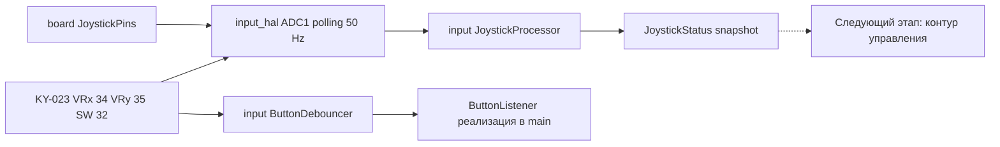
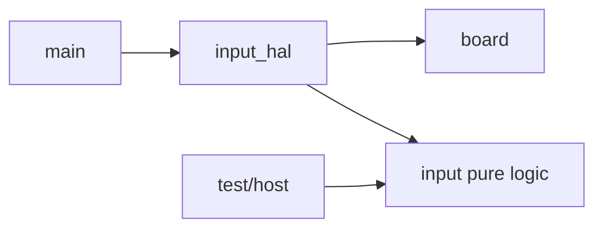

# 0003 — Обработка положений джойстика и кнопки

- Статус: реализация в работе — код и host-тесты готовы, сборка ESP-IDF и
  стендовые проверки не выполнены (`idf.py` отсутствует в PATH)
- Дата: 2026-11-15
- Стек: **ESP-IDF 6.1.0** + CMake, C++17, FreeRTOS
  (подтверждено значением `CONFIG_IDF_INIT_VERSION="6.1.0"` в локально
  сгенерированном `sdkconfig`; перед сборкой дополнительно подтвердить
  выводом `idf.py --version`)
- Целевой чип: `esp32` (ESP32-WROOM-32)
- Железо: джойстик KY-023 / HW-504 — VRx GPIO 34 (ADC1_CH6), VRy GPIO 35
  (ADC1_CH7), SW GPIO 32 (активный низкий уровень)
- Предыдущий этап: [`0002-motor-control.md`](0002-motor-control.md)
- Источник истины по пинам: [`docs/hardware/pinmap.md`](../hardware/pinmap.md)
- Описание железа: [`docs/hardware/overview.md`](../hardware/overview.md), раздел 6

## 1. Цель и границы

Реализовать **только обработку положений стика и кнопки**: калибровку центра,
фильтрацию, нормализацию, определение нейтрали, антидребезг кнопки и публикацию
результатов наружу.

**Джойстик на этом этапе не связан с управлением моторами.** `input` и
`input_hal` не зависят от `motion` и `motor_hal`, не формируют уставки скорости,
не включают оси и не останавливают движение. Интеграция значений в контур
управления — следующий этап.

| Слой | Компонент | Природа | Тестируемость |
|---|---|---|---|
| Обработка: калибровка, фильтр, нормализация, мёртвая зона, антидребезг | `input` | чистый C++17, без ESP-IDF | host-тесты без железа |
| Съём: ADC1, GPIO кнопки, задача опроса | `input_hal` | ESP-IDF, FreeRTOS, `esp_adc` | проверка на стенде |

Что появится на следующем этапе и **не входит** в этот план:

- преобразование положения стика в уставки скорости осей;
- кривая отклика и ограничение максимальной скорости;
- вызовы `MotorService`, включение осей, остановы и удержание;
- назначение кнопки (пользователь решил пока не назначать действие);
- арбитраж «ручное / ведение» с будущими `comms`;
- сохранение калибровки в NVS;
- калибровка крайних положений и компенсация нелинейности потенциометра.

Главное правило проекта сохраняется: обработка ввода не знает о драйверах
двигателей, а `motion` не знает о джойстике.

## 2. Принятые решения

1. **Два компонента, как `motion` / `motor_hal`.** `input` — чистая логика и
   host-тесты; `input_hal` — ADC, GPIO и задача опроса.
2. **Никаких зависимостей от моторов.** `input_hal` не подключает `motor_hal`;
   наружу отдаются только снимок состояния стика и события кнопки.
3. **Опрос, а не прерывания.** ADC читается задачей с периодом 20 мс
   (50 Гц); кнопка опрашивается в том же цикле, но **независимо** от
   результата ADC. ISR не используется: человеческий ввод не требует
   микросекундной реакции, а правила проекта требуют минимума кода в
   обработчиках прерываний.
4. **`adc_oneshot` на ADC1.** Каналы 6 и 7, аттенюация `ADC_ATTEN_DB_12`,
   12 бит. `ADC_ATTEN_DB_11` — устаревший эквивалент. ADC2 не используется:
   он недоступен при активном WiFi.
5. **Калибровка центра при старте — с честным контрактом.** По двум
   напряжениям нельзя доказать, что стик механически отпущен: неподвижно
   удерживаемое отклонение внутри допустимого коридора неотличимо от центра.
   Поэтому:
   - пользователь **обязан** отпустить стик при включении;
   - алгоритм проверяет только стабильность серии и правдоподобие центра;
   - стабильное отклонение внутри коридора `[center_min, center_max]`
     **может быть принято** как центр — это известное ограничение;
   - нестабильная серия и среднее вне коридора отвергаются, калибровка
     завершается таймаутом.
6. **Период калибровочных чтений фиксирован.** Отсчёты берутся не подряд, а
   по одному за `JOY_SAMPLE_PERIOD_MS` (20 мс). 64 отсчёта — это около 1,28 с
   наблюдения за реальной стабильностью, а не серия из быстрых чтений.
7. **Фильтрация — экспоненциальное сглаживание (EMA)** перед нормализацией.
   EMA выбрана начальным фильтром; её достаточность проверяется на стенде.
   Медианный фильтр не вводится: он требует буфера и усложняет тесты.
8. **Мёртвая зона радиальная, с гистерезисом.** Решение «нейтраль / активен»
   принимается по модулю вектора стика, а не по каждой оси отдельно.
9. **Оси стика — логические X и Y, а не оси монтировки.** VRx → X, VRy → Y.
   Привязка X/Y к азимуту и высоте и инверсия знаков — решение следующего
   этапа, когда появится контур управления.
10. **Результат доступен двумя способами.** Потребитель либо читает последний
    снимок `JoystickStatus`, либо подписывается на события кнопки через
    `ButtonListener`. Оба интерфейса не зависят от моторов.
11. **Кнопка только считывается и антидребезговывается.** Наружу отдаются
    события `Pressed`, `Released`, `Click`, `LongPress`; конкретное действие
    не назначается. Один вызов `update()` может вернуть до двух событий
    фиксированного размера, без динамической памяти.
12. **Номера GPIO и каналы ADC — только в `board`.** `input_hal` получает
    логическую структуру `JoystickPins`.
13. **Калибровка живёт в RAM.** NVS не трогается ни при старте, ни во время
    работы; сохранение калибровки — отдельная задача следующего этапа.
14. **`main` только запускает опрос и логирует результат.** Никаких вызовов
    `MotorService` из джойстика; самотест двигателей остаётся независимым.
15. **Версия стека — 6.1.0.** В плане 0002 указана 5.2.x, но фактический
    `sdkconfig` сгенерирован ESP-IDF 6.1.0. Все API-детали (`hal/adc_types.h`,
    `esp_adc/adc_oneshot.h`, поля конфигурации ADC) проверяются по
    установленной версии; при расхождении приоритет у фактической версии.
16. **Питание и уровни.** Джойстик питается от 3,3 В при непосредственном
    соединении с ESP32; обязательна общая земля. Сигналы VRx/VRy не должны
    иметь 5-вольтовый уровень. Аттенюация ADC **не является** защитой входа
    от перенапряжения.

## 3. Структура компонентов

```text
components/
├── board/
│   └── include/board/board.hpp        + JoystickPins и kJoystickPins
├── input/                             чистый C++17, без ESP-IDF
│   ├── CMakeLists.txt
│   ├── include/input/joystick_config.hpp
│   ├── include/input/joystick_processor.hpp
│   ├── include/input/sample_gate.hpp
│   ├── include/input/button_debouncer.hpp
│   ├── src/joystick_processor.cpp
│   ├── src/sample_gate.cpp
│   └── src/button_debouncer.cpp
└── input_hal/                         ESP-IDF и FreeRTOS, без motor_hal
    ├── CMakeLists.txt
    ├── Kconfig.projbuild
    ├── include/input_hal/adc_joystick.hpp
    ├── include/input_hal/button_input.hpp
    ├── include/input_hal/joystick_service.hpp
    ├── src/adc_joystick.cpp
    ├── src/button_input.cpp
    └── src/joystick_service.cpp

test/host/
├── CMakeLists.txt                     + input_host и новые тесты
├── test_joystick_processor.cpp
├── test_sample_gate.cpp
└── test_button_debouncer.cpp
```



Допустимые зависимости:



Запрещено: `input` и `input_hal` включают `motion` или `motor_hal`. Это
проверяется составом `CMakeLists.txt` и отсутствием соответствующих заголовков
в исходниках.

## 4. Типы и конфигурация `input`

`include/input/joystick_config.hpp`:

```cpp
namespace input {

/// Логические оси стика: X — VRx, Y — VRy. Не оси монтировки.
enum class StickAxis : std::uint8_t { X = 0, Y = 1, Count = 2 };

constexpr std::size_t kAxisCount = static_cast<std::size_t>(StickAxis::Count);

/// Один сырой отсчёт АЦП; valid = false означает ошибку чтения.
struct RawSample {
    std::uint16_t counts[kAxisCount] = {0, 0};
    bool valid = false;
};

/// Калибровка одной оси стика.
struct AxisCalibration {
    float center = 2048.0F;  // среднее положение, отсчёты АЦП
    float min = 0.0F;        // нижний край, отсчёты АЦП
    float max = 4095.0F;     // верхний край, отсчёты АЦП
    bool invert = false;     // инверсия знака оси
};

/// Конфигурация обработчика положений.
struct JoystickConfig {
    AxisCalibration axis[kAxisCount]{};

    float dead_zone = 0.12F;       // вход в активную зону, доля модуля
    float dead_zone_exit = 0.10F;  // возврат в нейтраль, доля модуля
    float filter_alpha = 0.25F;    // EMA, (0, 1]
};

/// Состояние стика после обработки.
struct StickState {
    bool neutral = true;
    float filtered[kAxisCount] = {0.0F, 0.0F};   // отсчёты после EMA
    float normalized[kAxisCount] = {0.0F, 0.0F}; // -1..1 с учётом invert
    float magnitude = 0.0F;                      // ограниченная единицей
                                                 // величина отклонения
};

bool isValid(const JoystickConfig &config) noexcept;

}  // namespace input
```

Правила валидации `isValid()`:

| Условие | Причина отказа |
|---|---|
| `center`, `min`, `max` не конечны (`std::isfinite`) | неопределённая геометрия оси |
| `min >= max` | пустой диапазон |
| `center` вне `(min, max)` | центр за пределами хода |
| `dead_zone` не конечна, `<= 0` или `>= 1` | мёртвая зона не имеет смысла |
| `dead_zone_exit` не конечна, `< 0` или `>= dead_zone` | гистерезис вывернут |
| `filter_alpha` не конечна, `<= 0` или `> 1` | фильтр неустойчив |

Проверки на конечность обязательны: `NaN` не проходит сравнения вида
`alpha <= 0 || alpha > 1` и иначе попал бы в конфигурацию.

Невалидная конфигурация — ошибка инициализации, а не повод молча править
значения.

## 5. Алгоритм обработки

### 5.1 Калибровка центра

`include/input/joystick_processor.hpp`:

```cpp
/// Оценка центра по стабильной серии отсчётов.
class CenterCalibrator {
public:
    bool configure(std::size_t samples, float noise_limit,
                   float center_min, float center_max) noexcept;
    void reset() noexcept;
    /// true = серия принята, можно продолжать сбор.
    bool add(const RawSample &sample) noexcept;
    bool ready() const noexcept;
    bool stable() const noexcept;
    float center(StickAxis axis) const noexcept;
};
```

Порядок сбора:

- `configure()` возвращает `false`, если `samples == 0`, `noise_limit`
  не конечен или отрицателен, либо `center_min` / `center_max` не конечны
  или `center_min >= center_max`. После отказа калибратор не используется.
- `input_hal` читает **один** отсчёт за `JOY_SAMPLE_PERIOD_MS` (20 мс) и
  передаёт его в `add()`; серия из 64 отсчётов занимает около 1,28 с.
  64 быстрых чтения подряд проверяли бы другую стабильность и запрещены.
- Сбор идёт, пока не набрано `samples` **валидных** отсчётов.
- Для каждой оси запоминаются минимум и максимум; на последнем отсчёте
  проверяется `max − min <= noise_limit` и попадание среднего в
  `[center_min, center_max]`.
- Если серия нестабильна или центр вне коридора, `stable()` даёт `false`;
  `input_hal` сбрасывает калибратор, ждёт следующий тик и начинает серию
  заново, пока не истёк `JOY_CALIBRATION_TIMEOUT_MS`.
- Калибратор не зависит от времени: таймаут реализует `input_hal`.

**Контракт калибровки:**

| Утверждение | Гарантия |
|---|---|
| Пользователь отпустил стик при старте | требование к пользователю, не проверяемое алгоритмом |
| Серия стабильна | проверяется по размаху |
| Центр правдоподобен | проверяется попаданием в коридор |
| Механическая нейтраль доказана | **не гарантируется** |
| Стабильное отклонение внутри коридора | может быть принято как центр |
| Отклонение вне коридора | отвергается |
| Автоматическая перекалибровка после fault | запрещена |

Если `JOY_CALIBRATE_ON_BOOT = n`, калибровка не выполняется: используются
`JOY_DEFAULT_CENTER`, а `calibrated` в статусе означает «конфигурация
применена», а не «центр измерен».

По умолчанию: 64 отсчёта, `noise_limit = 120` отсчётов,
`center_min = 1000`, `center_max = 3095`.

### 5.2 Фильтрация

EMA применяется к сырым отсчётам до нормализации:

\[
f_k = f_{k-1} + \alpha (x_k - f_{k-1})
\]

- `reset()` инициализирует фильтр центром калибровки, сбрасывает историю
  гистерезиса в нейтраль и рассчитывает состояние по центру, поэтому сразу
  после старта стик считается нейтральным.
- `resetWithSample(sample)` используется после снятия `read_fault` и делает
  полный детерминированный сброс:
  - инициализирует фильтр **свежим валидным** отсчётом;
  - сбрасывает историю гистерезиса в нейтраль;
  - сразу рассчитывает нормализованное положение и `magnitude` по этому
    отсчёту;
  - применяет порог `dead_zone`: если `magnitude >= dead_zone`, состояние
    сразу становится активным, иначе нейтральным.
  Результат не зависит от состояния до сбоя. Дополнительный
  `processor.update(raw)` тем же отсчётом не требуется: сервис публикует
  уже рассчитанное состояние.
- Невалидный отсчёт не попадает в фильтр и не двигает состояние: он
  обрабатывается как ошибка чтения (раздел 5.6).
- `alpha = 0.25` при 50 Гц даёт сглаживание с постоянной времени около
  3–4 периодов опроса.

### 5.3 Нормализация и инверсия

Для каждой оси:

\[
n =
\begin{cases}
\dfrac{f - c}{max - c}, & f \ge c \\[6pt]
\dfrac{f - c}{c - min}, & f < c
\end{cases}
\]

- `n` зажимается в `[-1, 1]`; отсчёты за краями не считаются ошибкой.
- Асимметричная нормировка использует реальные расстояния до краёв, а не
  фиксированные 2048, поэтому смещённый центр не «съедает» половину хода.
- При `invert = true` знак `n` меняется после нормировки.

### 5.4 Мёртвая зона и гистерезис

Состояние «активен / нейтрален» хранится в `JoystickProcessor`.
`magnitude` — ограниченная единицей величина отклонения:

\[
magnitude = \min\!\left(1,\ \sqrt{n_x^2 + n_y^2}\right)
\]

| Условие | Переход |
|---|---|
| сейчас нейтраль и `magnitude >= dead_zone` | стать активным |
| сейчас активен и `magnitude <= dead_zone_exit` | стать нейтральным |
| иначе | состояние не меняется |

- Сравнение выхода — **`<=`**, а не `<`. При `dead_zone_exit = 0` и
  `magnitude = 0` стик обязан вернуться в нейтраль; со строгим `<` это
  было бы невозможно.
- `dead_zone_exit` может быть равен нулю; валидация это допускает.
- В нейтрали `StickState::neutral = true`; нормализованные значения при этом
  **не обнуляются**: потребитель видит фактическое положение стика.
- Гистерезис (`dead_zone_exit < dead_zone`) не даёт дребезгу вокруг границы
  многократно переключать состояние.
- Радиальная зона выбрана вместо покомпонентной, чтобы диагональ не
  активировала оси по отдельности при небольшом отклонении.

### 5.5 Контракт `magnitude` и нормализованного вектора

- Компоненты `normalized[X]` и `normalized[Y]` нормируются **независимо**
  каждая в `[-1, 1]`.
- Поэтому длина вектора `normalized` может достигать \(\sqrt{2}\).
- `magnitude` — это **ограниченная единицей величина отклонения** для
  определения нейтрали, а не математический модуль опубликованного вектора.
- На следующем этапе **нельзя** использовать `magnitude` как делитель для
  получения единичного направления: при `normalized = {1, 1}` длина равна
  \(\sqrt{2}\), а `magnitude = 1`. Для нормировки направления нужна
  фактическая длина вектора.

Это уточнение контракта; дополнительная математика на текущем этапе не
вводится.

### 5.6 Свежесть данных, fault и восстановление

Сырое чтение и обработанное положение — разные сущности:

- `sample_valid` — результат **текущего** цикла чтения ADC;
- `output_valid` — можно ли использовать последнее обработанное положение;
- `read_fault` — подтверждённая серия ошибок, диагностический признак;
- `last_valid_us` — время последнего успешного чтения,
  `esp_timer_get_time()`.

Семантика:

| Событие | `sample_valid` | `output_valid` | `read_fault` | Обработка |
|---|---|---|---|---|
| неуспешное чтение | `false` | `false` | без изменений до порога | `processor` не обновляется |
| достижение порога ошибок | `false` | `false` | `true` | последнее положение сохраняется только для диагностики |
| успех до fault | `true` | `true` | `false` | обычное обновление EMA |
| успех во время fault ниже порога восстановления | `true` | `false` | `true` | `processor` не обновляется |
| достижение порога восстановления | `true` | `true` | `false` | `resetWithSample()` переинициализирует фильтр и сразу рассчитывает состояние; дополнительный `update()` не вызывается |

Правила:

- Любое неуспешное чтение сразу делает текущий отсчёт невалидным и сбрасывает
  счётчик последовательных успехов.
- Любое успешное чтение сбрасывает счётчик последовательных ошибок и
  обновляет `last_valid_us`.
- Во время `read_fault` последнее обработанное положение сохраняется в
  статусе для диагностики, но помечено `output_valid = false`.
- После пяти последовательных успехов fault снимается, EMA
  переинициализируется свежим отсчётом; **автоматической перекалибровки
  центра нет**, потому что пользователь в этот момент может держать стик
  отклонённым.
- Частичный успех (один канал прочитан, другой нет) считается ошибкой всего
  отсчёта: смешивать свежие и устаревшие оси нельзя.
- **Обрыв аналогового провода не обнаруживается.** `RawSample::valid`
  отражает только результат вызова `adc_oneshot_read()`. Плавающий вход
  может читаться как успешное измерение случайного напряжения; гарантия
  обнаружения обрыва на этом этапе не заявляется. Аппаратный контроль
  обрыва и шумовые эвристики не вводятся.

### 5.7 `SampleGate`: исполняемая политика fault и восстановления

Чтобы последовательности ошибок и успехов не оставались только в псевдокоде
сервиса, они выносятся в чистый класс `input::SampleGate` и покрываются
host-тестами.

`include/input/sample_gate.hpp`:

```cpp
enum class SampleGateAction : std::uint8_t {
    Ignore,             ///< положение не обновлять
    Process,            ///< обычное обновление
    RecoverAndProcess,  ///< снять fault и переинициализировать фильтр
};

struct SampleGateConfig {
    std::uint32_t error_threshold = 5;
    std::uint32_t recovery_threshold = 5;
};

class SampleGate {
public:
    bool isValid(const SampleGateConfig &config) noexcept;
    bool configure(const SampleGateConfig &config) noexcept;
    void reset() noexcept;  // счётчики 0, fault false, output false
    SampleGateAction update(bool sample_valid) noexcept;
    bool outputValid() const noexcept;
    bool faulted() const noexcept;
    std::uint32_t consecutiveErrors() const noexcept;     // насыщаются
    std::uint32_t consecutiveSuccesses() const noexcept;  // насыщаются
};
```

Правила:

| Вход | Действие | Состояние |
|---|---|---|
| ошибка до порога | `Ignore` | `output_valid = false`, счётчик успехов 0 |
| ошибка на пороге и далее | `Ignore` | `faulted = true` |
| успех без fault | `Process` | `output_valid = true`, счётчик ошибок 0 |
| успех во время fault меньше порога | `Ignore` | `output_valid = false` |
| успех во время fault на пороге | `RecoverAndProcess` | `faulted = false`, `output_valid = true` |

- Валидны только `error_threshold >= 1` и `recovery_threshold >= 1`.
  Нулевой порог отвергается: `configure()` возвращает `false` и не
  подставляет значения по умолчанию.
- Обычный успех без fault тоже увеличивает насыщающийся счётчик
  последовательных успехов; ошибка обнуляет его.
- Счётчики последовательных ошибок и успехов насыщаются на своих порогах:
  после достижения значения больше не растут.
- `reset()` обнуляет счётчики, снимает fault и `output_valid`.
- `SampleGate` не работает со временем и не знает о кнопке.

## 6. Кнопка

`include/input/button_debouncer.hpp`:

```cpp
struct ButtonConfig {
    std::uint32_t debounce_ms = 40;
    std::uint32_t long_press_ms = 1000;
};

enum class ButtonEvent : std::uint8_t {
    None, Pressed, Released, Click, LongPress,
};

/// До двух событий за один вызов, без динамической памяти.
struct ButtonEvents {
    ButtonEvent values[2]{};
    std::uint8_t count = 0;
};

class ButtonListener {
public:
    virtual ~ButtonListener() = default;
    /// Вызывается из задачи опроса; обязан быть неблокирующим
    /// и не вызывать start()/stop() этого сервиса.
    virtual void onButtonEvent(ButtonEvent event) = 0;
};

class ButtonDebouncer {
public:
    bool isValid(const ButtonConfig &config) noexcept;
    bool configure(const ButtonConfig &config) noexcept;
    /// Фиксирует исходное состояние без генерации события.
    void reset(bool raw_pressed, std::uint32_t now_ms) noexcept;
    ButtonEvents update(bool raw_pressed, std::uint32_t now_ms) noexcept;
    bool pressed() const noexcept;
};
```

Правила и порядок событий:

- Валидны только `debounce_ms > 0` и `long_press_ms > 0`; нулевые интервалы
  отвергаются, `configure()` возвращает `false` без скрытой подстановки
  значений по умолчанию.

| Ситуация | `ButtonEvents` |
|---|---|
| сырое состояние изменилось, но удерживается меньше `debounce_ms` | пусто |
| стабильное нажатие | `[Pressed]` |
| удержание достигло `long_press_ms` | `[LongPress]` ровно один раз |
| стабильное отпускание после короткого нажатия | `[Released, Click]` |
| стабильное отпускание после `LongPress` | `[Released]` |
| отпускание на границе, `LongPress` ещё не выдан | `[LongPress, Released]`, без `Click` |
| кнопка уже нажата при `reset(true, now)` | пусто до отпускания |

Уточнения:

- **Один вызов возвращает не больше двух событий.** Короткое отпускание
  отдаёт `Released` и `Click` сразу, без скрытой очереди до следующего
  опроса.
- `Pressed` генерируется в момент подтверждения нажатия антидребезгом;
  `press_started_ms` равно времени этого подтверждения.
- `LongPress` генерируется, когда `now_ms - press_started_ms >= long_press_ms`
  при всё ещё нажатой кнопке. Длительность считается от подтверждённого
  `Pressed`, а не от первого дребезжащего фронта. Граница включающая:
  ровно `long_press_ms` — это уже длинное нажатие.
- Если стабильное отпускание произошло на границе или позже, а `LongPress`
  ещё не был выдан, в одном вызове возвращаются `LongPress` и `Released`;
  `Click` не выдаётся.
- `reset(true, now)` означает «кнопка была нажата до запуска сервиса».
  Удержание в этом состоянии не выдаёт `LongPress`, отпускание даёт только
  `Released`, без `Click`. Следующие нажатия обрабатываются обычным образом.
- `reset(false, now)` — обычное исходное состояние.
- Время передаётся как `uint32_t` миллисекунды; разности считаются
  беззнаково, поэтому переполнение счётчика через ~49 суток не ломает
  тайминги.
- События считаются сформированными независимо от наличия слушателя;
  счётчик `button_events` — это счётчик событий, а не вызовов обработчика.

## 7. `input_hal`: съём и задача

### 7.1 `AdcJoystick`

```cpp
#include "esp_adc/adc_oneshot.h"

class AdcJoystick {
public:
    esp_err_t init(const board::JoystickPins &pins);
    /// Читает оба канала, усредняя oversample отсчётов на канал.
    input::RawSample read() noexcept;
    std::uint32_t errorCount() const noexcept;
    void deinit();
};
```

- `adc_oneshot_new_unit()` с `ADC_UNIT_1`, `ADC_ULP_MODE_DISABLE`.
- `adc_oneshot_config_channel()` для двух каналов:
  `ADC_ATTEN_DB_12`, `ADC_BITWIDTH_12`.
- Каждый `read()` делает `oversample` чтений на канал (по умолчанию 4) и
  возвращает среднее; при любой ошибке ставит `valid = false`.
- `adc_cali` не используется: нужны относительные положения, а не
  милливольты.
- `deinit()` освобождает unit; повторный `init()` после `deinit()`
  разрешён. Удаление unit не выполняется, пока задача может читать ADC.
- Точные имена полей `adc_oneshot_unit_init_cfg_t` и
  `adc_oneshot_chan_cfg_t` проверяются по ESP-IDF 6.1.0 при реализации.

### 7.2 `ButtonInput`

```cpp
class ButtonInput {
public:
    esp_err_t init(const board::JoystickPins &pins);
    bool isPressed() const noexcept;  // активный низкий уровень
    void deinit();
};
```

- `gpio_config()`: вход, `GPIO_INTR_DISABLE`, внутренняя подтяжка включена
  (модуль уже имеет свою; параллельная подтяжка безопасна и страхует
  обрыв).
- `isPressed()` = `gpio_get_level(sw) == 0`.
- Никаких ISR и очередей: кнопка опрашивается вместе с ADC, но независимо.

### 7.3 `JoystickService`

```cpp
struct JoystickStatus {
    bool calibrated = false;
    bool sample_valid = false;   // результат текущего цикла
    bool output_valid = false;   // положение пригодно к использованию
    bool read_fault = false;     // подтверждённая серия ошибок
    bool neutral = true;         // всегда равно stick.neutral при публикации
    input::RawSample raw{};
    input::StickState stick{};
    std::uint64_t last_valid_us = 0;
    std::uint32_t read_errors = 0;
    std::uint32_t button_events = 0;
};

class JoystickService {
public:
    /// Моторы и любые другие исполнительные устройства не передаются.
    esp_err_t start(const board::JoystickPins &pins,
                    input::ButtonListener *listener = nullptr);
    esp_err_t stop();
    /// Потокобезопасный снимок последнего состояния.
    JoystickStatus status() const;
};
```

Порядок `start()`:

```text
1. configure input::JoystickConfig из Kconfig
2. validate JoystickConfig, SampleGateConfig и ButtonConfig; ошибка ->
   ESP_ERR_INVALID_ARG, ресурсы не создаются
3. AdcJoystick::init(), ButtonInput::init()
   ошибка на любом шаге -> полный откат уже созданных ресурсов
4. калибровка центра:
     period = pdMS_TO_TICKS(JOY_SAMPLE_PERIOD_MS); period > 0
     last_wake = xTaskGetTickCount()
     пока не истёк CONFIG_JOY_CALIBRATION_TIMEOUT_MS:
         if (xTaskDelayUntil(&last_wake, period) == pdFALSE)
             last_wake = xTaskGetTickCount()  // переустановка базы
         raw = adc.read()
         если raw.valid: calibrator.add(raw)
         если серия готова и stable() -> применить центры, выйти
         если серия нестабильна -> reset() и продолжить
     таймаут -> полный откат ресурсов, ESP_ERR_INVALID_STATE
5. processor.reset(), gate.reset(), button.reset(button.isPressed(), now_ms)
6. создать задачу опроса
```

- Периодический опрос и калибровка используют `xTaskDelayUntil()` с
  периодом в тиках. Период после `pdMS_TO_TICKS()` обязан быть ненулевым.
  `vTaskDelay()` задаёт задержку от момента вызова и для периодической
  работы не используется.
- При существенном отставании (`xTaskDelayUntil()` вернул `pdFALSE`)
  пропущенные опросы **не** исполняются серией быстрых чтений: временная
  база переустанавливается, выполняется один текущий опрос.
- `start()` синхронный и может блокировать вызывающую задачу до
  `JOY_CALIBRATION_TIMEOUT_MS` (10 с). Это допустимо для текущего этапа,
  но порядок запуска в `main` подбирается так, чтобы самотест двигателей
  не задерживался (раздел 8.2).
- Повторный `start()` после успешного `stop()` сбрасывает счётчики ошибок,
  fault, фильтр, состояние нейтрали и кнопку.

### 7.4 Цикл задачи

```text
loop:
  if (xTaskDelayUntil(&last_wake, period) == pdFALSE)
      last_wake = xTaskGetTickCount()  // переустановка базы
  now_ms = esp_timer_get_time() / 1000 (в uint32_t)
  now_us = esp_timer_get_time()

  // 1. Кнопка обрабатывается всегда, независимо от ADC
  raw_pressed = button.isPressed()
  events = debouncer.update(raw_pressed, now_ms)
  button_events += events.count

  // 2. ADC и обработка положения
  raw = adc.read()
  if raw.valid:
      last_valid_us = now_us
  else:
      read_errors++

  action = gate.update(raw.valid)
  switch action:
      Process:
          stick = processor.update(raw)
          output_valid = true
      RecoverAndProcess:
          // resetWithSample сам считает фильтр, нормализацию,
          // magnitude и состояние нейтрали
          stick = processor.resetWithSample(raw)
          output_valid = true
      Ignore:
          output_valid = false
          // stick сохраняется для диагностики

  sample_valid = raw.valid
  read_fault = gate.faulted()

  // 3. Публикация снимка под коротким мьютексом
  publishStatus()

  // 4. Доставка событий кнопки вне мьютекса статуса
  для каждого events.values[i]:
      если listener != nullptr: listener->onButtonEvent(...)
```

Контракты цикла:

- **Сбой ADC не отключает кнопку.** Ветки независимы: ошибка чтения не
  делает `continue` и не теряет отпускание или длинное нажатие.
- Последовательности ошибок и успехов считает `SampleGate`; счётчики
  насыщаются на порогах и не растут бесконечно.
- Обработчик кнопки вызывается **после** публикации и вне удержания
  мьютекса статуса; он не должен вызывать `start()`/`stop()` сервиса.
- `button_events` увеличивается независимо от listener.
- Задача **не вызывает** методов `MotorService` и не включает оси.
- `stick` обновляется только валидными отсчётами; при `read_fault` он
  остаётся диагностическим и помечен `output_valid = false`.
- `raw` в статусе — последний прочитанный отсчёт, даже если он невалиден.
- `stop()` останавливает задачу до освобождения ADC unit и GPIO.

### 7.5 Жизненный цикл

- `start()` при любой ошибке полностью откатывает созданные ресурсы:
  задачу, ADC unit, GPIO, флаги состояния. Повторный вызов разрешён.
- `stop()` останавливает задачу и **ждёт подтверждения завершения**; только
  после подтверждения вызывается `AdcJoystick::deinit()`. Удаление ADC unit
  параллельно с чтением запрещено документацией драйвера.
- При таймауте ожидания задача не считается остановленной, ресурсы **не
  освобождаются**, `stop()` возвращает `ESP_ERR_TIMEOUT`. Повторный `stop()`
  обязателен до нового `start()`.
- `stop()` идемпотентен: повторный вызов после успешной остановки даёт
  `ESP_OK`.
- После успешного `stop()` публикуются `sample_valid = false` и
  `output_valid = false`. Последние значения положения сохраняются только
  для диагностики. `read_fault` при этом **не обязан** становиться `true`:
  остановленный сервис — не ошибка ADC.
- `output_valid` не является бессрочной гарантией свежести: потребитель
  обязан проверять возраст данных по `last_valid_us`.
- Повторный `start()` после успешного `stop()` сбрасывает счётчики серий
  ошибок, fault, фильтр, состояние нейтрали, события кнопки и счётчик
  `button_events`.
- `listener` должен существовать до **успешного** завершения `stop()` с
  результатом `ESP_OK`. После `ESP_OK` вызовов обработчика не происходит.
  При `ESP_ERR_TIMEOUT` задача и её ссылки остаются действительными:
  уничтожать listener, сервис или освобождать его ресурсы нельзя.
- Обработчик вызывается без мьютекса статуса и не должен вызывать
  `start()`/`stop()` этого сервиса.
- Мьютекс статуса создаётся в конструкторе из статического хранилища и не
  удаляется, как в `AxisMotor`: проверка состояния и копирование снимка не
  должны быть гонкой с освобождением ресурсов.
- Контракт владения: создание и первый запуск выполняются до публикации
  объекта другим задачам. Жизненным циклом управляет одна задача-владелец.
  Перед разрушением прекращаются внешние обращения. Остановка и разрушение
  не обязаны происходить до публикации.
- Деструктор не допускает освобождения объекта с живой задачей; применяется
  тот же согласованный подход, что в `AxisMotor`.

### 7.6 Kconfig `input_hal`

| Параметр | Значение | Смысл |
|---|---|---|
| `JOY_SAMPLE_PERIOD_MS` | 20 | период опроса и калибровочных чтений |
| `JOY_TASK_STACK` | 3072 | стек задачи |
| `JOY_TASK_PRIORITY` | 5 | ниже задач осей (10) |
| `JOY_TASK_CORE` | 0 | чтобы не конкурировать с шагами на ядре 1 |
| `JOY_ADC_OVERSAMPLE` | 4 | усреднений на канал за тик |
| `JOY_CALIBRATE_ON_BOOT` | y | калибровка центра при старте |
| `JOY_CALIBRATION_SAMPLES` | 64 | отсчётов в серии |
| `JOY_CALIBRATION_TIMEOUT_MS` | 10000 | таймаут повторов |
| `JOY_CALIBRATION_NOISE_LIMIT` | 120 | допустимый размах серии, отсчёты |
| `JOY_CENTER_MIN` / `JOY_CENTER_MAX` | 1000 / 3095 | допустимый центр |
| `JOY_DEFAULT_CENTER` | 2048 | центр при выключенной калибровке |
| `JOY_DEAD_ZONE_PERMILLE` | 120 | вход в активную зону |
| `JOY_DEAD_ZONE_EXIT_PERMILLE` | 100 | возврат в нейтраль |
| `JOY_FILTER_ALPHA_X100` | 25 | EMA |
| `JOY_INVERT_X` | n | знак логической оси X |
| `JOY_INVERT_Y` | n | знак логической оси Y |
| `JOY_ERROR_THRESHOLD` | 5 | ошибок подряд до `read_fault` |
| `JOY_RECOVERY_THRESHOLD` | 5 | успехов подряд до снятия fault |
| `JOY_BUTTON_DEBOUNCE_MS` | 40 | антидребезг |
| `JOY_BUTTON_LONG_PRESS_MS` | 1000 | длинное нажатие |

Дробные величины в Kconfig хранятся как целые с масштабом (`_X100`,
`_PERMILLE`) и переводятся в `float` только при сборке конфигурации.

## 8. Изменения в `board` и `main`

### 8.1 `board`

Добавить в [`board.hpp`](../../components/board/include/board/board.hpp:17):

```cpp
#include "hal/adc_types.h"

struct JoystickPins {
    gpio_num_t vrx;
    gpio_num_t vry;
    gpio_num_t sw;
    adc_unit_t adc_unit;
    adc_channel_t vrx_channel;
    adc_channel_t vry_channel;
};

constexpr JoystickPins kJoystickPins = {
    GPIO_NUM_34, GPIO_NUM_35, GPIO_NUM_32,
    ADC_UNIT_1, ADC_CHANNEL_6, ADC_CHANNEL_7,
};
```

- В ESP-IDF 6.1 типы ADC объявлены в `hal/adc_types.h`; заголовок
  `driver/adc_types.h` из ранних примеров не использовать.
- `board/CMakeLists.txt` при необходимости дополняется `REQUIRES hal`, если
  `driver` не реэкспортирует этот заголовок в целевой версии.
- `board::init()` не меняется: он по-прежнему обесточивает обмотки.
  Настройка входа кнопки и ADC unit — ответственность `input_hal`, но
  номера пинов и каналов остаются только в `board`.
- GPIO34 → ADC1_CH6 и GPIO35 → ADC1_CH7 выбраны верно: ADC1 не конфликтует
  с WiFi, в отличие от ADC2.

### 8.2 `main`

Порядок запуска:

```text
board::init()
MotorService::start(...)
#if CONFIG_APP_MOTOR_SELFTEST
runSelfTest(...)                  // до калибровки джойстика
#endif
JoystickService::start(board::kJoystickPins, &button_logger)
heartbeat
```

- Самотест двигателей выполняется **до** синхронной калибровки джойстика,
  поэтому 10-секундный таймаут не задерживает проверку приводов.
- `button_logger` — простая реализация `input::ButtonListener`, которая
  пишет событие в лог. Действие не назначается.
- Если `JoystickService::start()` вернул ошибку калибровки, `main` пишет
  `ESP_LOGE` и продолжает работу: моторная часть и heartbeat не зависят от
  джойстика.
- В периодический лог добавляется краткий статус джойстика: калибровка,
  `sample_valid`, `output_valid`, `read_fault`, нейтраль, нормализованные
  значения, `last_valid_us`, ошибки чтения.
- `main` не вызывает `setTargetRate`, `stop`, `enable` и другие методы
  `MotorService` из-за джойстика.

## 9. Host-тесты

`test/host/CMakeLists.txt`:

- новый `add_library(input_host STATIC ...)` с исходниками `input`;
- `-Wall -Wextra -Werror`, как у `motion_host`;
- новые исполняемые файлы: `test_joystick_processor`,
  `test_sample_gate`, `test_button_debouncer`.

`test_joystick_processor.cpp`:

1. Калибратор принимает стабильную серию и вычисляет среднее.
2. Калибратор отвергает серию с размахом больше лимита.
3. Калибратор отвергает центр вне `[center_min, center_max]`.
4. Калибратор **принимает** стабильное отклонение внутри коридора —
   тест фиксирует известное ограничение контракта, а не доказывает
   механическую нейтраль.
5. Невалидный отсчёт не попадает в EMA и не меняет состояние.
6. Стик в центре — нейтраль, нормализованные значения около нуля.
7. Отклонение внутри мёртвой зоны — нейтраль.
8. Отклонение чуть выше `dead_zone` — активен.
9. Гистерезис: после активации стик остаётся активным при значении между
   `dead_zone_exit` и `dead_zone`.
10. `dead_zone_exit = 0`: активный стик при `magnitude = 0` возвращается в
    нейтраль (проверка `<=`).
11. Полное отклонение даёт нормализованное значение около `1` с правильным
    знаком.
12. `invert` меняет знак нормализованного значения, не меняя `magnitude`.
13. Диагональ: компоненты независимо нормированы, длина вектора больше 1,
    `magnitude` зажата единицей.
14. Отсчёты за краями зажимаются в `[-1, 1]`.
15. Невалидная конфигурация отвергается `isValid()`, включая `NaN` в
    `dead_zone`, `dead_zone_exit` и `filter_alpha`.
16. `reset()` возвращает фильтр в центр и нейтраль;
    `resetWithSample()` инициализирует фильтр свежим отсчётом, сбрасывает
    гистерезис и сразу рассчитывает состояние. Положение между
    `dead_zone_exit` и `dead_zone` после сброса даёт нейтраль — результат
    не зависит от состояния до сбоя.
17. Смещённый центр (например, 1900) корректно нормирует обе стороны
    асимметрично.
18. Численный переход EMA при `alpha = 0.25`: центр 2048 и отсчёт 3048
    дают `filtered` 2298, затем 2485.5; невалидный отсчёт не меняет
    `filtered`.
19. Невалидная конфигурация калибратора отвергается: `samples == 0`,
    `NaN` или отрицательный `noise_limit`, неконечные или обратные границы
    центра.

`test_button_debouncer.cpp`:

1. Дребезг короче `debounce_ms` не даёт событий.
2. Стабильное нажатие даёт `[Pressed]`.
3. Короткое нажатие даёт `[Released, Click]` в одном вызове.
4. Удержание даёт один `[LongPress]`, отпускание — `[Released]` без `Click`.
5. `reset(true)`: нет `LongPress`, отпускание даёт только `[Released]`;
   следующее нажатие обрабатывается нормально.
6. Граница `long_press_ms`: ровно порог — уже `LongPress`.
7. Отпускание на границе без ранее выданного `LongPress` даёт
   `[LongPress, Released]`.
8. Повторные одинаковые состояния не дублируют события.
9. Переполнение `uint32_t` времени не ломает длительность нажатия.
10. За один вызов никогда не возвращается больше двух событий.
11. `isValid()` и `configure()` отвергают `debounce_ms == 0` и
    `long_press_ms == 0`; defaults не подставляются.

`test_sample_gate.cpp`:

1. 4 ошибки → успех: fault не установлен, действие `Process`.
2. 5 ошибок → 4 успеха → ошибка: fault остаётся, серия восстановления
   сброшена.
3. 5 ошибок → 5 успехов: ровно один `RecoverAndProcess`, fault снят,
   `output_valid = true`.
4. Счётчики насыщаются на порогах и не растут бесконечно.
5. Любая ошибка даёт `output_valid = false`; успех до fault возвращает
   `true`.
6. Ошибки ADC + нажатие и отпускание кнопки в одном цикле:
   `ButtonDebouncer` формирует все ожидаемые события независимо от
   `SampleGate`.
7. `reset()` обнуляет счётчики, fault и `output_valid`.
8. `isValid()` и `configure()` отвергают `error_threshold == 0` и
   `recovery_threshold == 0`; defaults не подставляются.
9. Полный цикл с порогами 2/3: две ошибки дают fault, три успеха —
   восстановление.
10. Успешные чтения без fault увеличивают счётчик успехов до порога,
    ошибка обнуляет его.

## 10. Стендовый протокол проверки

1. Перед сборкой подтвердить `idf.py --version` → 6.1.0.
2. Включить плату с **отпущенным** стиком; записать измеренный центр по
   каждой оси и размах серии.
3. Записать `raw` в центре, на обоих краях каждой оси и в промежуточных
   положениях 25 / 50 / 75 %. Отметить фактические минимумы, максимумы,
   шум и участки насыщения.
4. Проверить, что реальный ход потенциометра может быть уже 0…4095 и что
   у краёв измерения нелинейны; сглаживание не восстанавливает
   информацию, потерянную из-за насыщения.
5. Проверить переходы нейтраль/активен и гистерезис в обе стороны.
6. Проверить `Pressed` / `Released` / `Click` / `LongPress` при коротких,
   длинных и дребезжащих нажатиях.
7. Через тестовую инъекцию ошибок чтения проверить немедленный сброс
   `sample_valid` и `output_valid`, установку fault после заданного числа
   ошибок, независимость кнопки и восстановление после серии успехов
   (`SampleGate` покрывается host-тестами; на стенде используется
   тестовый режим или подмена чтения).
8. Отключение аналогового провода используется **только** для наблюдения
   поведения плавающего входа. Гарантия обнаружения обрыва на этом этапе
   не заявляется: `adc_oneshot_read()` может успешно вернуть случайные
   значения неподключённого входа.
9. Результаты измерений и выводы записать в журнал этого плана или в
   [`overview.md`](../hardware/overview.md).

## 11. Критерии готовности

1. `cmake -S test/host -B build-host`, сборка и `ctest` проходят без ошибок
   и предупреждений.
2. `idf.py build` проходит; `input` и `input_hal` зарегистрированы как
   компоненты, зависимости не циклические.
3. `input_hal` не содержит включений `motion` и `motor_hal` и не ссылается
   на них в CMake.
4. Версия ESP-IDF подтверждена как 6.1.0, заголовки ADC соответствуют ей.
5. При старте с отпущенным стиком в логе видна успешная калибровка центра.
6. Отклонение стика изменяет `normalized` в статусе; возврат в центр даёт
   `neutral = true`.
7. При **нестабильной серии** или **среднем вне допустимого коридора**
   калибровка завершается таймаутом. Требование «любое удержание стика при
   включении обязательно даёт timeout» не заявляется и не тестируется:
   стабильное отклонение внутри коридора может быть принято.
8. Кнопка даёт в логе `Pressed` / `Released` / `Click` / `LongPress` без
   дублей от дребезга; никакого действия на оси не производит.
9. При **инъекции** ошибок чтения ADC немедленно `sample_valid = false`,
   `output_valid = false`; при достижении порога — `read_fault = true`;
   кнопка при этом продолжает обрабатываться, моторы не затрагиваются.
   Обрыв аналогового провода не считается гарантированно обнаруживаемой
   ошибкой.
10. После успешного `stop()` публикуются `sample_valid = false` и
    `output_valid = false`; `read_fault` автоматически не становится
    `true`, последние значения остаются только для диагностики.
11. Обновлены `README.md` (статус этапа и версия стека) и
    [`overview.md`](../hardware/overview.md) (пункт о назначении кнопки —
    «отложено, события отдаются наружу»). [`pinmap.md`](../hardware/pinmap.md)
    не меняется: распиновка уже подтверждена.

## 12. Открытые вопросы и риски

1. **Калибровка не доказывает нейтраль.** Это ограничение метода двух
   напряжений. Контракт зафиксирован в разделе 5.1; пользователь обязан
   отпустить стик. Для гарантии понадобился бы механический упор или
   дополнительный датчик — вне текущего железа.
2. **Версия IDF в 0002 устарела.** Там указано 5.2.x, фактический
   `sdkconfig` — 6.1.0. При реализации проверяются заголовки и поля
   конфигурации ADC по 6.1.0; README обновляется до `release/v6.x`.
3. **Края потенциометра.** Реальный ход может быть уже 0…4095, у краёв
   возможны нелинейность и насыщение. Калибровка краёв — следующий этап;
   асимметричная нормировка уже корректно обрабатывает смещённый центр,
   но не восстанавливает потерянную информацию.
4. **`magnitude` — не модуль вектора.** Компоненты нормированы независимо,
   длина `normalized` достигает \(\sqrt{2}\), а `magnitude` ограничена
   единицей. Будущий контур не должен использовать её как делитель для
   единичного направления.
5. **Синхронный `start()`.** Калибровка до 10 с блокирует вызывающую задачу.
   Поэтому в `main` самотест выполняется до запуска джойстика, а heartbeat
   начинается после; полной асинхронности запуска на этом этапе нет.
6. **Кнопка без действия.** События отдаются наружу, но не используются.
   Машина состояний готова к назначению действия без изменения `input`.
7. **NVS.** Калибровка не сохраняется: после перезагрузки центрирование
   выполняется заново. Запись в NVS во время движения запрещена правилами
   проекта, поэтому сохранение калибровки должно происходить только на
   старте или по явной команде.
8. **Связь с моторами отложена осознанно.** На следующем этапе понадобится
   отдельный модуль преобразования `StickState` в уставки, кривая отклика,
   ограничение скорости и вызовы `MotorService`.
9. **Жизненный цикл.** Удаление ADC unit во время чтения недопустимо;
   `stop()` обязан дождаться подтверждения задачи. При таймауте ресурсы не
   освобождаются, и это должно быть видно вызывающему по коду ошибки.
10. **Обрыв аналогового провода не обнаруживается.** `RawSample::valid`
    отражает только ошибку вызова `adc_oneshot_read()`. Плавающий вход
    может читаться как валидный шум; аппаратный контроль обрыва и шумовые
    эвристики в этот этап не входят.

## 13. Порядок реализации

1. `board`: добавить `JoystickPins` и `kJoystickPins`, проверить
   `hal/adc_types.h` и зависимости CMake на ESP-IDF 6.1.0.
2. `input`: типы, валидация с `isfinite`, `CenterCalibrator`,
   `JoystickProcessor`.
3. `input`: `SampleGate` с насыщающимися счётчиками и действиями
   `Ignore` / `Process` / `RecoverAndProcess`.
4. `input`: `ButtonDebouncer` с `ButtonEvents` и интерфейс `ButtonListener`.
5. `test/host`: подключить `input_host` и написать три набора тестов,
   включая сценарии fault/recovery и независимость кнопки от ADC.
6. `input_hal`: `AdcJoystick`, `ButtonInput`, `JoystickService`, Kconfig,
   `xTaskDelayUntil`, независимые ветки кнопки и ADC, свежесть и
   восстановление.
7. `main`: запустить `JoystickService` после самотеста, логировать события и
   статус, не трогая управление моторами.
8. Документация: `README.md`, `overview.md`, ссылка на этот план.
9. Проверка: host-тесты, затем `idf.py build` и стендовый протокол.

## 14. Журнал выполнения

- 2026-11-15 — создан план обработки положений джойстика и кнопки; объём
  ограничен вводом, без связи с моторами.
- 2026-11-15 — добавлены `board::JoystickPins` и `kJoystickPins`, компонент
  `input` (`CenterCalibrator`, `JoystickProcessor`, `SampleGate`,
  `ButtonDebouncer`) и компонент `input_hal` (`AdcJoystick`, `ButtonInput`,
  `JoystickService`).
- 2026-11-15 — host-тесты: `test_joystick_processor`, `test_sample_gate`,
  `test_button_debouncer`; `ctest` — 7 из 7 зелёные. Найден и исправлен
  порядок событий на границе длинного нажатия: `[LongPress, Released]`.
- 2026-11-15 — `main` запускает `JoystickService` после самотеста и только
  логирует состояние; вызовы `MotorService` из джойстика отсутствуют.
- 2026-11-15 — по итогам ревью: Kconfig-инверсии читаются через `#ifdef`
  (выключенный bool не определён в `sdkconfig.h`); повторный `stop()` больше
  не уведомляет возможно удалённую задачу и только ждёт подтверждения;
  `SampleGate::configure` и `ButtonDebouncer::configure` возвращают `false`
  без подстановки defaults; счётчик успехов `SampleGate` увеличивается на
  любом успешном чтении и сбрасывается ошибкой.
- 2026-11-15 — добавлены численный тест EMA при `alpha = 0.25`, полный цикл
  fault/recovery с порогами 2/3 и проверка счётчика успехов. Host-тесты —
  7 из 7. Синтаксис `input_hal` проверен со stub-заголовками в двух
  конфигурациях: обе инверсии выключены и обе включены.
- 2026-11-15 — сборка `idf.py build` не выполнена: `idf.py` и `IDF_PATH` в
  текущем окружении отсутствуют, хотя `sdkconfig` сгенерирован ESP-IDF 6.1.0.
  API `adc_oneshot` реализован по 6.1.0 и требует подтверждения при сборке.
- Осталось: `idf.py build`, стендовый протокол измерений сырых значений,
  проверка калибровки и событий кнопки на железе.
