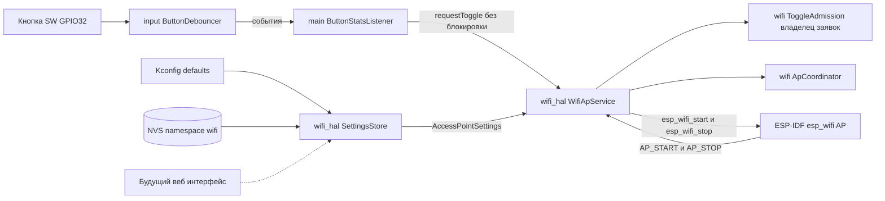
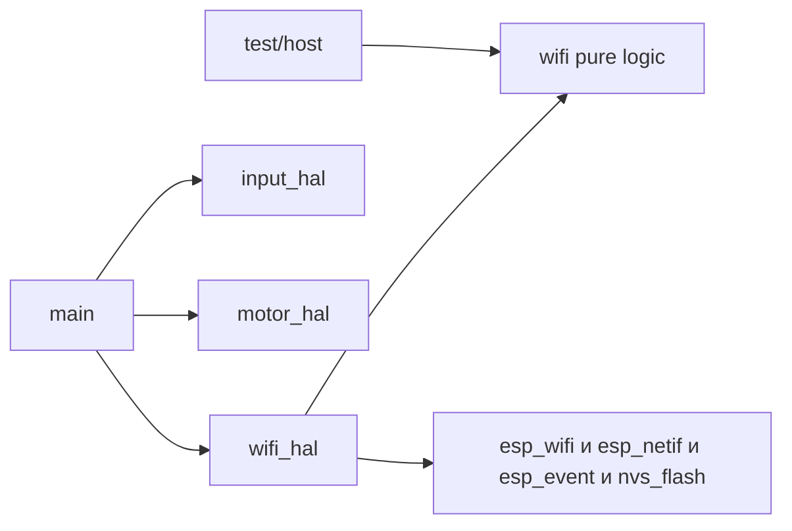
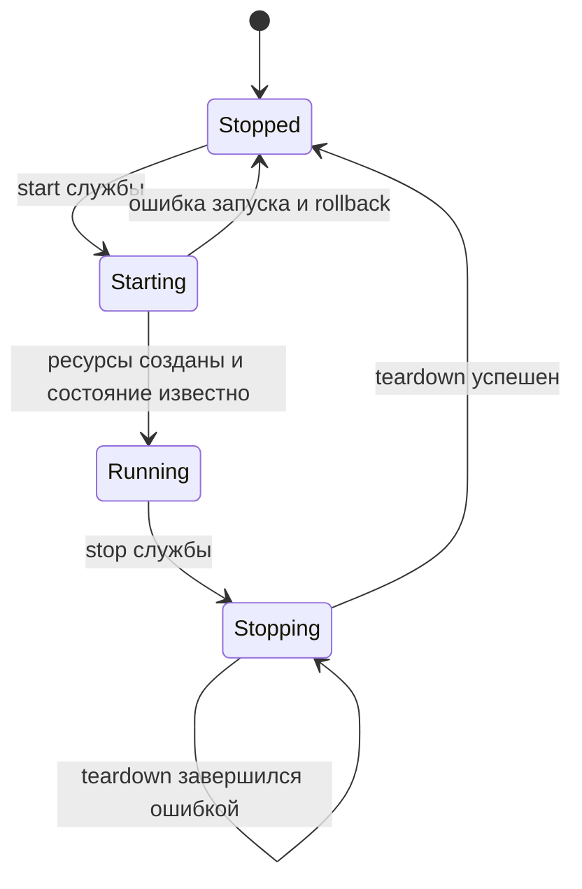

# 0004 — Точка доступа WiFi и переключение двойным нажатием кнопки

- Статус: **реализация выполнена** — редакция 6; ожидает `idf.py build` и
  стендовых проверок раздела 12
- Дата: 2026-11-15
- Стек: **ESP-IDF 6.1.0** + CMake, C++17, FreeRTOS
  (версия подтверждается значением `CONFIG_IDF_INIT_VERSION` в локально
  сгенерированном `sdkconfig`; перед сборкой дополнительно подтвердить
  выводом `idf.py --version`)
- Целевой чип: `esp32` (ESP32-WROOM-32)
- Железо: кнопка джойстика KY-023 / HW-504 — SW на GPIO 32, активный низкий
  уровень; WiFi использует встроенную антенну и не занимает GPIO
- Предыдущий этап: [`0003-joystick-input.md`](0003-joystick-input.md)
- Источник истины по пинам: [`docs/hardware/pinmap.md`](../hardware/pinmap.md) —
  **не меняется**
- Связанные документы: [`docs/hardware/overview.md`](../hardware/overview.md),
  [`README.md`](../../README.md)
- Карты замечаний ревью: приложения А–Г

## 1. Цель и границы

1. При включении платы поднимается WiFi-сеть в режиме точки доступа (AP).
2. Имя сети и пароль задаются конфигом, значения по умолчанию —
   `mount_01` и тестовый пароль `12345678`, подлежащий смене перед
   эксплуатацией.
3. Автозапуск точки доступа при включении — тоже настройка конфигурации.
4. Двойное нажатие кнопки джойстика выключает точку доступа; следующее
   двойное нажатие включает её снова.

Что **не входит** в этот план:

- веб-интерфейс, HTTP-сервер, настройка по воздуху, любой TCP-сервер
  приложения;
- режим станции (STA), подключение к внешней сети, NAT, mDNS, OTA;
- защищённое хранение credentials, шифрование NVS и flash, WPA3 —
  WPA2-PSK уже является частью выбранной защиты сети, но хранение пароля
  не защищено;
- сохранение результата переключения двойным нажатием (раздел 2, п. 18);
- выбор regulatory country и каналы 12–13 (раздел 2, п. 20);
- интеграция WiFi с контуром движения: `wifi_hal` не вызывает
  `MotorService`, не включает оси и не останавливает движение;
- смена источника шагов (GPTimer → RMT) и любые изменения моторной
  архитектуры; замеры раздела 12 только фиксируют факты.

Слой только сообщает наружу состояние точки доступа и принимает заявку на
переключение. Решение «когда переключать» принимает `main`.

## 2. Принятые решения

1. **Два компонента, как `input` / `input_hal`.**
   `wifi` — чистая логика без ESP-IDF: типы настроек, валидация, безопасная
   запись строк, учёт заявок и координатор операций. `wifi_hal` — ESP-IDF:
   NVS-хранилище и служба точки доступа. Связывание только в `main`.
2. **Настройки: Kconfig-значения по умолчанию + переопределение из NVS.**
   Валидный ключ NVS переопределяет Kconfig; отсутствующий ключ замещается
   `CONFIG_WIFI_AP_*`; реальная ошибка чтения не маскируется. Это готовит
   будущий веб-интерфейс, который будет писать через
   `SettingsStore::save()`.
3. **Автозапуск AP — настройка** (`start_on_boot`, Kconfig
   `WIFI_AP_START_ON_BOOT`, NVS-ключ `onboot`). При `false` драйвер
   инициализируется, но `esp_wifi_start()` не вызывается; причина в логе.
4. **Записи в flash при переключениях исключаются настройкой IDF.**
   `CONFIG_ESP_PHY_CALIBRATION_AND_DATA_STORAGE=n` в `sdkconfig.defaults`
   плюс компиляционная защита (`#ifdef` на символ в `sdkconfig.h` с
   `#error`). План не утверждает, что `esp_wifi_init()` закрывает всю
   записывающую подготовку. Цена — полная RF-калибровка при
   RF-инициализации и дополнительная задержка, измеряемая на стенде.
5. **`esp_wifi_set_storage(WIFI_STORAGE_RAM)`.** Конфигурация AP не
   сохраняется драйвером в NVS; отдельная мера, не заменяет п. 4.
6. **Только AP-режим.** `WIFI_MODE_AP`, WPA2-PSK, канал 1 по умолчанию,
   один клиент, SSID видимый, PMF не требуется.
7. **Правила валидации.** Пустой пароль — открытая сеть; пароль 1–7
   символов отвергается; SSID 1–32 печатных символа ASCII; невалидный
   итоговый конфиг — ошибка запуска без молчаливой подстановки.
8. **Ошибка WiFi не фатальна для приложения.** Джойстик и приводы
   остаются доступны, ошибка видна в логе и статусе.
9. **Приём заявки — одна проверка и одно резервирование, уведомление под
   защитой.** `requestToggle()` берёт `api_mutex_` и `state_mutex_` через
   try-lock, резервирует заявку, отпускает `state_mutex_`, **удерживая
   `api_mutex_`** отправляет `xTaskNotifyGive` и только затем отпускает
   `api_mutex_`. Копирование `task_` в локальную переменную не продлевает
   время жизни задачи и не используется.
10. **Единственный владелец количества заявок — `ToggleAdmission`.**
    Он же владеет счётчиками `accepted`, `rejected_*`, `executed`,
    `failed_on_*`, `dropped_on_*`. Задача забирает заявки по одной через
    `takeOne()`, поэтому локального пакета заявок не существует.
11. **Вместимость 2 относится к ожидающим заявкам.** Извлечённая и
    исполняемая заявка в `pending` не входит. Отдельного публичного
    счётчика «текущая заявка» нет: она видна косвенно по состоянию
    операции координатора.
12. **Ресинхронизация — по явному поводу, не более одной попытки на
    повод.** Поводы: таймаут обычного Toggle (одна попытка сразу) и
    `requestToggle()` при `Unknown` (отказ в переключении, установка
    `resync_requested_`, обязательное пробуждение задачи). Таймаут самой
    ресинхронизации новых попыток не запускает.
13. **События и ошибки драйвера отображаются таблицей.** `AP_START`
    завершает только `Starting`; `AP_STOP` — только `Stopping` и
    `Resyncing`; противоположное событие меняет наблюдаемое радио, но
    операцию не завершает. Немедленная ошибка вызова переводит радио в
    `Unknown`; исключение — `ESP_ERR_WIFI_NOT_STARTED` («уже остановлено»).
    Идентификатора операции в событиях нет: совпадение направления не
    доказывает принадлежность события конкретному вызову.
14. **Операции сериализованы**: одновременно выполняется не более одной.
15. **Жизненный цикл службы отделён от состояния радио.** Запись
    `lifecycle_` — только `start()` и `stop()` под `api_mutex_`; внешние
    заявки принимаются только в `Running`.
16. **Завершение задачи публикуется без `api_mutex_`.** Раздельное
    владение: `task_` меняют только `start()`/`stop()` под `api_mutex_`;
    задача пишет `teardown_result_` без мьютекса, публикует `task_exited_`
    атомарным store с release-семантикой, затем выдаёт `exit_sem_` и только
    после этого удаляет себя. Release/acquire публикует результат, но **не**
    гарантирует порядок выдачи семафора, поэтому финализация опирается на
    полученный `exit_sem_`, а не на флаг.
17. **`task_exited_` — диагностический признак и публикация результата.**
    Он означает завершение работы с ресурсами и видимость результата, но не
    выполненный `vTaskDelete()` и не окончание протокола. Окончательным
    подтверждением считается полученный `exit_sem_`. После выдачи семафора
    задача обращается только к собственному стеку и вызывает
    `vTaskDelete(nullptr)`.
18. **Первая финализация запуска всегда получает `exit_sem_`, даже если
    `task_exited_` уже наблюдается как `true`.** Ожидается только
    завершающая выдача подтверждения; после получения вызывается
    `finalizeStopLocked()` — одинаковая для первой и повторной остановки.
    Инвариант маркера: `Stopping` и `task_ != nullptr` — завершение ещё
    требует подтверждения; `Stopping` и `task_ == nullptr` — teardown уже
    финализирован с ошибкой, сохранённый код возвращается без ожидания.
    Поэтому повторный `start()` не может обогнать последнее подтверждение
    старой задачи.
19. **`start()` очищает состояние предыдущего запуска**: `shutdown_requested_`,
    `resync_requested_`, `teardown_result_`, `task_exited_`, остатки заявок
    и требует `task_ == nullptr`. Очистка `exit_sem_` остаётся защитной
    мерой: после успешной финализации подтверждение уже потреблено.
20. **Исход извлечённой заявки учитывает только управляющая задача**,
    ровно один раз. `stop()` закрывает приём, ставит shutdown-флаг,
    отбрасывает ожидающие заявки через `dropPending(Shutdown)` и будит
    задачу; извлечённую заявку он не учитывает.
21. **Приоритет подтверждения и shutdown.** Перед учётом задача под
    `state_mutex_` проверяет: если операция уже `None` и радио равно
    ожидаемому — заявка учитывается как `executed`, иначе при shutdown —
    `failed_on_shutdown`.
22. **Начальный запуск не подменяется неподтверждённым результатом.**
    Если после `esp_wifi_start()` и одной попытки ресинхронизации AP не
    подтверждена, `start()` возвращает ошибку и выполняет безопасный
    rollback. `startupSucceeded(false)` применяется только для намеренного
    `start_on_boot = false`.
23. **Результат переключения не сохраняется.** После перезагрузки
    действует `start_on_boot`.
24. **Пины не меняются.** WiFi не занимает GPIO; ADC2 не используется.
25. **Каналы 1–11**; настройка страны и каналы 12–13 отложены.
26. **Питание.** Проверяются источник, регулятор, проводка, земля и
    развязка; конденсатор — один из вариантов.
27. **Диагностика вне задач реального времени.** Обработчик кнопки не
    логирует; обработчик `WIFI_EVENT` меняет состояние под мьютексом,
    отпускает его и затем логирует.
28. **Фрагментация heap и задержки — измеряемые свойства.**
29. **Гарантия отсутствия callback — от `unregister`**, а не от времени
    жизни объекта; статическое время жизни лишь исключает разрушение
    объекта при выходе из `app_main`.
30. **Отсутствие взаимоблокировок не объявляется доказанным только
    порядком мьютексов.** Участники протокола ожиданий: `api_mutex_`,
    `state_mutex_`, `exit_sem_`, ожидание задачи и `unregister`; правила
    запрещают любые ожидания под `state_mutex_` и не требуют от задачи
    мьютекса, который удерживает ожидающий вызывающий.
31. **Баланс счётчиков проверяется после завершения обработки.** Формула
    `accepted == executed + failed_on_* + dropped_on_*` верна, когда
    `pending == 0` и нет извлечённой заявки. В промежуточном состоянии в
    балансе участвуют ожидающие заявки и одна извлечённая незавершённая;
    разрозненный снимок атомарных счётчиков не обязан быть транзакционным.
32. **Default event loop принадлежит приложению и не удаляется.** Служба
    может создать его при отсутствии, но не удаляет ни при rollback, ни при
    `stop()`: создание службой не означает, что другие компоненты не будут
    им пользоваться.

## 3. Структура компонентов

```text
components/
├── wifi/                              чистая логика C++17, без ESP-IDF
│   ├── CMakeLists.txt
│   ├── include/wifi/ap_config.hpp
│   ├── include/wifi/toggle_admission.hpp
│   ├── include/wifi/ap_lifecycle.hpp
│   ├── src/ap_config.cpp
│   ├── src/toggle_admission.cpp
│   └── src/ap_lifecycle.cpp
└── wifi_hal/                          ESP-IDF: NVS, esp_wifi, esp_netif
    ├── CMakeLists.txt
    ├── Kconfig.projbuild
    ├── include/wifi_hal/settings_store.hpp
    ├── include/wifi_hal/wifi_ap_service.hpp
    ├── src/settings_store.cpp
    └── src/wifi_ap_service.cpp

main/
├── main.cpp                           подключение WiFi и статистика кнопки
└── CMakeLists.txt                     + REQUIRES wifi_hal

sdkconfig.defaults                     + CONFIG_ESP_PHY_CALIBRATION_AND_DATA_STORAGE=n

test/host/
├── CMakeLists.txt                     + wifi_host и три новых теста
├── test_ap_config.cpp                 новый
├── test_toggle_admission.cpp          новый
├── test_ap_lifecycle.cpp              новый
└── test_button_debouncer.cpp          + сценарии двойного нажатия
```



Допустимые зависимости:



Запрещено: `wifi` и `wifi_hal` включают `motion`, `motor_hal`, `input`,
`input_hal`. Связывание выполняется только в `main`, как в плане 0003.

## 4. Типы, строковые контракты и валидация `wifi`

`include/wifi/ap_config.hpp`:

```cpp
namespace wifi {

constexpr std::size_t kSsidMaxLength = 32;
constexpr std::size_t kPasswordMaxLength = 63;
constexpr std::size_t kSsidCapacity = kSsidMaxLength + 1;
constexpr std::size_t kPasswordCapacity = kPasswordMaxLength + 1;
constexpr std::uint8_t kChannelMin = 1;
constexpr std::uint8_t kChannelMax = 11;   ///< без настройки country
constexpr std::uint8_t kMaxStationsMin = 1;
constexpr std::uint8_t kMaxStationsMax = 4;

struct AccessPointConfig {
    char ssid[kSsidCapacity] = {};
    char password[kPasswordCapacity] = {};
    std::uint8_t channel = kChannelMin;
    std::uint8_t max_stations = 1;
    bool hidden = false;
};

struct AccessPointSettings {
    AccessPointConfig ap{};
    bool start_on_boot = true;
};

enum class ConfigError : std::uint8_t {
    None,
    EmptySsid,
    SsidTooLong,
    SsidNotTerminated,
    SsidNotPrintable,
    PasswordTooShort,
    PasswordTooLong,
    PasswordNotTerminated,
    PasswordNotPrintable,
    InvalidChannel,
    InvalidMaxStations,
};

ConfigError validate(const AccessPointSettings &settings) noexcept;
const char *errorName(ConfigError error) noexcept;

/// Проверяют вход, затем изменяют объект; при отказе прежнее значение
/// сохраняется. nullptr — отказ.
bool setSsid(AccessPointConfig &config, const char *ssid) noexcept;
bool setPassword(AccessPointConfig &config, const char *password) noexcept;

/// Происхождение значения поля из NVS.
enum class NvsValue : std::uint8_t { Absent, Invalid, Present };

struct FieldMerge {
    bool applied = false;         ///< значение NVS применено
    bool kconfig_invalid = false; ///< значение Kconfig непригодно
};

/// Признак KconfigInvalid снимается только успешным применением значения.
FieldMerge mergeSsid(AccessPointConfig &config, bool kconfig_valid,
                     NvsValue value, const char *text) noexcept;
FieldMerge mergePassword(AccessPointConfig &config, bool kconfig_valid,
                         NvsValue value, const char *text) noexcept;

}  // namespace wifi
```

Разделение сценариев длины (буферы `33` и `64` байта):

| Сценарий | Проверка | Ожидание |
|---|---|---|
| внешняя строка SSID длиной 33 и более | `setSsid()` | `false`, объект не изменён |
| `ssid[33]` заполнен 33 ненулевыми байтами | `validate()` | `SsidNotTerminated`, без чтения за границы |
| `ssid[0…31]` заполнены, `ssid[32] == '\0'` | `validate()` | валиден, длина 32 |
| внешняя строка пароля длиной 64 и более | `setPassword()` | `false`, объект не изменён |
| `password[64]` без `'\0'` | `validate()` | `PasswordNotTerminated` |
| `password[0…62]` заполнены, `password[63] == '\0'` | `validate()` | валиден, длина 63 |
| пустая строка пароля | `setPassword()` и `validate()` | валидно, открытая сеть |

- длина считается ограниченно: `strnlen(buffer, capacity)`;
- сеттеры проверяют вход во временном буфере и только затем копируют;
- при передаче в `wifi_ap_config_t` SSID в 32 символа заполняет всё поле
  драйвера, поэтому `ssid_len = 32` задаётся явно; пароль копируется с
  терминатором, предел 63.

| Условие | Ошибка |
|---|---|
| `ssid` пуст | `EmptySsid` |
| нет `'\0'` в пределах 33 байт | `SsidNotTerminated` |
| длина `ssid` > 32 | `SsidTooLong` |
| символ `ssid` вне 0x20…0x7E | `SsidNotPrintable` |
| длина `password` 1…7 | `PasswordTooShort` |
| нет `'\0'` в пределах 64 байт | `PasswordNotTerminated` |
| длина `password` > 63 | `PasswordTooLong` |
| символ `password` вне 0x20…0x7E | `PasswordNotPrintable` |
| `channel` вне 1…11 | `InvalidChannel` |
| `max_stations` вне 1…4 | `InvalidMaxStations` |

Значения по умолчанию задаются в Kconfig и собираются в `wifi_hal`: чистая
логика не дублирует значения конфигурации проекта.

## 5. Учёт заявок и координатор операций — чистая логика

### 5.1 `wifi::ToggleAdmission` — единственный владелец заявок

`include/wifi/toggle_admission.hpp`:

```cpp
namespace wifi {

constexpr std::uint8_t kMaxPendingToggles = 2;

class ToggleAdmission {
public:
    enum class Result : std::uint8_t { Accepted, NotRunning, Unconfirmed, Full };
    enum class DropReason : std::uint8_t { Shutdown, Timeout, Error };

    struct Outcome {
        Result result = Result::NotRunning;
        bool wake_task = false;   ///< true для Accepted и Unconfirmed
    };

    Outcome tryAdmit(Lifecycle lifecycle, RadioState radio) noexcept;

    /// Извлечь одну ожидающую заявку; false — ожидающих нет.
    bool takeOne() noexcept;

    /// Извлечь ВСЕ ожидающие заявки и учесть их как отброшенные.
    /// Не касается заявки, уже извлечённой через takeOne().
    std::uint8_t dropPending(DropReason reason) noexcept;

    /// Учёт результата уже извлечённой заявки (ровно один раз).
    void accountExecuted() noexcept;
    void accountFailed(DropReason reason) noexcept;

    std::uint8_t pending() const noexcept;

    std::atomic<std::uint32_t> accepted{0};
    std::atomic<std::uint32_t> rejected_not_running{0};
    std::atomic<std::uint32_t> rejected_unconfirmed{0};
    std::atomic<std::uint32_t> rejected_full{0};
    std::atomic<std::uint32_t> executed{0};
    std::atomic<std::uint32_t> failed_on_shutdown{0};
    std::atomic<std::uint32_t> failed_on_timeout{0};
    std::atomic<std::uint32_t> failed_on_error{0};
    std::atomic<std::uint32_t> dropped_on_shutdown{0};
    std::atomic<std::uint32_t> dropped_on_timeout{0};
    std::atomic<std::uint32_t> dropped_on_error{0};

private:
    std::atomic<std::uint8_t> pending_{0};
};

}  // namespace wifi
```

| Условие `tryAdmit()` | Результат | `wake_task` | Счётчик |
|---|---|---|---|
| `lifecycle != Running` | `NotRunning` | `false` | `rejected_not_running` |
| `radio == Unknown` | `Unconfirmed` | `true` | `rejected_unconfirmed` |
| `pending >= kMaxPendingToggles` | `Full` | `false` | `rejected_full` |
| иначе | `Accepted` | `true` | `accepted`, `pending++` |

Резервирование — цикл `compare_exchange_weak`: проверка вместимости и
увеличение счётчика не разрываются.

Контракт учёта:

| Событие | Извлечённая заявка | Ожидающие заявки |
|---|---|---|
| операция подтверждена | `accountExecuted()` | не трогаются |
| таймаут операции | `accountFailed(Timeout)` | `dropPending(Timeout)` |
| немедленная ошибка вызова | `accountFailed(Error)` | `dropPending(Error)` |
| shutdown | решает задача (п. 21): `executed` или `failed_on_shutdown` | `dropPending(Shutdown)` |

- одна заявка не учитывается одновременно как исполненная и как
  отброшенная: `failed_on_*` относится к извлечённой, `dropped_on_*` — к
  ожидающим;
- `dropPending()` сам извлекает ожидающие заявки и учитывает их;
- баланс `accepted == executed + failed_on_* + dropped_on_*` проверяется
  **после завершения обработки** (`pending == 0`, извлечённой заявки нет).
  Пока работа идёт, в балансе участвуют `pending` и извлечённая
  незавершённая заявка; отдельный публичный счётчик для неё не вводится;
- разрозненный диагностический снимок атомарных счётчиков не обязан
  показывать баланс транзакционно.

### 5.2 `wifi::ApCoordinator` — операции радио

`include/wifi/ap_lifecycle.hpp`:

```cpp
namespace wifi {

enum class Lifecycle : std::uint8_t { Stopped, Starting, Running, Stopping };
enum class RadioState : std::uint8_t { Unknown, Running, Stopped };
enum class Operation : std::uint8_t { None, Starting, Stopping, Resyncing };
enum class Action : std::uint8_t { None, StartRadio, StopRadio, ResyncStop };

class ApCoordinator {
public:
    void beginStartup() noexcept;
    void startupSucceeded(bool ap_confirmed_running) noexcept;
    void startupFailed() noexcept;

    /// Операция первоначального запуска: взводит `Starting`, чтобы служба
    /// ждала `AP_START`, а не считала `Unknown` несовпадением.
    Action beginInitialStart() noexcept;

    /// Действие для уже извлечённой заявки; None — состояние не позволяет
    /// начать операцию (служба считает это внутренней ошибкой).
    Action beginToggleOperation() noexcept;

    /// Одна попытка ресинхронизации по явному поводу.
    Action beginResync() noexcept;

    void onApStarted() noexcept;
    void onApStopped() noexcept;
    void onOperationTimeout() noexcept;   ///< нет подтверждения
    void onOperationFailed() noexcept;    ///< немедленная ошибка вызова
    void onAlreadyStopped() noexcept;     ///< ESP_ERR_WIFI_NOT_STARTED
    void onStaConnected() noexcept;
    void onStaDisconnected() noexcept;

    bool beginShutdown() noexcept;
    void finishShutdown() noexcept;

    Lifecycle lifecycle() const noexcept;
    RadioState radioState() const noexcept;
    Operation operation() const noexcept;
    std::uint8_t stations() const noexcept;

    std::uint32_t event_timeouts = 0;
    std::uint32_t operation_errors = 0;
    std::uint32_t resyncs = 0;
    std::uint32_t starts = 0;
    std::uint32_t stops = 0;
};

}  // namespace wifi
```

| Ситуация | Наблюдаемое радио | Операция |
|---|---|---|
| `beginStartup()` из `Stopped` | `Unknown` | `None` |
| `beginInitialStart()` при `Starting` и радио `Unknown` | без изменений | `Starting`, `StartRadio` |
| `beginInitialStart()` иначе | без изменений | без изменений, `None` |
| `startupSucceeded(true)` | `Running` | `None` |
| `startupSucceeded(false)` | `Stopped` | `None` |
| `startupFailed()` | `Unknown` | `None` |
| `beginToggleOperation()` при `Stopped` | без изменений | `Starting`, `StartRadio` |
| `beginToggleOperation()` при `Running` | без изменений | `Stopping`, `StopRadio` |
| `beginToggleOperation()` при `Unknown` | без изменений | `None` |
| `beginToggleOperation()` при операции не `None` | без изменений | без изменений, `None` |
| `beginResync()` | без изменений | `Resyncing`, `resyncs++`, `ResyncStop` |
| `beginResync()` при операции не `None` | без изменений | без изменений, `None` |
| `AP_START` | `Running` | завершает только `Starting` |
| `AP_STOP` | `Stopped`, `stations = 0` | завершает только `Stopping` и `Resyncing` |
| `AP_START` при `Stopping` | `Running` | не завершает |
| `AP_STOP` при `Starting` | `Stopped` | не завершает |
| повторный `AP_START` | `Running` | без изменений, `starts` не растёт |
| повторный `AP_STOP` | `Stopped` | без изменений, `stops` не растёт |
| `onOperationTimeout()` | `Unknown` | `None`, `event_timeouts++` |
| `onOperationFailed()` | **`Unknown`** | `None`, `operation_errors++` |
| `onAlreadyStopped()` | `Stopped` | `None` |
| `onStaConnected()` | без изменений | `stations++` с насыщением |
| `onStaDisconnected()` | без изменений | `stations--`, только если больше нуля |
| `beginShutdown()` | без изменений | `None`; повторный вызов `false` |
| `finishShutdown()` | `Unknown` | `None` |

`starts`/`stops` считают переходы, а не сырые события. Операция снимается
только событием своего направления либо явным результатом вызова драйвера.



## 6. Kconfig и настройки IDF

`components/wifi_hal/Kconfig.projbuild`, меню `Telescope mount WiFi`:

| Символ | Тип | По умолчанию | Назначение |
|---|---|---|---|
| `WIFI_AP_SSID` | string | `mount_01` | имя сети |
| `WIFI_AP_PASSWORD` | string | `12345678` | тестовый пароль WPA2, пусто = открытая сеть |
| `WIFI_AP_START_ON_BOOT` | bool | `y` | поднимать AP при включении |
| `WIFI_AP_CHANNEL` | int 1…11 | `1` | канал, world-safe диапазон |
| `WIFI_AP_MAX_STATIONS` | int 1…4 | `1` | максимум клиентов |
| `WIFI_AP_HIDDEN` | bool | `n` | скрытый SSID |
| `WIFI_AP_EVENT_TIMEOUT_MS` | int 500…20000 | `5000` | ожидание `AP_START` и `AP_STOP` |
| `WIFI_SETTINGS_FROM_NVS` | bool | `y` | разрешить переопределение из NVS |
| `WIFI_TASK_STACK` | int 2048…8192 | `3584` | стек задачи `wifi_ap` |
| `WIFI_TASK_PRIORITY` | int 1…15 | `4` | приоритет задачи |
| `WIFI_TASK_CORE` | int 0…1 | `0` | ядро задачи |
| `WIFI_STOP_TIMEOUT_MS` | int 1000…30000 | `5000` | только ожидание вызывающего в `stop()` |

`components/input_hal/Kconfig.projbuild`, меню `Telescope mount joystick`:

| Символ | Тип | По умолчанию | Назначение |
|---|---|---|---|
| `JOY_DOUBLE_CLICK_MS` | int 0…1000 | `350` | окно двойного нажатия, `0` = выключено |

`sdkconfig.defaults`:

```text
# 0004: RF-калибровка не сохраняется, чтобы переключение AP не писало в NVS
CONFIG_ESP_PHY_CALIBRATION_AND_DATA_STORAGE=n
```

- `sdkconfig.defaults` применяется при генерации `sdkconfig`; при
  существующем `sdkconfig` изменение вносится через `idf.py menuconfig`;
- значение символа проверяется в `build/config/sdkconfig.h`; если IDF
  генерирует `0`, защита использует `#if defined(...) && CONFIG_...`;
- `WIFI_STOP_TIMEOUT_MS` ограничивает ожидание вызывающего, а не
  длительность teardown;
- «не позднее 100 мс» относится только к обнаружению флага shutdown;
- пароль в `sdkconfig` хранится в открытом виде (раздел 14);
- при конфликте имён Kconfig префикс меняется на `AP_WIFI_*`.

## 7. NVS-хранилище настроек

`include/wifi_hal/settings_store.hpp`:

```cpp
namespace wifi_hal {

enum class SettingSource : std::uint8_t { KconfigDefault, Nvs };
enum class SettingIssue : std::uint8_t { None, InvalidValue, ReadError };

struct FieldStatus {
    SettingSource source = SettingSource::KconfigDefault;
    SettingIssue issue = SettingIssue::None;
    esp_err_t error = ESP_OK;
};

struct LoadResult {
    esp_err_t status = ESP_OK;
    wifi::AccessPointSettings settings{};
    FieldStatus ssid{}, password{}, channel{}, max_stations{}, hidden{},
        start_on_boot{};
    bool any_invalid = false;
    bool any_read_error = false;
};

class SettingsStore {
public:
    static esp_err_t initNvs();
    LoadResult load() const;
    esp_err_t save(const wifi::AccessPointSettings &settings);
};

}  // namespace wifi_hal
```

| Ключ | Тип NVS | Допустимо | При отсутствии | При неверном значении |
|---|---|---|---|---|
| `ssid` | str | 1…32 печатных символа | Kconfig | Kconfig + `InvalidValue` |
| `pass` | str | 0 или 8…63 печатных символа | Kconfig | Kconfig + `InvalidValue`, значение не логируется |
| `chan` | u8 | 1…11 | Kconfig | Kconfig + `InvalidValue` |
| `maxsta` | u8 | 1…4 | Kconfig | Kconfig + `InvalidValue` |
| `hidden` | u8 | строго 0 или 1 | Kconfig | Kconfig + `InvalidValue` |
| `onboot` | u8 | строго 0 или 1 | Kconfig | Kconfig + `InvalidValue` |

- `initNvs()`: при `NO_FREE_PAGES` или `NEW_VERSION_FOUND` выполняется
  `nvs_flash_erase()` всего используемого раздела и повторная
  инициализация; только на старте, до задач движения, никогда по кнопке;
- ошибка `initNvs()` возвращается вызывающему; AP не запускается, NVS не
  стирается повторно во время работы;
- `ESP_ERR_NVS_NOT_FOUND` — «ключ отсутствует», не ошибка;
- `TYPE_MISMATCH` и `INVALID_LENGTH` (на обоих этапах чтения строк) —
  `InvalidValue` с предупреждением без содержимого значения, поле
  замещается значением Kconfig;
- прочие ошибки чтения — `ReadError`, `any_read_error`, ненулевой `status`;
- строки Kconfig не обрезаются: если `CONFIG_WIFI_AP_SSID` или
  `CONFIG_WIFI_AP_PASSWORD` не помещаются в буфер или непечатаемы, поле
  помечается `KconfigInvalid`. Запуск тогда возможен только при валидном
  переопределении этого поля из NVS; иначе `start()` возвращает явную
  ошибку без молчаливой подмены значения;
- слияние выполняют чистые функции `wifi::mergeSsid()` и
  `wifi::mergePassword()`, покрытые host-тестами. Невалидное значение NVS
  **не снимает** `KconfigInvalid`: признаки сохраняются одновременно, и
  запуск отвергается, пока не применится валидное значение. Признак
  снимается только успешным применением;
- явно сохранённая в NVS пустая строка пароля — валидное переопределение
  открытой сети и снимает `KconfigInvalid`, как любое другое валидное
  значение;
- итоговые настройки проверяются `wifi::validate()`, источник каждой
  настройки попадает в лог;
- `save()` пишет ключи и вызывает `nvs_commit()`; атомарность набора
  ключей при потере питания не гарантируется;
- `save()` допустим только при неподвижных осях; `WifiApService` в NVS не
  пишет.

## 8. `WifiApService`

`include/wifi_hal/wifi_ap_service.hpp`:

```cpp
namespace wifi_hal {

struct AccessPointStatus {
    wifi::Lifecycle lifecycle = wifi::Lifecycle::Stopped;
    wifi::RadioState radio_state = wifi::RadioState::Unknown;
    wifi::Operation operation = wifi::Operation::None;
    bool configured_start_on_boot = true;
    bool task_exited = false;
    std::uint8_t pending_toggles = 0;
    char ssid[wifi::kSsidCapacity] = {};
    std::uint8_t channel = 0;
    std::uint8_t auth_mode = 0;
    std::uint8_t stations = 0;

    std::uint32_t accepted_toggles = 0;
    std::uint32_t rejected_not_running = 0;
    std::uint32_t rejected_unconfirmed = 0;
    std::uint32_t rejected_full = 0;
    std::uint32_t executed_toggles = 0;
    std::uint32_t failed_on_shutdown = 0;
    std::uint32_t failed_on_timeout = 0;
    std::uint32_t failed_on_error = 0;
    std::uint32_t dropped_on_shutdown = 0;
    std::uint32_t dropped_on_timeout = 0;
    std::uint32_t dropped_on_error = 0;
    std::uint32_t rejected_api_busy = 0;
    std::uint32_t rejected_state_busy = 0;
    std::uint32_t internal_errors = 0;
    std::uint32_t event_timeouts = 0;
    std::uint32_t operation_errors = 0;
    std::uint32_t resyncs = 0;
    std::uint32_t starts = 0;
    std::uint32_t stops = 0;
    esp_err_t last_error = ESP_OK;
    esp_err_t teardown_result = ESP_OK;
};

class WifiApService {
public:
    WifiApService();
    ~WifiApService();

    esp_err_t start();
    esp_err_t stop();
    esp_err_t requestToggle();
    AccessPointStatus status() const;

private:
    static void taskEntry(void *arg);
    void run();
    static void eventHandler(void *arg, esp_event_base_t base, int32_t id,
                             void *data);

    esp_err_t createResources();
    esp_err_t initNetwork();
    esp_err_t initDriver(const wifi::AccessPointSettings &settings);
    esp_err_t registerHandler();
    esp_err_t applyConfig(const wifi::AccessPointSettings &settings);
    esp_err_t initialStart(bool start_on_boot);
    esp_err_t teardown();

    /// Финализация под api_mutex_ для обеих веток stop().
    esp_err_t finalizeStopLocked();

    void doToggleOnce();
    void doResyncOnce();
    bool supervise(wifi::Operation operation, wifi::RadioState expected_radio);
    void accountCurrentRequest(wifi::ToggleAdmission::DropReason reason);

    ...
};

}  // namespace wifi_hal
```

### 8.1 Порядок запуска

1. Создать объекты синхронизации и счётчики: `api_mutex_`, `state_mutex_`,
   `exit_sem_`, атомарные `shutdown_requested_`, `resync_requested_`,
   `task_exited_`, `rejected_api_busy`, `rejected_state_busy`,
   `internal_errors`, экземпляр `ToggleAdmission`.
2. `SettingsStore::initNvs()` и `load()`; проверка `wifi::validate()`.
3. `esp_netif_init()`; при необходимости `esp_event_loop_create_default()`;
   создание собственного AP netif.
4. `esp_wifi_init()`; `esp_wifi_set_storage(WIFI_STORAGE_RAM)`; режим AP;
   применение конфигурации.
5. Регистрация экземпляра обработчика событий.
6. Начальный запуск:
   - `start_on_boot = false` → `startupSucceeded(false)`;
   - иначе операция первоначального запуска взводится до вызова драйвера
     (`beginInitialStart()`), иначе первая же проверка ожидания увидит
     `operation == None` и `radio == Unknown` и примет ещё не пришедший
     `AP_START` за несовпадение;
   - `esp_wifi_start()`:
     - `ESP_OK` и `AP_START` подтверждён → `startupSucceeded(true)`;
     - таймаут → одна попытка `doResyncOnce()`; она может подтвердить
       только `Stopped` (`AP_STOP` или `ESP_ERR_WIFI_NOT_STARTED`) либо
       оставить `Unknown`, так как `ResyncStop` завершается только
       остановкой. В обоих случаях AP не подтверждена: `startupFailed()`,
       безопасный rollback, `start()` возвращает ошибку;
     - немедленная ошибка вызова → `startupFailed()`, rollback, код ошибки.
   - `startupSucceeded(false)` для `start_on_boot = true` не применяется.
7. Создание задачи `wifi_ap` и публикация `Running`.
8. Только теперь `requestToggle()` принимает заявки.

**Сброс состояния предыдущего запуска** в начале `start()` под
`api_mutex_`, только при `lifecycle_ == Stopped` и `task_ == nullptr`
(инвариант выполненной финализации):

```cpp
shutdown_requested_ = false;
resync_requested_ = false;
teardown_result_ = ESP_OK;
task_exited_.store(false, std::memory_order_release);
while (xSemaphoreTake(exit_sem_, 0) == pdTRUE) {
    // защитная очистка: после успешной финализации подтверждение уже
    // потреблено, поэтому в норме цикл не выполняется ни разу
}
admission_.dropPending(wifi::ToggleAdmission::DropReason::Shutdown);  // 0 в норме
```

Протокол не оставляет «лишних» подтверждений: первая финализация каждого
запуска всегда получает `exit_sem_`, поэтому очистка выше — страховка.
`start()` без выполненной финализации (`task_ != nullptr`) возвращает
`ESP_ERR_INVALID_STATE`.

### 8.2 Владельцы данных и правила ожиданий

| Данные | Кто пишет | Защита |
|---|---|---|
| `admission_` | `requestToggle()`, `stop()`, задача | внутренние `std::atomic` |
| `coordinator_` | задача, обработчик событий | `state_mutex_`, короткие критические секции без ожиданий и логирования |
| `lifecycle_` | только `start()`/`stop()` | `api_mutex_` |
| `published_lifecycle_` | `start()`/`stop()` | `std::atomic` (для `status()`) |
| `shutdown_requested_`, `resync_requested_` | `stop()`, `requestToggle()`, задача | `std::atomic` |
| `task_` | только `start()`/`stop()` | `api_mutex_`; `task_ == nullptr` означает выполненную финализацию |
| `teardown_result_` | задача (без мьютекса) и синхронный rollback в `start()` | `std::atomic<esp_err_t>`: store release при публикации, load acquire в `stop()` и `status()` |
| `task_exited_` | задача | `std::atomic<bool>`, store release; диагностика и публикация результата, не критерий финализации |
| `exit_sem_` | задача (give), `start()` (сброс), `stop()` (ожидание) | семафор |
| `rejected_*_busy`, `internal_errors` | `requestToggle()`, задача | `std::atomic` |
| `handler_instance_`, `netif_`, `wifi_initialized_`, `handler_removed_` | `start()`, задача | по разделу 8.5 |
| `ssid`, `channel`, `auth_mode`, `configured_start_on_boot` | `start()` до публикации `Running` | неизменяемы после публикации |

Правила ожиданий:

- единственный порядок взятия мьютексов — `api_mutex_` → `state_mutex_`;
- задача **никогда** не берёт `api_mutex_`: mutex, который `stop()`
  удерживает во время ожидания, задаче не нужен, поэтому взаимного
  ожидания «stop ждёт задачу, задача ждёт stop» не возникает;
- `state_mutex_` не удерживается во время любых ожиданий (`vTaskDelay`,
  `exit_sem_`, `unregister`);
- обработчик событий берёт `state_mutex_` только на изменение координатора,
  отпускает и затем логирует; `api_mutex_` не берёт;
- отсутствие взаимоблокировок не объявляется доказанным только порядком
  двух мьютексов: участники протокола — `api_mutex_`, `state_mutex_`,
  `exit_sem_`, ожидание задачи и `unregister`; правила запрещают ожидания
  под `state_mutex_` и не требуют от задачи мьютекса вызывающего;
- `status()` берёт `state_mutex_` с ожиданием; снимок по группам полей не
  транзакционный, это документировано;
- `stop()` берёт `api_mutex_` RAII-guard-ом (`ApiLock`), поэтому мьютекс
  освобождается на любом выходе; `finalizeStopLocked()` вызывается только
  под этой блокировкой и сам её не освобождает.

### 8.3 Приём заявки

```cpp
esp_err_t WifiApService::requestToggle()
{
    if (xSemaphoreTake(api_mutex_, 0) != pdTRUE) {
        rejected_api_busy_.fetch_add(1);
        return ESP_ERR_TIMEOUT;
    }
    if (xSemaphoreTake(state_mutex_, 0) != pdTRUE) {
        rejected_state_busy_.fetch_add(1);
        (void)xSemaphoreGive(api_mutex_);
        return ESP_ERR_TIMEOUT;
    }

    const wifi::RadioState radio = coordinator_.radioState();
    const wifi::ToggleAdmission::Outcome outcome =
        admission_.tryAdmit(lifecycle_, radio);
    if (outcome.result == wifi::ToggleAdmission::Result::Unconfirmed) {
        resync_requested_.store(true);   // повод доставляется даже при отказе
    }
    (void)xSemaphoreGive(state_mutex_);

    // api_mutex_ удерживается: stop() не может обнулить task_ между
    // проверкой и уведомлением.
    if (outcome.wake_task && task_ != nullptr) {
        (void)xTaskNotifyGive(task_);
    }
    (void)xSemaphoreGive(api_mutex_);

    switch (outcome.result) {
        case wifi::ToggleAdmission::Result::Accepted:
            return ESP_OK;
        case wifi::ToggleAdmission::Result::Full:
            return ESP_ERR_NO_MEM;
        case wifi::ToggleAdmission::Result::Unconfirmed:
        case wifi::ToggleAdmission::Result::NotRunning:
            return ESP_ERR_INVALID_STATE;
    }
    return ESP_ERR_INVALID_STATE;
}
```

- проверка состояния и резервирование — одна согласованная операция под
  двумя try-lock; обработчик кнопки не блокируется;
- `wake_task == true` и для `Accepted`, и для `Unconfirmed`;
- `ESP_OK` означает «заявка сохранена»; исход — `executed` или
  `failed_on_*`, ожидающие заявки уходят в `dropped_on_*`;
- при `Unconfirmed` заявка не сохраняется: после восстановления нужна
  новая;
- `task_` не копируется в локальную переменную: время жизни задачи
  продлевает только удержание `api_mutex_`.

### 8.4 Задача `wifi_ap`

```
run():
  for (;;)
    ulTaskNotifyTake(pdTRUE, portMAX_DELAY)        // счётное уведомление
    for (;;)
      if (shutdown_requested_): dropPending(Shutdown); goto teardown
      if (resync_requested_.exchange(false)):
          doResyncOnce(); continue
      if (!admission_.takeOne()): break
      doToggleOnce()
```

- заявки забираются по одной; извлечённого пакета не существует;
- `shutdown_requested_` проверяется между заявками и внутри ожидания;
- `doToggleOnce()` вызывает `beginToggleOperation()`:
  - `StartRadio` → `esp_wifi_start()`; `StopRadio` → `esp_wifi_stop()`;
  - `None` — нарушение инварианта: `internal_errors++`, заявка
    учитывается как `accountFailed(Error)`;
- `doResyncOnce()` — одна попытка (`beginResync()` → `esp_wifi_stop()`);
  таймаут попытки новых попыток не запускает, состояние остаётся
  `Unknown` до следующего повода. Автоматическая попытка разрешена только
  после таймаута обычного Toggle и при начальном запуске.

#### 8.4.1 Вызов драйвера и немедленные результаты

| Действие | Результат вызова | Отображение | Учёт заявки |
|---|---|---|---|
| `StartRadio` | `ESP_OK` | ожидание `AP_START` | по итогу ожидания |
| `StartRadio` | иная ошибка | `onOperationFailed()`, радио `Unknown`, `last_error` | `accountFailed(Error)`, `dropPending(Error)` |
| `StopRadio` | `ESP_OK` | ожидание `AP_STOP` | по итогу ожидания |
| `StopRadio` | `ESP_ERR_WIFI_NOT_STARTED` | `onAlreadyStopped()`, `Stopped` | `accountExecuted()` |
| `StopRadio` | иная ошибка | `onOperationFailed()`, `Unknown` | `accountFailed(Error)`, `dropPending(Error)` |
| `ResyncStop` | `ESP_OK` | ожидание `AP_STOP` | — (не заявка) |
| `ResyncStop` | `ESP_ERR_WIFI_NOT_STARTED` | `onAlreadyStopped()` | — |
| `ResyncStop` | иная ошибка | `onOperationFailed()`, `Unknown` | — |

Немедленная ошибка учитывается в `operation_errors` и `last_error`, но
**не** как таймаут.

#### 8.4.2 Ожидание подтверждения и учёт извлечённой заявки

```
supervise(operation, expected_radio):
  deadline = now + CONFIG_WIFI_AP_EVENT_TIMEOUT_MS
  loop:
    if shutdown_requested_: return ABORTED
    if coordinator_.operation() == None:
        return coordinator_.radioState() == expected_radio ? CONFIRMED : MISMATCH
    if now >= deadline:
        // Решение принимается под state_mutex_ после повторной проверки:
        // обработчик мог подтвердить операцию между двумя блокировками.
        if coordinator_.operation() == None:
            return radio == expected ? CONFIRMED : MISMATCH
        coordinator_.onOperationTimeout()
        last_error = ESP_ERR_TIMEOUT
        return TIMED_OUT
    vTaskDelay(pdMS_TO_TICKS(100))
```

Результат `supervise()` и учёт (выполняет **только задача**, ровно один
раз на извлечённую заявку):

| Результат | Условие | Учёт |
|---|---|---|
| `CONFIRMED` | — | `accountExecuted()` |
| `ABORTED` (shutdown) | повторная проверка под `state_mutex_`: операция `None` и радио равно ожидаемому | `accountExecuted()` |
| `ABORTED` (shutdown) | иначе | `accountFailed(Shutdown)` |
| `MISMATCH` | — | `accountFailed(Error)`, `internal_errors++` |
| `TIMED_OUT` | — | `accountFailed(Timeout)`, `dropPending(Timeout)`, затем одна попытка `doResyncOnce()` |

- `stop()` извлечённые заявки не учитывает: он только отбрасывает
  ожидающие через `dropPending(Shutdown)` (п. 20–21);
- приоритет одновременного подтверждения и shutdown реализован повторной
  проверкой под `state_mutex_` непосредственно перед учётом;
- событие противоположного направления не завершает операцию, поэтому
  `MISMATCH` возможен только при нарушении инварианта и учитывается как
  внутренняя ошибка.

### 8.5 Жизненный цикл, публикация завершения и teardown

Публикация завершения задачей (без `api_mutex_`):

```cpp
// конец wifi_ap task
teardown_result_ = result;                              // без мьютекса
task_exited_.store(true, std::memory_order_release);    // публикация
(void)xSemaphoreGive(exit_sem_);                        // после публикации
vTaskDelete(nullptr);                                   // после этого задача
                                                        // полей службы не
                                                        // касается
```

Порядок публикации задаёт видимость результата, но не завершает протокол:
`task_exited_` не означает выполненный `vTaskDelete()` и не заменяет
получение семафора.

`stop()` и финализация. `api_mutex_` берётся RAII-guard-ом, который
освобождает его на **любом** выходе, включая ранние `return` и ветку
таймаута:

```
stop():
  ApiLock lock(api_mutex_)                 // ожидание; release на выходе
  if lifecycle_ == Stopped: return ESP_OK
  if lifecycle_ == Stopping && task_ == nullptr:
      return teardown_result_              // финализация уже выполнена
  if lifecycle_ != Stopping:               // Running или Starting
      lifecycle_ = Stopping; published_lifecycle_ = Stopping
      admission_.dropPending(Shutdown)     // извлечённую заявку не учитывает
      shutdown_requested_ = true
      xTaskNotifyGive(task_)
  // Семафор ожидается всегда для первой финализации этого запуска,
  // даже если task_exited_ уже true: остаётся только завершающая
  // выдача подтверждения старой задачей.
  if xSemaphoreTake(exit_sem_, WIFI_STOP_TIMEOUT_MS) != pdTRUE:
      return ESP_ERR_TIMEOUT               // ресурсы сохраняются
  return finalizeStopLocked()              // release выполнит guard

finalizeStopLocked():                      // всегда под api_mutex_,
  const esp_err_t result =                 // сам мьютекс не освобождает
      teardown_result_.load(acquire)
  task_ = nullptr
  if result == ESP_OK:
      lifecycle_ = Stopped; published_lifecycle_ = Stopped
  return result                            // при ошибке остаётся Stopping
```

Свойства:

- окончательным подтверждением является полученный `exit_sem_`; поэтому
  между `task_exited_.store()` и `xSemaphoreGive()` повторный запуск
  невозможен: первый `stop()` ждёт семафор, а не флаг;
- поздний успешный teardown после таймаута полностью завершает `stop()`:
  повторный `stop()` сначала получает уже выданный семафор, затем
  финализирует и возвращает `ESP_OK` и `Stopped`; новый `start()` разрешён;
- «немедленный возврат результата» гарантируется только после **выполненной
  финализации** (`task_ == nullptr`), а не после одной публикации
  `task_exited_`;
- при ошибке teardown финализация выполнена, служба остаётся в
  терминальном `Stopping`, повторный `stop()` возвращает сохранённый код
  без ожидания;
- `coordinator_.finishShutdown()` вызывается только при успешном teardown;
- финализация идемпотентна и выполняется ровно один раз: её признак —
  `task_ == nullptr`;
- синхронный rollback в `start()` сохраняет результат teardown в
  `teardown_result_` до возврата ошибки, поэтому последующий `stop()` не
  сообщает ложный успех: он возвращает сохранённую ошибку;
- `finalizeStopLocked()` никогда не освобождает `api_mutex_` сам: это
  делает guard вызывающего.

| № | Ресурс | Владелец | Предусловие освобождения | При невыполненном предусловии |
|---|---|---|---|---|
| 1 | объекты синхронизации и счётчики | служба, статическая память | созданы в конструкторе | null handle → `ESP_ERR_NO_MEM` на старте |
| 2 | NVS-раздел | приложение | — | не освобождается и не стирается повторно |
| 3 | `esp_netif_init()` | приложение | — | не деинициализируется |
| 4 | default event loop | приложение | — | **никогда не удаляется**, даже если создан службой |
| 5 | AP netif | служба | драйвер подтверждённо больше его не использует | netif сохраняется |
| 6 | обработчик событий | служба | `unregister` вернул `ESP_OK`, новые вызовы прекращены | ресурсы, доступные обработчику, не освобождаются |
| 7 | драйвер | служба | обработчик снят; `esp_wifi_stop()` дал `ESP_OK` или `ESP_ERR_WIFI_NOT_STARTED` | `esp_wifi_deinit()` не вызывается, netif не уничтожается |
| 8 | задача | служба | teardown завершён (успешно или нет) | сообщает результат и удаляется всегда |
| 9 | заявки | служба | — | `dropped_on_shutdown` / `failed_on_shutdown` |

Правила teardown:

1. Первая ошибка сохраняется; после неё выполняются только шаги с
   выполненными предусловиями, не создающие доступ к освобождённым
   ресурсам.
2. Если отсутствие callback не подтверждено, драйвер и netif не
   освобождаются: служба остаётся `Stopping`, ошибка возвращается,
   требуется перезагрузка.
3. Нулевой счётчик выполняющихся callback недостаточен без
   подтверждённой невозможности новых вызовов: сначала гарантия
   прекращения новых вызовов, затем ожидание завершения текущих.
4. Порядок при выполненных предусловиях: прекращение обработки заявок →
   `unregister` → `esp_wifi_stop()` при необходимости → `esp_wifi_deinit()`
   → уничтожение AP netif → `finishShutdown()`.
5. Полная деинициализация ESP-NETIF не выполняется; уничтожается только
   созданный службой AP netif.
6. Гарантия прекращения callback опирается на
   `esp_event_handler_instance_unregister()`; её гарантия подтверждается по
   документации и исходникам ESP-IDF 6.1.0. При недостаточности
   используется счётчик выполняющихся callback, проверяемый **после**
   подтверждённой невозможности новых вызовов.
7. Статическое время жизни `WifiApService` в `main.cpp` только исключает
   разрушение объекта при выходе из `app_main`; правила 1–3 оно не
   заменяет.

## 9. Двойное нажатие в `input`

`include/input/button_debouncer.hpp`:

```cpp
struct ButtonConfig {
    std::uint32_t debounce_ms = 40;
    std::uint32_t long_press_ms = 1000;
    std::uint32_t double_click_ms = 350;  ///< 0 = режим выключен
};

enum class ButtonEvent : std::uint8_t {
    None,
    Pressed,
    Released,
    Click,
    LongPress,
    DoubleClick,  ///< добавляется после LongPress, значения не сдвигаются
};
```

1. Кандидат в одиночный клик возникает только при подтверждённом коротком
   отпускании (нажатие не достигло `long_press_ms`).
2. Окно начинается в момент этого отпускания.
3. Второе нажатие засчитывается по подтверждённому `Pressed`.
4. Граница включительная: второе нажатие принимается при
   `elapsed <= double_click_ms`; отложенный клик выдаётся при
   `elapsed > double_click_ms`; проверка истечения — первой в `update()`.
5. После принятия второго нажатия таймер первого клика снимается.
6. Длинное второе нажатие отменяет первый клик и даёт `LongPress`.
7. После `DoubleClick` третье нажатие начинает новый жест.
8. При `double_click_ms == 0` клик выдаётся вместе с `Released`.

| Текущее состояние | Вход | События |
|---|---|---|
| ожидание клика | истекло окно | `[Click]` |
| ожидание клика | подтверждённое нажатие в окне | `[Pressed]`, ожидание снято, жест помечен как второй |
| жест помечен как второй | подтверждённое короткое отпускание | `[Released, DoubleClick]` |
| жест помечен как второй | достигнут `long_press_ms` | `[LongPress]`, затем `[Released]` |
| без ожидания | подтверждённое отпускание, окно включено | `[Released]`, клик отложен |
| без ожидания | подтверждённое отпускание, `double_click_ms = 0` | `[Released, Click]` |
| любое | `reset()` / `configure()` | состояние жеста сбрасывается |

- `ButtonEvents` вмещает два события; третий невозможен, так как ожидание
  клика и незавершённое нажатие взаимоисключающи;
- при совпадении истечения окна и нового `Pressed`: `[Click, Pressed]`;
- старые тесты обязаны передавать `ButtonConfig{40, 1000, 0}`.

## 10. Изменения в `input_hal` и `main`

`input_hal`: `makeButtonConfig()` возвращает три поля, третье — из
`CONFIG_JOY_DOUBLE_CLICK_MS`.

`main`:

- `ButtonStatsListener` считает события кнопки и отказы `requestToggle()` в
  атомарных счётчиках; логирования и ожиданий в обработчике нет;
- `WifiApService` размещается со статическим временем жизни;
- периодический лог печатает счётчики кнопки и `AccessPointStatus`
  (жизненный цикл, радио, операция, SSID, канал, клиенты, счётчики заявок,
  `last_error`, `teardown_result`).

Порядок в `app_main`:

1. `board::init()`.
2. `WifiApService::start()`; ошибка логируется и не прерывает запуск.
3. `motor_hal::MotorService` + `start(...)`.
4. Самотест при `CONFIG_APP_MOTOR_SELFTEST`.
5. `JoystickService` с `ButtonStatsListener`.
6. Цикл диагностики.

`main/CMakeLists.txt`: `REQUIRES board motion motor_hal input input_hal wifi_hal`.

## 11. Host-тесты

`test/host/test_ap_config.cpp`:

1. `AccessPointSettings{}` по умолчанию: `start_on_boot = true`,
   `channel = 1`, `max_stations = 1`.
2. Пустой SSID — `EmptySsid`.
3. `ssid[0…31]` заполнены, `ssid[32] == '\0'` — валидно, длина 32.
4. Все 33 байта `ssid` ненулевые — `SsidNotTerminated`, без чтения за
   границы (санитайзер).
5. Внешняя строка SSID длиной 33 — `setSsid()` даёт `false`, объект не
   изменён.
6. SSID с байтом 0x1F или 0x7F — `SsidNotPrintable`.
7. Пустой пароль валиден.
8. Пароль 8 и 63 символа валидны; 1…7 — `PasswordTooShort`.
9. Внешняя строка пароля длиной 64 — `setPassword()` даёт `false`, объект
   не изменён (это **не** `PasswordTooLong`).
10. Все 64 байта `password` ненулевые — `PasswordNotTerminated`;
    `password[0…62]` заполнены и `password[63] == '\0'` — валидно, 63.
11. Пароль с непечатным символом — `PasswordNotPrintable`.
12. Канал 0 и 12 отвергаются, 1 и 11 принимаются.
13. `max_stations` 0 и 5 отвергаются, 1 и 4 принимаются.
14. `nullptr` для обоих сеттеров — `false`; успешный вызов меняет значение
    и завершает строку нулём.
15. `errorName()` непустой для каждой ошибки.

`test/host/test_ap_settings_merge.cpp` — регрессии слияния defaults и NVS:

| Kconfig-пароль | Значение NVS | Ожидание |
|---|---|---|
| 64 символа | ключа нет | отказ запуска, `KconfigInvalid` сохранён |
| 64 символа | неправильный тип | отказ запуска |
| 64 символа | строка из 5 символов | отказ запуска |
| 64 символа | слишком длинная строка | отказ запуска |
| 64 символа | валидный WPA2-пароль | запуск с паролем NVS |
| 64 символа | явно сохранённая пустая строка | запуск с открытой сетью |
| валидный | невалидное значение | запуск с паролем Kconfig |

Аналогично проверяются SSID: Kconfig из 33 символов без переопределения и с
невалидным NVS даёт отказ, а валидное значение NVS заменяет поле. Тест
проходит путь «defaults → применение NVS», а не только `wifi::validate()`:
`validate()` на пустом пароле проблему не видит, решение принимает
`KconfigInvalid`.

`test/host/test_toggle_admission.cpp`:

1. `Accepted` при `Running` и известном состоянии: `pending = 1`,
   `accepted = 1`, `wake_task == true`.
2. Вместимость 2: второй `Accepted`, третий `Full`; `pending == 2`,
   `rejected_full = 1`, `wake_task == false`.
3. `takeOne()` извлекает одну заявку и уменьшает `pending`; повторный
   вызов при пустом наборе — `false`.
4. `NotRunning` при `lifecycle != Running`: `wake_task == false`,
   `pending` не меняется.
5. `Unconfirmed` при `radio == Unknown`: `wake_task == true`, `pending` не
   меняется, `accepted` не растёт.
6. `accountExecuted()` увеличивает `executed`; `accountFailed` для каждого
   `DropReason` увеличивает соответствующий `failed_on_*`.
7. `dropPending()` извлекает **ожидающие** заявки, увеличивает
   `dropped_on_*` и не касается уже извлечённой заявки.
8. Баланс `accepted == executed + failed_on_* + dropped_on_*` проверяется
   **после полного завершения обработки**: в тесте это состояние
   `pending == 0` и все извлечённые заявки учтены. Промежуточный баланс с
   `pending` и текущей заявкой отдельно не проверяется: публичного счётчика
   текущей заявки нет.

`test/host/test_ap_lifecycle.cpp`:

1. Нормальный запуск: `beginStartup()`, `startupSucceeded(true)` →
   `Running`, радио `Running`; `beginToggleOperation` → `StopRadio`;
   `onApStopped` → `Stopped`; следующая заявка → `StartRadio`.
2. `start_on_boot = false`: `startupSucceeded(false)` → `Stopped`, первая
   заявка даёт `StartRadio`.
3. `beginToggleOperation()` при незавершённой операции → `None`.
4. `beginToggleOperation()` при `Unknown` → `None`.
5. `onOperationTimeout()` → `Unknown`, операция `None`, `event_timeouts`
   растёт.
6. `beginResync()` даёт `ResyncStop` и `resyncs = 1`; `onApStopped()` →
   `Stopped`.
7. Ресинхронизация по внешнему поводу: `Unknown` при `pending = 0`,
   `beginResync()` — одна попытка; `onAlreadyStopped()` → `Stopped`;
   без нового повода повторного вызова нет.
8. Неудачная ресинхронизация: `beginResync()`, `onOperationTimeout()` →
   `Unknown`; `resyncs` не растёт до нового повода.
9. Немедленная ошибка: `onOperationFailed()` → операция `None`, радио
   **`Unknown`**, `operation_errors` растёт, `event_timeouts` не растёт.
10. `onAlreadyStopped()` → `Stopped`, операция `None`.
11. `Start timeout → beginResync → поздний AP_START → AP_STOP`: после
    таймаута `Unknown`; `beginResync` даёт `ResyncStop`; поздний
    `AP_START` даёт радио `Running`, операция `Resyncing` сохраняется;
    `AP_STOP` даёт `Stopped` и завершает операцию.
12. Противоположные события не завершают операцию.
13. Дубликаты не увеличивают `starts`/`stops`.
14. `stations` не уходит в минус и сбрасывается на `AP_STOP`.
15. `beginShutdown()` → `Stopping`, повторный вызов `false`,
    `finishShutdown()` → `Stopped`; повторный успешный запуск.
16. `beginStartup()` + `startupFailed()` → `Stopped`; затем повторный
    успешный запуск.
17. Операция первоначального запуска: `beginStartup()` и
    `beginInitialStart()` дают `StartRadio` и `Starting`; до прихода
    `AP_START` операция не сбрасывается, поэтому служба продолжает ждать, а
    не считает `Unknown` несовпадением; поздний `AP_START` подтверждает
    запуск; вне `Starting` и при уже идущей операции метод возвращает
    `None`.

`test/host/test_button_debouncer.cpp`: сценарии 1–11 предыдущей редакции
без изменений (совместимость с `{40, 1000, 0}`, границы окна, второй
`LongPress`, третье нажатие, переполнение `uint32_t`, не более двух
событий за вызов).

`test/host/CMakeLists.txt`: библиотека `wifi_host` из `src/ap_config.cpp`,
`src/toggle_admission.cpp`, `src/ap_lifecycle.cpp`; тесты `test_ap_config`,
`test_toggle_admission`, `test_ap_lifecycle`; флаги
`-Wall -Wextra -Werror`.

Связывающий код службы host-тестами не покрывается; для него фиксируются
`Outcome::wake_task` (тест заявок), правила блокировок и teardown
(разделы 8.2, 8.5) и стендовые сценарии раздела 12.

## 12. Стендовый протокол проверки

1. Подтвердить `idf.py --version` → 6.1.0 и наличие
   `CONFIG_ESP_PHY_CALIBRATION_AND_DATA_STORAGE=n` в `sdkconfig` и
   `build/config/sdkconfig.h`; собрать.
2. Записать до запуска службы, после него и после серии переключений:
   `heap_caps_get_free_size`, `heap_caps_get_minimum_free_size`,
   `heap_caps_get_largest_free_block`.
3. `idf.py menuconfig` → `Telescope mount WiFi`: `mount_01`, тестовый
   пароль, `start_on_boot = y`, канал 1.
4. Включить плату: в логе AP запущена, сеть видна, подключение по паролю
   успешно (Android, iOS, ноутбук).
5. Записать задержки: `esp_wifi_init()`, первый `esp_wifi_start()`,
   `AP_START`, время переключения off/on, момент RF-калибровки.
6. Двойное нажатие: `DoubleClick` в счётчиках, `AP_STOP`, сеть пропадает;
   повторное двойное нажатие — `AP_START`. Ни один жест не даёт двух
   переключений.
7. Серия из 20 переключений: сравнить память и `largest_free_block` до и
   после; систематического уменьшения быть не должно.
8. Одиночное нажатие и удержание: растут `Click`/`LongPress`, AP не
   меняется.
9. `start_on_boot = n`: AP отсутствует, причина в логе; двойное нажатие
   поднимает AP; после перезагрузки снова выключена.
10. Невалидный Kconfig-пароль (5 символов): проверять при
    `WIFI_SETTINGS_FROM_NVS=n` или после `idf.py erase-flash`; ожидается
    `PasswordTooShort`, AP не поднимается, приложение работает.
    Дополнительно при `WIFI_SETTINGS_FROM_NVS=n`: SSID длиной 33 и пароль
    длиной 64 дают явную ошибку запуска без обрезки; после записи валидных
    значений в NVS запуск проходит. Ключ неправильного типа (например,
    `chan` строкой) даёт предупреждение и значение Kconfig, а не отказ
    службы. Явно записанная пустая строка `pass` даёт открытую сеть и
    снимает ошибку непригодного Kconfig-пароля.
11. Временная инъекция `Unknown` (отладочная сборка, **не входит в
    поставку**). Механизм: в обработчике `WIFI_EVENT` подавляется
    применение подтверждающих событий — первого `AP_START` (для Toggle) и
    первого `AP_STOP` (для автоматической ресинхронизации) — через
    локальный `#define`, который не коммитится. Инъекция включается
    **после** успешной загрузки, иначе `start()` сам получит таймаут и
    выполнит rollback. Порядок проверки:
    1. двойное нажатие → операция не подтверждается → `event_timeouts`
       растёт, радио `Unknown`;
    2. автоматическая ресинхронизация после таймаута обычного Toggle
       выполняется, но её подтверждение тоже подавлено → `Unknown`
       сохраняется, `resyncs` растёт на одну попытку, новых попыток без
       повода нет (проверяется по логу и отсутствию роста `resyncs`);
    3. убедиться, что задача не крутится: она ожидает уведомление, счётчик
       `event_timeouts`/`resyncs` не меняется;
    4. двойное нажатие при `Unknown` → `rejected_unconfirmed` растёт,
       появляется запись о попытке ресинхронизации (задача проснулась);
    5. снять инъекцию и убедиться, что следующее нажатие восстанавливает
       известное состояние.
12. Ошибка вызова драйвера: в отладочной сборке вызвать операцию при
    неинициализированном драйвере; проверить рост `operation_errors`,
    переход радио в `Unknown`, отсутствие роста `event_timeouts`.
13. Нагрузка без HTTP-сервера: непрерывный `ping` адреса AP; проверить
    стабильность WiFi и завершение переключений под нагрузкой.
14. Сосуществование с приводами: при активном `ping` включить
    `CONFIG_APP_MOTOR_SELFTEST`; сравнить `late_corrections` и
    `late_replans` с фоновым значением. Замена GPTimer на RMT в этом плане
    не рекомендуется.
15. Переключение кнопкой во время движения в текущем порядке запуска
    недостижимо (самотест идёт до старта джойстика) — ограничение.
16. Гарантия `esp_event_handler_instance_unregister()`: подтвердить по
    документации и исходникам ESP-IDF 6.1.0; при недостаточности —
    включить синхронизацию по счётчику callback и повторить остановку под
    нагрузкой.
17. Протокол завершения:
    1. при медленном teardown `stop()` возвращает `ESP_ERR_TIMEOUT`, после
       фактического завершения повторный `stop()` получает уже выданный
       семафор, возвращает `ESP_OK`, служба переходит в `Stopped`, а новый
       `start()` проходит успешно;
    2. искусственная задержка между `task_exited_.store()` и
       `xSemaphoreGive(exit_sem_)` (отладочная сборка, не входит в
       поставку): первый `stop()` возвращает `ESP_ERR_TIMEOUT`, повторный
       `stop()` не финализирует и не разрешает `start()`, пока
       подтверждение не выдано; после выдачи повторный `stop()` даёт
       `ESP_OK` и `Stopped`;
    3. после неуспешного teardown повторный `stop()` возвращает ту же
       ошибку без ожидания семафора, `start()` даёт
       `ESP_ERR_INVALID_STATE`, NVS и flash повторно не затрагиваются.
18. Питание: при просадках проверяются источник 5 В, регулятор, проводка,
    общая земля и развязка; конденсатор 100–470 мкФ — один из вариантов.
19. Результаты записать в журнал плана и в
    [`overview.md`](../hardware/overview.md).

## 13. Критерии готовности

1. `ctest` проходит без ошибок и предупреждений; добавлены
   `test_ap_config`, `test_toggle_admission`, `test_ap_lifecycle`.
2. `idf.py build` проходит; компоненты зарегистрированы, зависимости не
   циклические, коллизий Kconfig нет.
3. `wifi` не включает ESP-IDF; `wifi_hal` не включает `motion`,
   `motor_hal`, `input`, `input_hal`.
4. `CONFIG_ESP_PHY_CALIBRATION_AND_DATA_STORAGE` выключен, защита
   срабатывает, задержки RF-калибровки измерены.
5. При `start_on_boot = y` сеть `mount_01` доступна сразу после старта;
   валидный ключ NVS переопределяет Kconfig, отсутствующий замещается,
   невалидный игнорируется с предупреждением. Невалидное значение NVS не
   снимает признак непригодного значения Kconfig: запуск отвергается, пока
   поле не заменено валидным значением.
6. Двойное нажатие выключает и включает AP; одиночное нажатие и удержание
   AP не меняют.
7. Состояние переключения не сохраняется; действует `start_on_boot`.
8. `requestToggle()` не блокируется, не логирует; проверка и
   резервирование выполняются один раз; уведомление отправляется под
   `api_mutex_`; при `Unconfirmed` задача пробуждается.
9. Заявки забираются по одной; ожидающие отбрасываются только через
   `dropPending()`; извлечённую заявку учитывает только задача ровно одним
   исходом; баланс сходится после завершения обработки.
10. Таймаут обычного Toggle даёт `Unknown` и одну попытку
    ресинхронизации; таймаут ресинхронизации новых попыток не запускает.
11. Немедленная ошибка вызова даёт `Unknown` (кроме
    `ESP_ERR_WIFI_NOT_STARTED`) и не учитывается как таймаут.
12. `start()` при неподтверждённом запуске возвращает ошибку и выполняет
    безопасный rollback.
13. Задача не берёт `api_mutex_`; результат публикуется через
    `teardown_result_` и `task_exited_` release/acquire, но окончательным
    подтверждением служит полученный `exit_sem_`.
14. `stop()` освобождает `api_mutex_` RAII-guard-ом на любом выходе, а
    `finalizeStopLocked()` мьютекс не освобождает; первая финализация
    запуска всегда получает `exit_sem_`, поэтому повторный `start()` не
    обгоняет последнее подтверждение старой задачи. Поздний успешный
    teardown даёт `Stopped` и разрешает новый `start()`; при ошибке
    сохраняется терминальный `Stopping` с кодом ошибки; немедленный возврат
    результата гарантирован только после выполненной финализации
    (`task_ == nullptr`); `start()` сбрасывает флаги, результат и признак
    завершения и требует `task_ == nullptr`.
15. Teardown освобождает ресурсы только по предусловиям; default event
    loop не удаляется никогда.
16. Невалидный конфиг даёт явную ошибку и не роняет приложение.
17. Обновлены [`README.md`](../../README.md) и
    [`overview.md`](../hardware/overview.md); [`pinmap.md`](../hardware/pinmap.md)
    не меняется.

## 14. Открытые вопросы и риски

1. **Питание и brownout.** Проверяются источник, регулятор, проводка,
   земля и развязка.
2. **Сосуществование с GPTimer шагов.** Замеры по
   `late_corrections`/`late_replans`; моторная архитектура вне плана.
3. **RF-калибровка при каждом старте** — цена выключенного сохранения
   калибровки, измеряется.
4. **Хранение пароля.** `sdkconfig`, NVS и логи не защищены; `12345678` —
   тестовый пароль.
5. **Веб-интерфейс затрагивает правило flash.** `save()` допустим только
   при неподвижных осях.
6. **Потеря `Click` при удержании вторым нажатием.**
7. **Задержка одиночного клика** до `double_click_ms`.
8. **`Unknown` требует внешнего повода**; счётчики делают ситуацию
   видимой.
9. **Нет идентификатора операции в событиях**; поведение проверяется
   последовательностями, а не формальной гарантией.
10. **Неуспешный teardown не восстанавливается программно**: терминальный
    `Stopping`, требуется перезагрузка.
11. **`stop()` может вернуть таймаут при медленном teardown.** Повторный
    `stop()` после фактического завершения получает подтверждение и доводит
    финализацию до `Stopped`.
12. **`task_exited_` публикуется раньше выдачи семафора и `vTaskDelete`.**
    Публикация не является окончательным подтверждением: финализация ждёт
    `exit_sem_`. После выдачи семафора задача вызывает только
    `vTaskDelete(nullptr)` и к полям службы не обращается; это условие
    проверяется код-ревью и стендовым сценарием с искусственной задержкой.
13. **Выключение AP обрывает клиентов** без уведомления.
14. **Совместимость клиентов** ограничена проверенными моделями.
15. **ESP-NETIF не деинициализируется**, default event loop не удаляется
    никогда.
16. **Стирание NVS на старте** затрагивает весь раздел.
17. **`nvs_commit()` не даёт атомарности набора ключей.**

## 15. Порядок реализации

1. `input`: `ButtonEvent::DoubleClick`, `ButtonConfig::double_click_ms`,
   автомат отложенного клика.
2. `test/host`: сценарии двойного нажатия; `ctest`.
3. `input_hal`: `CONFIG_JOY_DOUBLE_CLICK_MS`.
4. `wifi`: `ap_config`.
5. `wifi`: `toggle_admission` и `ap_lifecycle`.
6. `test/host`: `test_ap_config`, `test_toggle_admission`,
   `test_ap_lifecycle`; `ctest`.
7. `sdkconfig.defaults` и компиляционная защита.
8. `wifi_hal`: Kconfig и `SettingsStore`.
9. `wifi_hal`: `WifiApService` — приём заявки с уведомлением под
   `api_mutex_`, задача по одной заявке, начальный запуск с rollback,
   ожидание, публикация завершения без `api_mutex_`, единая финализация
   `stop()`, условный teardown.
10. `main`: запуск службы, `ButtonStatsListener`, диагностика.
11. Документация: этот план, `README.md`, `overview.md`.
12. Проверка: host-тесты, `idf.py build`, стендовый протокол раздела 12.

## 16. Журнал выполнения

- 2026-11-15 — редакция 1: создан план точки доступа WiFi.
- 2026-11-15 — редакция 2: исключены PHY-записи; зафиксированы порядок
  ресурсов и владение; введён координатор с `Unknown` и поздними
  событиями; shutdown отделён от заявок; уточнены строковые контракты,
  приоритет NVS, каналы 1–11 и стендовый протокол.
- 2026-11-15 — редакция 3: заявки переданы `ToggleAdmission`; убрана
  повторная проверка; ресинхронизация ограничена одним поводом; введены
  таблицы событий и ошибок драйвера; teardown выполняет задача; гарантия
  callback привязана к `unregister`.
- 2026-11-15 — редакция 4: уведомление под `api_mutex_` и при
  `Unconfirmed`; заявки по одной; `failed_on_*` и контракт
  `dropPending()`; `task_exited_`; условный teardown; немедленная ошибка
  в `Unknown`; startup с rollback.
- 2026-11-15 — редакция 5: публикация завершения без `api_mutex_`
  (release/acquire), раздельное владение `task_` и результатом; единая
  финализация `stop()` для обеих ветвей и сброс состояния при `start()`;
  учёт извлечённой заявки только задачей с приоритетом подтверждения над
  shutdown; уточнён баланс счётчиков; воспроизводимая инъекция `Unknown`
  на стенде; default event loop никогда не удаляется.
- 2026-11-15 — редакция 6: окончательным подтверждением завершения задачи
  стал полученный `exit_sem_`; первая финализация запуска ждёт семафор даже
  при уже опубликованном `task_exited_`, поэтому повторный `start()` не
  обгоняет последнее подтверждение; признаком выполненной финализации
  закреплён `task_ == nullptr`; `api_mutex_` освобождается RAII-guard-ом на
  всех выходах `stop()`. Добавлены сценарий с искусственной задержкой между
  публикацией и выдачей семафора и уточнения в критериях и рисках. Статус —
  на ревью.
- 2026-11-15 — план утверждён ревьюером для реализации после редакции 6.
- 2026-11-15 — реализация: `input` получил `DoubleClick` и отложенный
  одиночный клик, старые тесты переведены на явный `ButtonConfig{40, 1000, 0}`;
  созданы `components/wifi` (`ap_config`, `toggle_admission`,
  `ap_lifecycle`) и `components/wifi_hal` (Kconfig, `SettingsStore`,
  `WifiApService`), добавлен `sdkconfig.defaults`; `main` запускает службу
  до приводов и связывает двойное нажатие через `ButtonStatsListener`.
  Host-тесты — 10 из 10. `idf.py build` не выполнен: `idf.py` и `IDF_PATH`
  в окружении отсутствуют; синтаксис `wifi_hal` проверен на
  stub-заголовках.
- 2026-11-15 — исправления по ревью коммита: введена операция
  `beginInitialStart()` (первоначальный запуск ждёт `AP_START` вместо
  мгновенного несовпадения); `failStart()` сохраняет результат
  синхронного rollback в `teardown_result_`, пишет причину в `last_error_`
  и приводит координатор к `Stopped` либо к терминальной остановке;
  `teardown_result_` стал атомарным (release/acquire) для `stop()` и
  `status()`; значения Kconfig не обрезаются — не поместившаяся строка
  помечается `KconfigInvalid` и требует валидного переопределения из NVS;
  `TYPE_MISMATCH` и `INVALID_LENGTH` классифицируются как невалидное
  значение на обоих этапах чтения строк; `supervise()` принимает решение о
  таймауте под `state_mutex_` после повторной проверки операции.
  Host-тесты: 10 из 10.
- 2026-11-15 — слияние Kconfig/NVS вынесено в чистые
  `wifi::mergeSsid()`/`wifi::mergePassword()`: невалидное значение NVS
  больше не снимает `KconfigInvalid`, пустая строка пароля из NVS
  переопределяет непригодный Kconfig как намеренная открытая сеть. Добавлен
  `test_ap_settings_merge` — 11 из 11 host-тестов.
- Осталось: `idf.py build`, стендовые проверки раздела 12.

## Приложение А. Карта замечаний ревью редакции 2

| Замечание | Где исправлено |
|---|---|
| P1.1 записи PHY в NVS | 2 п. 4–5, 6, 8.1, 12 п. 1, 13 п. 4 |
| P1.2 порядок ресурсов, владение, блокировки | 8.1, 8.2 |
| P1.3 таймауты, поздние события | 2 п. 12–14, 5.2, 8.4 |
| P1.4 shutdown и `WIFI_STOP_TIMEOUT_MS` | 2 п. 18, 6, 8.5 |
| P1.5 rollback и callback | 8.5, 14 п. 10 |
| P2.6 автомат двойного нажатия | 9, 11 |
| P2.7 строковые контракты | 4 |
| P2.8 ошибки NVS и приоритет источников | 2 п. 2, 7, 13 п. 5 |
| P2.9 каналы и country | 2 п. 25, 4, 6, 7 |
| P2.10 безопасность, логирование, область работ | 1, 2 п. 27, 10, 12 |
| P2.11 стендовый протокол | 12 |
| P2.12 проверки жизненного цикла | 5.1, 5.2, 11 |

## Приложение Б. Карта замечаний ревью редакции 3

| Замечание | Где исправлено |
|---|---|
| 1. Единственный владелец заявок | 2 п. 10, 5.1, 8.3, 11 |
| 2. Достижимость ресинхронизации | 2 п. 12, 8.3, 8.4, 12 п. 11 |
| 3. События, немедленные ошибки, ограничение протокола | 2 п. 13, 5.2, 8.4.1, 8.4.2, 11 |
| 4. Владелец teardown и гарантия callback | 2 п. 16, 29, 8.5, 12 п. 16–17 |
| 5. Строковые тесты и ёмкость | 4, 11 |
| 6. API ожидания и shutdown | 2 п. 18, 6, 8.4, 8.5 |

## Приложение В. Карта замечаний ревью редакции 4

| Замечание | Где исправлено |
|---|---|
| 1. Уведомление при ресинхронизации | 2 п. 9, 12, 5.1, 8.3, 12 п. 11 |
| 2. `api_mutex_` до уведомления | 2 п. 9, 8.2, 8.3 |
| 3. Учёт извлечённой заявки | 2 п. 10–11, 5.1, 8.4 |
| 4. «Teardown идёт» и «teardown с ошибкой» | 2 п. 16–18, 8.5 |
| 5. Условное освобождение ресурсов | 8.5 |
| 6. Исходы startup и немедленной ошибки | 2 п. 13, 22, 5.2, 8.1, 8.4.1 |
| Неблокирующие: `onAlreadyStopped`, пароль 64, ёмкость 2, взаимоблокировки | 11, 2 п. 11 и 30, 8.2 |

## Приложение Г. Карта замечаний ревью редакции 5

| Замечание | Где исправлено |
|---|---|
| 1. Публикация завершения без `api_mutex_` | 2 п. 16–17, 8.2 (таблица владельцев), 8.5 (публикация), 13 п. 13, 14 п. 12 |
| 2. Поздний успешный teardown завершает `stop()` | 2 п. 18–19, 8.1 (сброс состояния), 8.5 (`finalizeStopLocked`), 12 п. 17, 13 п. 14 |
| 3. Учёт извлечённой заявки только задачей | 2 п. 20–21, 5.1 (таблица учёта), 8.4.2, 13 п. 9 |
| 4. Баланс счётчиков после завершения обработки | 2 п. 31, 5.1, 11 (тест заявок п. 8) |
| 5. Воспроизводимая инъекция `Unknown` | 12 п. 11 |
| 6. Владение default event loop | 2 п. 32, 8.5 (таблица, строка 4), 13 п. 15 |

## Приложение Д. Карта замечаний ревью редакции 6

| Замечание | Где исправлено |
|---|---|
| 1. Повторный `start()` не обгоняет последнее подтверждение | 2 п. 16–19, 8.1 (условие сброса), 8.2 (таблица владельцев, правила), 8.5 (публикация, `stop()`, свойства), 12 п. 17.2, 13 п. 14, 14 п. 12 |
| 2. Явное освобождение `api_mutex_` на всех выходах | 8.2 (правило про `ApiLock`), 8.5 (псевдокод `stop()` и `finalizeStopLocked()`), 13 п. 14 |
