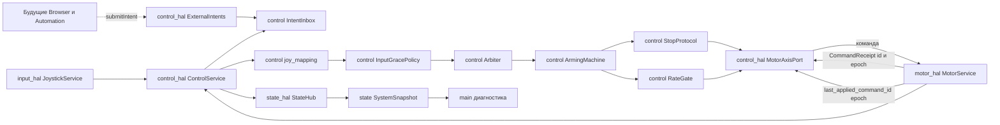
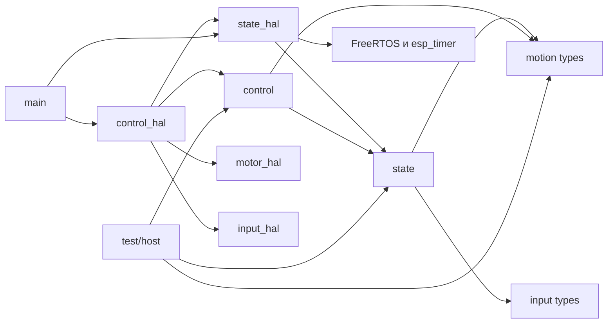
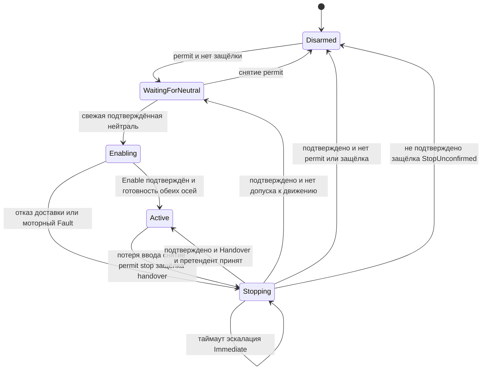

# 0005 — Базовый слой состояния и управление двумя моторами от джойстика

- Статус: **реализация выполнена — редакция 10** (план утверждён в редакции 9,
  код и host-тесты готовы; `idf.py build` и стенд не выполнялись). Карты ревью —
  приложения А–З, фактический журнал — раздел 19
- Дата: 2026-11-15
- Анализируемый коммит: `7f710f9c338e36e8b1a695aedda854de3a8f7652`
  (`refs/heads/main`)
- Стек: **ESP-IDF 6.1.0** + CMake, C++17, FreeRTOS
- Целевой чип: `esp32` (ESP32-WROOM-32)
- Железо: джойстик KY-023 / HW-504 (VRx 34, VRy 35, SW 32); 28BYJ-48 +
  ULN2003, полушаг
- Предыдущий этап: [`0004-wifi-access-point.md`](0004-wifi-access-point.md)
- Пины: [`docs/hardware/pinmap.md`](../hardware/pinmap.md) — не меняются

---

## 1. Цель и границы

### 1.1 Цель этапа

1. Связать джойстик с движением двух осей: X → азимут, Y → высота по
   умолчанию, знак — направление, модуль — скорость, обе оси одновременно.
2. Ввести базовый слой наблюдаемого состояния.
3. Ввести слой намерений и арбитража с контрактом расширения под Browser и
   Automation.
4. Оставить единственную рабочую точку отправки команд в `MotorService` и
   единственного исполнителя моторных операций — управляющую задачу.
5. Сделать безопасный останов обязательным протоколом с доказуемым
   подтверждением обработки конкретной команды.
6. Зафиксировать границу будущего слоя «полушаги → углы».

### 1.2 Обязательный MVP

| № | Что входит |
|---|---|
| 1 | `state` — типы снимков, общий словарь фаз/защёлок/источников, правила свежести |
| 2 | `state_hal::StateHub` — единственный владелец копии снимка |
| 3 | `control` — преобразователь, арбитраж, автомат фаз и защёлок, протокол останова, гейт уставок, grace-политика |
| 4 | `control_hal::ControlService` — задача, каналы входных намерений, единственный путь команд в `MotorService` |
| 5 | Джойстик как действующий источник; Browser и Automation — только интерфейс и тестовые намерения |
| 6 | Протокол останова на идентификаторах команд, назначаемых нижним слоем |
| 7 | Host-тесты чистой логики с подставным временем и fake-портом моторов |
| 8 | **Изменения `motion` и `motor_hal`**: `id` команды, эпоха, `CommandReceipt`, канал emergency-id с забором в начале обработки (11.4) |
| 9 | Асинхронный протокол восстановления после защёлки, исполняемый управляющей задачей (12.4) |
| 10 | Явная передача владения после self-test, независимость WiFi от движения |

### 1.3 Отложенное расширение

- HTTP-сервер, веб-интерфейс, протокол связи, источник Browser;
- автоматика, наведение, ведение объекта;
- слой «полушаги → углы» (только контракт, раздел 13);
- lease уставки либо супервизор (11.7);
- владение отдельно каждой осью (8.4);
- калибровки, сохранение состояния в NVS;
- концевики, энкодеры, закрытый контур, `homed`;
- назначение `DoubleClick` чему-либо, кроме WiFi.

### 1.4 Ограничения этапа

- Пины не меняются; `board`, `input`, `input_hal`, `wifi`, `wifi_hal` — без
  правок.
- В `motion` допускается только объём 11.4: поле `id` в `AxisCommand`, поля
  ack в `AxisStatus`, `Params::command_epoch`, метод `takeEmergencyId()` в
  `CommandSource`, их использование в `AxisExecutor`. Планировщик шагов,
  GPTimer, `ULN2003`, задачи осей не переписываются.
- В `motor_hal` допускается только объём 11.4: назначение идентификаторов,
  эпоха, `CommandReceipt`, атомарный слот emergency-id.
- Нет записи в NVS/flash во время движения.
- Управление не переносится в callback кнопки или в задачу опроса ADC.
- `DoubleClick` остаётся переключением WiFi.

---

## 2. Факты текущего кода

Номера строк — по коммиту `7f710f9c338e36e8b1a695aedda854de3a8f7652`.

| № | Факт | Где | Следствие |
|---|---|---|---|
| 1 | `setTargetRate` возвращает результат `post` | `components/motor_hal/src/motor_service.cpp:99-103` | `true` = «положено в очередь» |
| 2 | `post` берёт `api_mutex_` с `portMAX_DELAY`, `xQueueSend(..., 0)` | `axis_motor.cpp:188-201` | Верхней границы ожидания нет |
| 3 | Очередь 8 команд, бюджет 8 за пробуждение | `components/motor_hal/Kconfig.projbuild` | В FIFO могут быть ранее принятые команды |
| 4 | Команды применяются асинхронно при следующем пробуждении | `axis_motor.cpp:290-321` | Снимок до отправки не доказывает обработку |
| 5 | Идентификатора команды нет | `components/motion/include/motion/axis_command.hpp:29-45` | Подтверждение нечем доказать |
| 6 | `apply()` вызывают и self-test, и управление | `main/main.cpp:263-325` | Количества не имеют общего начала |
| 7 | `StopImmediate` очищает очередь (`source_.clear()`) | `axis_executor.cpp:80-89` | Часть отправленных команд не дойдёт до `apply()` |
| 8 | Уведомление задачи не несёт полезной нагрузки | `axis_motor.cpp:203-215` | Идентификатор emergency нужен отдельным каналом |
| 9 | Биты уведомления объединяются (`eSetBits`) | `axis_motor.cpp:143-147`, `281` | Несколько emergency до пробуждения неразличимы по битам |
| 10 | `AxisMotor::stop()` ставит `EmergencyStop | TaskExit` и ждёт `exit_sem_` | `axis_motor.cpp:129-166` | Служебный путь подтверждается завершением задачи |
| 11 | `CommandSource` объявляет `take`/`empty`/`clear` | `components/motion/include/motion/executor_io.hpp`, `axis_motor.hpp:63-68` | Канал emergency-id добавляется в этот интерфейс |
| 12 | `AxisExecutor::publish()` заполняет `status_.energized` | `axis_executor.cpp:403-407` | Поля исполнителя — существующий приём |
| 13 | `AxisPlanner::configure` сбрасывает `status_` | `axis_planner.cpp:32-60` | Поля исполнителя обнуляются при новом запуске |
| 14 | `SetTargetRate` клампится к `±max_rate`, отклоняется при `!enabled_`/Fault, идемпотентен | `axis_planner.cpp:98-120` | Предел должен совпадать с конфигурацией |
| 15 | Изменение уставки инкрементит `intent_rev_`, шаг отменяется | `axis_planner.cpp:115-118`, `axis_executor.cpp:147-153` | Уставка разрушает расписание |
| 16 | `Enable` при Fault отклоняется, повторный — no-op | `axis_planner.cpp:75-88` | Готовность — по свежему опросу |
| 17 | `ResetFault` уводит в `Disabled`, `enabled_ = false` | `axis_planner.cpp:495-508` | После сброса нужен `Enable` |
| 18 | `Immediate` снимает `position_trusted` | `axis_planner.cpp:472-474` | Не обычный останов |
| 19 | `AxisStatus` без timestamps, `homed` всегда `false` | `axis_planner.hpp:33-47` | Времени измерения нет |
| 20 | `last_valid_us` — время последнего валидного отсчёта; при `Ignore` `output_valid=false` | `joystick_service.cpp:259-286` | Единственное честное время измерения |
| 21 | `read_fault` — подтверждённая серия ошибок | `joystick_service.hpp:27-39` | Разная реакция на ошибку и fault |
| 22 | Нейтраль с гистерезисом `0.12/0.10`, `magnitude = min(1, |v|)` | `joystick_processor.cpp:232-245` | `magnitude` — не длина вектора |
| 23 | `main`: WiFi → `MotorService::start` → self-test → `JoystickService::start` | `main/main.cpp:329-381` | Порядок запуска задан |
| 24 | Умолчания оси: `start 100`, `max 800`, `accel/decel 800`, `interval 600 мкс` | `axis_config.hpp:28-42` | Числа для модели голодания |
| 25 | Watchdog проверяется внутри задачи оси | `axis_executor.cpp:67-74` | Не защищает от отсутствия команд |

### 2.1 Что из этого следует

1. Подтверждение возможно только по идентификатору конкретной команды, и
   идентификатор должен быть уникален на всё время жизни эпохи.
2. Уведомление не несёт данных и схлопывается: идентификатор emergency
   передаётся отдельным атомарным слотом, а забирать его нужно **до**
   выполнения останова, иначе подтверждается запрос, для которого FIFO уже
   была очищена ранее.
3. Поля ack принадлежат исполнителю, хотя лежат в структуре планировщика.
4. Моторные операции должны иметь одного исполнителя: второй отправитель
   ломает подтверждение по равенству тикету.

---

## 3. Принятые решения

1. **Четыре компонента, две пары «чистая логика / HAL»**: `state` +
   `state_hal`, `control` + `control_hal`.
2. Источники состояний владеют своими состояниями; хаб публикует копии;
   `control` выбирает владельца; `control_hal` — единственная точка команд.
3. **Хаб — зеркало, не источник истины.**
4. **Общий словарь в `state`**; `control` подключает через `using`.
5. **Фаза, защёлка и `permit` — независимые понятия**; «Fault» — защёлка.
6. **Останов — обязательный протокол** в любом состоянии, включая защёлку.
7. **Идентификатор назначает нижний слой, владеющий эпохой**: `post` и
   `emergencyStop`. Публичный `post` **всегда** назначает новый ненулевой id
   и игнорирует входное значение поля; входной `id` не является способом
   попросить HAL пропустить назначение. Тип — `std::uint64_t`, монотонный на
   всё время жизни объекта, без сброса при перезапуске верхнего слоя.
   `CommandReceipt.accepted` — единый признак приёма к исполнению для
   FIFO-команд и для `Immediate`; `notified` учитывается отдельно.
8. **Ack публикуется только после** отмены плана, очистки FIFO и снятия фаз.
9. **Исполнитель забирает emergency-id в начале обработки** атомарным
   `exchange(0)`. Подтверждается только забранный id. Запрос, пришедший
   после забора, обрабатывается отдельно и даёт ack только после собственной
   очистки FIFO. Emergency-бит при пустом слоте не очищает FIFO повторно,
   кроме служебного shutdown-пути с `TaskExit`.
10. **Занятый emergency-слот не замещается.** Новый запрос публикуется только
    через `compare_exchange` из нуля; при занятом слоте возвращается
    `accepted = false`, существующий запрос не меняется. После забора
    исполнителем слот свободен, и следующий запрос принимается, даже пока
    предыдущий физически обрабатывается.
11. **Единственный исполнитель моторных операций — управляющая задача.**
    `acknowledgeFault()` — асинхронный запрос с `request_id`, ограниченным
    ожиданием и отменой по таймауту (12.4); протокол выполняет та же задача,
    что и уставки. Таймаут сохраняет защёлку, поздний результат её не снимает.
12. **Эпоха меняется только при запуске `AxisMotor`**; перезапуск мотора —
    только при остановленной службе управления (I7).
13. **Владение парой осей целиком**; приоритет `stop > Joystick > Browser >
    Automation`.
14. **Вытеснение — протокол**: останов, подтверждение, перепроверка
    претендента, затем поколение + 1; исходы разделены (9.5).
15. **Готовность источника — на уровне источника и его сессии** (8.5).
16. **Намерение принимается атомарно**: одна проверка `session`/`sequence`,
    проверка размещения обязательных событий, приём целиком или отказ без
    частичных изменений (8.2).
17. **Транспорт не теряет сообщения**: при отказе атомарного приёма из-за
    занятости сообщение остаётся в очереди (8.3).
18. **Grace — только для кратковременной ошибки ADC** (11.2).
19. **Уставка — чистая функция**; компонентный гейт назван явно (7.3).
20. **Свежесть — от времени измерения**; три времени раздельны.
21. **Наблюдаемое состояние — POD-копии под одним мьютексом.**
22. **`min_run_rate` — компромисс**, проверяемый моделью (14.3).
23. **Защёлка переживает `start()`/`stop()`** и снимается только протоколом
    восстановления (12.4–12.5).
24. **`stop()` различает три терминальных исхода** (12.3).
25. **Предел гарантии назван явно**; независимый наблюдатель — отдельный этап.
26. **Все числа — в Kconfig**; невалидная конфигурация — ошибка запуска.
27. **Никаких записей в NVS**; ограничений хода не вводится.
28. **`main` только связывает и логирует.**

---

## 4. Рассмотренные варианты

### 4.1 Где назначать идентификатор

| Вариант | Оценка |
|---|---|
| В `control_hal` со сбросом при `start()` | Отвергнут: перезапуск службы даёт коллизию с прошлым ack при прежней эпохе |
| В `control_hal` без сброса, статический счётчик | Отвергнут: не связан с эпохой, правила владения размыты |
| **В `AxisMotor`, под `api_mutex_`, вместе с эпохой** | Принят: единственная точка отправки, генератор и эпоха в одном объекте |
| Пропуск назначения по входному `id == 0` | Отвергнут: фабрики команд создают `id == 0`, обычные команды остались бы без тикета |
| Отдельный ack-канал только для останова | Отвергнут: два механизма вместо одного |

### 4.2 Кто исполняет снятие защёлки

| Вариант | Оценка |
|---|---|
| Вызывающая задача напрямую через адаптер | Отвергнут: второй отправитель команд ломает подтверждение по равенству тикету и конкурирует с `stop()`/`requestSafetyStop()` |
| Явный эксклюзивный recovery-режим у вызывающей задачи | Отвергнут: `permit = false` недостаточно, требуется передача владения адаптером и правила конкуренции с shutdown |
| **Асинхронный запрос к управляющей задаче с ограниченным ожиданием** | Принят: единственный исполнитель, синхронность API сохраняется |

### 4.3 Подтверждение останова

| Вариант | Оценка |
|---|---|
| Один снимок `rate == 0` и не в движении | Отвергнут: снимок может быть до применения команд |
| Сравнение количеств `apply()` и отправок | Отвергнут: нет общего начала, self-test, `Enable`, очистка FIFO |
| «Добавить offset» | Отвергнут: правила учёта не определены |
| **Идентификатор команды + эпоха + забор id в начале обработки** | Принят |

### 4.4 Общая архитектура

Вариант A (прямое связывание в `main`) отвергнут: цикл 5 с, нет арбитража,
будущий HTTP получит доступ к `MotorService`. Вариант B (event bus с
реестром) отвергнут: запрещено постановкой, недетерминизм. Принят вариант C.

Внутри C отвергнуты: владение по осям, хаб как истина, набор `atomic` вместо
копии, seqlock, публикация шага в хаб, вторая EMA, `Immediate` как обычный
останов, `latest-value` для событий владения и останова.

---

## 5. Структура компонентов и зависимости

```text
components/
├── state/                                   чистый C++17
│   ├── include/state/channels.hpp            SourceId, ControlPhase, LatchCode, DenyReason
│   ├── include/state/observation.hpp         ObservationMeta, AxisObservation,
│   │                                         JoystickObservation, ControlObservation,
│   │                                         SensorObservation<T>, SystemSnapshot
│   └── include/state/health.hpp              ageUs, freshness, axisHealth, joyHealth
├── state_hal/                               ESP-IDF: мьютекс, esp_timer
│   ├── include/state_hal/state_hub.hpp
│   └── src/state_hub.cpp
├── control/                                 чистый C++17
│   ├── include/control/intent.hpp            AxisRate, Intent, ArbitratedSetpoint
│   ├── include/control/command_ticket.hpp    CommandTicket, Delivery, правила ack
│   ├── include/control/joy_mapping.hpp       JoyMappingConfig, convert
│   ├── include/control/arbiter.hpp           Arbiter, сессии, претензии
│   ├── include/control/intent_inbox.hpp      атомарный приём и раздельные каналы
│   ├── include/control/arming.hpp            ArmingMachine, инварианты
│   ├── include/control/stop_protocol.hpp     StopProtocol, StopReason, StopOutcome
│   ├── include/control/rate_gate.hpp         гейт уставок
│   ├── include/control/input_grace.hpp       классифицированный grace
│   ├── include/control/actuator.hpp          AxisActuator
│   └── src/{joy_mapping,arbiter,intent_inbox,arming,stop_protocol,
│            rate_gate,input_grace}.cpp
├── control_hal/                             ESP-IDF: задача, адаптер, входные каналы
│   ├── Kconfig.projbuild
│   ├── include/control_hal/motor_axis_port.hpp
│   ├── include/control_hal/control_service.hpp
│   ├── include/control_hal/external_intents.hpp
│   └── src/{motor_axis_port,control_service,external_intents}.cpp
├── motion/                                  изменяется только по 11.4
│   ├── include/motion/axis_command.hpp      + id
│   ├── include/motion/axis_planner.hpp      + 2 поля в AxisStatus
│   ├── include/motion/executor_io.hpp       + takeEmergencyId()
│   ├── include/motion/axis_executor.hpp     + Params::command_epoch, поля ack
│   └── src/axis_executor.cpp                + забор id, ack, публикация
├── motor_hal/                               изменяется только по 11.4
│   ├── include/motor_hal/axis_motor.hpp     + CommandReceipt, эпоха, слот emergency-id
│   ├── src/axis_motor.cpp
│   ├── include/motor_hal/motor_service.hpp  + CommandReceipt
│   └── src/motor_service.cpp

main/        main.cpp, CMakeLists.txt, Kconfig.projbuild
test/host/   CMakeLists.txt, control_fakes.hpp, тесты раздела 14
```

### 5.1 Компоненты и потоки



### 5.2 Допустимые зависимости



- `state` — чистый C++17, зависит от типов `motion` и `input`;
- `state_hal` — обязан использовать FreeRTOS/`esp_timer`;
- `control` — чистый C++17;
- `control_hal` — ESP-IDF, владеет `MotorAxisPort`.

Запрещено: `state` → `control`, `*_hal`, `wifi*`; `control` → `motor_hal`,
`input_hal`, `wifi*`, ESP-IDF; `control_hal` → `wifi*`, `board`;
`motion`/`motor_hal`/`input`/`input_hal`/`wifi*` → `state*`, `control*`.

---

## 6. Контракт слоя состояния

### 6.1 Общий словарь (`state/channels.hpp`)

```cpp
namespace state {

enum class SourceId : std::uint8_t { None = 0, Joystick, Browser, Automation, Count };
constexpr std::size_t kSourceCount = static_cast<std::size_t>(SourceId::Count);

enum class ControlPhase : std::uint8_t {
    Disarmed, WaitingForNeutral, Enabling, Active, Stopping
};

enum class LatchCode : std::uint8_t {
    None, MotorFault, DeliveryFailed, StopUnconfirmed, ConfigInvalid
};

enum class DenyReason : std::uint8_t {
    None, NotCalibrated, NoSample, InvalidSample, ReadFault, StaleInput,
    InvalidConfig, NotOwner, OldSession, RepeatedSequence, MotorFault,
    DeliveryFailed, StopInProgress, NotReady, Busy
};

}  // namespace state
```

### 6.2 Типы снимков

```cpp
namespace state {

using Micros = std::uint64_t;
constexpr Micros kNever = 0;

struct ObservationMeta {
    Micros measured_us = kNever;
    Micros polled_us = kNever;
    Micros published_us = kNever;
    std::uint32_t sequence = 0;
    bool valid = false;
};

struct AxisObservation {
    ObservationMeta meta{};
    motion::AxisStatus status{};
    std::uint32_t read_failures = 0;
};

struct JoystickObservation {
    ObservationMeta meta{};
    bool calibrated = false;
    bool sample_valid = false;
    bool output_valid = false;
    bool read_fault = false;
    bool neutral = true;
    input::StickState stick{};
    input::RawSample raw{};
    std::uint32_t read_errors = 0;
};

struct ControlObservation {
    ObservationMeta meta{};        ///< measured_us = kNever
    ControlPhase phase = ControlPhase::Disarmed;
    LatchCode latch = LatchCode::None;
    SourceId owner = SourceId::None;
    std::uint32_t owner_generation = 0;
    bool permit = false;
    bool recovery_active = false;
    DenyReason deny = DenyReason::None;

    float desired_rate[2] = {0.0F, 0.0F};
    float enqueued_rate[2] = {0.0F, 0.0F};
    bool enqueued_known[2] = {false, false};
    float confirmed_rate[2] = {0.0F, 0.0F};
    std::uint64_t last_ticket_id[2] = {0, 0};
    std::uint64_t last_applied_id[2] = {0, 0};
    std::uint32_t command_epoch[2] = {0, 0};

    Micros stop_requested_us = kNever;
    bool stop_confirmed = false;
    std::uint8_t stop_reason = 0;
    std::uint32_t delivery_failures[2] = {0, 0};
    std::uint32_t stop_timeouts = 0;
    std::uint32_t escalations = 0;
    std::uint32_t ack_mismatches = 0;
    std::uint32_t emergency_slot_busy = 0;
    std::uint32_t unmatched_emergency_notifications = 0;
    std::uint32_t notify_failures = 0;
    std::uint32_t rejected_intents = 0;
    std::uint64_t cycle = 0;
};

template <typename T>
struct SensorObservation { ObservationMeta meta{}; T value{}; };

struct SystemSnapshot {
    Micros generated_us = kNever;
    AxisObservation axis[2]{};
    JoystickObservation joystick{};
    ControlObservation control{};
};

}  // namespace state
```

### 6.3 Хаб

```cpp
namespace state_hal {

class StateHub {
public:
    StateHub();
    StateHub(const StateHub &) = delete;
    StateHub &operator=(const StateHub &) = delete;

    void publishAxis(motion::AxisId id, const motion::AxisStatus &status,
                     state::Micros polled_us, std::uint32_t read_failures) noexcept;
    void publishJoystick(const state::JoystickObservation &obs) noexcept;
    void publishControl(const state::ControlObservation &obs) noexcept;
    void invalidateAxis(motion::AxisId id) noexcept;
    void invalidateJoystick() noexcept;
    state::SystemSnapshot snapshot() const noexcept;

private:
    mutable StaticSemaphore_t mutex_storage_{};
    SemaphoreHandle_t mutex_ = nullptr;
    state::SystemSnapshot published_{};
};

}  // namespace state_hal
```

Под мьютексом только копирование POD: без HAL, логов, ожиданий, callback.

### 6.4 Владельцы, защиты, времена

| Блок | Писатель | Защита | Время измерения | Время опроса | Публикация | До первой публикации | После остановки |
|---|---|---|---|---|---|---|---|
| `axis[i]` | управляющая задача → хаб | мьютекс хаба | нет → `kNever` | `polled_us` перед `status()` | назначает хаб | `valid=false` | `invalidateAxis` |
| `joystick` | управляющая задача → хаб | мьютекс хаба | `last_valid_us` | при чтении снимка | назначает хаб | `valid=false` | `invalidateJoystick` |
| `control` | управляющая задача | мьютекс хаба | `kNever` | начало цикла | назначает хаб | `Disarmed` | `Disarmed` |
| намерения | каждый источник — свой канал | мьютекс `ExternalIntents` | `created_us` | — | — | канал пуст | каналы очищаются |
| тикеты, `last_enqueued` | управляющая задача | без мьютекса | — | — | — | «не отправлялось» | сброс |
| `last_applied_command_id`, `command_epoch` | **исполнитель оси** | внутри задачи оси | — | — | в `AxisStatus` | `0` / эпоха запуска | до перезапуска |
| `position_step` | планировщик оси | `api_mutex_` + `mutex_` | программная | — | — | `0` | сохраняется |

### 6.5 Согласованность снимка

- Атомарно вместе читаются блок одной оси, блок джойстика, блок управления.
- Две оси могут относиться к разным моментам опроса.
- Возраст блока считается по его полю, а не по публикации.
- `sequence` — признак новой публикации, не свежести.
- Отдельные `atomic`-поля транзакционным снимком не являются.

---

## 7. Преобразователь джойстика

### 7.1 Типы

```cpp
namespace control {

using state::Micros;
using state::DenyReason;

struct JoyMappingConfig {
    motion::AxisId x_axis = motion::AxisId::Azimuth;
    motion::AxisId y_axis = motion::AxisId::Altitude;
    bool invert_x = false;
    bool invert_y = false;
    float max_rate[2] = {800.0F, 800.0F};
    float min_run_rate[2] = {40.0F, 40.0F};
    float dead_zone = 0.12F;              ///< = CONFIG_JOY_DEAD_ZONE_PERMILLE
    Micros stale_after_us = 200'000;
};

bool isValid(const JoyMappingConfig &config) noexcept;

struct JoyConversion {
    bool ok = false;
    DenyReason deny = DenyReason::None;
    float rate[2] = {0.0F, 0.0F};
    bool neutral = false;
};

JoyConversion convert(const state::JoystickObservation &snapshot,
                      const JoyMappingConfig &config, Micros now_us) noexcept;

}  // namespace control
```

`isValid`: `x_axis`/`y_axis` ∈ `{Azimuth, Altitude}` и не равны; все числа
конечны; `0 <= min_run_rate[i] < max_rate[i]`; `dead_zone` в `(0,1)`;
`stale_after_us != 0`.

### 7.2 Порядок проверок `convert()`

| Шаг | Условие | Результат |
|---|---|---|
| 1 | `!isValid(config)` | `InvalidConfig` |
| 2 | `!meta.valid` | `NoSample` |
| 3 | `read_fault` | `ReadFault` |
| 4 | `!output_valid` | `InvalidSample` |
| 5 | `!calibrated` | `NotCalibrated` |
| 6 | `freshness(now, measured_us, stale_after_us) != Fresh` | `StaleInput` |
| 7 | `normalized` не конечно | `InvalidSample` |
| 8 | `neutral` | `ok`, обе уставки 0 |
| 9 | иначе | расчёт по 7.3 |

Оркестратор дополнительно проверяет свежесть до `convert()` (11.2).

### 7.3 Формула и граница

```text
a       = min(|n|, 1)
scaled  = clamp((a - dz) / (1 - dz), 0, 1)
rate    = 0                                            при a <= dz
rate    = sign(n) * (r_min + (r_max - r_min) * scaled)  при a > dz
```

- при `a == dz` уставка равна нулю, при `a > dz` скачком достигает `r_min`;
- `dz` — компонентный гейт поверх радиальной мёртвой зоны `input`;
- `dz` — из `CONFIG_JOY_DEAD_ZONE_PERMILLE`, того же символа, что у
  `input_hal`;
- `min_run_rate` — компромисс, проверяемый моделью (14.3) и стендом (15.11).

### 7.4 Крайние случаи

| Вопрос | Решение |
|---|---|
| `normalized` напрямую | да; `magnitude` коэффициентом не служит |
| Диагональ | компоненты независимы |
| Насыщение ADC | `input` клампит в `±1` |
| Пределы | `max_rate[i]` ≤ `AxisConfig::max_rate_steps_s`; расхождение логируется |
| Инверсия | физическая — `CONFIG_JOY_INVERT_X/Y`; `invert_*` — резерв |
| NaN/Inf | `InvalidConfig` / `InvalidSample` |
| Малая ненулевая скорость | не создаётся: либо 0, либо ≥ `r_min` |

---

## 8. Намерения, арбитраж и потокобезопасность

### 8.1 Типы

```cpp
namespace control {

using state::SourceId;
using state::DenyReason;

struct AxisRate { bool valid = false; float half_steps_per_s = 0.0F; };

struct Intent {
    SourceId source = SourceId::None;
    std::uint32_t session = 0;
    std::uint32_t sequence = 0;
    state::Micros created_us = 0;
    state::Micros valid_until_us = 0;
    bool claim = false;
    bool release = false;
    bool stop = false;
    AxisRate axis[2]{};
};

struct ArbitratedSetpoint {
    bool have_command = false;
    SourceId owner = SourceId::None;
    std::uint32_t owner_generation = 0;
    std::uint32_t session = 0;
    float rate[2] = {0.0F, 0.0F};
    bool stop = false;
    bool handover_pending = false;
    DenyReason deny = DenyReason::None;
};

}  // namespace control
```

### 8.2 Атомарный приём намерения

```cpp
class IntentInbox {
public:
    enum class EventKind : std::uint8_t { Claim, Release };
    struct Event {
        SourceId source = SourceId::None;
        EventKind kind = EventKind::Claim;
        std::uint32_t session = 0;
        std::uint32_t sequence = 0;
        state::Micros created_us = 0;
    };
    struct StopRequest {
        SourceId source = SourceId::None;
        std::uint32_t session = 0;
        std::uint32_t sequence = 0;
        state::Micros created_us = 0;
    };

    bool submit(const Intent &intent, state::Micros now_us,
                DenyReason &out_deny) noexcept;

    std::size_t drainRates(Intent *out, std::size_t max_count) noexcept;
    std::size_t drainEvents(Event *out, std::size_t max_count) noexcept;
    bool takeStop(StopRequest &out) noexcept;
    bool stopLatched() const noexcept;
    void clear() noexcept;
};
```

Порядок `submit`:

```text
1. Отклонить, если session/sequence не новее принятого (OldSession /
   RepeatedSequence) — реестр НЕ меняется.
2. Определить обязательные части: claim/release, stop, скорости.
3. Проверить размещение: для claim/release нужно место в кольце;
   иначе отказ Busy целиком, без частичных изменений.
4. Обновить реестр session/sequence РОВНО ОДИН раз.
5. Разложить: скорости → слот источника, событие → кольцо,
   stop → защёлка с полными сведениями.
```

Порядок применения в цикле: `takeStop` → `drainEvents` → `drainRates`.

### 8.3 `ExternalIntents` (HAL)

```cpp
namespace control_hal {

class ExternalIntents {
public:
    ExternalIntents();
    ~ExternalIntents();
    ExternalIntents(const ExternalIntents &) = delete;

    /// Неблокирующая: try-lock и нулевой таймаут очереди.
    esp_err_t submit(const control::Intent &intent);
    std::size_t drainInto(control::IntentInbox &inbox, state::Micros now_us);
    void reset();
    struct Stats {
        std::uint32_t busy = 0;            ///< очередь транспорта занята
        std::uint32_t full = 0;            ///< очередь транспорта полна
        std::uint32_t rejected_old = 0;    ///< старое сообщение снято окончательно
        std::uint32_t deferred_atomic = 0; ///< отложено до следующего цикла
    };
    Stats stats() const;
private:
    StaticSemaphore_t mutex_storage_{};
    SemaphoreHandle_t mutex_ = nullptr;
    QueueHandle_t queue_ = nullptr;   ///< целые Intent
};
```

`drainInto` работает по принципу «посмотреть и зафиксировать»:

| Результат `IntentInbox::submit` | Что делает транспорт | Счётчик |
|---|---|---|
| принято | сообщение извлекается из очереди | — |
| `OldSession` / `RepeatedSequence` | извлекается и отбрасывается окончательно | `rejected_old` |
| `Busy` (нет места под событие) | сообщение **остаётся** в очереди, обход прекращается | `deferred_atomic` |
| `InvalidConfig` и подобные неустранимые | извлекается, сообщение отвергнуто | `rejected_old` |

Так обещание «нет молчаливой потери события владения или останова»
выполняется: при занятости сообщение дожидается следующего цикла, а отказ
наблюдаем в счётчиках.

### 8.4 Арбитраж

```cpp
class Arbiter {
public:
    struct Config {
        SourceId priority[state::kSourceCount]{};
        state::Micros default_lease_us = 200'000;
        state::Micros joystick_idle_release_us = 3'000'000;
    };

    explicit Arbiter(const Config &config) noexcept;

    bool submit(const Intent &intent, state::Micros now_us,
                DenyReason &out_deny) noexcept;
    void expire(state::Micros now_us) noexcept;
    ArbitratedSetpoint arbitrate(state::Micros now_us) noexcept;

    bool revalidateClaim(state::Micros now_us, DenyReason &out_deny) const noexcept;
    void completeHandover(state::Micros now_us) noexcept;
    void cancelHandover() noexcept;
    void release(SourceId source, state::Micros now_us) noexcept;

    SourceId owner() const noexcept;
    std::uint32_t generation() const noexcept;
    bool handoverPending() const noexcept;
    void reset(state::Micros now_us) noexcept;
};
```

| Правило | Формулировка |
|---|---|
| Владельцев | не более одного; единица владения — пара осей |
| Приоритет | `Joystick` > `Browser` > `Automation`; `stop` сильнее скорости |
| Получение | `claim` при свободном владении — немедленно, `generation + 1` |
| Вытеснение | `claim` более приоритетного → `handover_pending` → `StopReason::Handover` |
| Передача | только при подтверждённом останове и успешной `revalidateClaim` |
| Провал перепроверки | владение не передаётся, исход по 9.5 |
| Удержание | пригодный lease; нейтральный джойстик уставку 0 |
| Освобождение по нейтрали | после `joystick_idle_release_us`; джойстик пассивен |
| Повторная претензия | только новым отклонением с `claim` и большим `sequence` |
| Сбой неактивного источника | влияет только на его слот |

### 8.5 Готовность источника

| Источник | Условие готовности | Сброс |
|---|---|---|
| `Joystick` | в текущей сессии наблюдалась свежая нейтраль, затем отклонение с `claim` | потеря валидности, новый `session` |
| `Browser` | первое намерение сессии с `claim` и нулевыми уставками | разрыв сессии, истечение lease |
| `Automation` | то же | то же |

### 8.6 Публичный API управления

```cpp
namespace control_hal {

class ControlService {
public:
    ControlService(motor_hal::MotorService &motors,
                   input_hal::JoystickService &joystick,
                   state_hal::StateHub &hub);
    ~ControlService();
    ControlService(const ControlService &) = delete;
    ControlService &operator=(const ControlService &) = delete;

    /// Разрешён и при сохранённой защёлке: служба поднимается в Disarmed
    /// и публикует защёлку.
    esp_err_t start(const control::JoyMappingConfig &mapping);
    esp_err_t stop();

    /// ESP_ERR_INVALID_STATE при latch != None.
    esp_err_t arm();
    esp_err_t disarm();
    esp_err_t requestSafetyStop();

    esp_err_t submitIntent(const control::Intent &intent);

    /// Асинхронный запрос: ставит задачу восстановления и ждёт результат
    /// с ограничением. Протокол исполняет управляющая задача (12.4).
    esp_err_t acknowledgeFault(state::Micros timeout_us = 0);

    ControlStatus status() const;
};

}  // namespace control_hal
```

### 8.7 Единственный исполнитель моторных операций

- Все вызовы `MotorAxisPort` (уставки, `Enable`, `Stop`, `ResetFault`)
  делает **только управляющая задача**.
- `ControlService::start/stop/arm/disarm/requestSafetyStop/acknowledgeFault`
  не вызывают порт; они ставят запросы и, где нужно, ждут результата.
- Следствие: `last_applied_command_id` не может быть перезаписан чужим
  отправителем, поэтому подтверждение по равенству тикету корректно.

| Держится | Можно взять | Нельзя |
|---|---|---|
| `api_mutex_` внутри `AxisMotor` | внутренний `mutex_` исполнителя | мьютексы `control*`, хаба, логи |
| `api_mutex_` в `ControlService` (только внешние API) | `recovery_mutex_` (кратко) | удерживать при ожидании `recovery_done_`/`exit_sem_`, при вызове порта, при обращении к хабу |
| `recovery_mutex_` в `ControlService` | ничего | удерживать при вызове порта, ожидании семафора, завершении задачи |
| мьютекс хаба / `ExternalIntents` | ничего | HAL, логи, ожидания, callback |
| управляющая задача | `recovery_mutex_` (кратко), арбитр, автомат, протокол, гейт, порт | `api_mutex_` службы — **никогда** |
| порядок захвата | `api_mutex_` → `recovery_mutex_` → листовые мьютексы | обратный порядок |

---

## 9. Автоматы

### 9.1 Понятия и инварианты

| Понятие | Значения |
|---|---|
| `ControlPhase` | `Disarmed`, `WaitingForNeutral`, `Enabling`, `Active`, `Stopping` |
| `LatchCode` | `None`, `MotorFault`, `DeliveryFailed`, `StopUnconfirmed`, `ConfigInvalid` |
| `permit` | `true`/`false` |

- **I1.** В `Stopping` доставка останова, эскалация и наблюдение разрешены
  при любой защёлке и любом `permit`.
- **I2.** Ненулевая уставка — только при `permit && latch == None &&
  phase == Active`.
- **I3.** Вход в `Active` — только через `Enabling` с подтверждённой
  готовностью обеих осей.
- **I4.** Защёлка снимается только протоколом восстановления, не автоматом и
  не повторным `start()`.
- **I5.** Ни один переход не отменяет активный протокол останова.
- **I6.** `disarm()` и `stop()` не означают «ничего не отправляем».
- **I7.** `MotorService::start()` — только при остановленной
  `ControlService`; после перезапуска служба фиксирует новые эпохи.
- **I8.** Запрет новых команд после останова с тикетом `T` относится к каждой
  оси, получившей останов; он не запрещает доставку останова второй оси,
  повтор недоставленного запроса тем же тикетом и эскалацию новым тикетом.
- **I9.** Подтверждение невозможно при `ticket.id == 0`, при
  `accepted == false`, при неизвестной или несовпавшей эпохе.
- **I10.** Все моторные операции исполняет только управляющая задача; второй
  отправитель запрещён (8.7). Задача **никогда** не берёт `api_mutex_`.
- **I11.** У запроса восстановления есть терминальное состояние; переход в
  него, решение о снятии защёлки и публикация результата выполняются одной
  операцией под `recovery_mutex_`. Побеждает ровно один исход.

### 9.2 Фазы



### 9.3 Последовательность `Enable`

```text
permit + свежая подтверждённая нейтраль
  → Enabling
  → Enable обеим осям (тикет на каждую ось)
  → проверка доставки
  → свежий опрос: !has_fault && state != Disabled
  → Active
```

Повтор `Enable` — только при недоставке. Отказ сверх предела →
`DeliveryFailed`; моторный `Fault` → `MotorFault`; оба ведут в `Stopping`.

### 9.4 Тикеты и протокол останова

```cpp
namespace control {

struct CommandTicket {
    std::uint64_t id = 0;     ///< назначает AxisMotor; 0 = не подтверждается
    std::uint32_t epoch = 0;
};

struct Delivery {
    /// Принято к исполнению: для FIFO-команды — фактическое присутствие
    /// в очереди; для Immediate — ненулевой id опубликован в emergency-слот.
    bool accepted = false;
    bool notified = false;    ///< удалось разбудить задачу оси (FIFO-путь)
    CommandTicket ticket{};
};

enum class StopReason : std::uint8_t {
    InputLoss, Disarm, SafetyStop, Handover, MotorFault, DeliveryLimit,
    Shutdown, Acknowledge
};

enum class StopMode : std::uint8_t { Smooth, Immediate };

class StopProtocol {
public:
    struct Start {
        StopReason reason = StopReason::InputLoss;
        StopMode mode = StopMode::Smooth;
        state::Micros now_us = 0;
        std::uint32_t baseline_epoch[2] = {0, 0};
    };
    struct Action {
        bool send[2] = {false, false};
        StopMode mode = StopMode::Smooth;
    };

    void begin(const Start &start) noexcept;
    Action next(state::Micros now_us) noexcept;
    void noteSent(motion::AxisId id, const Delivery &delivery) noexcept;
    void noteFailed(motion::AxisId id) noexcept;

    struct Observation {
        state::Micros polled_us = 0;
        motion::AxisStatus status{};
    };
    enum class Decision { Pending, Confirmed, Escalate, Failed };
    Decision check(const Observation (&obs)[2], state::Micros now_us) noexcept;

    StopReason reason() const noexcept { return reason_; }
    StopMode mode() const noexcept { return mode_; }
    bool escalated() const noexcept { return escalated_; }
    bool stopped(motion::AxisId id) const noexcept;
    void reset() noexcept;
};

}  // namespace control
```

### 9.5 Исходы останова и handover

| Условие | Фаза | Защёлка | Владение |
|---|---|---|---|
| Подтверждено, нет `permit` | `Disarmed` | — | снято |
| Подтверждено, есть `permit`, причина не `Handover`, защёлки нет | `WaitingForNeutral` | — | снято |
| Подтверждено, есть защёлка (любая причина) | `Disarmed` | сохраняется | снято |
| Подтверждено, `Handover`, претендент принят | `Active` | — | передано, `generation + 1` |
| Подтверждено, `Handover`, претендент отклонён | `WaitingForNeutral` (или `Disarmed` без `permit`) | — | снято |
| Не подтверждено (любая причина) | `Disarmed` | `StopUnconfirmed` | снято, передача запрещена |

Приоритет: `permit && latch == None` важнее любого продолжения handover.

---

## 10. Безопасность и восстановление

### 10.1 Таблица отказов

| Сценарий | Обнаружение | Реакция | Движение после | Требуется | Предел гарантии |
|---|---|---|---|---|---|
| Запуск с отклонённым стиком | `neutral == false` при свежем снимке | `WaitingForNeutral` | нет | нейтраль | блокирует бесконечно |
| Нет валидных данных | `!meta.valid` / `measured_us == kNever` | `WaitingForNeutral`, `NoSample` | нет | исправность ADC | — |
| Единичная ошибка ADC | `InvalidSample`, `!read_fault`, свежесть в норме | grace удерживает ранее успешно поставленную ненулевую уставку ≤ `CONFIG_CTRL_INPUT_GRACE_US` | продолжается при восстановлении | восстановление | срок не продлевается, движение не инициируется |
| `read_fault` | `read_fault == true` | grace запрещён, протокол останова | нет | восстановление + нейтраль | ≤ одного цикла обнаружения |
| `StaleInput` | `now - measured_us > stale_after_us` | grace запрещён, останов | нет | свежие данные + нейтраль | проверка независима от `convert()` |
| `InvalidConfig`/`NotCalibrated` | `deny` | grace запрещён | нет | исправление | — |
| Зависание опроса | `measured_us` не растёт | как `StaleInput` | нет | перезапуск службы джойстика | задача не диагностируется |
| Восстановление при отклонённом стике | данные валидны, `neutral == false` | `Stopping → WaitingForNeutral` | нет | нейтраль | — |
| Моторный `Fault` одной оси | `has_fault`/`state == Fault` | `MotorFault`, `Stopping(Smooth)` для здоровой оси | останов обеих | восстановление 12.4 + `Enable` + нейтраль | вторая ось останавливается всегда |
| `Disabled` в `Active` | `state == Disabled` | `DeliveryFailed`, `Stopping` | нет | включение | — |
| Отказ приёма команды | `accepted == false` | счётчик, повтор актуальной уставки | продолжается | очередь либо свободный emergency-слот | предел 3 → `DeliveryLimit` |
| Команда принята, уведомление нет | `accepted && !notified` | команда **считается принятой** (она в FIFO либо в emergency-слоте), повтор не выполняется | состояние уточняется при следующем пробуждении | тикет | если задача не проснётся — протокол останова истечёт по таймауту |
| Частичный успех пары | тикет только у одной оси | пара недоставлена; повтор только недоставленной оси | успешная ось сохраняет значение | успешная доставка | длительность не ограничена периодом |
| Ложный «старый покой» | требуется `last_applied_command_id == ticket.id` | не подтверждается | останов продолжается | тикет и эпоха | — |
| Emergency во время обработки другого | id забирается в начале, слот освобождается сразу при заборе | повторный запрос при занятом слоте отвергается (`accepted = false`), после забора принимается и обрабатывается отдельной итерацией | нет | собственный ack | подтверждается только забранный id |
| Emergency-бит без id и без TaskExit | `takeEmergencyId() == 0`, `TaskExit` не установлен | FIFO **не** очищается, счётчик `unmatched_emergency_notifications` | не меняется | разбирательство | по построению недостижимо, кроме shutdown |
| Смена эпохи | `command_epoch != baseline` | протокол заново, `ack_mismatches += 1` | нет | новая baseline | перезапуск только при остановленной службе |
| Таймаут подтверждения | нет `Confirmed` за таймаут | одна эскалация `Immediate`; повтор → `StopUnconfirmed` | нет | 12.5 | ограничено живучестью задач |
| Остановка службы | `stop()` | полный протокол, исходы 12.3 | нет | 12.5 | — |
| Повторный запуск | `start → stop → start` | защёлка сохраняется, тикеты новые из нижнего слоя | после восстановления и `arm` | — | сессия не восстанавливается |
| Смена владельца | `handover_pending` | `Stopping(Handover)` → перепроверка → передача | по новому намерению | подтверждение | старые команды в FIFO поглощаются |

### 10.2 Политика восстановления

| Причина | Возобновление | Внешний вызов |
|---|---|---|
| Нейтраль | отклонить стик снова | нет |
| Потеря валидности/свежести/`read_fault` | свежая нейтраль | нет |
| `disarm()`/`stop()` | `arm()` и нейтраль | да |
| Любая защёлка | `acknowledgeFault()` → `arm()` → нейтраль | да |

### 10.3 Три вида останова

| Вид | Когда | Что делает | Последствия |
|---|---|---|---|
| Штатное торможение | нейтраль | `SetTargetRate(0)` | позиция доверенная |
| Протокол останова | потеря ввода/владения, handover, защёлка | плавно + тикет + подтверждение | позиция доверенная |
| Эскалация `Immediate` | таймаут, моторный Fault, предел отказов | `emergencyStop` с тикетом | `position_trusted = false`, очередь очищена |

---

## 11. Доставка команд и нагрузка

### 11.1 Управляющая задача

| Параметр | Значение | Обоснование |
|---|---|---|
| Период | `CONFIG_CTRL_PERIOD_MS` = 50 мс | опрос 20 мс, EMA ≈ 80 мс |
| Приоритет | 6 | выше джойстика (5) и WiFi (4), ниже осей (10) |
| Ядро | 0 | задачи осей на ядре 1 |
| Стек | 3584 | без рекурсии и логов |
| Время | `esp_timer_get_time()` | тот же источник, что `last_valid_us` |
| Пропуск периода | база `xTaskDelayUntil` переустанавливается | как в задаче джойстика |

### 11.2 Порядок обработки ввода и grace

```text
1. freshness(now, measured_us): Never/Stale → StaleInput, grace запрещён
2. convert(...): ok → уставка; deny → классификация
3. grace допустим только при InvalidSample, !read_fault и свежести в норме;
   запрещён при ReadFault, StaleInput, InvalidConfig, NotCalibrated,
   NoSample, потере permit, handover, моторном Fault
```

```cpp
class InputGracePolicy {
public:
    struct Config { state::Micros grace_us = 100'000; };
    void configure(const Config &config, state::Micros stale_after_us) noexcept;
    void onGoodSample(state::Micros measured_us) noexcept;

    struct Decision { bool hold_previous = false; bool expired = false; };
    Decision onRejected(state::DenyReason reason, state::Micros now_us) noexcept;

    state::Micros deadline() const noexcept;
    void reset(state::Micros now_us) noexcept;
};
```

- `deadline = min(first_error + grace, last_good_measured + stale_after)`;
- `hold_previous` — только для оси с последней **успешной** ненулевой
  постановкой; недоставленная команда не повторяется;
- иначе желаемая уставка 0 и протокол останова `InputLoss`.

### 11.3 Гейт уставок

```cpp
class RateGate {
public:
    struct Decision { bool send = false; float value = 0.0F; };
    Decision evaluate(motion::AxisId id, float desired,
                      std::uint32_t generation) noexcept;
    void noteEnqueued(motion::AxisId id, float value,
                      std::uint32_t generation) noexcept;
    void noteFailed(motion::AxisId id) noexcept;
    void dropGeneration(std::uint32_t generation) noexcept;
    bool hasEnqueuedNonZero(motion::AxisId id) const noexcept;
    bool hasUnnotified(motion::AxisId id) const noexcept;
    void reset() noexcept;
};
```

Правила по каждой оси:

1. `generation != generation_` → слот неизвестен, отправляется текущая уставка.
2. `desired == 0` и (`!known` или `value != 0` или `pending`) → отправить 0.
3. `desired != 0` и (`!known` или смена знака или
   `|desired - value| >= deadband` или `pending`) → отправить `desired`.
4. Иначе не отправлять.

`noteEnqueued` вызывается и при `accepted && !notified`: команда уже принята,
повтор создал бы дубль. Неуведомлённость фиксируется и учитывается
протоколом по таймауту, а не повторной отправкой.

### 11.4 Подтверждение команд

#### 11.4.1 Назначение идентификаторов и приём результата

Идентификатор назначает нижний слой, владеющий эпохой.

```cpp
// motion/axis_command.hpp
struct AxisCommand {
    CommandKind kind = CommandKind::Enable;
    float value = 0.0F;
    std::int64_t steps = 0;
    HoldPolicy hold{};
    /// Поле-результат: заполняется AxisMotor::post и не читается им на входе.
    std::uint64_t id = 0;
};

// motion/axis_planner.hpp, AxisStatus
std::uint64_t last_applied_command_id = 0;  ///< заполняет исполнитель
std::uint32_t command_epoch = 0;            ///< заполняет исполнитель

// motion/executor_io.hpp, CommandSource
virtual std::uint64_t takeEmergencyId() = 0;  ///< атомарный exchange(0)

// motion/axis_executor.hpp
struct Params {
    std::uint32_t watchdog_us = 5000;
    std::size_t command_budget = 8;
    std::uint32_t command_epoch = 1;
};

// motor_hal/axis_motor.hpp
struct CommandReceipt {
    /// Принято к исполнению. Для обычной команды — после успешного
    /// помещения в FIFO; для Immediate — после публикации ненулевого id
    /// в emergency-слоте. До принятия — false.
    bool accepted = false;
    bool notified = false;    ///< задача оси разбужена (FIFO-путь)
    std::uint64_t command_id = 0;
    std::uint32_t epoch = 0;
};
CommandReceipt post(AxisCommand cmd);
CommandReceipt emergencyStop();
std::atomic<std::uint64_t> pending_emergency_id_{0};
std::atomic<std::uint32_t> emergency_slot_busy_{0};
std::atomic<std::uint32_t> notify_failures_{0};
std::uint32_t epoch_ = 0;

// motor_hal/motor_service.hpp
CommandReceipt enable(motion::AxisId id);
CommandReceipt setTargetRate(motion::AxisId id, float half_steps_per_s);
CommandReceipt stopAxis(motion::AxisId id, motion::StopMode mode);
CommandReceipt resetFault(motion::AxisId id);
struct PairReceipt { CommandReceipt azimuth; CommandReceipt altitude; };
PairReceipt stopAll(motion::StopMode mode);
```

Правила назначения (без исключений и без лазеек):

1. **Публичный `post(AxisCommand)` всегда назначает новый ненулевой id**,
   независимо от входного значения поля. Входной `id` игнорируется; это поле
   только для чтения результата.
2. Служебный shutdown **не использует `post`**: `AxisMotor::stop()` ставит
   `EmergencyStop | TaskExit` напрямую и подтверждается через `exit_sem_`.
3. `emergencyStop()` назначает id из того же счётчика. При успешной
   публикации в emergency-слот возвращается `accepted = true` и ненулевой id;
   при отказе (нет свободного слота из-за незабранного запроса, исчерпан
   счётчик, исполнитель не работает) — `accepted = false`, `command_id = 0`.
   Формулировка «всегда возвращает ненулевой id» относится только к
   успешному приёму.
4. `start()` увеличивает `epoch_` и передаёт её в `Params::command_epoch`;
   `post`/`emergencyStop` возвращают именно эту эпоху.
5. Счётчик `std::uint64_t` не сбрасывается; при исчерпании `post` возвращает
   `accepted = false` и увеличивает диагностический счётчик, не переиспользуя
   идентификаторы.
6. `CommandReceipt.accepted` означает **принятие к исполнению**, а не
   конкретно FIFO: для обычной команды — успешное помещение в очередь, для
   `Immediate` — публикация ненулевого id в emergency-слоте. Это единое
   условие подтверждения для обоих путей останова.
7. Если `xQueueSend` прошёл, а уведомление — нет, команда не объявляется
   непринятой: `accepted = true`, `notified = false`,
   `notify_failures_ += 1`; повторная отправка не выполняется, а ожидание
   подтверждения закрывается обычным таймаутом протокола.
8. Если `xQueueSend` не прошёл (очередь полна), `accepted = false`, команды в
   FIFO нет, вызывающий повторяет с актуальным значением.

Верхний слой (`MotorAxisPort`) — тонкий адаптер: преобразует
`CommandReceipt` в `control::Delivery`, генератора не имеет.

#### 11.4.2 Забор emergency-id и повторная очистка FIFO

Уведомление не несёт данных (факт 8) и биты схлопываются (факт 9), поэтому
идентификатор передаётся атомарным слотом, а забирается **в начале**
обработки:

| Вопрос | Решение |
|---|---|
| Канал | `AxisMotor::pending_emergency_id_` (`std::atomic<std::uint64_t>`) |
| Кто пишет | `emergencyStop()` под `api_mutex_`, `compare_exchange` из нуля, до `xTaskNotify` |
| Кто забирает | задача оси, `AxisExecutor::handleEmergency()`, **первым действием** |
| Как забирает | `source_.takeEmergencyId()` → `exchange(0, acq_rel)` |
| Защита | `api_mutex_` сериализует писателей; `compare_exchange` не даёт перезаписать незабранный запрос; release/acquire публикует значение |
| Публикация ack | только для забранного id, в конце обработки: после `disarm`, `source_.clear()`, `forceReleased()`, `coil_.release()` |

Алгоритм обработки:

```text
handleEmergency(bits):
  taken = source_.takeEmergencyId()            // первым действием
  if (taken != 0):
      disarm, clear FIFO, forceReleased, coil.release
      last_applied_id_ = taken; publish()      // ack после очистки и снятия фаз
      return
  if (bits & TaskExit):
      disarm, clear FIFO, forceReleased, coil.release
      return                                   // ack по тикету не выдаётся
  // emergency-бит без отслеживаемого id и без TaskExit
  ++unmatched_emergency_notifications
  // FIFO НЕ очищается, фазы не снимаются, ack нет
```

Политика занятого слота (одна, без замещения):

```cpp
// AxisMotor::emergencyStop()
std::uint64_t expected = 0;
const std::uint64_t id = next_id();
if (!pending_emergency_id_.compare_exchange_strong(expected, id,
                                                   std::memory_order_acq_rel,
                                                   std::memory_order_acquire)) {
    ++emergency_slot_busy_;                 // слот занят незабранным запросом
    return CommandReceipt{false, false, 0, epoch_};   // существующий запрос не меняется
}
const bool notified = notifyTask(EmergencyStop);
return CommandReceipt{true, notified, id, epoch_};
```

- публикация нового id возможна **только** при `pending == 0`
  (`compare_exchange`, а не безусловный `exchange`);
- при занятом слоте — отказ `accepted = false`, `command_id = 0`; уже
  опубликованный запрос не изменяется и не теряется;
- после забора исполнителем (`exchange(0)`) слот свободен, и следующий запрос
  принимается **даже пока предыдущий физически обрабатывается**;
- подтверждение по-прежнему требует совпадения с конкретным id, поэтому
  «принят» не означает «предыдущий уже обработан»; контрольный слой держит
  только один отслеживаемый тикет и при занятом слоте считает попытку
  недоставленной, повторяя её на следующем цикле;
- `TaskExit` требует останова независимо от наличия отслеживаемого id;
- один emergency физически снимает фазы и очищает очередь один раз; повторный
  бит без id повторной очистки не вызывает.

#### 11.4.3 Владение и публикация полей ack

- Поля объявлены в `AxisStatus`, но принадлежат исполнителю:
  `AxisPlanner::updateStatus()` их не заполняет, `AxisExecutor::publish()`
  пишет их из собственных полей — как уже сделано с `energized` (факт 12).
- `AxisExecutor` хранит `last_applied_id_` и `epoch_` (из
  `Params::command_epoch`); при обработке команды с `id != 0` обновляет
  `last_applied_id_` и вызывает `publish()`.
- `MotionController::status()` (чистая логика) показывает `0` в этих полях —
  это осознанно и отмечено в заголовке.
- После `configure()`/`start()` публикуется `last_applied_id_ = 0` и новая
  эпоха.

#### 11.4.4 Правила подтверждения

```text
Подтверждение по оси допустимо только при всех условиях:
1. ticket.id != 0
2. Delivery.accepted == true
   (для FIFO-команды — помещение в очередь, для Immediate — публикация id
   в emergency-слоте)
3. ticket.epoch != 0 и известна baseline_epoch
4. obs.polled_us > stop_requested_us
5. obs.status.command_epoch == ticket.epoch
6. obs.status.last_applied_command_id == ticket.id
7. axisAtRest(obs) ИЛИ axisCannotMove(obs)
```

`axisCannotMove`: `state ∈ {Fault, Disabled, Released}` и `!energized` и
`rate == 0`.

`ControlService::start()` фиксирует `baseline_epoch` из первого успешного
опроса обеих осей и отказывается стартовать, если эпоха не читается.

Практическое следствие: без механизма тикетов подтверждение останова
недоказуемо. `Immediate` сам по себе проблемы не решает — «нет движения» в
снимке не отличается от «состояние до обработки уведомления».

### 11.5 Тикеты, отправка, coalescing

- Тикет назначается при каждой постановке в очередь, включая нулевую
  уставку, `Enable`, `ResetFault` и останов.
- Уставки — поток «последнее значение»; FIFO одинаковых значений не
  заполняется.
- После останова оси новых команд этой оси нет до подтверждения (I8).
- Частичный успех пары — по каждой оси отдельно.

### 11.6 Оценки задержек (расчёт, не измерение)

| Событие | Обнаружение | Момент отправки | Торможение | Итог |
|---|---|---|---|---|
| Нейтраль | ≤ 20 мс + EMA | на ближайшем цикле при работающей задаче (период 50 мс) | 800 → 1 с, 100 → 0,125 с | до ≈ 1,07 с от полной скорости |
| `read_fault` | следующая публикация ≤ 20 мс | как выше | как выше | + подтверждение по тикету |
| `StaleInput` | 200 мс после измерения | как выше | как выше | ≈ 250 мс + торможение |
| Safety stop | немедленно | как выше | как выше | как выше |
| Handover | на ближайшем цикле | останов прежнего владельца | как выше | + перепроверка претендента |

«На ближайшем цикле» — период до очередной попытки при работающем цикле, не
верхняя граница доставки: ожидание `api_mutex_` в `post` и `status` не
ограничено.

### 11.7 Пределы гарантий

- Доставка не доказывает применения — доказывает тикет.
- При повторных отказах доставки окно «оси движутся по-разному» может длиться
  дольше одного периода.
- Нижний слой не имеет сторожа уставки.
- Гарантия остановки ограничена живучестью управляющей задачи и задач осей.

Независимый наблюдатель (отложено): lease в `AxisExecutor`, отдельная
задача-супервизор с `emergencyStop`, внешний watchdog. Механизм не
предрешён; до его реализации гарантии при зависании управляющей задачи нет.

---

## 12. Жизненный цикл

### 12.1 Запуск

```text
app_main:
  1. board::init
  2. WifiApService::start
  3. MotorService::start                 // I7
  4. self-test при включённой опции, затем подтверждённый останов
  5. static StateHub hub
  6. JoystickService::start
  7. ControlService control{motors, joystick, hub}
  8. control.start(mapping)              // baseline эпох, Disarmed
  9. control.arm()                       // при защёлке вернёт ошибку
 10. цикл main: логирование snapshot()
```

- `start()` разрешён при сохранённой защёлке: служба поднимается в
  `Disarmed` и публикует защёлку.
- `start()` отклоняется `ESP_ERR_INVALID_STATE`, если запись
  восстановления ещё используется: `result_unread == true` или
  `execution_busy == true` (12.4).
- `arm()` при `latch != None` → `ESP_ERR_INVALID_STATE`.
- Ошибка `JoystickService::start` → `arm()` не вызывается.
- Моторный `Fault` → `arm()` не приводит к `Active`.

### 12.2 `stop()` как протокол

```text
stop():
  1. permit = false, защёлка останова, очистка входа
  2. владение снято
  3. StopProtocol(Shutdown): плавно -> тикеты -> подтверждение
  4. таймаут -> одна эскалация Immediate(новый тикет) -> подтверждение
  5. повторный таймаут -> latch = StopUnconfirmed
  6. уведомление задачи, ожидание exit_sem_ с таймаутом
  7. RateGate.reset(), тикеты забыты, хаб инвалидирован
```

Если в этот момент исполняется восстановление, оно прерывается: `stop()`
имеет приоритет, ожидающий `acknowledgeFault()` получает
`ESP_ERR_INVALID_STATE`, защёлка сохраняется.

### 12.3 Терминальные исходы `stop()`

| Исход | `stop()` | lifecycle | Задача | Ресурсы | Защёлка | Повторный `start()` |
|---|---|---|---|---|---|---|
| Всё подтверждено | `ESP_OK` | `Stopped` | завершена | освобождены | нет | разрешён |
| Задача не подтвердила выход | `ESP_ERR_TIMEOUT` | `Stopping` | жива | удерживаются | нет | запрещён; повторный `stop()` только ждёт |
| Останов не подтверждён | `ESP_FAIL` | `Stopped` | завершена | освобождены | `StopUnconfirmed` сохраняется | разрешён, но `arm()` запрещён |

### 12.4 Протокол восстановления: запрос, исполнение, отмена

`acknowledgeFault()` — **асинхронный запрос** к управляющей задаче. У запроса
есть `request_id` и терминальное состояние; переход в терминальное состояние,
решение о снятии защёлки и публикация результата выполняются **одной
согласованной операцией** под `recovery_mutex_`.

```cpp
enum class RecoveryState : std::uint8_t {
    Idle, Pending, Succeeded, Cancelled, Failed
};

/// Защищено recovery_mutex_. Никогда не удерживается при вызове порта,
/// ожидании семафора или завершении задачи.
struct RecoveryRecord {
    RecoveryState state = RecoveryState::Idle;
    std::uint32_t request_id = 0;
    state::Micros deadline_us = 0;
    bool execution_busy = false;   ///< задача выполняет шаги 1–4
    bool result_unread = false;    ///< терминальный результат ещё не прочитан
                                   ///< своим ожидающим; запись не переиспользуется
    esp_err_t result = ESP_OK;
};
```

Разделение синхронизации: `api_mutex_` — только сериализация внешнего API;
`recovery_mutex_` — только `RecoveryRecord`. Управляющая задача берёт
`api_mutex_` **никогда** (8.7), поэтому взаимного ожидания с `stop()` нет.

```text
вызывающая задача:
  1. под api_mutex_: Running? иначе ESP_ERR_INVALID_STATE
  2. под recovery_mutex_: регистрация разрешена только если
       execution_busy == false И result_unread == false И state != Pending
     иначе ESP_ERR_INVALID_STATE
     request_id = ++next_request_id_; state = Pending; result_unread = true;
     deadline = now + timeout (CONFIG_CTRL_ACK_TIMEOUT_MS); result = ESP_OK
  3. отпустить recovery_mutex_, затем api_mutex_
  4. notify задачи
  5. ЦИКЛ (семафор — только повод перечитать состояние, не доказательство):
       под recovery_mutex_:
         а) терминальный результат моего id (Succeeded/Failed/Cancelled):
              прочитать result из записи и вернуть ИМЕННО его;
              код не выводится из состояния повторно;
              result_unread = false; выйти
         б) мой id и state == Pending и now >= deadline:
              state = Cancelled; recovery_timeouts += 1;
              result = ESP_ERR_TIMEOUT; result_unread = false; выйти
         в) мой id и state == Pending и now < deadline:
              remaining = deadline - now; уйти ждать
         г) иначе (чужой id): уйти ждать (своё состояние читается заново)
       отпустить recovery_mutex_
       ждать recovery_done_ не дольше remaining; повторить цикл
  6. если семафор не пришёл до остатка времени — повторить цикл по (б):
     отмена выполняется только по фактическому дедлайну

управляющая задача (единственный исполнитель порта):
  1. под recovery_mutex_: взять копию request_id; state != Pending -> выйти;
     execution_busy = true (публикуется как recovery_active)
     permit = false, снять владение, очистить вход
  2. протокол останова (если есть потенциальное движение) + подтверждение
  3. проверить безопасное состояние: обе оси подтверждённо стоят
     либо Fault/Disabled с !energized
  4. ResetFault каждой оси с тикетом, дождаться ack и свежего опроса
     !has_fault && state == Disabled
  5. ФИНАЛИЗАЦИЯ одной операцией под recovery_mutex_
     (состояние и код результата устанавливаются вместе):
       state != Pending или id != мой  -> ничего не менять,
                                          recovery_late_results += 1
       иначе если now > deadline       -> state = Cancelled;
                                          result = ESP_ERR_TIMEOUT;
                                          recovery_cancelled += 1
       иначе если шаги 2–4 успешны     -> state = Succeeded;
                                          result = ESP_OK;
                                          защёлка = None
       иначе                           -> state = Failed;
                                          result = ненулевой код причины;
                                          защёлка сохраняется
       execution_busy = false; result_unread остаётся true
  6. отпустить recovery_mutex_; выдать recovery_done_
  7. если на шагах 2–4 обнаружена отмена или shutdown — прекратить шаги
     и перейти к финализации: исход Failed, защёлка остаётся
```

Правила и пограничные случаи:

- одновременно допускается только один незавершённый запрос; повторный
  `acknowledgeFault()` → `ESP_ERR_INVALID_STATE`;
- победить может ровно один исход: и задача, и вызывающий переходят в
  терминальное состояние только из `Pending` и только под `recovery_mutex_`;
- **код результата задаётся в том же критическом участке, что и состояние**:

  | Терминальный переход | `state` | `result` |
  |---|---|---|
  | протокол завершён, защёлка снята | `Succeeded` | `ESP_OK` |
  | дедлайн истёк (обнаружил исполнитель или ожидающий) | `Cancelled` | `ESP_ERR_TIMEOUT` |
  | прервано `stop()` или `requestSafetyStop()` | `Cancelled` | `ESP_ERR_INVALID_STATE` |
  | ошибка исполнения: останов не подтверждён, `ResetFault` не доставлен, ack `ResetFault` не пришёл | `Failed` | конкретный ненулевой код причины |

- **инвариант:** для терминального запроса `result == ESP_OK` допустим
  только при `state == Succeeded`; `Cancelled` и `Failed` не возвращают
  `ESP_OK` ни при каком порядке обнаружения;
- **`recovery_done_` — только повод перечитать состояние.** Ожидание всегда
  циклическое: пробуждение по семафору и истечение остатка времени
  обрабатываются одинаково, и отмена происходит **только при
  `now >= deadline`**. Оставшийся сигнал прошлого запроса не может отменить
  новый;
- **результат сохраняется до чтения потребителем**: регистрация требует
  `result_unread == false`, поэтому B не затирает непрочитанный результат A;
  ожидающий A получает свой код, а не `ESP_ERR_INVALID_STATE` из-за чужого id;
- **успех, зафиксированный до дедлайна, не превращается в таймаут**: если
  уведомление задержалось, вызывающий читает сохранённый `Succeeded` и
  возвращает `ESP_OK`;
- **политика таймаута: защёлка сохраняется.** Если отмена выиграла, поздняя
  финализация задачи находит `state != Pending` и защёлку не снимает
  (`recovery_late_results`);
- уже отправленные `ResetFault` могут физически обработаться после таймаута.
  Это не разрешает движение и не считается успешным завершением отменённого
  восстановления: `permit` остаётся `false`, защёлка — на месте;
- **после таймаута новый запрос не начинает моторные операции, пока прежний
  исполнительный протокол не завершён**: регистрация требует
  `execution_busy == false`; задача снимает `execution_busy` только в
  финализации шага 5;
- **исход `Failed` обязателен**: останов не подтверждён, `ResetFault` не
  доставлен или его ack не пришёл, восстановление прервано shutdown —
  фиксируется `Failed` с кодом причины, защёлка сохраняется. Ветка «успех по
  умолчанию» после неуспешных шагов 2–4 не применяется;
- `api_mutex_` не удерживается во время ожидания, поэтому `stop()` публикует
  свой приоритетный запрос и прерывает восстановление; ожидающий получает
  `ESP_ERR_INVALID_STATE`, защёлка сохраняется;
- `arm()` во время восстановления → `ESP_ERR_INVALID_STATE`;
- у шага 4 собственный таймаут `CONFIG_CTRL_ACK_STEP_TIMEOUT_US`; истечение →
  финализация `Failed`, защёлка сохраняется, счётчик растёт;
- **`start()` не стирает используемую запись.** Повторный запуск требует
  `result_unread == false` **и** `execution_busy == false`; иначе
  `ESP_ERR_INVALID_STATE`. Сначала прежний ожидающий читает свой результат,
  затем исполнитель завершает протокол, и только после этого разрешён
  `start()`. Причина: `stop()` может завершиться раньше, чем ожидающий
  получит процессорное время;
- `stop()` оставляет запись как есть: незавершённый запрос переводится в
  `Cancelled` с `ESP_ERR_INVALID_STATE`, `result_unread` остаётся `true`
  до прочтения;
- уставки не отправляются (I2), потому что `permit == false` и фаза не
  `Active`.

Диагностика: `recovery_timeouts`, `recovery_cancelled`, `recovery_failed`,
`recovery_late_results`.


### 12.5 Восстановление после `StopUnconfirmed`

| Шаг | Кто | Действие | Условие перехода |
|---|---|---|---|
| 1 | `main` | `ControlService::stop()` → `ESP_FAIL`, защёлка `StopUnconfirmed` | зафиксировать |
| 2 | `main` | `MotorService::stop()` | `ESP_OK` — обе задачи осей подтвердили выход |
| 3 | `main` | при `ESP_ERR_TIMEOUT` — повторять `stop()`, ничего не запускать | до `ESP_OK` |
| 4 | `main` | `MotorService::start(...)` — эпохи увеличиваются | `ESP_OK` |
| 5 | `main` | `ControlService::start(mapping)` — `Disarmed`, новая baseline | `ESP_OK` |
| 6 | `main` | `ControlService::acknowledgeFault()` — запрос и ожидание | протокол 12.4 завершён, защёлка снята |
| 7 | `main` | `ControlService::arm()` + нейтраль | `ESP_OK` |

- `MotorService::stop()` возвращает `ESP_OK` только когда обе задачи осей
  подтвердили выход через `exit_sem_`; к этому моменту `handleEmergency` уже
  снял фазы. Это проверяемая гарантия. При `ESP_ERR_TIMEOUT` ресурсы
  удерживаются, повторный запуск запрещён.
- Пока защёлка не снята, `arm()` возвращает `ESP_ERR_INVALID_STATE`.
- `acknowledgeFault()` без работающей службы →
  `ESP_ERR_INVALID_STATE`: протокол требует опроса статусов.
- `ResetFault` не включает ось, поэтому `Enabling` повторно отправит `Enable`.

### 12.6 Блокировки

См. таблицу 8.7. `ControlService` не владеет сервисами и хабом. Существующие
ожидания (`post`, `status`, `emergencyStop`, `JoystickService::status`,
`snapshot`) не имеют жёсткой верхней границы — это измеряется.

### 12.7 WiFi

`control*` не включает `wifi*`; ошибка AP не влияет на джойстик;
`DoubleClick` остаётся переключением AP; разрыв браузерной сессии — потеря
только `Browser`.

---

## 13. Будущий слой производных величин

| Элемент | Определение |
|---|---|
| Коэффициент | `half_steps_per_revolution` (номинал 4096) × `gear_ratio` |
| Направление | `invert` слоя углов; не путать с `AxisConfig::invert_direction` |
| Нулевое смещение | `zero_offset_half_steps` |
| Непрерывный угол | `true` для азимута |
| Нормализованный | `false` для высоты, если предел подтверждён (18.8) |
| Валидность | `position_trusted`, `homed`, наличие калибровки |
| Timestamp и качество | `ObservationMeta.polled_us` и `generated_us` |

Запреты: называть программную координату измеренным углом; вводить
программные ограничения хода; вводить люфт и обратную связь до энкодеров.

---

## 14. Host-тесты

### 14.1 Цели

```text
motion_host  : + тикеты, эпоха, забор emergency-id, публикация ack
state_host   : components/state/src/*.cpp
control_host : components/control/src/*.cpp + state_host
тесты        : test_state_health, test_joy_mapping, test_arbiter,
               test_intent_inbox, test_arming, test_stop_protocol,
               test_rate_gate, test_input_grace, test_rate_starvation
```

### 14.2 `control_fakes.hpp`

```cpp
namespace fakes {
/// Моделирует эпоху, назначение id, FIFO, задержку применения,
/// «ось стоит, команда в очереди», «emergency не обработан»,
/// забор идентификатора, занятость emergency-слота, отказы доставки.
struct FakeActuator final : control::AxisActuator { /* ... */ };
struct FakeTime { state::Micros now = 0; void advance(state::Micros dt) { now += dt; } };
}
```

### 14.3 Перечень тестов

| Файл | Проверки |
|---|---|
| `test_state_health` | насыщение `ageUs`; `Never` не `Fresh`; `now < measured` → `Stale`; повторная публикация не обновляет свежесть; приоритет `read_fault`; `axisHealth` |
| `test_joy_mapping` | знак и масштаб; `a == dz` → 0; `a > dz` → `r_min`; компонентный гейт; диагональ; `neutral`; насыщение; NaN/Inf; `output_valid == false`; `read_fault`; `!calibrated`; stale; валидация `AxisId` и чисел |
| `test_arbiter` | один владелец; приоритеты; `claim`/`handover_pending`; `revalidateClaim`; `completeHandover` — одно увеличение поколения; `cancelHandover`; `release`; истечение lease; сбой неактивного источника; `OldSession`; `RepeatedSequence`; `idle_release`; готовность по сессии |
| `test_intent_inbox` | атомарный приём; отказ без частичных изменений; одна проверка последовательности; `claim` не отбрасывается; `Claim(10)` не теряется после `Rate(11)`; защёлкнутый останов с полными сведениями; порядок применения «останов → события → скорости» |
| `test_external_intents` | `Busy` → сообщение остаётся в очереди и повторяется; `OldSession` → снимается и считается; счётчики `busy/full/rejected_old/deferred_atomic`; нет молчаливой потери события владения или останова |
| `test_arming` | `Disarmed` молчит; `permit`; старт с отклонённым стиком; `Enabling`; `Active` только при I2; Fault одной оси при движении второй; `disarm()` в движении; shutdown из каждого состояния; I1–I11; защёлка переживает `start()`; `arm()` при защёлке; восстановление через запрос |
| `test_recovery` | **timeout A → позднее завершение A → защёлка сохранена** (`recovery_late_results`); **timeout A → запрос B → поздний сигнал A не завершает B** (сверка `request_id`); **A отменён → исполнитель освободил запись → зарегистрирован B → поздняя выдача `recovery_done_` от A → B остаётся `Pending` до собственного результата или дедлайна** (семафор — только повод перечитать); **успех A зафиксирован → вызывающий A задержан → попытка B не затирает непрочитанный результат A** (регистрация отклонена по `result_unread`), A получает `ESP_OK`; **восстановление ожидает → `stop()` публикуется и прерывает восстановление**, ожидающий получает `ESP_ERR_INVALID_STATE`; успех, зафиксированный до дедлайна, читается как `ESP_OK` даже при позднем уведомлении; **код API проверяется, когда дедлайн первым обнаружил исполнитель: возвращается `ESP_ERR_TIMEOUT`, а не `ESP_OK`**; `Cancelled` из-за shutdown возвращает `ESP_ERR_INVALID_STATE`; после таймаута новый запрос при `execution_busy` → `ESP_ERR_INVALID_STATE` и не начинает моторные операции; повторный запрос при `Pending` → `ESP_ERR_INVALID_STATE`; **`Failed`** для «останов не подтверждён», «`ResetFault` не доставлен или его ack не пришёл» — ненулевой код, защёлка сохраняется; **shutdown во время recovery → попытка `start()` до чтения результата отклоняется (`ESP_ERR_INVALID_STATE`) → ожидающий A получает свой код → `start()` разрешён**; дубликаты и ложные пробуждения семафора не отменяют запрос раньше дедлайна; управляющая задача не берёт `api_mutex_` (встречный `stop()` во время восстановления завершается); переходы `Pending → Succeeded/Cancelled/Failed` только под `recovery_mutex_`, победитель ровно один; `result == ESP_OK` только при `Succeeded` |
| `test_stop_protocol` | отказ без наблюдения после запроса; отказ при `last_applied != ticket`; отказ при `ticket.id == 0`; отказ при `accepted == false`; отказ при неизвестной/несовпавшей эпохе; «ось стоит, команда в очереди»; «emergency не обработан»; `axisCannotMove`; смена эпохи → `Failed`; ровно одна эскалация; все `StopReason` по 9.5; исходы handover разделены; **`Immediate` подтверждается без каких-либо записей в FIFO**, включая `accepted == true && notified == false` |
| `test_rate_gate` | дедупликация, `deadband`, смена знака; нуль вытесняет ожидающую; `pending` повторяет актуальное; смена поколения; `accepted && !notified` не вызывает повтора |
| `test_input_grace` | срок без продления; только `InvalidSample`; запрет для `ReadFault`/`StaleInput`/`InvalidConfig`/потери permit/handover/Fault; `deadline = min(...)`; недоставленная ненулевая команда не повторяется; stale независим от `convert()` |
| `test_rate_starvation` | модель `AxisPlanner` + `AxisExecutor` + `FakeClock` + `FakeSource`; уставка каждые 50 мс; матрица конфигураций; доля исполненных шагов; рост `late_*` |
| `test_axis_planner` (расширение) | `id` — поле-результат, планировщиком не читается; `last_applied_command_id` заполняется исполнителем |
| `test_axis_executor` (расширение) | ack после очистки FIFO и снятия фаз; **interleaving**: запрос при занятом слоте отвергается и не меняет существующий; запрос после забора (слот свободен) принимается и даёт ack только после собственной очистки FIFO; запрос после ack обрабатывается обычным путём; оставшийся бит уведомления при пустом слоте **не** очищает FIFO и не даёт ack; `TaskExit` останавливает ось без ack; `unmatched_emergency_notifications` |
| `test_axis_motor` (новый) | перезапуск только `ControlService` при работающем `MotorService` — новый тикет строго больше прежнего ack, ложное подтверждение невозможно; `post` игнорирует входной `id`; `xQueueSend` прошёл, уведомление нет → `accepted && !notified`, повторной отправки нет; `emergencyStop` → `accepted = true` при свободном слоте и `accepted = false` при незабранном запросе, исчерпании счётчика или неработающем исполнителе; при отказе существующий запрос не изменяется (`emergency_slot_busy`); после забора новым запросом слот свободен; исчерпание счётчика `post` → отказ |

### 14.4 Что чем доказывается

| Вид | Доказывает | Не доказывает |
|---|---|---|
| host-тест | детерминированную логику | очереди FreeRTOS и задержки |
| синтаксическая проверка со stub | согласованность типов | работу на ESP-IDF |
| `idf.py build` | компиляцию и линковку | поведение на стенде |
| стенд | задержки, шаги, торможение | отсутствие редких гонок |

---

## 15. Стендовый протокол

| № | Проверка | Как | Что фиксировать |
|---|---|---|---|
| 1 | Обе оси, оба направления | малые уставки | направление, пропуски |
| 2 | Скорость от отклонения | 5–6 точек | `target_rate_steps_s`, `rate_steps_s` |
| 3 | Нейтраль | отпускание | время до нуля, `late_corrections` |
| 4 | Реверс | противоположное отклонение | пауза, `late_replans` |
| 5 | Одновременное движение | диагональ | обе оси |
| 6 | `read_fault` | контролируемая инъекция ошибки чтения | срабатывание, останов |
| 7 | Валидные, но неверные показания | постоянное отклонение, «замороженный» ADC | что обнаруживается |
| 8 | Зависание данных | остановить обновление `last_valid_us` | обнаружение по возрасту |
| 9 | Восстановление при отклонённом стике | вернуть данные при отклонении | движение не возобновляется |
| 10 | Self-test и передача владения | `CONFIG_APP_MOTOR_SELFTEST=y` | нет одновременных команд |
| 11 | Голодание шагов | 1–3 % отклонения, 10 минут | число шагов, `late_*` |
| 12 | WiFi в движении | двойное нажатие | движение не прерывается |
| 13 | Подтверждение останова | метки отправки и подтверждения | `last_applied_id`, эпоха, `escalations` |
| 14 | Перезапуск службы управления | `stop`/`start` при работающих моторах | тикеты растут, ложных ack нет |
| 15 | Восстановление после защёлки | искусственный таймаут | порядок 12.5, `ESP_OK` у `MotorService::stop()` |
| 16 | Память и загрузка | `idf.py size`, high-water mark | запас стека, heap |
| 17 | Длительная работа | 1–2 часа | отсутствие Fault |
| 18 | Известное ограничение | остановка управляющей задачи | оси продолжают движение |

---

## 16. Критерии готовности

### 16.1 Код реализован

1. Джойстик управляет обеими осями по 7.3.
2. Останов — протокол с тикетами из нижнего слоя, подтверждением по id и
   эпохе, эскалацией.
3. `Enable` — отдельная фаза с подтверждением по тикету; `post` всегда
   назначает id.
4. Защёлки отделены от фаз; `Immediate` — эскалация, Fault, предел отказов.
5. `RateGate` отправляет актуальную уставку; нуль вытесняет ожидающую;
   `accepted && !notified` не вызывает повтора.
6. `CommandReceipt.accepted` единообразно определён для FIFO-команд и
   `Immediate`; подтверждение `Immediate` возможно без записей в FIFO.
6. Арбитраж: `claim`, `handover_pending`, перепроверка, поколение, реестр
   сессий; исходы handover разделены.
7. Входные каналы: атомарный приём, затем разделение; транспорт не теряет
   сообщения при `Busy`.
8. Grace классифицирован и не инициирует движение.
9. Хаб публикует снимок; свежесть от `measured_us`/`polled_us`.
10. Единственный исполнитель моторных операций — управляющая задача;
    `acknowledgeFault()` работает как запрос.
11. Восстановление после `StopUnconfirmed` реализовано по 12.5.

### 16.2 Сборка подтверждена

1. Host-тесты 14.3 проходят, результат указан фактически.
2. `idf.py build` выполнен, результат указан фактически.
3. Недоступность окружения отмечается как «не выполнялось».

### 16.3 Стенд пройден

Пункты 15.1–15.17 с фактическими числами; 15.18 фиксирует ограничение.

---

## 17. Файлы и порядок реализации

### 17.1 Файлы

| Путь | Действие |
|---|---|
| `components/state/**` | новый чистый компонент |
| `components/state_hal/**` | новый HAL-компонент |
| `components/control/**` | новый чистый компонент |
| `components/control_hal/**` | новый HAL-компонент |
| `components/motion/include/motion/axis_command.hpp` | + `id` (поле-результат) |
| `components/motion/include/motion/axis_planner.hpp` | + 2 поля в `AxisStatus` |
| `components/motion/include/motion/executor_io.hpp` | + `takeEmergencyId()` |
| `components/motion/include/motion/axis_executor.hpp` | + `Params::command_epoch`, поля ack |
| `components/motion/src/axis_executor.cpp` | + забор id, ack, публикация, defensive-ветка |
| `components/motor_hal/include/motor_hal/axis_motor.hpp`, `src/axis_motor.cpp` | + `CommandReceipt`, эпоха, слот emergency-id, `notify_failures_` |
| `components/motor_hal/include/motor_hal/motor_service.hpp`, `src/motor_service.cpp` | + `CommandReceipt`, `PairReceipt` |
| `main/main.cpp` | связывание, `arm()` после self-test, порядок 12.5 |
| `main/CMakeLists.txt`, `main/Kconfig.projbuild` | зависимости, Kconfig |
| `test/host/CMakeLists.txt`, `control_fakes.hpp`, тесты 14.3 | новые цели |
| `README.md` | статус этапа, структура, ссылка на план |

### 17.2 Порядок работ

1. `state` — словарь, типы, `health`; `test_state_health`.
2. `motion` + `motor_hal` — тикеты, эпоха, забор emergency-id, публикация
   ack; `test_axis_planner`, `test_axis_executor`, `test_axis_motor`.
3. `control` — `joy_mapping`; `test_joy_mapping`.
4. `control` — `arbiter`, `intent_inbox`; `test_arbiter`,
   `test_intent_inbox`.
5. `control` — `arming`, `stop_protocol`, `rate_gate`, `input_grace`,
   `actuator`; тесты по 14.3.
6. `control` — `test_rate_starvation` на реальном планировщике.
7. `state_hal` — `StateHub`.
8. `control_hal` — `MotorAxisPort`, `ExternalIntents`, `ControlService`,
   `acknowledgeFault` как запрос, Kconfig.
9. `main` — связывание, `arm()`, порядок 12.5.
10. Прогон host-тестов, фиксация результата.
11. `idf.py build` (если доступно) с явной отметкой.
12. README и журнал раздела 19.
13. Стендовый протокол раздела 15.

Коммиты и пуш — только по отдельному разрешению.

---

## 18. Нерешённые вопросы

| № | Вопрос | Предлагаемое решение | Последствие |
|---|---|---|---|
| 18.1 | Одобрение изменений `motion`/`motor_hal` (11.4) | тикеты в нижнем слое, эпоха, `CommandReceipt`, канал emergency-id | без них подтверждение останова недоказуемо, этап не может быть принят |
| 18.2 | Приоритет источников | `Joystick` > `Browser` > `Automation` | автоматике нужен явный re-arm |
| 18.3 | Нейтраль при вытеснении | не требуется при `Active`; требуется после ухода в `WaitingForNeutral` | мгновенное вытеснение с перепроверкой |
| 18.4 | Плавный или немедленный останов при потере ввода | плавный, эскалация по таймауту | до ≈1 с от полной скорости |
| 18.5 | Освобождение владения при нейтрали | 3000 мс, затем пассивное наблюдение | Browser получает управление без кнопки |
| 18.6 | Пол минимальной скорости | 40 полушагов/с | скачок при выходе из мёртвой зоны |
| 18.7 | Орган явного восстановления | API-запрос; в MVP не назначен на кнопку | отдельного органа нет |
| 18.8 | Защита от зависания управляющей задачи | отдельный этап (lease или супервизор) | гарантия ограничена |
| 18.9 | Механический предел высоты | не вводить, пока не подтверждён | при подтверждении — `continuous = false` |

---

## 19. Журнал выполнения

| Дата | Что сделано | Чем подтверждено |
|---|---|---|
| 2026-11-15 | Прочитан код на коммите `7f710f9c338e36e8b1a695aedda854de3a8f7652`, зафиксированы факты раздела 2 | чтение исходников; код не изменялся |
| 2026-11-15 | Редакция 1 | документ на ревью |
| 2026-11-15 | Редакция 2: останов как протокол, `Enabling`, контракт гейта, передача владения, зависимости, граница формулы | приложение А |
| 2026-11-15 | Редакция 3: тикеты и эпоха, ack `Immediate`, классифицированный grace, handover, исходы `stop()`, раздельные каналы | приложение Б |
| 2026-11-15 | Редакция 4: id в нижнем слое, канал emergency-id, порядок восстановления, исходы handover, атомарный приём | приложение В |
| 2026-11-15 | Редакция 5: забор emergency-id в начале обработки, единственный исполнитель моторных операций, правила назначения id и частичной доставки, транспорт без потери сообщений | приложение Г |
| 2026-11-15 | Редакция 6: единое условие `accepted` для FIFO и Immediate, контракт запроса восстановления с `request_id`, отменой по таймауту и ожиданием без `api_mutex_` | приложение Д |
| 2026-11-15 | Редакция 7: `recovery_mutex_` вместо захвата `api_mutex_` управляющей задачей, политика отказа при занятом emergency-слоте, терминальные состояния восстановления с единственным победителем | приложение Е |
| 2026-11-15 | Редакция 8: циклическое ожидание восстановления с проверкой дедлайна, сохранение непрочитанного результата, явный исход `Failed` | приложение Ж |
| 2026-11-15 | Редакция 9: полный код результата для каждого терминального перехода, запрет `start()` при используемой записи восстановления | приложение З |
| 2026-11-15 | Редакция 9 утверждена владельцем проекта, начата реализация | решение владельца |
| 2026-11-15 | Созданы компоненты `state`, `state_hal`, `control`, `control_hal`; в `motion`/`motor_hal` добавлены тикет, эпоха, `CommandReceipt`, слот emergency-id и публикация ack; `main` связывает службу и передаёт владение после self-test | код в рабочем дереве, ревью не проводилось |
| 2026-11-15 | Написаны host-тесты: `test_state_health`, `test_joy_mapping`, `test_arbiter`, `test_intent_inbox`, `test_arming`, `test_stop_protocol`, `test_rate_gate`, `test_input_grace`, `test_axis_command_ack`; `fakes::FakeSource` получил канал emergency-id, `test_axis_executor` обновлён под новый контракт | `cmake --build build-host` и `ctest`: **20 из 20 тестов пройдено** |
| 2026-11-15 | Статическое ревью реализации: исправлены 6 P1 и 1 P2. (1) локальный снимок джойстика теперь строится через `control::makeObservation` с `meta.valid = true`; (2) завершённый `StopProtocol` сбрасывается в `driveLoop` после того, как автомат потребил терминальный исход; (3) `axisConfirmed` выполняет обязательные проверки тикета/времени/эпохи и только потом `axisAtRest || axisCannotMove`; (4) `ResetFault` подтверждается только связкой «принятый тикет + совпавшие id/эпоха + свежий `Disabled && !fault && !energized`»; (5) `requestSafetyStop()` и `stop()` отменяют восстановление между шагами и перед фиксацией успеха; (6) потеря готовности оси в `Active`/`Enabling` даёт защёлку `DeliveryFailed` и останов пары; (7) при handover претендент сохраняется до `revalidateClaim`, отмена — только если передача не состоялась | добавлены `test_joy_observation` и `test_rate_starvation`, `test_stop_protocol` переведён на отрицательную проверку `Disabled` без тикета; `ctest`: **22 из 22 тестов пройдено** |
| 2026-11-15 | Повторное статическое ревью: (1) `RateGate` при смене поколения сбрасывает ОБА слота через `resetSlots()`, `noteEnqueued` не меняет `generation_` без инвалидации; (2) отмена восстановления согласована с терминальным переходом — `requestSafetyStop()` и `stop()` под `api_mutex_` берут `recovery_mutex_` и выставляют `recovery_cancel_requested_` только пока запрос `Pending`, а финализатор проверяет этот признак в той же критической секции, что и фиксацию `Succeeded`; уже зафиксированный результат не переписывается | `test_rate_gate`: добавлены `generationResetsBothAxes`, `generationResetsBothAxesReverseOrder`, `generationWithPartialFailure`; `ctest`: **22 из 22** |
| 2026-11-15 | Третье ревью: добавлено отсутствовавшее определение `ControlService::markRecoveryCancelledIfPending()` (краткий захват `recovery_mutex_`, установка `recovery_cancel_requested_` только при `Pending`, без порта и ожиданий); выполнен аудит символов `control_hal` — все объявленные методы имеют определения (`ControlService` 30/30, `ExternalIntents` 4/4, `MotorAxisPort` 7/7); в `test_rate_gate` добавлен `noteEnqueuedWithoutEvaluate` | `ctest`: **22 из 22**; линковка прошивки не проверялась |
| 2026-11-15 | `idf.py build` | **не выполнялся**: `idf.py` отсутствует в PATH, `IDF_PATH` не задан |
| 2026-11-15 | Стендовый протокол (раздел 15) | **не выполнялся** |

### 19.1 Отклонения реализации от редакции 9 (осознанные)

| Отклонение | Причина |
|---|---|
| `StopProtocol::axisCannotMove` считает недвижимой только ось в `Fault` или `Disabled`, но не `Released` | `Release`/`Immediate` не сбрасывают `enabled_`: обесточенная ось в `Released` снова примет команду скорости. Подтверждать её покой можно только тикетом |
| Регистр сессий перенесён в `IntentInbox`; `Arbiter` принимает события владения и уставки раздельно (`applyOwnership`/`applyRates`) | Иначе одно сообщение обновляло бы `sequence` дважды и его же части отбрасывались бы как повтор |
| Восстановление выполняется ограниченной блокирующей последовательностью внутри задачи, а не по шагу за цикл | За время восстановления `permit == false` и уставки не отправляются; так проще удержать один исполнитель и явные таймауты |
| `ControlObservation.emergency_slot_busy` и `notify_failures` берутся из `MotorService` | Эти факты принадлежат `AxisMotor`, а не хабу |

### 19.2 Что не покрыто тестами

| Пункт плана | Состояние |
|---|---|
| `test_rate_starvation` (модель планировщика, пол минимальной скорости) | написан: 4 сценария, включая голодание при частых уставках ниже пола |
| `test_joy_observation` (наблюдение → `convert()` → `Enabling`) | написан: регрессия на `meta.valid` |
| `test_external_intents` (повтор при `Busy`) | не написан: класс требует FreeRTOS-очереди |
| `test_axis_motor` (регрессия перезапуска службы, `compare_exchange` слота) | не написан |
| `test_recovery` (таймаут/поздний результат восстановления) | не написан |
| расширение `test_axis_planner` (поле `id` как результат) | не написано |
| host-тесты `control_hal` (жизненный цикл `ControlService`) | не написаны: требуют FreeRTOS |

Реализация, host-тесты, `idf.py build` и стендовые измерения **не выполнялись**.

---

## Приложение А. Карта замечаний ревью редакции 1

| Замечание | Изменение | Раздел |
|---|---|---|
| P1.1 останов — не протокол | `StopProtocol`, фаза/защёлка/`permit`, I1–I6, самодостаточный `stop()` | 9.1, 9.4, 12.2 |
| P1.2 ложное подтверждение | заменено на тикеты и эпоху | 11.4 |
| P1.3 цикл `Enable` | фаза `Enabling` | 9.3 |
| P1.4 повтор уставки | контракт `RateGate`, приоритет нуля | 11.3 |
| P1.5 арбитраж | `claim`/`handover`/поколение, реестр сессий | 8.2–8.6 |
| P2.6 зависимости | словарь в `state`, ESP-IDF в `state_hal`, граф | 5.2, 6.1 |
| P2.7 формула | граница `a == dz`, компонентный гейт, `dz` из Kconfig | 7.3 |
| P2.8 противоречия | grace-политика, политика восстановления, инъекция ошибки, три дорожки критериев | 10.2, 11.2, 15, 16 |

## Приложение Б. Карта замечаний ревью редакции 2

| Замечание | Изменение | Раздел |
|---|---|---|
| барьер по количествам | тикеты и эпоха | 11.4 |
| подтверждение `Immediate` | ack конкретного запроса | 11.4.2, 11.4.4 |
| grace для всех причин | классификация по `DenyReason`, независимая проверка stale | 11.2 |
| handover против автомата | `StopReason`, продолжения, `revalidateClaim` | 9.5 |
| терминальный исход `stop()` | таблица трёх исходов, сохранение защёлки | 12.3, 12.5 |
| потеря событий во входе | раздельные каналы, предварительная проверка сессий | 8.2, 8.3 |
| редакционное | убраны «≤ 50 мс» как верхняя граница | 11.6 |

## Приложение В. Карта замечаний ревью редакции 3

| Замечание | Изменение | Раздел |
|---|---|---|
| сброс id при перезапуске службы | генератор в `AxisMotor`, `uint64`, без сброса | 4.1, 11.4.1 |
| передача emergency-id | отдельный слот, контракт владения, момент ack | 11.4.2 |
| круг восстановления | порядок 12.5 с владельцами шагов | 12.5 |
| провал handover | три исхода, приоритет `permit && latch == None` | 9.5 |
| порядок приёма намерения | атомарный `submit` | 8.2 |

## Приложение Г. Карта замечаний ревью редакции 4

| Замечание | Изменение | Раздел |
|---|---|---|
| P1.1 забор emergency-id и повторная очистка FIFO | забор `exchange(0)` **первым действием**; ack только для забранного id; запрос, пришедший после забора, обрабатывается отдельной итерацией; emergency-бит при пустом слоте не очищает FIFO; `TaskExit` останавливает без ack; тесты interleaving. Счётчик `superseded` из этой редакции **заменён** в редакции 7 политикой отказа при занятом слоте (приложение Е) | 3 (9–10), 11.4.2, 10.1, 14.3 |
| P1.2 второй отправитель в `acknowledgeFault()` | восстановление стало асинхронным запросом; протокол исполняет управляющая задача; правила конкуренции с `stop()`/`requestSafetyStop()`/повторным запросом; `recovery_done_` с таймаутом; I10 | 4.2, 8.6, 8.7, 12.4 |
| P1.3 противоречие в назначении id | публичный `post` всегда назначает ненулевой id и игнорирует входное поле; shutdown не использует `post`; `CommandReceipt` отражает фактическое присутствие в FIFO, отдельный флаг `notified`, политика отказа уведомления | 4.1, 11.4.1, 11.3, 10.1 |
| мелкое: 18.1 | удалена альтернатива «Immediate всегда»; прямо сказано, что без механизма этап не может быть принят | 18.1 |
| мелкое: 8.3 | `drainInto` по принципу «посмотреть и зафиксировать»: `Busy` → сообщение остаётся в очереди, `OldSession` → снимается и считается | 8.3 |

## Приложение Е. Карта замечаний ревью редакции 6

| Замечание | Изменение | Раздел |
|---|---|---|
| P1.1 управляющая задача берёт `api_mutex_` | сериализация внешнего API и синхронизация запроса восстановления разделены: `api_mutex_` — только внешние API, `recovery_mutex_` — только `RecoveryRecord`; задача берёт `api_mutex_` никогда; `recovery_mutex_` не удерживается при вызове порта, ожидании семафора и завершении задачи; зафиксирован порядок захвата `api_mutex_` → `recovery_mutex_`; инвариант I10 уточнён | 8.7, 9.1, 12.4 |
| P1.2 emergency одновременно отвергает и замещает слот | выбрана одна политика — отказ при занятом слоте: публикация только через `compare_exchange` из нуля, при занятости `accepted = false` и существующий запрос не меняется, счётчик `emergency_slot_busy`; замещение и `superseded_emergencies` удалены из решений, полей, таблицы отказов и тестов; забор исполнителем `exchange(0)` в начале обработки сохранён | 3 (10), 6.2, 11.4.1, 11.4.2, 10.1, 14.3 |
| P1.3 проверка дедлайна без атомарной фиксации | введены терминальные состояния `RecoveryState`; переход в терминальное состояние, решение о снятии защёлки и публикация результата выполняются одной операцией под `recovery_mutex_`; победитель ровно один; успех, зафиксированный до дедлайна, читается как `ESP_OK`; при победе отмены поздняя финализация защёлку не снимает; новый запрос не начинает моторные операции, пока прежний протокол не завершён (`execution_busy`); инвариант I11; регрессии `test_recovery` | 12.4, 9.1, 14.3 |

## Приложение Д. Карта замечаний ревью редакции 5

| Замечание | Изменение | Раздел |
|---|---|---|
| P1.1 `enqueued` не определён для `Immediate` | общий признак заменён на `accepted`: для FIFO-команды — помещение в очередь, для `Immediate` — публикация ненулевого id в emergency-слоте; `notified` остаётся отдельным; условие подтверждения требует `accepted`; `emergencyStop` ограничен успешным приёмом (`accepted = false` при незабранном запросе, исчерпании счётчика, неработающем исполнителе); тест успешного `Immediate` без записей в FIFO, включая `accepted && !notified` | 9.4, 11.4.1, 11.4.4, 9.1 (I9), 10.1, 11.3, 14.3, 16.1 |
| P1.2 таймаут `acknowledgeFault()` не завершает запрос | у запроса `request_id`; результат публикуется с тем же id; `api_mutex_` удерживается только при регистрации, разборе результата и отметке отмены, во время ожидания свободен; один незавершённый запрос; поздний ответ не завершает другой запрос; перед снятием защёлки повторная проверка «не отменён и не просрочен»; политика «таймаут сохраняет защёлку»; поздние `ResetFault` не разрешают движение; счётчики `recovery_timeouts`/`recovery_cancelled`/`recovery_late_results`; регрессии `test_recovery` | 8.7, 12.4, 14.3 |
| уточнение | в таблице блокировок зафиксировано, что `recovery_done_` ожидается **после** отпускания `api_mutex_`, иначе приоритет `stop()` не публикуется | 8.7 |

## Приложение Ж. Карта замечаний ревью редакции 7

| Замечание | Изменение | Раздел |
|---|---|---|
| P1.1 оставшийся сигнал `recovery_done_` отменяет новый запрос | ожидание стало циклом: `recovery_done_` — только повод перечитать состояние; отмена выполняется **только** при `now >= deadline`; пробуждение по семафору и истечение остатка времени обрабатываются одинаково; ожидание не дольше остатка до дедлайна; регрессия «A отменён → запись освобождена → зарегистрирован B → поздний сигнал A → B остаётся `Pending`» | 12.4, 14.3 |
| P1.1 результат A затирается запросом B | в `RecoveryRecord` добавлен `result_unread`; регистрация требует `result_unread == false`; запись не переиспользуется, пока терминальный результат не прочитан своим ожидающим; наличие сигнала семафора не считается признаком прочтения; `start()` очищает запись, `stop()` прерывает незавершённый запрос; регрессия «успех A зафиксирован → вызывающий A задержан → B не затирает результат A» | 12.4, 14.3 |
| уточнение финализации | явно добавлен исход `Failed` для «останов не подтверждён», «`ResetFault` не доставлен или ack не пришёл», «прервано shutdown»; защёлка при `Failed` сохраняется; ветка «успех по умолчанию» после неуспешных шагов 2–4 исключена; счётчик `recovery_failed` | 12.4, 14.3 |

## Приложение З. Карта замечаний ревью редакции 8

| Замечание | Изменение | Раздел |
|---|---|---|
| P1.1 ветка `Cancelled` не устанавливает код результата | код задаётся в том же критическом участке, что и состояние: `Succeeded → ESP_OK`, `Cancelled` по дедлайну → `ESP_ERR_TIMEOUT`, `Cancelled` из-за `stop()`/`requestSafetyStop()` → `ESP_ERR_INVALID_STATE`, `Failed` → конкретный ненулевой код. Добавлена таблица переходов и инвариант «`result == ESP_OK` только при `Succeeded`»; ожидающий возвращает сохранённый код, а не выводит его из состояния повторно; тест проверяет код API, когда дедлайн первым обнаружил исполнитель | 12.4, 14.3 |
| P1.2 `start()` стирал ещё используемую запись | `start()` требует `result_unread == false` и `execution_busy == false`, иначе `ESP_ERR_INVALID_STATE`; запись не очищается, пока существует активный вызов API; `stop()` переводит незавершённый запрос в `Cancelled` с `ESP_ERR_INVALID_STATE` и оставляет `result_unread = true` до прочтения; регрессия «shutdown во время recovery → restart до чтения отклоняется → A получает свой код → restart разрешён» | 12.1, 12.4, 14.3 |
