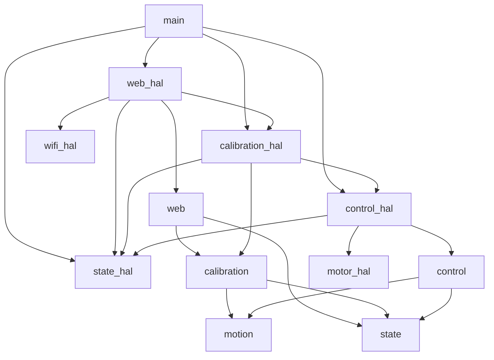

# 0007 — Постоянная калибровка масштаба механики двухосевой монтировки

- Статус: **документ проектирования**, реализация не выполнялась
- Дата: 2026-11-17
- Анализируемое состояние: рабочее дерево репозитория `telescope_mount` на дату
  документа; номера строк приведены по этому состоянию
- Стек: **ESP-IDF 6.1.0** + CMake, C++17, FreeRTOS, классический ESP32
  (ESP32-WROOM-32); проверки сборки и стенда в рамках этого документа
  **не выполнялись**
- Номер `0007` — предварительный: `0006`/`0007` могут быть заняты планами
  памяти и веб-слоя, окончательная нумерация и перенос — решение владельца
- Связанные документы: [`0002-motor-control.md`](0002-motor-control.md),
  [`0005-state-layer-and-joystick-control.md`](0005-state-layer-and-joystick-control.md),
  [`../../plans/web-status-page-plan.md`](../../plans/web-status-page-plan.md),
  [`../../plans/memory-stack-flash-plan.md`](../../plans/memory-stack-flash-plan.md)

> Документ не выдаёт предположения о коде за факты. В разделе 2 отдельно
> перечислено, что подтверждено исходниками, а что не проверялось сборкой,
> измерениями или стендом.

---

## 1. Вердикт и границы MVP

### 1.1 Вердикт

1. В текущем коде **нет** калибровки «полушаги → углы»: слой производных
   величин явно отложен в [`0005-state-layer-and-joystick-control.md:52`](0005-state-layer-and-joystick-control.md:52),
   а текущая веб-страница только читает состояние
   ([`README.md:39`](../../README.md:39), [`index.html:190`](../web_hal/www/index.html:190)).
2. Для калибровки **не нужно** менять `motion`, `motor_hal`, GPTimer, формат
   шага или счётчик позиции: `AxisStatus::position_step` уже является
   знаковым `int64` и меняется только после фактического переключения фаз
   ([`axis_planner.hpp:33`](../motion/include/motion/axis_planner.hpp:33),
   [`0002-motor-control.md:44`](0002-motor-control.md:44)).
3. Нужны **три группы изменений**:
   - новый чистый компонент `calibration` — математика, формат записи и
     автомат сессии, тестируемые на хосте без ESP-IDF;
   - новый `calibration_hal` — интеграция с `ControlService`, NVS и
     таймаутами; команды движения по-прежнему идут только через управляющую
     задачу;
   - HTTP-адаптер в `web_hal` и вкладка в существующей странице. HTTP не
     получает доступа ни к `MotorService`, ни к `MotorAxisPort`, ни к
     `ControlService` напрямую.
4. Минимальные расширения существующего управления **необходимы**:
   - новый источник `state::SourceId::Calibration` с приоритетом выше
     джойстика, чтобы калибровка эксклюзивно владела движением через
     существующий арбитраж;
   - разрешение фазе `Active` работать без свежей нейтрали джойстика, когда
     владельцем является калибровка (сейчас `ArmingMachine` требует
     `neutral_confirmed` и `input_usable` от джойстика:
     [`arming.cpp:103`](../control/src/arming.cpp:103),
     [`control_service.cpp:750`](../control_hal/src/control_service.cpp:750));
   - подтверждение останова с привязкой к конкретной команде и позиции:
     существующий `StopProtocol` уже проверяет тикет, эпоху, время опроса и
     покой ([`stop_protocol.cpp:117`](../control/src/stop_protocol.cpp:117)),
     но не публикует тикет останова и позицию на момент подтверждения;
   - окно запрета движения на всё время записи NVS, а не проверка нулевой
     скорости перед записью.
5. Базовый итоговый коэффициент считается как отношение суммарного угла к
   суммарному числу фактически выполненных полушагов:
   `k = 360° · ΣM_i / ΣΔn_i`. Простое среднее `k_i` не используется:
   измерения имеют разную длину и нелинейно входят в `k_i`.
6. Пропущенные двигателем шаги по программному счётчику **не обнаруживаются**
   и не обещаются. Калибровка измеряет эффективный масштаб по подтверждённой
   пользователем метке, а не фактическое положение ротора.

### 1.2 Обязательный минимальный вариант

| № | Что входит |
|---|---|
| 1 | Калибровка одной оси за сессию; вторая ось не затрагивается |
| 2 | Ручное грубое и точное перемещение из браузера с ограниченным по времени разрешением |
| 3 | Подтверждённый останов перед фиксацией начального и конечного счётчиков |
| 4 | Несколько измерений с разным числом оборотов; таблица и удаление неудачного измерения |
| 5 | Итог `k`, показатель повторяемости и предупреждение о плохом разбросе |
| 6 | Явные действия «Применить и сохранить» и «Отменить» |
| 7 | Постоянное хранение per-axis с независимым обновлением осей |
| 8 | Отдельная вкладка «Калибровка»; существующая страница состояния сохраняется |
| 9 | HTTP API чтения и команд с проверкой состояния на сервере |
| 10 | Host-тесты математики, автомата, JSON-контракта и парсера команд |

### 1.3 Вне границ

Звёздная привязка, GPS, компас, энкодеры, концевики, поиск механического нуля,
абсолютное положение, автоматическая компенсация люфта, настройка направления
вращения, наведение на объект, OTA, файловая система, TLS и интернет-доступ.
Калибровка **не** меняет `invert_direction`, не вводит ограничения хода и не
заменяет протокол останова.

---

## 2. Что установлено по текущему коду

Классы доказательств: **(И)** исходники этого рабочего дерева, **(Д)**
документы репозитория, **(О)** оценка/проектное решение, **(НП)** не
проверялось.

### 2.1 Движение и счётчик

| № | Факт | Где |
|---|---|---|
| 1 | Ограничений хода, концевиков и хоуминга нет; обе оси вращаются неограниченно | (Д) [`0002-motor-control.md:29`](0002-motor-control.md:29) |
| 2 | Единица счёта — полушаг; номинал 4096 полушагов на оборот вала | (Д) [`0002-motor-control.md:34`](0002-motor-control.md:34), (И) [`main.cpp:43`](../../main/main.cpp:43) |
| 3 | Позиция — `std::int64_t`, меняется только в `commitPending()` после фактического переключения фаз | (И) [`axis_planner.hpp:33`](../motion/include/motion/axis_planner.hpp:33), (Д) [`0002-motor-control.md:44`](0002-motor-control.md:44) |
| 4 | `position_step` — счётчик **выданных** полушагов, а не измеренное положение ротора; открытый контур | (Д) [`0002-motor-control.md:65`](0002-motor-control.md:65), (И) [`axis_planner.hpp:33`](../motion/include/motion/axis_planner.hpp:33) |
| 5 | `position_trusted` снимается аварийным остановом; `has_fault`/`feed` отражают отказ исполнителя | (И) [`axis_planner.hpp:40`](../motion/include/motion/axis_planner.hpp:40), [`0002-motor-control.md:68`](0002-motor-control.md:68) |
| 6 | `command_epoch` и `last_applied_command_id` заполняются исполнителем и позволяют доказать обработку конкретной команды | (И) [`axis_planner.hpp:41`](../motion/include/motion/axis_planner.hpp:41), [`0005-state-layer-and-joystick-control.md:1519`](0005-state-layer-and-joystick-control.md:1519) |
| 7 | Номинальные скорости: `start 100`, `max 800`, `accel/decel 800` полушагов/с; `min_phase_interval 600 мкс` | (Д) [`0002-motor-control.md:861`](0002-motor-control.md:861), (И) [`main.cpp:185`](../../main/main.cpp:185), [`motor_hal/Kconfig.projbuild:20`](../motor_hal/Kconfig.projbuild:20) |
| 8 | Конфигурация оси допускает `max_rate` до 1600 полушагов/с, а `CTRL_AXIS_MAX_RATE_HALF_STEPS_S` — 100…1600; фактические 800 не являются паспортным пределом | (И) [`control_hal/Kconfig.projbuild:92`](../control_hal/Kconfig.projbuild:92) |
| 9 | `main` использует `moveSteps` только в самотесте; управляющая задача `ControlService` отправляет только `setRate`, `enable`, `stop`, `resetFault` | (И) [`main.cpp:476`](../../main/main.cpp:476), [`actuator.hpp:18`](../control/include/control/actuator.hpp:18), [`control_service.cpp:657`](../control_hal/src/control_service.cpp:657) |
| 10 | В `control` нет команды относительного перемещения на N полушагов; калибровка должна двигать ось уставкой скорости | (И) [`control_service.cpp:657`](../control_hal/src/control_service.cpp:657) |

### 2.2 Владелец движения, арбитраж и останов

| № | Факт | Где |
|---|---|---|
| 11 | Все команды в `MotorService` идут только из задачи `ControlService` через `MotorAxisPort` | (И) [`control_service.hpp:3`](../control_hal/include/control_hal/control_service.hpp:3), [`control_service.cpp:657`](../control_hal/src/control_service.cpp:657) |
| 12 | Внешние вызовы `start/stop/arm/disarm/requestSafetyStop/submitIntent/acknowledgeFault` не касаются порта; они ставят запросы | (И) [`control_service.hpp:5`](../control_hal/include/control_hal/control_service.hpp:5) |
| 13 | Приоритет источников жёстко задан: `Joystick > Browser > Automation` | (И) [`arbiter.cpp:20`](../control/src/arbiter.cpp:20) |
| 14 | Владение — пара осей целиком; `stop` сильнее скорости; передача владения идёт через останов и перепроверку | (Д) [`0005-state-layer-and-joystick-control.md:155`](0005-state-layer-and-joystick-control.md:155), (И) [`arbiter.cpp:57`](../control/src/arbiter.cpp:57) |
| 15 | Уставки источника имеют lease; истечение lease владельца даёт `owner_expired`, снятие `permit` и `safety_stop_requested_` | (И) [`arbiter.cpp:142`](../control/src/arbiter.cpp:142), [`control_service.cpp:981`](../control_hal/src/control_service.cpp:981) |
| 16 | Останов подтверждается тикетом конкретной команды, эпохой, временем опроса и покоем; «нулевая скорость» сама по себе не доказывает останов | (И) [`stop_protocol.cpp:117`](../control/src/stop_protocol.cpp:117), (Д) [`README.md:261`](../../README.md:261) |
| 17 | `StopProtocol::check()` подтверждает обе оси; при неподтверждении через таймаут выполняется одна эскалация `Immediate` | (И) [`stop_protocol.cpp:143`](../control/src/stop_protocol.cpp:143) |
| 18 | `ControlObservation` публикует `stop_confirmed`, `stop_requested_us`, `stop_reason`, `last_ticket_id`, `command_epoch`, но **не** публикует тикет останова и позицию на момент подтверждения | (И) [`observation.hpp:72`](../state/include/state/observation.hpp:72), [`control_service.cpp:1000`](../control_hal/src/control_service.cpp:1000) |
| 19 | `control::StopReason` не содержит отдельного значения для калибровки | (И) [`stop_protocol.hpp:23`](../control/include/control/stop_protocol.hpp:23) |
| 20 | `ArmingMachine` требует `neutral_confirmed` для перехода `WaitingForNeutral → Enabling` и `input_usable`, иначе в `Active` запускает останов `InputLoss` | (И) [`arming.cpp:103`](../control/src/arming.cpp:103), [`arming.cpp:88`](../control/src/arming.cpp:88) |
| 21 | `neutral_confirmed` и `input_usable` формируются из джойстика, а не из владельца-калибровки | (И) [`control_service.cpp:750`](../control_hal/src/control_service.cpp:750), [`control_service.cpp:754`](../control_hal/src/control_service.cpp:754) |

Подтверждение команды устроено двухступенчато: `MotorService`/`AxisMotor`
возвращают `CommandReceipt` с `command_id` и эпохой, а `AxisStatus` публикует
`last_applied_command_id` и `command_epoch` после фактической обработки
([`axis_motor.hpp:33`](../motor_hal/include/motor_hal/axis_motor.hpp:33),
[`axis_planner.hpp:41`](../motion/include/motion/axis_planner.hpp:41)). Поэтому
калибровка не может считать «команда отправлена» доказательством «ось
остановлена»; она обязана дождаться attestation останова.

Защёлки ошибок (`LatchCode::MotorFault`, `DeliveryFailed`, `StopUnconfirmed`,
`ConfigInvalid`) запрещают движение и снимаются только протоколом
восстановления, а не повторным `start()` или калибровкой
([`channels.hpp:33`](../state/include/state/channels.hpp:33),
[`arming.cpp:54`](../control/src/arming.cpp:54)). Новая сессия калибровки при
активной защёлке отклоняется `409 control_busy`; она не пытается снять защёлку
«попутно».

### 2.3 Наблюдаемое состояние и веб-слой

| № | Факт | Где |
|---|---|---|
| 22 | `StateHub::snapshot()` — одна копия POD под мьютексом; `SystemSnapshot` включает оси, джойстик и контур | (И) [`state_hub.hpp:19`](../state_hal/include/state_hal/state_hub.hpp:19), [`observation.hpp:95`](../state/include/state/observation.hpp:95) |
| 23 | Существующий JSON ограничен 2048 байтами, собирается вручную в буфер на стеке обработчика | (И) [`state_json.hpp:27`](../web/include/web/state_json.hpp:27), [`http_status_service.cpp:458`](../web_hal/src/http_status_service.cpp:458) |
| 24 | Существующие маршруты только читают: `GET /` и `GET /api/state` | (И) [`http_status_service.cpp:343`](../web_hal/src/http_status_service.cpp:343), (Д) [`README.md:41`](../../README.md:41) |
| 25 | `web_hal` зависит от `web`, `state`, `state_hal`, `wifi_hal`, `esp_http_server`; моторных слоёв в зависимостях нет | (И) [`web_hal/CMakeLists.txt:21`](../web_hal/CMakeLists.txt:21) |
| 26 | `httpd` настроен на `max_uri_handlers = 2`, `max_resp_headers = 4`, `max_open_sockets = 3`, стек 8192 | (И) [`http_status_service.cpp:312`](../web_hal/src/http_status_service.cpp:312), [`web_hal/Kconfig.projbuild:14`](../web_hal/Kconfig.projbuild:14) |
| 27 | Страница встроена в образ через `EMBED_FILES`; файловой системы нет | (И) [`web_hal/CMakeLists.txt:21`](../web_hal/CMakeLists.txt:21) |
| 28 | Страница явно сообщает, что она только читает состояние и не даёт владения моторами | (И) [`index.html:190`](../web_hal/www/index.html:190) |
| 29 | Обновление страницы восстанавливает отображение из серверного снимка, но серверного состояния калибровки пока не существует | (И) [`index.html:473`](../web_hal/www/index.html:473) |

Свежесть и здоровье уже реализованы отдельно от значений: `state::freshness()`,
`axisHealth()`, `joyHealth()`, а возраст блока управления считается по
`meta.polled_us`, потому что `measured_us` у него всегда `kNever`
([`health.hpp:23`](../state/include/state/health.hpp:23),
[`0005-state-layer-and-joystick-control.md:375`](0005-state-layer-and-joystick-control.md:375)).
Калибровка обязана использовать эти же правила, а не вводить второй набор
порогов.

### 2.4 NVS, конфигурация и тесты

| № | Факт | Где |
|---|---|---|
| 30 | Настройки Wi-Fi хранятся в namespace `wifi`; запись NVS разрешена только при неподвижных осях | (И) [`settings_store.cpp:26`](../wifi_hal/src/settings_store.cpp:26), [`settings_store.hpp:10`](../wifi_hal/include/wifi_hal/settings_store.hpp:10) |
| 31 | `SettingsStore::initNvs()` при `ESP_ERR_NVS_NO_FREE_PAGES` или `ESP_ERR_NVS_NEW_VERSION_FOUND` стирает **весь** NVS-раздел; это происходит только на старте | (И) [`settings_store.cpp:328`](../wifi_hal/src/settings_store.cpp:328) |
| 32 | NVS-раздел штатной таблицы — 0x9000, 24 КиБ; приложение `factory` — 1 МиБ; файла `partitions.csv` в репозитории нет | (Д) [`memory-stack-flash-plan.md:95`](../../plans/memory-stack-flash-plan.md:95), [`memory-stack-flash-plan.md:24`](../../plans/memory-stack-flash-plan.md:24) |
| 33 | RF-калибровка не сохраняется, поэтому переключение AP не пишет flash | (И) [`sdkconfig.defaults:10`](../../sdkconfig.defaults:10), [`wifi_ap_service.cpp:486`](../wifi_hal/src/wifi_ap_service.cpp:486) |
| 34 | Правило проекта: во время движения запрещены запись NVS/flash, OTA и тяжёлое логирование | (Д) [`README.md:222`](../../README.md:222) |
| 35 | Host-тесты собирают чистые компоненты обычным CMake; `web`, `control`, `state`, `motion` уже подключены | (И) [`test/host/CMakeLists.txt:27`](../../test/host/CMakeLists.txt:27) |
| 36 | Тестовый фреймворк — собственный `check.hpp`, без внешних зависимостей | (И) [`test/host/CMakeLists.txt:27`](../../test/host/CMakeLists.txt:27) |

### 2.5 Что не подтверждено / не выполнялось

1. Сборка `idf.py build` и host-тесты для предлагаемых изменений **не
   выполнялись**.
2. Фактический коэффициент каждой оси, реальный люфт, пропуски шагов и
   достижимая скорость **не измерялись**.
3. Поведение NVS при отключении питания во время `nvs_commit()` на этом
   устройстве **не измерялось**; проект опирается на документированную
   устойчивость NVS и на двойной слот с CRC, но не заявляет измеренную
   гарантию.
4. Влияние записи NVS на задачи осей при остановленном движении **не
   измерялось**.
5. Однозадачность `esp_http_server` и поведение медленного клиента для новых
   маршрутов **не проверялись**; проект не вводит новых гарантий по общему
   дедлайну ответа.
6. Точный объём RAM/flash новых компонентов **не измерялся**.
7. Механическая доступность метки и указателя на обеих осях, а также
   направление, в котором удобно делать несколько оборотов, — предмет
   стендовой проверки.

---

## 3. Требования и границы задачи

### 3.1 Что требуется

Для каждой оси независимо определить `degrees_per_half_step` — реальное
угловое перемещение оси телескопа на один полушаг двигателя с учётом всей
установленной передачи.

Результат — два независимых постоянных коэффициента:

```text
azimuth.degrees_per_half_step
altitude.degrees_per_half_step
```

Единица — градусы на полушаг. Коэффициент является масштабом механики, а не
привязкой к звёздам, не абсолютным положением, не поиском нуля, не настройкой
направления и не компенсацией люфта.

### 3.2 Обязательные условия

1. Измеряется оборот **оси телескопа**, а не только вала двигателя.
2. Используются счётчики фактически выполненных полушагов, а не заданное
   число шагов и не длительность движения.
3. Счётчики не сбрасываются и не сворачиваются по модулю одного оборота;
   используется `int64` разность.
4. Начальный и конечный счётчики фиксируются только после **подтверждённого
   останова**.
5. Подтверждение останова соответствует текущей команде, а не случайному
   снимку с нулевой скоростью.
6. Финальный подход к метке выполняется в одном направлении.
7. Измерение не должно незаметно включать реверс, аварийный останов, сбой
   исполнителя или потерю достоверности счётчика.
8. Нарушения явно аннулируют измерение или переводят его в состояние,
   требующее повторения; автоматического «исправления» нет.
9. Число оборотов подтверждает пользователь; прошивка не может самостоятельно
   проверить, сколько полных оборотов физически выполнено.
10. Обнаружение пропущенных двигателем шагов по программному счётчику не
    обещается.
11. Приблизительное перемещение на несколько оборотов может использовать
    номинальный или ранее сохранённый коэффициент, но он не подменяет
    измерение и подтверждение метки.
12. Непрерывное движение из браузера имеет ограничение по времени без
    обновления разрешения; событие отпускания кнопки не является единственной
    защитой.
13. На время измерения и подтверждения опорных точек действует явно выбранная
    политика удержания. Если сохранение механического положения не обеспечено,
    интерфейс требует повторной проверки метки; один лишь неизменившийся
    счётчик не считается доказательством неподвижности оси.
14. Владение сессией и разрешение движения — разные вещи. Владелец
    `Calibration` без свежей команды движения браузера не даёт ненулевой
    скорости.

---

## 4. Пользовательский сценарий

### 4.1 Подготовка

1. Пользователь открывает страницу, переходит на вкладку «Калибровка».
2. Выбирает ось: «Азимут» или «Высота».
3. Выбирает направление измерения (например, «по часовой» / «против часовой»).
4. Задаёт число полных оборотов в одном измерении `M` (по умолчанию 3,
   допустимо 1…20) и число повторов (по умолчанию 3, допустимо 2…5).
5. Сервер создаёт сессию, забирает владение движением у джойстика через
   существующий арбитраж и показывает инструкцию:
   - вращающаяся метка на оси;
   - неподвижный указатель;
   - подходить к метке только в выбранном направлении;
   - после остановки дождаться подтверждения «ось остановлена»;
   - число оборотов считает пользователь, прошивка его не угадывает.

### 4.2 Измерение `i`

1. Пользователь грубыми кнопками подводит метку к указателю.
2. При необходимости использует точные кнопки.
3. Отпускает кнопку движения и нажимает «Стоп».
4. Сервер отправляет команду останова и ждёт подтверждения по тикету и
   эпохе. До подтверждения кнопка «Подтвердить начало» заблокирована.
5. Для калибруемой оси включается явная политика удержания: по умолчанию
   бессрочное удержание (`hold_enabled=true`, `hold_timeout_ms=0`). Сервер
   ждёт, пока исполнитель подтвердит `energized=true`. Если удержание не
   установлено, подтверждение начала недоступно.
6. После подтверждённого останова и активного удержания пользователь нажимает
   «Подтвердить начало». Сервер фиксирует `n_start,i` из подтверждённого
   снимка останова. Если удержание было потеряно между остановом и нажатием,
   attestation аннулируется, и метку нужно проверить заново.
7. Пользователь включает грубое движение и выполняет `M` полных оборотов.
   Число оборотов он считает по метке; подсказка «ожидаемо ≈ S_current · M
   полушагов» является только ориентиром.
8. Пользователь останавливается, переходит на точное доведение и совмещает
   метку с указателем, подходя **в том же направлении**. При остановке
   удержание снова активно; без него точное доведение не считается
   подтверждённым.
9. Нажимает «Стоп». Сервер ждёт подтверждённого останова и активного
   удержания.
10. После подтверждения нажимает «Подтвердить конец». Сервер фиксирует
    `n_end,i`, вычисляет `Δn_i`, `S_i`, `k_i` и добавляет измерение в таблицу.
11. Если метка не совмещена:
    - можно продолжить движение **только вперёд** и повторить останов;
    - если метка пройдена, измерение явно аннулируется, ось возвращается в
      режим начального позиционирования, и пользователь повторяет измерение.
      Реверс внутри измерения запрещён;
    - альтернатива для механики с неограниченным вращением — явно увеличить
      `M_i` на 1 и продолжить в том же направлении до следующей метки
      (рассмотрено в 4.5, в MVP не обязательно).
12. Если удержание пропало после фиксации счётчика, но до подтверждения,
    сервер не принимает счётчик как доказательство: состояние переходит в
    `InitialPositioning` с флагом `mark_recheck_required`, а пользователь
    обязан снова совместить метку и повторить останов/подтверждение.

### 4.3 Повторы и результат

1. После каждого измерения, если повторов ещё не хватает, сервер переходит к
   подтверждению начала следующего измерения. Метка уже совмещена, но
   пользователь подтверждает начало явно.
2. Когда выполнено запланированное число измерений, сервер показывает:
   - таблицу `M`, `Δn`, `S`, `k`, отклонение от итога, статус;
   - итоговый `k`;
   - `spread_ppm` и `max_deviation_ppm`;
   - предупреждение, если разброс выше допуска.
3. Пользователь может удалить неудачное измерение и выполнить повтор.
4. «Применить и сохранить» — единая операция:
   - проверяет повторяемость и состояние;
   - получает окно запрета движения;
   - записывает и проверяет NVS;
   - только после успешной проверки публикует новый действующий коэффициент
     в RAM;
   - показывает раздельно «рассчитано», «применено» и «сохранено».
   При ошибке NVS прежний действующий коэффициент остаётся в RAM, новый
   результат остаётся рассчитанным и доступным для повторного сохранения.
5. «Отменить»:
   - останавливает ось, если она движется;
   - освобождает владение;
   - не меняет постоянную калибровку.

### 4.4 Как проходить несколько оборотов без точного коэффициента

Точный коэффициент неизвестен до измерения, поэтому прошивка **не** ведёт ось
к вычисленной цели по числу полушагов как к доказательству. Разрешены:

- ручное удержание грубой кнопки; пользователь считает обороты по метке;
- подсказка `S_current · M`, где `S_current = 360 / k_current`, выводимая на
  экран как ориентир;
- отображение текущего `Δn = |n_now − n_start|` в полушагах, чтобы видеть
  приближение к ожидаемому значению.

Ни подсказка, ни `Δn` не заменяют подтверждение метки. Итоговое измерение
всегда использует `n_start` и `n_end` из подтверждённых остановов.

### 4.5 Точное доведение: сравнение вариантов

| Вариант | Плюсы | Минусы | Решение |
|---|---|---|---|
| Непрерывное медленное движение (`fine`, 40 полушагов/с) | использует существующий путь `setRate`; останов и lease уже работают; не требует нового интерфейса управления | при отпускании кнопки возможен перелёт; зависит от задержки HTTP и реакции пользователя | **MVP** |
| Ограниченное перемещение на N полушагов | детерминированный шаг, удобные кнопки +1/+5/+10; меньше перелётов | требует `moveSteps` в `AxisActuator`/`ControlService`, новых тестов и взаимодействия с протоколом останова; текущий `ControlService` относительного перемещения не имеет | отдельное улучшение |
| Продолжить в том же направлении до следующей метки и явно увеличить `M_i` | соответствует неограниченному вращению; не требует реверса | добавляет полный оборот и требует отдельного подтверждения; не входит в MVP | рассмотрено, отдельное улучшение |

MVP выбирает непрерывное медленное движение, потому что оно не расширяет
моторный интерфейс и не создаёт второй способ позиционирования. Прямой вызов
`MotorService::moveSteps()` из `calibration_hal` запрещён: это обошло бы
управляющую задачу и арбитраж. Если точность совмещения окажется
недостаточной, ограниченное перемещение оформляется как явное расширение
`AxisActuator`/`ControlService` с собственными host-тестами, а не как
«попутная» правка.

---

## 5. Формулы и оценка повторяемости

### 5.1 Обозначения

Для измерения `i`:

- `M_i` — положительное целое число полных оборотов оси, подтверждённое
  пользователем;
- `n_start,i`, `n_end,i` — счётчики выполненных полушагов из подтверждённых
  остановов, `std::int64_t`;
- `Δn_i = |n_end,i − n_start,i|` — беззнаковая разность, `std::uint64_t`;
- `S_i = Δn_i / M_i` — полушагов на оборот оси;
- `k_i = 360° · M_i / Δn_i` — градусов на полушаг.

Дополнительно проверяется знак:

```text
sign_i = sign(n_end,i − n_start,i)
```

Он должен соответствовать выбранному направлению измерения. Абсолютная
формула `Δn_i` используется для масштаба, но знак проверяется отдельно, чтобы
реверс или движение не в ту сторону не были замаскированы модулем.

### 5.2 Итоговый коэффициент

Базовый расчёт:

```text
k = 360° · Σ M_i / Σ Δn_i
```

Обоснование:

1. Это отношение суммарного подтверждённого угла к суммарному числу фактически
   выполненных полушагов. Физически это тот же масштаб, что и у отдельного
   измерения, но с использованием всего пройденного пути.
2. Измерения с большим `M_i` и большим `Δn_i` получают больший вес
   автоматически. Короткое измерение с ошибкой совмещения метки не может
   перевесить длинное.
3. Если ошибка числа шагов пропорциональна длине измерения (например,
   редкие пропуски шагов), отношение сумм является оценкой максимального
   правдоподобия для модели `Δn_i ≈ a · M_i` с дисперсией, пропорциональной
   `M_i`.
4. Простое среднее `k_i` не используется: `k_i` обратно пропорционально
   `Δn_i`, поэтому короткие и длинные измерения входят неравномерно, а
   среднее обратных величин смещено. Например, при `M_1=1, Δn_1=4096` и
   `M_2=5, Δn_2=20500`:

   ```text
   k_1 = 0.087890625
   k_2 = 0.087804878
   простое среднее = 0.087847752
   итог по суммам  = 360·6 / 24596 = 0.087819157
   ```

   Разница мала, но она систематическая; при разной длине измерений и
   реальном разбросе она может маскировать проблему.
5. Альтернатива — взвешенный МНК `a = Σ M_i·Δn_i / Σ M_i²` при постоянной
   дисперсии ошибки в шагах. Она не выбрана в MVP, потому что пользователь
   подтверждает угол, а не шаги, и ошибка совмещения метки обычно имеет
   угловую природу. Отношение сумм прозрачнее и напрямую соответствует
   «суммарный угол / суммарные шаги». Взвешенный МНК можно добавить позже как
   дополнительную оценку, не меняя основной результат.

### 5.3 Показатель повторяемости

Для каждого измерения вычисляется отклонение от итога:

```text
deviation_ppm_i = round( (k_i / k − 1) · 1 000 000 )
```

Показатель повторяемости:

```text
spread_ppm = round( (max k_i − min k_i) / k · 1 000 000 )
max_deviation_ppm = max |deviation_ppm_i|
```

Выбран размах, а не стандартное отклонение:

- при 2–5 измерениях выборочное стандартное отклонение само по себе очень
  шумно;
- размах консервативнее и понятнее пользователю;
- он напрямую показывает худшее расхождение, которое видно в таблице.

Дополнительно показывается `max_deviation_ppm`, чтобы отличить один выброс от
равномерного разброса. Автоматического отбрасывания выбросов нет.

Порог по умолчанию:

```text
CAL_MAX_SPREAD_PPM = 5000   // 0.5 %
```

Если `spread_ppm > CAL_MAX_SPREAD_PPM`, результат помечается
`repeatability:"warn"`. «Применить и сохранить» требует явного
`acknowledge_low_repeatability: true`; без него сервер отвечает `422
repeatability_rejected`. Если измерений меньше `CAL_MIN_MEASUREMENTS` (2) или
хотя бы одно обязательное измерение недействительно, применение запрещено.

`repeatability` — это только повторяемость измерений, а не доказанная
абсолютная точность. Абсолютная точность не проверяется без независимого
эталона; в контракте всегда присутствует `accuracy_verified: false`.

Порог — стартовая гипотеза, а не измеренная характеристика. Он должен быть
уточнён на стенде после первых калибровок.

### 5.4 Валидация измерения

Измерение считается действительным, только если одновременно:

1. `M_i` — целое в диапазоне `CAL_MIN_REVOLUTIONS…CAL_MAX_REVOLUTIONS`
   (по умолчанию 1…20).
2. `Δn_i > 0`.
3. `sign(n_end,i − n_start,i)` соответствует выбранному направлению.
4. Оба счётчика получены из подтверждённых остановов, соответствующих
   калибровочной команде останова.
5. `position_trusted == true` на обеих фиксациях (для калибруемой оси
   обязательно; для второй оси — в рамках протокола останова пары).
6. Нет `has_fault`, `Fault`, смены `command_epoch`, эскалации `Immediate`,
   аварийного останова, истечения lease или отказа доставки во время
   измерения.
7. Направление движения после подтверждения начала не менялось.
8. Для калибруемой оси удержание активно и `energized == true`; иначе
   подтверждение не принимается.
9. `k_i` и `S_i` конечны, положительны и попадают в допустимый диапазон.

Если условие нарушено, измерение не добавляется в таблицу как действительное,
а сессия переходит в состояние, требующее повтора, с явной причиной.

### 5.5 Допустимые диапазоны результата

Проектные границы (уточняются на стенде):

```text
k_min = 0.00001 °/полушаг
k_max = 1.0 °/полушаг
S_min = 360 / k_max = 360 полушагов/оборот
S_max = 360 / k_min = 36 000 000 полушагов/оборот
```

Значения вне диапазона означают ошибку измерения или неверно заданное `M`, а
не «особую механику»; результат отклоняется. Диапазон хранится в Kconfig.

### 5.6 Точность и формат

- Вычисления — в `double`; суммарные счётчики — `uint64_t` с безопасной
  разностью.
- Постоянное значение хранится как `int64_t nanodegrees_per_half_step`
  (1 н° = 10⁻⁹ градуса). Для номинала 4096 это `87 890 625` н°.
- В JSON коэффициент публикуется строкой с 9 знаками после запятой, чтобы
  показать полезную точность и не зависеть от двоичного округления `Number`.
- `half_steps_per_revolution` публикуется как производное значение с 3
  знаками после запятой.
- Счётчики и тикеты публикуются строками; арифметика над ними в браузере не
  выполняется.

---

## 6. Автомат состояний и владение движением

### 6.1 Состояния

| Состояние | Назначение | Владелец движения |
|---|---|---|
| `Inactive` | активной сессии нет | нет |
| `Preparing` | сессия создана, параметры заданы, ожидается подтверждение владения | `Calibration` |
| `InitialPositioning` | подводка к начальной метке | `Calibration` |
| `AwaitingStartStop` | запрошен останов перед фиксацией начала | `Calibration` |
| `StartReady` | останов подтверждён; удержание активно или требуется повторная проверка метки, можно подтвердить начало | `Calibration` |
| `Measuring` | идёт измерение, направление заблокировано | `Calibration` |
| `AwaitingEndStop` | запрошен останов перед фиксацией конца | `Calibration` |
| `EndReady` | останов подтверждён; удержание активно или требуется повторная проверка метки, можно подтвердить конец или продолжить вперёд | `Calibration` |
| `Review` | результаты, удаление измерений, применение | нет |
| `Applying` | проверка повторяемости и подготовка окна flash | нет |
| `Saving` | окно запрета движения, запись и проверка NVS | нет |
| `Saved` | NVS проверена, новый коэффициент опубликован в RAM | нет |
| `SaveFailed` | запись/проверка завершилась ошибкой до подтверждения записи; действует прежний коэффициент, новый результат рассчитан | нет |
| `SaveUncertain` | `nvs_commit` вернул успех, но чтение-проверка не подтвердила содержимое; постоянное состояние неизвестно | нет |
| `Cancelling` | останов перед отменой | `Calibration` до подтверждения |
| `Cancelled` | сессия отменена, постоянные данные не изменены | нет |
| `Error` | неустранимая ошибка сессии; при движении сначала останов | нет после подтверждения |

`Review`, `Saved`, `SaveFailed`, `SaveUncertain`, `Cancelled`, `Error`
владения не удерживают:
джойстик снова доступен после обязательной новой нейтрали (6.3). Для нового
измерения из `Review` калибровка заново запрашивает владение и требует нового
подтверждения начальной метки.

### 6.2 Таблица переходов (основные)

| Из | Событие/команда | Условие | В | Действие |
|---|---|---|---|---|
| `Inactive` | `create_session` | ось валидна, параметры в диапазоне, контроль Running, нет защёлки | `Preparing` | создать сессию, claim `Calibration`, revision++ |
| `Preparing` | владелец подтверждён | `ControlStatus.owner == Calibration`, `calibration_input_ready`, политика удержания применена | `InitialPositioning` | разрешить движение |
| `Preparing` | timeout/busy | владение/удержание не получены | `Error` | причина `control_busy`/`hold_unavailable`, release |
| `InitialPositioning` | `move` | скорость coarse/fine, направление любое, свежий move lease | `InitialPositioning` | обновить lease и уставку |
| `InitialPositioning` | `stop` | — | `AwaitingStartStop` | запросить калибровочный останов |
| `AwaitingStartStop` | подтверждённый останов | тикет/эпоха/время/покой, причина — калибровочная; `energized` и `reference_ready` | `StartReady` | сохранить attestation |
| `AwaitingStartStop` | удержание не активно | — | `Error` | `hold_unavailable`, release |
| `AwaitingStartStop` | ошибка/таймаут/эскалация | — | `Error` | причина, останов/защёлка |
| `StartReady` | `confirm_start` | attestation актуален, движения после него не было, `reference_ready` | `Measuring` | записать `n_start`, lock направления |
| `StartReady` | `move` | — | `InitialPositioning` | сбросить готовность (пользователь снова двигает) |
| `StartReady` | потеря удержания | `energized==false`/удержание снято | `InitialPositioning` | `mark_recheck_required=true`, аннулировать attestation |
| `Measuring` | `move` | направление совпадает с lock, `motion_generation` актуален | `Measuring` | обновить lease |
| `Measuring` | `move` противоположное | — | `Error`/повтор | причина `direction_violation`, останов |
| `Measuring` | потеря удержания на останове | `energized==false` | `InitialPositioning` | аннулировать измерение, `mark_recheck_required` |
| `Measuring` | `stop` | — | `AwaitingEndStop` | запросить калибровочный останов |
| `AwaitingEndStop` | подтверждённый останов | `energized` и `reference_ready` | `EndReady` | сохранить attestation |
| `EndReady` | `confirm_end` | метка подтверждена, движения после останова нет, `reference_ready` | `Review` или `StartReady` | вычислить и добавить измерение; при повторах перенести конечную точку в начало следующего, но потребовать явного `confirm_start` |
| `EndReady` | потеря удержания | `energized==false` | `InitialPositioning` | аннулировать текущее измерение, `mark_recheck_required` |
| `EndReady` | `resume` | только вперёд | `Measuring` | продолжить измерение |
| `EndReady` | `abandon` | — | `InitialPositioning` | аннулировать текущее измерение |
| `Review` | `delete_measurement` | индекс валиден | `Review` | удалить, пересчитать |
| `Review` | `add_repeat` | < `CAL_MAX_MEASUREMENTS` | `Preparing`/`InitialPositioning` | заново claim, новое начало |
| `Review` | `apply` | повторяемость/количество/состояние | `Applying` | проверка |
| `Applying` | проверка пройдена | — | `Saving` | release, begin flash window |
| `Applying` | повторяемость не подтверждена | — | `Review` | `422 repeatability_rejected` |
| `Saving` | NVS записана и проверена | commit OK и readback/CRC OK | `Saved` | опубликовать RAM, `applied=true`, `saved=true` |
| `Saving` | ошибка до подтверждённой записи | commit/verify вернул ошибку, запись не подтверждена | `SaveFailed` | прежний RAM-коэффициент сохранён, `applied=false`, `saved=false` |
| `Saving` | исход записи неизвестен | `nvs_commit` вернул OK, но readback/CRC не подтвердил | `SaveUncertain` | прежний RAM-коэффициент сохранён, `applied=false`, `saved=false`, `persistence:"unconfirmed"` |
| `Saved`/`SaveFailed`/`SaveUncertain` | `close` | — | `Inactive` | release, сессия закрыта |
| `SaveFailed`/`SaveUncertain` | `apply` | повторяемость/количество/состояние | `Applying` | повторное окно flash и запись NVS |
| любое активное | `cancel` | — | `Cancelling` | если движение — останов |
| `Cancelling` | останов подтверждён | — | `Cancelled` | release, постоянные данные не изменены |
| любое | `fault/epoch change/position untrusted/lease expiry/emergency stop/hold lost` | — | `Error` | останов, аннулировать текущее измерение |
| `Error` | `close` | останов подтверждён | `Inactive` | release |

`Revision` увеличивается на каждом переходе, добавлении/удалении измерения и
изменении результата. Продление lease движения revision **не** увеличивает;
для этого есть отдельный счётчик `motion_seq`.

Разрешённые команды по состояниям (сервер проверяет независимо от браузера):

| Состояние | Разрешённые команды |
|---|---|
| `Inactive` | `create_session` (в том числе `purpose:"reset"`) |
| `Preparing` | `ping`, `stop`, `cancel`; `reset` только для `purpose:"reset"`; `move` — только после подтверждения владельца (переход в `InitialPositioning`) |
| `InitialPositioning` | `ping`, `move`, `stop`, `cancel` |
| `AwaitingStartStop` | `ping`, `stop`, `cancel` |
| `StartReady` | `ping`, `move`, `confirm_start`, `cancel` |
| `Measuring` | `ping`, `move`, `stop`, `cancel` |
| `AwaitingEndStop` | `ping`, `stop`, `cancel` |
| `EndReady` | `ping`, `confirm_end`, `resume`, `abandon`, `cancel` |
| `Review` | `ping`, `delete_measurement`, `add_repeat`, `apply`, `cancel` |
| `Applying` | `ping` (ожидание результата) |
| `Saving` | `ping` (ожидание результата) |
| `Saved` | `ping`, `close` |
| `SaveFailed` | `ping`, `apply` (повтор сохранения), `close` |
| `SaveUncertain` | `ping`, `apply` (повтор сохранения), `close` |
| `Cancelling` | `ping` (ожидание останова) |
| `Cancelled` | `ping`, `close` |
| `Error` | `ping`, `close` после подтверждённого останова |

### 6.3 Владелец движения и другие источники

1. `Calibration` получает владение через существующий `Arbiter`:
   `Intent{source=Calibration, session=<id>, sequence=<n>, claim=true,
   axis[axis]={valid=true, rate}, axis[other]={valid=true, rate=0},
   valid_until_us=now+lease}`.
2. Приоритет `Calibration` выше `Joystick`, `Browser` и `Automation`. Это
   минимальное изменение [`arbiter.cpp:20`](../control/src/arbiter.cpp:20).
3. Пока калибровка владеет, `applyJoystick()` может отправлять claim/rates, но
   арбитр отклоняет их как `NotOwner`; движения от джойстика нет. Счётчик
   `rejected_intents` растёт, это наблюдаемо.
4. `requestSafetyStop()`/`stopImmediate()` сохраняют приоритет: они не
   проходят через арбитраж и доступны в любом состоянии.
5. При `owner_expired` (сервис калибровки перестал обновлять lease)
   `ControlService` сам снимает `permit` и запускает safety stop. Сессия
   калибровки получает это как ошибку, а не как штатный останов.
6. Владение и пригодность входа — разные условия, и проверка зависит от
   выбранного источника, а не от OR источников. `selected_source` — текущий
   владелец арбитража (`arbiter_.owner()`), а не «любой источник, который
   может быть исправен». `CalibrationService` публикует в `ControlService`
   отдельный признак `calibration_input_ready`:
   ```text
   selected_source         = arbiter_.owner()
   calibration_owns        = selected_source == SourceId::Calibration
   session_valid           = сессия активна, не истекла, нет ошибки
   source_healthy          = ControlService Running, нет защёлки,
                             оси готовы, command_epoch не менялся
   calibration_input_ready = calibration_owns && session_valid &&
                             source_healthy && hold_ready &&
                             now <= input_ready_valid_until_us
   hold_ready              = hold_policy_applied
   reference_ready         = hold_policy_applied && last_reference_stop_energized
   ```
   `ArmingMachine` получает `selected_source` и использует **ветвление**, а
   не объединение:
   ```text
   if (selected_source == SourceId::Calibration) {
       input_usable     = calibration_input_ready;
       neutral_confirmed = calibration_input_ready;
   } else {
       input_usable     = joystick input usable;
       neutral_confirmed = joystick fresh neutral;
   }
   ```
   Поэтому исправный джойстик не может маскировать истёкший
   `calibration_input_ready`: при выбранном `Calibration` его `false`
   немедленно даёт `InputLoss` и останов. Пока владелец — джойстик, его
   состояние проверяется как раньше. Это изменение
   [`arming.cpp:103`](../control/src/arming.cpp:103) и
   [`control_service.cpp:750`](../control_hal/src/control_service.cpp:750).
7. Признак `calibration_input_ready` публикуется с lease
   (`input_ready_valid_until_us`), а не как бессрочный boolean. Если
   `CalibrationService` перестал его обновлять, `ControlService` считает вход
   непригодным и уходит в останов, не дожидаясь исправного джойстика.
8. **Приобретение владения до разрешения движения.** Чтобы не было
   циклического ожидания `Preparing → InitialPositioning`, последовательность
   явная:
   1. `CalibrationService` создаёт сессию в `Preparing` и отправляет
      `claim` с нулевыми уставками. Claim не требует `calibration_input_ready`.
   2. Если владельцем был джойстик, арбитр запускает существующий handover:
      прежний владелец останавливается, затем владение переходит к
      `Calibration`.
   3. Только после `arbiter_.owner() == Calibration` сервис публикует
      `calibration_input_ready=true` с lease, если сессия действительна,
      источник исправен и удержание применено.
   4. `ArmingMachine` видит `selected_source == Calibration` и
      `calibration_input_ready=true`, переходит в `Active`; сессия переходит
      `Preparing → InitialPositioning`.
   5. Владение само по себе не разрешает вращение: до свежего `move` сервис
      отправляет нулевую уставку. Ненулевая уставка появляется только после
      `browser_move_authorized`.
   Если handover не завершился или `hold_ready` не получен, сессия уходит в
   `Error`; движение не начинается.
9. Разрешение ненулевого движения выдаётся отдельно:
   ```text
   browser_move_authorized = session_valid && source_healthy &&
                             fresh move lease && направление разрешено &&
                             motion_generation == current_motion_generation
   ```
   Только при `browser_move_authorized` `CalibrationService` отправляет
   ненулевые уставки. Во всех остальных случаях он отправляет нулевую уставку
   и запрашивает останов. `ControlService` не выводит ненулевое движение из
   одного владения.
10. После `Review`/`Saved`/`SaveFailed`/`SaveUncertain`/`Cancelled`/`Error` калибровка
   освобождает владение, но возврат джойстику требует **новой** нейтрали:
   - при освобождении фиксируется `calibration_released_us`;
   - `ControlService` игнорирует claim/rates джойстика, пока не увидит свежий
     нейтральный отсчёт с `measured_us > calibration_released_us`;
   - старое подтверждение нейтрали, полученное до калибровки, не
     используется;
   - после новой нейтрали обычное правило claim по отклонению снова
     действует.
   Отказ джойстику в этот период отражается `DenyReason::NeutralRequired`.
11. Если стик отклонён в момент освобождения, движения нет; сначала он должен
   вернуться в нейтраль. Это предотвращает неожиданный старт сразу после
   завершения измерения.

### 6.4 Повторные, запоздавшие и конкурентные команды

Защита строится на четырёх идентификаторах:

- `session_id` — 32-битный ненулевой идентификатор сессии;
- `control_token` — случайный токен, выданный создателю сессии; требуется
  для изменяющих команд;
- `revision` — 32-битная ревизия состояния сессии;
- `motion_generation` — 32-битное поколение разрешения движения. Владелец
  счётчика — управляющий слой (`ControlService`), а не HTTP-адаптер. Оно
  увеличивается при **любом** событии, отзывающем разрешение: принятый
  `stop`, истечение lease, отмена, ошибка, потеря удержания, потеря
  владельца, открытие flash-окна, завершение сессии и release. Новое
  движение возможно только после явного действия пользователя с актуальным
  поколением, полученным из наблюдаемого состояния.

Правила:

1. Все изменяющие команды, **кроме `stop`**, содержат `session_id`,
   `command_id` (32-битный), `expected_revision` и токен. `move`
   дополнительно содержит `motion_generation`.
2. Для `move` сначала проверяется `motion_generation`; при несовпадении
   возвращается `409 motion_generation_mismatch`. Затем проверяется
   `expected_revision != current_revision` → `409 revision_mismatch` с текущим
   состоянием и `allowed_commands`. Команда не применяется.
3. Повтор с тем же `command_id` и тем же телом возвращает сохранённый
   результат и **не** применяется повторно. Для `move` повтор не продлевает
   lease.
4. Тот же `command_id` с другим телом → `409 command_id_reused`.
5. Команда старше окна истории (`CAL_COMMAND_HISTORY = 8`) → `409
   command_expired`; клиент обязан перечитать состояние.
6. Два браузера: создатель сессии имеет токен; второй клиент может читать
   `GET /api/calibration`, но изменяющие команды получают `403
   not_session_owner`. Автоматического перехвата сессии нет.
7. Обновление страницы: токен хранится в `sessionStorage` вкладки; страница
   читает серверное состояние и не создаёт новую сессию. Новая вкладка без
   токена — только наблюдатель.
8. Закрытие вкладки/разрыв Wi-Fi:
   - движение прекращается по истечении `CAL_MOVE_LEASE_MS` (по умолчанию
     300 мс), затем сервис запрашивает калибровочный останов;
   - сессия без команд истекает через `CAL_SESSION_IDLE_TIMEOUT_MS` (по
     умолчанию 10 минут), освобождает владение и переходит в `Error`/`Inactive`;
   - после восстановления связи страница видит результат и не продолжает
     измерение автоматически.
9. Перезапуск ESP32: временная сессия теряется; постоянная калибровка
   загружается из NVS; незавершённое измерение не сохраняется.
10. Сохранение во время движения: `apply` в состоянии движения отклоняется
    `409 invalid_state`; сервер сам не останавливает и не сохраняет
    «попутно».
11. Отмена: переводит в `Cancelling`, останавливает ось, освобождает
    владение, постоянные данные не меняет.

**Особый статус `stop`:**

- требует `session_id` и `control_token`, но **не** требует
  `expected_revision` и не отклоняется только из-за устаревшей ревизии;
- идемпотентен: повторный `stop` в `AwaitingStartStop`, `AwaitingEndStop`,
  `Cancelling` или после подтверждения возвращает текущее состояние без
  создания второй команды останова; повтор с новым `command_id` также не
  создаёт новую логическую операцию, пока останов уже запрошен/подтверждён;
- не расходует обычный лимит `CAL_MAX_REQUESTS_PER_SEC` для команд движения;
  для него действует отдельный предел `CAL_STOP_REQUESTS_PER_SEC = 10`, а
  также общий предел соединений;
- первый принятый `stop` увеличивает `motion_generation` в управляющем слое;
  повтор того же логического останова не создаёт новую операцию и не
  увеличивает поколение второй раз;
- все `move` с прежним `motion_generation` отклоняются `409
  motion_generation_mismatch`;
- запоздавший `move`, пришедший после любого отзыва разрешения (stop, lease
  expiry, cancel, error, hold lost), не может возобновить движение даже при
  совпавшей ревизии: его `motion_generation` уже устарел. Это обязательный
  host-тест для каждого вида отзыва.

### 6.5 Таймауты

| Параметр | Значение по умолчанию | Назначение |
|---|---:|---|
| `CAL_MOVE_LEASE_MS` | 300 | срок, на который браузер разрешает движение без повторного запроса |
| `CAL_MOVE_REFRESH_MS` | 100 | период повторения `move` на странице (клиент) |
| `CAL_CONTROL_LEASE_MS` | 200 | lease уставки в арбитраже, обновляется сервисом |
| `CAL_STOP_CONFIRM_TIMEOUT_MS` | 2500 | ожидание подтверждения останова; больше `CONFIG_CTRL_STOP_CONFIRM_TIMEOUT_US` |
| `CAL_REFERENCE_CONFIRM_TIMEOUT_MS` | 180000 | ожидание подтверждения опорной точки при активном удержании |
| `CAL_READINESS_LEASE_MS` | 1000 | срок `calibration_input_ready`; единственный оперативный дедлайн удержания |
| `CAL_READINESS_REFRESH_MS` | 250 | период обновления readiness исправным `CalibrationService` |
| `CAL_SESSION_IDLE_TIMEOUT_MS` | 600000 | бездействие сессии без команд |
| `CAL_CLIENT_STALE_MS` | 3000 | после этого UI помечает клиента устаревшим |
| `CAL_SAVE_TIMEOUT_MS` | 5000 | ожидание окна запрета движения и записи NVS |
| `CAL_MAX_REFERENCE_HOLD_MS` | 600000 | абсолютный предел времени удержания от `beginCalibrationHold` |
| `CAL_MAX_CONTINUOUS_MOVE_MS` | 120000 | жёсткий предел одного непрерывного движения |
| `CAL_STOP_REQUESTS_PER_SEC` | 10 | отдельный предел для safety-команды `stop` |

Таймауты — проектные значения; они не отменяют измерение автоматически
«успешным». Истечение lease — это ошибка измерения, а не останов для
подтверждения метки.

### 6.6 Политика удержания опорных точек

Опорная точка (начало или конец) имеет смысл только тогда, когда ось не
изменила механическое положение после подтверждённого останова. Счётчик
полушагов этого не доказывает: он не меняется при провороте ротора,
отпускании обмоток или механическом смещении. Поэтому в MVP поддерживается
**только режим с удержанием**. Режим без удержания не входит в обязательный
объём; если механика не допускает удержание, сессия завершается
`hold_unavailable`, а не подменяет доказательство неподвижности галочкой.

**Временная политика удержания принадлежит `ControlService`, а не сессии:**

1. На время сессии для калибруемой оси устанавливается
   `HoldPolicy{hold_enabled=true, hold_timeout_ms=0}` — бессрочное удержание
   до явного завершения сессии. Вторая ось не удерживается.
2. `ControlService::beginCalibrationHold(axis, session_id,
   absolute_deadline_us)`:
   - сохраняет исходную политику оси, полученную из конфигурации
     (`MotorService::holdPolicy(axis)`), а не предполагает автообесточивание;
   - применяет временную политику через `MotorAxisPort`/`MotorService`;
   - запоминает `absolute_deadline_us` и `session_id`. Это **абсолютный**
     предел от начала удержания, он не продлевается и не является вторым
     lease;
   - повторный `beginCalibrationHold` с тем же `session_id` не перезаписывает
     сохранённую исходную политику и не расширяет абсолютный дедлайн.
3. `ControlService::endCalibrationHold(axis, session_id)`:
   - идемпотентен: повторный вызов с тем же `session_id` после восстановления
     является no-op;
   - сначала доводит останов, если ось ещё движется;
   - затем восстанавливает **сохранённую исходную** политику, а не всегда
     `hold_enabled=false`;
   - вызывается при нормальном завершении, при истечении readiness и при
     достижении абсолютного дедлайна.
4. **Единственный оперативный дедлайн удержания — lease
   `calibration_input_ready`.** `CalibrationService` обновляет его каждые
   `CAL_READINESS_REFRESH_MS`; срок жизни — `CAL_READINESS_LEASE_MS`.
   Управляющий слой проверяет:
   - если `calibration_input_ready` истёк → немедленно останов по `InputLoss`,
     затем восстановление исходной политики; никакого ожидания ещё 10 минут
     нет;
   - если достигнут `CAL_MAX_REFERENCE_HOLD_MS` от `beginCalibrationHold`,
     даже при свежем readiness → останов и восстановление исходной политики;
   - оба пути не требуют участия исправного `CalibrationService`.
5. `StartReady` и `EndReady` разрешают подтверждение только при
   `energized == true` и `reference_ready == true`.
6. Удержание включается до первого движения и остаётся активным в
   `InitialPositioning`, `StartReady`, `Measuring`, `AwaitingEndStop` и
   `EndReady`. В `Review`, `Saved`, `SaveFailed`, `SaveUncertain`,
   `Cancelled`, `Error` временная политика снимается и восстанавливается
   исходная.
7. Длительность ограничена:
   - `CAL_READINESS_LEASE_MS` — оперативный срок готовности источника;
   - `CAL_MAX_REFERENCE_HOLD_MS` — абсолютный предел времени удержания;
   - `CAL_REFERENCE_CONFIRM_TIMEOUT_MS` (180 с) на подтверждение опорной
     точки;
   - `CAL_SESSION_IDLE_TIMEOUT_MS` на бездействие сессии;
   - `CAL_MAX_CONTINUOUS_MOVE_MS` на одно непрерывное движение.
   По истечении подтверждения `CalibrationService` инициирует
   `endCalibrationHold`, сессия переходит в `Error` с причиной
   `reference_confirm_timeout`; точка не подтверждается автоматически. Если
   сервис уже недоступен, `calibration_input_ready` истекает через
   `CAL_READINESS_LEASE_MS`, и `ControlService` выполняет то же самое
   самостоятельно.
8. UI показывает предупреждение о нагреве обмоток при длительном удержании и
   оставшееся время до снятия.

**Потеря удержания:**

- В `StartReady` потеря `energized`/удержания аннулирует attestation,
  переводит в `InitialPositioning` с `mark_recheck_required=true`.
- В `Measuring` или `EndReady` потеря удержания на останове, в том числе во
  время паузы между движениями, аннулирует текущее измерение и возвращает в
  `InitialPositioning` с `mark_recheck_required=true`.
- Если удержание не удаётся восстановить, сессия переходит в `Error` с
  причиной `hold_unavailable`.
- Пользователь обязан снова совместить метку, остановиться и подтвердить
  точку. Неизменившийся счётчик не принимается как доказательство
  неподвижности.

---

## 7. Конфигурация и хранение

### 7.1 Постоянные результаты

Для каждой оси хранится независимая запись:

```cpp
struct AxisCalibrationRecord {
    std::uint32_t magic;                    // 'CAL0'
    std::uint16_t schema_version;           // 1
    std::uint16_t flags;                    // bit0: user_calibrated
    std::uint32_t sequence;                 // порядок слота A/B
    std::int64_t  nanodegrees_per_half_step;
    std::uint32_t sample_count;
    std::uint32_t total_revolutions;
    std::uint32_t spread_ppm;
    std::uint32_t crc32;                    // по всем полям до crc32
};
```

Минимальный состав метаданных:

- `user_calibrated` — признак пользовательской калибровки;
- `sample_count` — число принятых измерений;
- `total_revolutions` — сумма `M_i`;
- `spread_ppm` — показатель повторяемости на момент сохранения;
- `schema_version` — версия формата;
- `sequence` и `crc32` — для восстановления после сбоя питания.

Дополнительные поля не добавляются, пока нет практической необходимости.
Направление, дата, температура и серийный номер не хранятся: они не влияют на
расчёт масштаба в MVP.

### 7.2 Номинальное значение до первой калибровки

Номинал задаётся **отдельно для каждой оси**:

```text
S_nom_az  = CAL_AZ_NOMINAL_HALF_STEPS_PER_REVOLUTION  = 4096
S_nom_alt = CAL_ALT_NOMINAL_HALF_STEPS_PER_REVOLUTION = 4096
k_nom_az  = 360 / S_nom_az
k_nom_alt = 360 / S_nom_alt
```

Значение 4096 — первоначальная гипотеза, а не подтверждённая характеристика
обеих осей. Оно может быть изменено в Kconfig без изменения кода; после
первой калибровки используется сохранённое значение.

Номинал используется, если:

- записи в NVS нет;
- запись повреждена или неизвестной версии;
- пользователь явно сбросил калибровку.

Если записи нет, действует `source:"config_nominal"`, `saved:false`,
`persistence:"absent"`. Если пользователь сохранил сброс к номиналу, это
отдельное состояние `source:"saved_nominal"`, `saved:true`,
`persistence:"verified"`. Номинал не считается пользовательской
калибровкой и не маскирует отсутствие записи.

### 7.3 Настройки процесса (Kconfig)

Все значения — в `components/calibration_hal/Kconfig.projbuild`; значения по
умолчанию согласованы с существующими настройками приводов.

| Символ | По умолчанию | Диапазон | Обоснование |
|---|---:|---:|---|
| `CAL_ENABLED` | `y` | bool | отключаемая сборка и аварийный откат |
| `CAL_AZ_NOMINAL_HALF_STEPS_PER_REVOLUTION` | 4096 | 100…100000 | номинал азимута, гипотеза |
| `CAL_ALT_NOMINAL_HALF_STEPS_PER_REVOLUTION` | 4096 | 100…100000 | номинал высоты, гипотеза |
| `CAL_MIN_REVOLUTIONS` | 1 | 1…20 | короткое измерение допустимо |
| `CAL_MAX_REVOLUTIONS` | 20 | 1…50 | ограничение таблицы и времени |
| `CAL_DEFAULT_REVOLUTIONS` | 3 | 1…20 | компромисс точности и времени |
| `CAL_MIN_MEASUREMENTS` | 2 | 2…5 | нельзя объединять одно измерение |
| `CAL_MAX_MEASUREMENTS` | 5 | 2…8 | размер таблицы и JSON |
| `CAL_DEFAULT_REPEATS` | 3 | 2…5 | стартовый сценарий |
| `CAL_COARSE_RATE_HALF_STEPS_S` | 500 | 40…800 | ниже `max_rate_steps_s = 800` |
| `CAL_FINE_RATE_HALF_STEPS_S` | 40 | 1…200 | совпадает с нижней эффективной скоростью |
| `CAL_MOVE_LEASE_MS` | 300 | 100…1000 | короткое разрешение движения |
| `CAL_MOVE_REFRESH_MS` | 100 | 50…250 | чаще lease |
| `CAL_CONTROL_LEASE_MS` | 200 | 50…1000 | существующий порядок lease |
| `CAL_STOP_CONFIRM_TIMEOUT_MS` | 2500 | 500…10000 | больше `CTRL_STOP_CONFIRM_TIMEOUT_US` |
| `CAL_REFERENCE_CONFIRM_TIMEOUT_MS` | 180000 | 30000…600000 | время на подтверждение точки при удержании |
| `CAL_READINESS_LEASE_MS` | 1000 | 200…5000 | срок `calibration_input_ready`; оперативный дедлайн удержания |
| `CAL_READINESS_REFRESH_MS` | 250 | 50…1000 | период обновления readiness исправным сервисом |
| `CAL_SESSION_IDLE_TIMEOUT_MS` | 600000 | 60000…3600000 | сессия не висит вечно |
| `CAL_CLIENT_STALE_MS` | 3000 | 1000…30000 | диагностика UI |
| `CAL_MAX_SPREAD_PPM` | 5000 | 100…100000 | 0.5 % стартовая гипотеза |
| `CAL_MIN_DEGREES_PER_HALF_STEP` | 10 | 1…100000 | мк°; 1e-5 °/полушаг |
| `CAL_MAX_DEGREES_PER_HALF_STEP` | 1000000 | 1000…100000000 | мк°; 1.0 °/полушаг |
| `CAL_SAVE_TIMEOUT_MS` | 5000 | 1000…30000 | окно flash + NVS |
| `CAL_MAX_REFERENCE_HOLD_MS` | 600000 | 60000…1800000 | абсолютный предел удержания от начала политики |
| `CAL_MAX_CONTINUOUS_MOVE_MS` | 120000 | 10000…600000 | жёсткий предел одного непрерывного движения |
| `CAL_MAX_BODY_BYTES` | 512 | 128…1024 | тело одной команды |
| `CAL_MAX_REQUESTS_PER_SEC` | 20 | 5…100 | защита от потока |
| `CAL_STOP_REQUESTS_PER_SEC` | 10 | 1…100 | отдельный предел для `stop` |
| `CAL_COMMAND_HISTORY` | 8 | 4…32 | идемпотентность повторов |

Отдельных параметров разгона/торможения в MVP **нет**: используется
существующий профиль оси (`start_rate`, `max_rate`, `accel`, `decel`,
`min_phase_interval_us`). Причина: калибровка не должна вводить второй профиль
движения; точность измерения определяется счётчиком и меткой, а не профилем.

Проверка согласованности:

- `CAL_COARSE_RATE_HALF_STEPS_S <= CONFIG_APP_AXIS_MAX_RATE_HALF_STEPS_S`;
- `CAL_FINE_RATE_HALF_STEPS_S < CAL_COARSE_RATE_HALF_STEPS_S`;
- `CAL_MIN_MEASUREMENTS <= CAL_MAX_MEASUREMENTS`;
- `CAL_DEFAULT_REPEATS` в пределах min/max;
- `CAL_DEFAULT_REVOLUTIONS` в пределах min/max;
- оба номинала положительны и дают `k` в допустимом диапазоне;
- `CAL_READINESS_REFRESH_MS < CAL_READINESS_LEASE_MS`;
- `CAL_REFERENCE_CONFIRM_TIMEOUT_MS < CAL_MAX_REFERENCE_HOLD_MS`;
- `CAL_REFERENCE_CONFIRM_TIMEOUT_MS < CAL_SESSION_IDLE_TIMEOUT_MS`.

Невалидная конфигурация — ошибка запуска `CalibrationService`, а не молчаливая
подстановка.

### 7.4 Временные данные

В RAM, отдельно от постоянной калибровки:

- `session_id`, `control_token`, `revision`, `motion_generation`, `state`,
  `axis`, `direction`;
- `M_i`, `n_start,i`, `n_end,i`, `Δn_i`, `k_i`, `S_i`, причина недействительности;
- текущий `stop_attestation` (тикет, эпоха, время, позиции, `energized`);
- `hold_active`, `hold_deadline_us`, `mark_recheck_required`;
- `calculated/applied/saved` и ошибка сохранения;
- история последних `command_id` для идемпотентности.

Временные данные **не** пишутся в NVS. Перезагрузка ESP32 их теряет; это
ожидаемо и не должно повреждать постоянную калибровку.

### 7.5 Формат и независимость осей

Предлагается namespace `mount_cal` и по два слота на ось:

```text
mount_cal/az_a, mount_cal/az_b
mount_cal/alt_a, mount_cal/alt_b
```

Правила:

1. Каждая запись — blob с `magic`, `schema_version`, `sequence`, `crc32`.
2. При загрузке для оси выбирается валидная запись с максимальным
   `sequence`; при равенстве — слот A.
3. Повреждённая запись игнорируется; если вторая валидна, используется она.
4. Если обе повреждены/отсутствуют — номинал для этой оси, предупреждение в
   лог, `user_calibrated=false`. Вторая ось не затрагивается.
5. Сохранение оси пишет **только её** слот (следующий по кругу A/B), затем
   `nvs_commit`, затем чтение-проверка CRC и `sequence`. Другая ось не
   перезаписывается.
6. Сброс к номиналу пишет запись с `user_calibrated=false` и
   `nanodegrees_per_half_step = k_nom_axis` (номинал именно этой оси); слот и
   sequence обновляются. Это явное постоянное состояние, а не удаление ключа
   «наугад».
7. Неизвестная `schema_version` не перезаписывается и не стирается: ось
   переходит на номинал с предупреждением, чтобы не потерять данные будущей
   версии.

### 7.6 Восстановление после сбоя питания

Двойной слот и CRC дают следующее поведение:

- питание пропало до `nvs_commit` — предыдущая валидная запись остаётся;
- питание пропало во время записи нового слота — новый слот может быть
  повреждён, старая запись остаётся;
- питание пропало после `nvs_commit`, но до обновления RAM — при следующем
  старте загрузится новая запись; в текущем сеансе питания RAM могла
  сохранить старое значение, но устройство уже перезагружается;
- обе записи повреждены — номинал для этой оси, вторая ось независима.

Это проектное решение, а не измеренная гарантия. Стендовый тест с
принудительным сбросом во время сохранения обязателен.

### 7.7 Валидация загрузки

Для каждой записи проверяется:

1. `magic` и `schema_version`;
2. длина blob равна ожидаемой;
3. `crc32` совпадает;
4. `nanodegrees_per_half_step` в допустимом диапазоне;
5. `sample_count` и `total_revolutions` не превышают разумные пределы;
6. `spread_ppm` не отрицателен и не больше `UINT32_MAX`;
7. `user_calibrated == false` влечёт `sample_count == 0` и
   `total_revolutions == 0`.

При нарушении — запись игнорируется, причина пишется в лог и в статус оси.

### 7.8 Применение, сохранение и сброс

Три состояния результата показываются раздельно:

- `calculated` — результат посчитан, но не используется;
- `applied` — значение обновлено в RAM и используется текущим сеансом;
- `saved` — значение подтверждено в NVS.

**Единый контракт «Применить и сохранить»:**

```text
Рассчитано
    ↓
Получено окно запрета движения
    ↓
NVS записана и проверена
    ↓
Новый действующий коэффициент опубликован в RAM
    ↓
Сохранено
```

Порядок:

1. Проверить состояние сессии (`Review`), количество измерений и
   повторяемость.
2. Перевести сессию в `Applying`.
3. Освободить владение движением и запросить у `ControlService` окно
   запрета движения (`beginFlashWindow`).
4. `ControlService` выполняет останов, ждёт подтверждения и выставляет
   `flash_window_active`; новые `setRate`/`enable`/`claim` не пропускаются,
   аварийный останов остаётся доступным.
5. Записать только выбранную ось в NVS, выполнить `nvs_commit`.
6. Прочитать запись обратно и проверить CRC/sequence.
7. Только после успешной проверки опубликовать значение в RAM, выставить
   `applied=true`, `saved=true`, `persistence="verified"`, перейти в `Saved`.
8. Завершить окно запрета движения (`endFlashWindow`).
9. Если ошибка произошла до подтверждённой записи: `applied=false`,
   `saved=false`, `persistence="failed"`, состояние `SaveFailed`. Прежний
   действующий коэффициент остаётся в RAM; новый результат остаётся
   рассчитанным и доступен для повторного сохранения.
10. Если `nvs_commit` вернул успех, но чтение-проверка не подтвердила
    содержимое: `applied=false`, `saved=false`,
    `persistence="unconfirmed"`, состояние `SaveUncertain`. Прежний
    коэффициент остаётся действующим в RAM, но интерфейс **не обещает**, что
    после перезагрузки загрузится именно он: постоянное содержимое может
    оказаться старым, новым или номинальным. Окно закрывается, ошибка
    показывается явно.

Отдельного режима «применить только до перезагрузки» в MVP нет. Если он
понадобится, он оформляется отдельной командой и отдельным состоянием, а не
возникает как побочный результат ошибки NVS.

Сброс:

- команда `reset` требует `confirm:true` и состояния без движения;
- выполняется в том же окне запрета движения;
- пишет номинал с `user_calibrated=false`;
- при ошибке до подтверждённой записи действующий RAM-коэффициент остаётся
  прежним, состояние `SaveFailed`;
- при успешном `nvs_commit`, но неудачной проверке состояние
  `SaveUncertain`: RAM-коэффициент остаётся прежним, но содержимое NVS не
  подтверждено;
- сброс одной оси не меняет другую.

---

## 8. Веб-интерфейс

### 8.1 Состав

Существующая страница состояния сохраняется. В `components/web_hal/www/index.html`
добавляются две вкладки:

```text
[ Состояние ] [ Калибровка ]
```

Вкладка «Состояние» — текущая разметка без функциональных изменений.
Вкладка «Калибровка» — новый блок; внешних ресурсов, CDN и шрифтов нет.

### 8.2 Текущие коэффициенты

Для каждой оси:

| Поле | Пример | Примечание |
|---|---|---|
| Градусов на полушаг | `0.087890625` | 9 знаков, строка |
| Полушагов на оборот | `4096.000` | производное |
| Источник | `config_nominal` / `saved_nominal` / `user` | происхождение значения |
| Сохранено | `да` / `нет` | boolean `saved` |
| Состояние постоянного хранилища | `absent` / `verified` / `failed` / `unconfirmed` | enum `persistence` |
| Измерений | `3` | `sample_count` |
| Суммарно оборотов | `9` | `total_revolutions` |
| Повторяемость | `хорошая` / `предупреждение` | по `spread_ppm` |
| Разброс | `480 ppm` | `spread_ppm`, только повторяемость |
| Абсолютная точность | `не проверена` | без независимого эталона |
| Сброс | кнопка «Сбросить к номиналу» | только в сессии обслуживания, с подтверждением |

Согласованный статус коэффициента:

| Ситуация | `source` | `saved` | `persistence` | Отображение |
|---|---|---|---|---|
| Записи нет, действует значение из конфигурации | `config_nominal` | `false` | `absent` | Номинал из конфигурации |
| Пользователь сохранил сброс к номиналу | `saved_nominal` | `true` | `verified` | Номинал, сохранён |
| Загружена пользовательская калибровка | `user` | `true` | `verified` | Пользовательская, сохранена |
| Ошибка записи до подтверждения | прежний `source` | `false` | `failed` | Ошибка записи; действует прежнее значение |
| Исход последней записи не подтверждён | прежний `source` | `false` | `unconfirmed` | Постоянное состояние не подтверждено |

`source` и `persistence` — разные поля: `source` говорит, откуда взято
действующее значение, `persistence` — что известно о его сохранении.
Отсутствие записи NVS не выдаётся за `saved:true`.

### 8.3 Мастер калибровки

Текстовый макет:

```text
┌ Калибровка ───────────────────────────────────────────────┐
│ Ось:        (•) Азимут   ( ) Высота                       │
│ Направление:(•) вперёд   ( ) назад                        │
│ Оборотов:   [ 3 ]   Повторов: [ 3 ]                       │
│                                                           │
│ Инструкция: подведите метку к указателю. Подходить к      │
│ метке только в выбранном направлении. Число оборотов      │
│ считаете вы; прошивка его не угадывает.                   │
│                                                           │
│ Состояние: InitialPositioning     Владелец: calibration   │
│ Ось: azimuth    Δn: 0 полушагов   Ожидаемо: ≈ 12288       │
│ Удержание: активно, обмотки под током, осталось 2:41      │
│                                                           │
│ [ Грубо вперёд ] [ Грубо назад ]                          │
│ [ Точно вперёд ] [ Точно назад ]                          │
│ [ СТОП ]  (доступна во время движения)                    │
│                                                           │
│ Останов: не подтверждён / подтверждён тикетом 12345       │
│ [ Подтвердить начало ]  (только после останова и          │
│                          активного удержания)             │
│                                                           │
│ Измерение 1 из 3                                          │
│ Начало: 8192   Конец: —   Δn: —   k: —                    │
│                                                           │
│ Таблица измерений                                         │
│ #  M   Δn      S          k           откл., ppm  статус  │
│ 1  3   12298   4099.333   0.08782     +40         ok      │
│ 2  3   12310   4103.333   0.08774     -460        ok      │
│                                                           │
│ Итог: 0.08778 °/полушаг   S=4101.33   разброс 7200 ppm    │
│ Повторяемость: предупреждение. Точность не проверена.     │
│ Внимание: разброс выше допуска. Требуется подтверждение.  │
│ Контрольная проверка на числе оборотов, не участвовавшем  │
│ в расчёте, выполняется отдельным стендовым шагом.         │
│                                                           │
│ [ Применить и сохранить ] [ Отменить ]                    │
└───────────────────────────────────────────────────────────┘
```

Требования к UI:

1. Кнопки блокируются по состоянию сессии и `allowed_commands`, но сервер
   проверяет всё независимо.
2. «Подтвердить начало/конец» недоступны, пока сервер не сообщил
   подтверждённый останов и `energized=true`; при потере удержания
   показывается «проверьте метку заново» и подтверждение блокируется до
   нового останова.
3. «Стоп» доступна во время движения и не блокируется остальными действиями;
   она не зависит от актуальности `expected_revision` и не расходует обычный
   лимит команд движения.
4. При удержании кнопки движения страница отправляет `move` не реже
   `CAL_MOVE_REFRESH_MS`; отпускание/потеря указателя/`visibilitychange`
   отправляют `stop`, но сервер всё равно полагается на lease.
5. Движение показывает предупреждение: «остановится автоматически, если
   страница перестанет отвечать».
6. После обновления страница читает `GET /api/calibration`; если сессия
   активна и токен есть в `sessionStorage`, отображает её; новую сессию
   автоматически не создаёт.
7. Второй клиент видит «сессия активна в другом клиенте» и не получает
   кнопок управления.
8. Плохая повторяемость показывается предупреждением; «Применить и
   сохранить» требует явной галочки «понимаю, что разброс выше допуска».
   Слово «точность» не используется как синоним повторяемости.
9. Удаление измерения требует подтверждения и пересчитывает итог.
10. Сброс к номиналу требует ввода/галочки подтверждения.
11. Режим без удержания в MVP отсутствует; при невозможности удержания
    сессия завершается `hold_unavailable`, а не предлагает обходную галочку.

---

## 9. HTTP API и наблюдаемое состояние

### 9.1 Маршруты

| Метод и путь | Назначение | Код успеха |
|---|---|---|
| `GET /` | существующая страница | 200 |
| `GET /api/state` | существующий read-only снимок | 200 |
| `GET /api/calibration` | состояние калибровки и текущие коэффициенты | 200 |
| `POST /api/calibration/session` | создать сессию | 201 |
| `POST /api/calibration/ping` | продлить сессию/подтвердить жизнь клиента | 200 |
| `POST /api/calibration/move` | задать/продлить движение | 202 |
| `POST /api/calibration/stop` | запросить останов | 202 |
| `POST /api/calibration/confirm-start` | зафиксировать начало | 200 |
| `POST /api/calibration/confirm-end` | зафиксировать конец и добавить измерение | 200 |
| `POST /api/calibration/resume` | продолжить вперёд после `EndReady` | 202 |
| `POST /api/calibration/abandon` | аннулировать текущее измерение | 200 |
| `POST /api/calibration/measurements/delete` | удалить измерение | 200 |
| `POST /api/calibration/add-repeat` | добавить повтор | 202 |
| `POST /api/calibration/apply` | применить и сохранить | 202 |
| `POST /api/calibration/cancel` | отменить сессию | 202 |
| `POST /api/calibration/close` | закрыть завершённую/отменённую/ошибочную сессию | 200 |
| `POST /api/calibration/reset` | сбросить ось к номиналу | 200 |
| любой другой путь | — | 404 |
| неподдерживаемый метод | — | 405 |

Всего 17 маршрутов. Для них `max_uri_handlers` увеличивается с 2 до 20
(с запасом); `max_open_sockets`, `max_resp_headers`, таймауты сокетов не
меняются без измерений.

Регистрация каждого маршрута проверяется при старте `httpd`: ошибка любого
`httpd_register_uri_handler()` откатывает частичный старт так же, как сейчас
для двух существующих маршрутов ([`http_status_service.cpp:368`](../web_hal/src/http_status_service.cpp:368)).
Молчаливого пропуска последних маршрутов быть не должно; интеграционный тест
проверяет, что каждый путь отвечает, а не только первые зарегистрированные.

### 9.2 Общие правила

- Все ответы: `Cache-Control: no-store`, `Content-Type` явно.
- Тело запроса: только `application/json; charset=utf-8`, не более
  `CAL_MAX_BODY_BYTES` (512). `Content-Length` обязателен; chunked не
  поддерживается.
- Неизвестные поля, лишние байты после JSON, неверные типы и выход за
  диапазон — `400`.
- Изменяющие команды требуют заголовки:
  - `X-Calibration-Token: <token>`;
  - `X-Mount-Action: calibration`;
  - при наличии `Origin` он должен совпадать с `http://<device>`.
- `OPTIONS` не обслуживается: cross-origin preflight не получает CORS-разрешения.
- Глобальный token-bucket: не более `CAL_MAX_REQUESTS_PER_SEC` запросов в
  секунду; превышение — `429` с `Retry-After: 1`. `stop` использует отдельный
  лимит `CAL_STOP_REQUESTS_PER_SEC` и не блокируется лимитом команд движения.
- Создание сессии — не чаще одного раза в 2 секунды.
- Ответ на асинхронную команду не означает завершения движения или записи.
  Завершение наблюдается через `GET /api/calibration`.

### 9.3 `GET /api/calibration`

Пример без активной сессии:

```json
{
  "schema": 1,
  "session": {
    "active": false
  },
  "axes": {
    "azimuth": {
      "degrees_per_half_step": "0.087890625",
      "half_steps_per_revolution": "4096.000",
      "source": "config_nominal",
      "saved": false,
      "persistence": "absent",
      "applied": true,
      "metadata": {
        "sample_count": 0,
        "total_revolutions": 0,
        "spread_ppm": 0,
        "schema_version": 1
      }
    },
    "altitude": {
      "degrees_per_half_step": "0.087890625",
      "half_steps_per_revolution": "4096.000",
      "source": "config_nominal",
      "saved": false,
      "persistence": "absent",
      "applied": true,
      "metadata": {
        "sample_count": 0,
        "total_revolutions": 0,
        "spread_ppm": 0,
        "schema_version": 1
      }
    }
  },
  "allowed_commands": ["create_session"]
}
```

`reset` выполняется в отдельной короткой сессии обслуживания: страница сначала
создаёт сессию с `purpose:"reset"`, получает `control_token`, затем вызывает
`reset` с этим токеном.

Пример активной сессии:

```json
{
  "schema": 1,
  "session": {
    "active": true,
    "session_id": "a1b2c3d4",
    "revision": 7,
    "state": "end_ready",
    "axis": "azimuth",
    "direction": "forward",
    "owner": "calibration",
    "motion_generation": 4,
    "hold": {
      "mode": "indefinite",
      "active": true,
      "energized": true,
      "expires_in_ms": 161000
    },
    "client": {
      "stale": false,
      "lease_expires_ms": 0
    },
    "stop": {
      "confirmed": true,
      "ticket": "12345",
      "epoch": 3,
      "requested_ms": 171234,
      "confirmed_ms": 171236,
      "position_half_steps": "20490",
      "position_trusted": true
    },
    "current_measurement": {
      "index": 0,
      "revolutions": 3,
      "start_position_half_steps": "8192",
      "end_position_half_steps": null,
      "delta_half_steps": null,
      "start_ticket": "12340",
      "start_epoch": 3
    },
    "measurements": [
      {
        "index": 0,
        "revolutions": 3,
        "delta_half_steps": "12298",
        "half_steps_per_revolution": "4099.333",
        "degrees_per_half_step": "0.087821",
        "deviation_ppm": 40,
        "valid": true,
        "reason": "ok"
      }
    ],
    "result": {
      "degrees_per_half_step": "0.087821",
      "half_steps_per_revolution": "4099.333",
      "spread_ppm": 500,
      "max_deviation_ppm": 460,
      "sample_count": 1,
      "total_revolutions": 3,
      "repeatability": "insufficient",
      "accuracy_verified": false,
      "calculated": true,
      "applied": false,
      "saved": false,
      "persistence": "not_attempted"
    },
    "allowed_commands": ["move", "stop", "confirm_end", "resume", "abandon", "cancel"]
  },
  "axes": { "...": "как в примере без сессии" }
}
```

Правила полей:

- `position_half_steps`, `delta_half_steps`, `ticket` — строки;
- `epoch`, `revision`, `motion_generation`, `deviation_ppm`, `spread_ppm` — числа;
- коэффициент — строка с 9 знаками;
- `allowed_commands` — вычисляется сервером по состоянию;
- `axes.<id>.source` — `config_nominal`, `saved_nominal` или `user`;
- `axes.<id>.saved` — boolean;
- `axes.<id>.persistence` — `absent`, `verified`, `failed` или
  `unconfirmed`; `unconfirmed` означает, что содержимое NVS не подтверждено;
- `result.persistence` — `not_attempted`, `verified`, `failed` или
  `unconfirmed`;
- `repeatability` — только повторяемость измерений; `accuracy_verified`
  всегда `false` без независимого эталона;
- `hold.mode` — только `indefinite`; `hold.active` и `hold.energized`
  обязательны для подтверждения;
- неизвестное состояние не выдумывается: при ошибке сессии `state:"error"` и
  `reason`.

### 9.4 `POST /api/calibration/session`

Запрос:

```json
{
  "purpose": "calibration",
  "axis": "azimuth",
  "direction": "forward",
  "revolutions": 3,
  "repeats": 3
}
```

`purpose` — `calibration` (по умолчанию) или `reset`. Для `reset` поля
`direction`, `revolutions`, `repeats` не обязательны.

Ответ `201`:

```json
{
  "accepted": true,
  "session_id": "a1b2c3d4",
  "control_token": "b7e1c2d4f6a80913",
  "revision": 1,
  "state": "preparing",
  "owner": "pending",
  "expires_in_ms": 600000
}
```

Ошибки: `409 control_busy` (идёт передача владения/защёлка),
`422 invalid_parameters`, `503 motion_unavailable`.

### 9.5 `POST /api/calibration/move`

Запрос:

```json
{
  "session_id": "a1b2c3d4",
  "command_id": 17,
  "expected_revision": 4,
  "motion_generation": 4,
  "speed": "coarse",
  "direction": "forward"
}
```

Ответ `202`:

```json
{
  "accepted": true,
  "command_id": 17,
  "revision": 4,
  "state": "measuring",
  "lease_expires_in_ms": 300,
  "owner": "calibration"
}
```

Правила:

- `speed` — `coarse` или `fine`; произвольная скорость не принимается;
- `motion_generation` проверяется **до** `expected_revision`: после `stop`
  или другого отзыва разрешения старые `move` отклоняются `409
  motion_generation_mismatch`, даже если ревизия тоже устарела;
- в `InitialPositioning` допускаются оба направления;
- в `Measuring`/`EndReady` — только направление сессии; иначе `422
  direction_violation`;
- повтор с тем же `command_id` не продлевает lease;
- истечение lease без нового `move` — ошибка `motion_lease_expired`;
- `move` не является разрешением на движение вне сессии: проверяются
  `session_valid`, `source_healthy`, `hold_ready` и владение
  `Calibration`.

### 9.6 `POST /api/calibration/stop`

```json
{
  "session_id": "a1b2c3d4",
  "command_id": 18
}
```

Ответ `202`:

```json
{
  "accepted": true,
  "command_id": 18,
  "revision": 6,
  "motion_generation": 5,
  "state": "awaiting_end_stop",
  "stop_requested": true
}
```

`accepted` означает только приём команды. Подтверждение останова появляется в
`GET /api/calibration` как `stop.confirmed == true` с тикетом и позицией.

`stop` не требует `expected_revision`, идемпотентен и не блокируется обычным
лимитом команд движения. Первый принятый `stop` увеличивает
`motion_generation`; повтор того же логического останова (в том числе с новым
`command_id`) не увеличивает поколение второй раз. Запоздавший `move` со
старым поколением не может возобновить движение.

### 9.7 `POST /api/calibration/confirm-start`

```json
{
  "session_id": "a1b2c3d4",
  "command_id": 19,
  "expected_revision": 6
}
```

Ответ `200`:

```json
{
  "accepted": true,
  "revision": 7,
  "state": "measuring",
  "start": {
    "position_half_steps": "8192",
    "ticket": "12340",
    "epoch": 3
  }
}
```

Если останов не подтверждён, после него было движение или потеряно
удержание: `422 not_stopped`/`hold_unavailable` с текущим `stop`, `hold` и
`allowed_commands`.

### 9.8 `POST /api/calibration/confirm-end`

```json
{
  "session_id": "a1b2c3d4",
  "command_id": 20,
  "expected_revision": 10
}
```

Ответ `200`:

```json
{
  "accepted": true,
  "revision": 11,
  "state": "review",
  "measurement": {
    "index": 0,
    "revolutions": 3,
    "delta_half_steps": "12298",
    "half_steps_per_revolution": "4099.333",
    "degrees_per_half_step": "0.087821"
  },
  "result": {
    "degrees_per_half_step": "0.087821",
    "half_steps_per_revolution": "4099.333",
    "spread_ppm": 0,
    "max_deviation_ppm": 0,
    "sample_count": 1,
    "total_revolutions": 3,
    "repeatability": "insufficient",
    "accuracy_verified": false,
    "calculated": true,
    "applied": false,
    "saved": false,
    "persistence": "not_attempted"
  }
}
```

Если измерение недействительно: `422 measurement_invalid` с `reason`
(`zero_delta`, `direction_mismatch`, `position_untrusted`, `fault`,
`stop_unconfirmed`, `epoch_changed`, `lease_expired`, `emergency_stop`,
`hold_lost`, `hold_unavailable`). Измерение не добавляется.

### 9.9 `POST /api/calibration/measurements/delete`

```json
{
  "session_id": "a1b2c3d4",
  "command_id": 21,
  "expected_revision": 11,
  "index": 0
}
```

Ответ `200` с пересчитанным `result`.

### 9.10 `POST /api/calibration/apply`

```json
{
  "session_id": "a1b2c3d4",
  "command_id": 22,
  "expected_revision": 12,
  "acknowledge_low_repeatability": false
}
```

Ответ `202`:

```json
{
  "accepted": true,
  "command_id": 22,
  "revision": 13,
  "state": "applying"
}
```

После завершения в `GET /api/calibration`:

```json
{
  "session": {
    "active": true,
    "state": "saved",
    "result": {
      "degrees_per_half_step": "0.087821",
      "half_steps_per_revolution": "4099.333",
      "spread_ppm": 500,
      "max_deviation_ppm": 460,
      "sample_count": 3,
      "total_revolutions": 9,
      "repeatability": "good",
      "accuracy_verified": false,
      "calculated": true,
      "applied": true,
      "saved": true,
      "persistence": "verified"
    }
  }
}
```

Ошибки: `422 repeatability_rejected` (нужен
`acknowledge_low_repeatability:true`), `409 invalid_state`,
`500 nvs_error` с `state:"save_failed"` или `state:"save_uncertain"`.
В обоих случаях `applied:false`, `saved:false`; прежний RAM-коэффициент
остаётся действующим. При `save_uncertain` `persistence:"unconfirmed"`:
постоянное содержимое NVS не подтверждено, и после перезагрузки нельзя
обещать загрузку именно прежнего значения.

### 9.11 `POST /api/calibration/reset`

Запрос (токен сессии передаётся заголовком `X-Calibration-Token`):

```json
{
  "session_id": "a1b2c3d4",
  "axis": "azimuth",
  "confirm": true,
  "command_id": 24,
  "expected_revision": 1
}
```

Сессия должна иметь `purpose:"reset"` (или находиться в `Review` без
движения). Если активной сессии нет, страница создаёт короткую сессию
обслуживания; изменяющая команда без токена отклоняется.

Ответ `200`:

```json
{
  "accepted": true,
  "axis": "azimuth",
  "source": "saved_nominal",
  "degrees_per_half_step": "0.087890625",
  "saved": true,
  "persistence": "verified"
}
```

Ошибки: `409 busy` (активная движущаяся сессия), `422 confirmation_required`,
`500 nvs_error` с `state:"save_failed"` или `state:"save_uncertain"`.
При `save_uncertain` содержимое NVS не подтверждено; RAM-коэффициент остаётся
прежним.

### 9.12 `POST /api/calibration/close`

```json
{
  "session_id": "a1b2c3d4",
  "command_id": 25,
  "expected_revision": 14
}
```

Закрывает сессию в `Saved`, `SaveFailed`, `SaveUncertain`, `Cancelled` или
`Error` после подтверждённого останова, освобождает владение и переводит в
`Inactive`.
Ответ `200`:

```json
{
  "accepted": true,
  "state": "inactive",
  "revision": 15
}
```

Для `Error` при неподтверждённом останове `close` возвращает `409
stop_unconfirmed`; сессия остаётся владельцем до подтверждения останова.

### 9.13 Коды ошибок

| HTTP | `error` | Смысл |
|---|---|---|
| 400 | `bad_request` | тело не разобрано, неверный тип/поле |
| 400 | `body_too_large` | тело больше `CAL_MAX_BODY_BYTES` |
| 403 | `csrf_required` | нет `X-Mount-Action`/неверный `Origin` |
| 403 | `not_session_owner` | нет/неверен `control_token` |
| 404 | `not_found` | неизвестный путь |
| 405 | `method_not_allowed` | известный путь, неверный метод |
| 409 | `no_session` | сессии нет |
| 409 | `session_mismatch` | чужой/устаревший `session_id` |
| 409 | `revision_mismatch` | устаревшая команда, кроме `stop` |
| 409 | `motion_generation_mismatch` | запоздавший `move` после `stop` |
| 409 | `command_id_reused` | тот же id с другим телом |
| 409 | `command_expired` | команда старше истории |
| 409 | `invalid_state` | действие недопустимо в состоянии |
| 409 | `control_busy` | владение не получено/защёлка |
| 409 | `stop_unconfirmed` | `close` до подтверждения останова |
| 422 | `not_stopped` | нет подтверждённого останова |
| 422 | `measurement_invalid` | измерение аннулировано |
| 422 | `direction_violation` | попытка реверса |
| 422 | `repeatability_rejected` | плохая повторяемость без подтверждения |
| 422 | `hold_unavailable` | удержание не установлено/потеряно |
| 422 | `reference_confirm_timeout` | истекло время подтверждения точки |
| 422 | `invalid_parameters` | `M`/повторы вне диапазона |
| 429 | `rate_limited` | превышена частота обычных команд |
| 500 | `serialize_overflow` | JSON не поместился |
| 500 | `nvs_error` | ошибка записи/чтения NVS |
| 500 | `internal` | прочее |
| 503 | `motion_unavailable` | управляющая задача не работает |

Все ошибки возвращают JSON с `error`, `message`, `state`, `revision` и
`allowed_commands`, чтобы страница могла восстановиться без догадок.

### 9.14 Размеры, частота и подтверждение исполнения

- `CAL_MAX_BODY_BYTES = 512`; больше — `400 body_too_large`.
- `kMaxCalibrationJsonBytes = 4096`; при переполнении — `500
  serialize_overflow`, частичный JSON не отправляется.
- `CAL_MAX_REQUESTS_PER_SEC = 20`; `move` при удержании идёт ~10 Гц, остальные
  команды редки. `stop` использует отдельный лимит
  `CAL_STOP_REQUESTS_PER_SEC` и не блокируется лимитом команд движения.
- Создание сессии — не чаще 1 раза в 2 секунды.
- Принятие HTTP-запроса не означает:
  - что движение началось;
  - что останов подтверждён;
  - что NVS записана;
  - что новый коэффициент применён.
  Подтверждение — только через `GET /api/calibration` с тикетом останова,
  `state`, `hold`, `applied` и `saved`.

---

## 10. Архитектура и изменения интерфейсов

### 10.1 Новые компоненты

#### `components/calibration` — чистая логика

| Файл | Ответственность |
|---|---|
| `include/calibration/types.hpp` | `AxisScale`, `Measurement`, `InvalidReason`, `SessionState`, `SessionConfig`, `CalibrationParams` |
| `include/calibration/math.hpp`, `src/math.cpp` | безопасная разность `int64`, `k_i`, `S_i`, объединение, `spread_ppm`, `deviation_ppm`, валидация диапазонов |
| `include/calibration/session.hpp`, `src/session.cpp` | автомат сессии: команды, переходы, `revision`, `command_id`, допустимые действия, ошибки |
| `include/calibration/record.hpp`, `src/record.cpp` | формат записи, CRC32, encode/decode, выбор слота, проверка версии |
| `include/calibration/port.hpp` | `CalibrationPort` — узкий интерфейс к управлению: `claim`, `release`, `setInputReady`, `beginHold`, `endHold`, `setRate`, `requestStop`, `lastStopAttestation`, `beginFlashWindow`, `endFlashWindow`, `snapshot` |
| `include/calibration/coordinator.hpp`, `src/coordinator.cpp` | чистая координация сессии и порта по тикам; без FreeRTOS и NVS |

`calibration` не включает ESP-IDF, FreeRTOS, `nvs.h`, `esp_timer.h`.
Зависимости — `motion` (типы оси), `state` (типы состояния). Host-тесты
обязательны.

#### `components/calibration_hal` — ESP-IDF

| Файл | Ответственность |
|---|---|
| `Kconfig.projbuild` | все `CAL_*` параметры |
| `include/calibration_hal/calibration_service.hpp` | публичный API для `web_hal`: статус, create, move, stop, confirm, apply, cancel, close, reset, ping |
| `src/calibration_service.cpp` | задача сервиса, мьютекс состояния, таймауты, `CalibrationPort` поверх `ControlService`, удержание, `calibration_input_ready`, `motion_generation` |
| `include/calibration_hal/calibration_store.hpp`, `src/calibration_store.cpp` | NVS namespace `mount_cal`, двойные слоты, CRC, load/save/reset |
| `CMakeLists.txt` | `REQUIRES calibration control_hal state_hal nvs_flash esp_timer` |

`calibration_hal` не вызывает `MotorService` и `MotorAxisPort`. Все команды
движения идут через `ControlService`:
`submitIntent`, `requestCalibrationStop`, `beginFlashWindow`,
`endFlashWindow`.

### 10.2 Изменения существующих компонентов

| Файл | Изменение | Причина |
|---|---|---|
| [`state/channels.hpp`](../state/include/state/channels.hpp:20), [`state/src/channels.cpp`](../state/src/channels.cpp:10) | добавить `SourceId::Calibration`, его имя и `DenyReason::NeutralRequired` | наблюдаемость владельца и отказа джойстику до новой нейтрали |
| [`control/src/arbiter.cpp`](../control/src/arbiter.cpp:20) | `priorityRank(Calibration) = 4` | эксклюзивное владение калибровкой |
| [`control/include/control/arming.hpp`](../control/include/control/arming.hpp:28), [`src/arming.cpp`](../control/src/arming.cpp:103) | вход `selected_source` и `calibration_input_ready`; при `Calibration` используются только они, при другом владельце — джойстик | исправный джойстик не маскирует отказ калибровки, а владение не становится разрешением движения |
| [`control/include/control/stop_protocol.hpp`](../control/include/control/stop_protocol.hpp:49), [`src/stop_protocol.cpp`](../control/src/stop_protocol.cpp:65) | `request_id` в `Start`, геттеры тикета и времени подтверждения | привязка останова к команде калибровки |
| [`control_hal/include/control_hal/control_service.hpp`](../control_hal/include/control_hal/control_service.hpp:83), [`src/control_service.cpp`](../control_hal/src/control_service.cpp:657) | `requestCalibrationStop(request_id)`, `lastStopAttestation()`, `beginCalibrationHold`/`endCalibrationHold`, `holdPolicy`, `beginFlashWindow`/`endFlashWindow`, `setCalibrationInputReady`, `motion_generation`, `require_neutral_after_calibration_` | подтверждённый останов, позиция на останове, временное удержание с восстановлением исходной политики, запрет движения на время NVS, защита от старого `move`, возврат джойстика только после новой нейтрали |
| [`control/include/control/actuator.hpp`](../control/include/control/actuator.hpp:18), [`src/motor_axis_port.cpp`](../control_hal/src/motor_axis_port.cpp:20) | `holdPolicy` + `setHoldPolicy` в порту исполнения; чтение исходной политики для восстановления | калибровка не вызывает `MotorService` напрямую |
| [`web/include/web/state_json.hpp`](../web/include/web/state_json.hpp:17), новые `web/calibration_json.*`, `web/calibration_commands.*` | JSON-контракт калибровки и разбор команд | HTTP-адаптер не содержит бизнес-логики |
| [`web_hal/src/http_status_service.cpp`](../web_hal/src/http_status_service.cpp:310) | новые маршруты, чтение тела с лимитом, проверки безопасности, вызовы `CalibrationService` | управление через существующий HTTP-слой |
| [`web_hal/www/index.html`](../web_hal/www/index.html:111) | вкладка «Калибровка» | UI |
| [`web_hal/Kconfig.projbuild`](../web_hal/Kconfig.projbuild:14) | при необходимости увеличить стек `httpd` под буфер 4096 | бюджет RAM |
| [`main/main.cpp`](../../main/main.cpp:575) | статический `CalibrationService`, передача в `HttpStatusService`, запуск после `ControlService` | связывание |
| [`main/CMakeLists.txt`](../../main/CMakeLists.txt:11) | `calibration_hal` в `REQUIRES` | сборка |
| [`test/host/CMakeLists.txt`](../../test/host/CMakeLists.txt:27) | `calibration_host` и новые тесты | host-проверки |

### 10.3 Граф зависимостей



Запрещённые направления:

- `web_hal` не вызывает `MotorService`, `MotorAxisPort`, `ControlService`;
- `control_hal` не зависит от `web`/`web_hal`/`calibration_hal`;
- `wifi_hal` не знает о калибровке и HTTP;
- `motion`/`motor_hal` не знают о калибровке;
- `main` остаётся единственным местом связывания.

### 10.4 `CalibrationPort` (чистый интерфейс)

```cpp
namespace calibration {

struct StopAttestation {
    bool valid = false;
    std::uint64_t request_id = 0;
    std::uint64_t ticket_id[2] = {0, 0};
    std::uint32_t epoch[2] = {0, 0};
    std::int64_t position_step[2] = {0, 0};
    state::Micros requested_us = 0;
    state::Micros confirmed_us = 0;
    state::Micros polled_us[2] = {0, 0};
    bool position_trusted[2] = {false, false};
    bool energized[2] = {false, false};
    bool immediate = false;
    bool confirmed = false;
    std::uint32_t motion_generation = 0;
};

class CalibrationPort {
public:
    virtual ~CalibrationPort() = default;
    virtual bool claim(std::uint32_t session) = 0;
    virtual void release(std::uint32_t session) = 0;
    virtual void setInputReady(bool ready, std::uint32_t session,
                               state::Micros valid_until_us) = 0;
    virtual bool beginHold(motion::AxisId axis, std::uint32_t session,
                           state::Micros absolute_deadline_us) = 0;
    virtual bool endHold(motion::AxisId axis, std::uint32_t session) = 0;
    virtual bool setRate(std::uint32_t session, motion::AxisId axis,
                         float rate, state::Micros lease_us) = 0;
    virtual bool requestStop(std::uint64_t request_id) = 0;
    virtual StopAttestation lastStopAttestation() const = 0;
    virtual bool beginFlashWindow(state::Micros timeout_us) = 0;
    virtual void endFlashWindow() = 0;
    virtual StateSnapshot snapshot() const = 0;
    virtual state::Micros nowUs() const = 0;
};

}  // namespace calibration
```

`StateSnapshot` — минимальная копия: позиция, `position_trusted`,
`has_fault`, `state`, `command_epoch`, `rate`, владелец, фаза, счётчики
доставки. Реализация `CalibrationPort` в `calibration_hal` преобразует
вызовы в `ControlService::submitIntent`, `requestCalibrationStop` и
`beginFlashWindow`; прямого доступа к моторам нет.

### 10.5 Изменения `ControlService`

```cpp
struct CalibrationStopAttestation {
    bool valid = false;
    std::uint64_t request_id = 0;
    std::uint64_t ticket_id[2] = {0, 0};
    std::uint32_t epoch[2] = {0, 0};
    std::int64_t position_step[2] = {0, 0};
    state::Micros requested_us = 0;
    state::Micros confirmed_us = 0;
    state::Micros polled_us[2] = {0, 0};
    bool position_trusted[2] = {false, false};
    bool energized[2] = {false, false};
    bool immediate = false;
    std::uint32_t motion_generation = 0;
};

esp_err_t requestCalibrationStop(std::uint64_t request_id);
CalibrationStopAttestation lastStopAttestation() const;

esp_err_t beginCalibrationHold(motion::AxisId axis, std::uint32_t session,
                               state::Micros absolute_deadline_us);
esp_err_t endCalibrationHold(motion::AxisId axis, std::uint32_t session);
motion::HoldPolicy holdPolicy(motion::AxisId axis) const;
void setCalibrationInputReady(bool ready, std::uint32_t session,
                              state::Micros valid_until_us);
std::uint32_t motionGeneration() const;

esp_err_t beginFlashWindow(state::Micros timeout_us);
void endFlashWindow();
bool flashWindowActive() const;
```

Правила:

1. `requestCalibrationStop` не блокирует; ставит приоритетный запрос и
   `request_id`. Управляющая задача запускает `StopProtocol` с этим
   `request_id` и увеличивает `motion_generation` один раз на логический
   останов. `ControlService` также увеличивает поколение при истечении
   `calibration_input_ready`, `owner_expired`, отмене, ошибке, потере
   удержания и открытии flash-окна; `CalibrationService` только читает это
   значение. Повторное обнаружение уже обработанного отказа не увеличивает
   поколение: увеличение происходит только на переходе «разрешение
   действует → разрешение отозвано».
2. При `Decision::Confirmed` управляющая задача сохраняет attestation:
   тикеты, эпохи, позиции, `polled_us`, `position_trusted`, `energized`,
   `immediate`, `motion_generation`. Attestation **не** стирается при обычном
   `stop_protocol_.reset()`.
3. `lastStopAttestation()` копирует структуру под отдельным мьютексом; моторы
   не вызывает.
4. `beginCalibrationHold` ставит запрос в управляющую задачу. Задача сохраняет
   исходную политику через `holdPolicy(axis)`, применяет временную
   `HoldPolicy{true,0}` через `MotorAxisPort` и запоминает lease/session.
   Повторный `begin` с тем же `session_id` обновляет только lease.
   `endCalibrationHold` идемпотентен: сначала доводит останов, затем
   восстанавливает сохранённую исходную политику. Прямой вызов `MotorService`
   из `calibration_hal` запрещён.
5. `ControlService` проверяет два независимых условия: истечение
   `calibration_input_ready` и достижение абсолютного
   `CAL_MAX_REFERENCE_HOLD_MS`. Любое из них инициирует останов,
   восстановление исходной политики и увеличение `motion_generation`.
   Участие исправного `CalibrationService` не требуется.
6. `setCalibrationInputReady` публикует признак с lease, что сессия, источник
   и удержание пригодны. Только он вместе с владением `Calibration` заменяет
   проверки нейтрали/входа в `ArmingMachine`; сам по себе владелец не даёт
   разрешения на nonzero. Истёкший lease считается `false`.
7. `beginFlashWindow`:
   - ставит запрос в управляющую задачу;
   - задача снимает `permit`, освобождает владение, запускает и доводит
     останов;
   - после подтверждённого останова и отсутствия движения выставляет
     `flash_window_active = true` и сигналит вызывающему;
   - при неудаче возвращает ошибку, окно не открывается.
8. Пока `flash_window_active`:
   - `sendRates` не отправляет ненулевые уставки;
   - `enable` не запускает новую ось;
   - новые `claim` от источников не дают движения;
   - `requestSafetyStop`/`stopImmediate` продолжают работать.
9. `endFlashWindow` снимает запрет; только после этого разрешено новое
   движение.
10. `CalibrationService` не пишет NVS, пока окно не открыто, и не открывает
    окно, пока сессия не остановлена.
11. При освобождении владения калибровкой `ControlService` выставляет
    `require_neutral_after_calibration_` и игнорирует джойстик до свежей
    нейтрали после `calibration_released_us`.

### 10.6 `main`

Порядок:

1. `access_point.start()` — как сейчас, NVS инициализируется до движения.
2. `MotorService::start`.
3. `StateHub`, `JoystickService`; ошибка `JoystickService::start` больше не
   блокирует запуск `ControlService`: управляющая задача и арбитраж должны
   существовать, чтобы калибровка могла получить владение при недоступном
   джойстике. В этом случае путь джойстика остаётся `invalid`, а движение от
   него невозможно.
4. `ControlService::start(mapping)` и `arm()` — как сейчас; `arm()` не
   запускает движение без выбранного исправного источника.
5. `static calibration_hal::CalibrationService calibration(control, hub);`
6. `calibration.start()` — загрузка NVS, запуск задачи, публикация статуса.
7. `static web_hal::HttpStatusService web(hub, access_point, calibration);`
8. `web.start()`.

`CalibrationService` создаётся статически, чтобы не увеличивать кадр стека
`main` (по действующему образцу `access_point`/`hub`:
[`main.cpp:543`](../../main/main.cpp:543), [`main.cpp:565`](../../main/main.cpp:565)).
При недоступном джойстике калибровка может получить владение и оставаться в
нулевой уставке; `calibration_input_ready` не зависит от джойстика, но
ненулевое движение всё равно требует `browser_move_authorized`.

---

## 11. Обработка отказов и безопасность

### 11.1 Отказы измерения

| Ситуация | Обнаружение | Реакция |
|---|---|---|
| Реверс во время измерения | знак `move`/`Δn` не совпадает с lock | останов, `measurement_invalid/direction_violation`, повтор |
| Аварийный останов | `stop_attestation.immediate` или `position_trusted=false` | аннулировать измерение, `Error`, останов |
| Сбой исполнителя | `has_fault`, `state==Fault`, `command_epoch` изменился | аннулировать, `Error` |
| Потеря достоверности счётчика | `position_trusted=false` | аннулировать, `Error` |
| Отказ доставки | `delivery_failures` вырос, владелец потерян | аннулировать, `Error` |
| Истечение lease движения | нет `move` дольше `CAL_MOVE_LEASE_MS` | останов, `measurement_invalid/lease_expired` |
| Останов не подтверждён | `StopProtocol` таймаут/эскалация/`Failed` | `measurement_invalid/stop_unconfirmed`, `Error` |
| Потеря удержания | `energized=false`/удержание снято | аннулировать attestation/измерение, `mark_recheck_required`, `InitialPositioning` или `Error` |
| Счётчики равны | `Δn == 0` | `422 measurement_invalid/zero_delta` |
| Счётчик не та | `Δn` вне разумного диапазона | `422 measurement_invalid/invalid_result` |
| NVS не пишется, ошибка до подтверждения | `nvs_set_blob`/`nvs_commit` ошибка, запись не подтверждена | `SaveFailed`; прежний RAM-коэффициент сохранён, новый не применён |
| Исход записи неизвестен | `nvs_commit` OK, readback/CRC не подтвердил | `SaveUncertain`; прежний RAM-коэффициент сохранён, содержимое NVS не подтверждено |
| Питание во время записи | слот/CRC/sequence при старте | выбрать валидный слот, иначе номинал этой оси |

Ни один из этих случаев не «исправляется» автоматически. Пользователь видит
причину и повторяет измерение или сессию.

### 11.2 Отказы связи и клиентов

- Закрытая вкладка: lease движения истекает, сервис останавливает ось;
  сессия живёт до `CAL_SESSION_IDLE_TIMEOUT_MS`, затем освобождает владение.
- Разрыв Wi-Fi: то же; после восстановления страница читает состояние, но не
  продолжает измерение без нового `move`.
- Два клиента: только владелец токена управляет; второй наблюдает.
- Перезапуск ESP32: временная сессия потеряна, постоянная калибровка
  загружена из NVS.
- Отмена: останавливает ось и освобождает владение; NVS не меняется.

### 11.3 Модель безопасности

Существующий интерфейс был только читающим; добавление управления меняет
модель. Политика MVP:

1. **Сеть — не авторизация.** Нахождение в SoftAP с паролем не даёт права
   менять калибровку. Пароль — доступ к сети, а не к аккаунту.
2. **Токен сессии.** Создатель сессии получает случайный `control_token`;
   изменяющие команды без него отклоняются `403 not_session_owner`. Сброс
   калибровки выполняется в сессии обслуживания и также требует токен.
3. **CSRF-защита.** Требуются `Content-Type: application/json`, заголовок
   `X-Mount-Action: calibration` и совпадение `Origin`, если он передан.
   Простая HTML-форма не может выставить эти заголовки; cross-origin
   `fetch` не получает CORS-разрешения, потому что `OPTIONS` не обслуживается.
4. **Ограничение тела и частоты.** 512 байт, 20 запросов/с, 1 создание
   сессии в 2 с.
5. **Валидация всех полей на сервере.** Блокировки в браузере — только
   удобство. Неизвестные поля, неверные типы, NaN/Inf, выход за диапазон
   отклоняются.
6. **Без TLS и без пользовательских аккаунтов в MVP.** Любой, кто уже
   находится в SoftAP и перехватывает трафик, может читать и, при наличии
   токена, управлять. Это явное ограничение локального MVP; оно не
   маскируется словом «локально».
7. **Аварийный останов не требует токена?** В MVP отдельного физического
   органа останова нет; `stop` доступен только с токеном сессии. Это
   ограничение надо признать: при потере страницы движение прекращается по
   lease, а не по кнопке. Физическая кнопка останова — отдельное улучшение.
8. **Секреты не логируются.** Токен не печатается в лог и не попадает в
   `/api/state`.

---

## 12. Тестирование и критерии приёмки

### 12.1 Host-тесты

Новая библиотека `calibration_host` в [`test/host/CMakeLists.txt`](../../test/host/CMakeLists.txt:27)
и тесты:

| Тест | Что проверяет |
|---|---|
| `test_calibration_math` | `Δn` для обеих осей и направлений; разные номиналы осей; `M=1…20`; разные `M` в повторах; `Δn=0`; `int64` около `INT64_MIN/MAX`; безопасная разность; `k_i`, `S_i`; итог `360·ΣM/ΣΔn`; сравнение с простым средним; `spread_ppm`; `deviation_ppm`; порог; NaN/Inf/отрицательные/ноль; диапазоны `k` |
| `test_calibration_session` | все переходы; `revision`; `command_id`; повтор/устаревшая/конкурентная команда; `confirm_start` без останова; реверс; `abandon`; `resume`; удаление измерения; apply при плохой повторяемости; cancel; close; error; таймауты; потеря удержания; `SaveFailed` и `SaveUncertain` с сохранением прежнего коэффициента и разными `persistence`; истечение `motion_generation` для move после lease expiry/cancel/error/hold lost |
| `test_calibration_record` | encode/decode; CRC; `magic`/версия; sequence; выбор слота; повреждение; неизвестная версия; независимость осей; сброс в номинал |
| `test_calibration_coordinator` | чистый координатор с fake-портом: lease, останов, attestation, удержание, ошибки порта, flash window, отсутствие движения при сохранении, `SaveFailed`/`SaveUncertain`; истечение `calibration_input_ready` и абсолютного `CAL_MAX_REFERENCE_HOLD_MS` восстанавливает исходную политику без участия сервиса |
| `test_calibration_json` | сериализация без/с сессией; строки счётчиков; 9 знаков; `hold`, `repeatability`, `accuracy_verified`, `motion_generation`, `persistence`; `saved` — boolean; статусы `config_nominal`/`saved_nominal`/`user` и `absent`/`verified`/`failed`/`unconfirmed`; `allowed_commands`; overflow 4096; отсутствие NaN/Inf; ошибки |
| `test_calibration_commands` | парсер JSON: допустимые команды, `stop` без ревизии, `close`, `motion_generation`, неизвестные поля, лишние байты, неверные типы, числа вне диапазона, пустое тело, тело >512 |
| `test_arbiter` (расширение) | `Calibration` выше джойстика; джойстик получает `NotOwner`; stop не блокируется; release возвращает управление; после release требуется новая нейтраль |
| `test_arming` (расширение) | выбранный источник `Calibration` использует только `calibration_input_ready`; исправный джойстик не маскирует `false`; acquisition владения без input_ready не даёт движения; владение само по себе не разрешает nonzero; без владельца поведение не меняется; латч и stop сохраняют приоритет |
| `test_stop_protocol` (расширение) | `request_id` в attestation; тикет/эпоха/время; `Immediate`; обе оси; `motion_generation`; запоздавший `move` после stop/lease expiry/cancel/error/hold lost не возобновляет движение; повторный `stop` не увеличивает поколение второй раз |
| `test_calibration_route_table` | чистая таблица 17 маршрутов: уникальность пути/метода, наличие `close`, число не больше `max_uri_handlers`; фактическая регистрация проверяется интеграционно |
| `test_server_lifecycle`/`test_server_controller` | регрессия: существующие маршруты и lifecycle не сломаны |

Сценарии, которые обязаны быть явно покрыты:

1. формулы для азимута и высоты, для обоих направлений;
2. несколько оборотов и разное `M` в повторах;
3. большие исходные счётчики, включая экстремумы `int64`;
4. нулевая разность;
5. нечисловые и недопустимые входы;
6. реверс и ошибка исполнителя во время измерения;
7. невозможность зафиксировать точку до подтверждённого останова;
8. арбитраж с джойстиком;
9. повторные, устаревшие и конкурентные команды;
10. разрыв связи во время движения;
11. отмена и перезапуск;
12. отказ NVS и сбой питания (модель двойного слота);
13. сохранение одной оси без изменения другой;
14. запрет движения во время записи flash;
15. сохранение работоспособности существующей страницы состояния;
16. потеря удержания в `StartReady`/`EndReady` и обязательная повторная
    проверка метки;
17. запоздавший `move` после принятого `stop` не возобновляет движение;
18. `stop` не отклоняется из-за устаревшей ревизии и не блокируется обычным
    лимитом команд движения;
19. калибровка активна, джойстик исправен, `calibration_input_ready` истёк →
    останов, а не продолжение движения;
20. калибровка запускается при недоступном джойстике: владение получается,
    но ненулевого движения нет; acquisition само по себе не разрешает
    вращение;
21. истечение `calibration_input_ready` или абсолютного
    `CAL_MAX_REFERENCE_HOLD_MS` без участия `CalibrationService` выполняет
    останов и восстанавливает исходную политику оси;
22. `SaveUncertain` отличается от `SaveFailed` и не обещает загрузку прежнего
    значения после перезагрузки;
23. запоздавший `move` после lease expiry/cancel/error/hold lost отклоняется
    по `motion_generation`.

### 12.2 Стендовые проверки

1. **Масштаб по независимому числу оборотов.** Откалибровать ось на `M=3`,
   затем отдельно проверить на `M=7`, не использованном в расчёте: подвести
   метку, выполнить 7 оборотов, остановиться, сравнить `Δn` с ожидаемым
   `7·S`. Это проверка масштаба, а не точности наведения.
2. **Оба направления.** Откалибровать в одном направлении, проверить в
   обратном. Расхождение больше допуска указывает на люфт/механику, а не
   автоматически на ошибку коэффициента.
3. **Повторяемость.** 3–5 измерений с разным `M`; зафиксировать `spread_ppm`.
4. **Джойстик во время сессии.** Отклонение стика не двигает ось; в логе
   растёт `rejected_intents`. После завершения/отмены калибровки при
   отклонённом стике движения нет; после возврата в нейтраль и нового
   отклонения джойстик снова управляет.
5. **Аварийный останов.** Во время измерения вызвать safety stop; измерение
   обязано стать недействительным, коэффициент не применяется.
6. **Потеря удержания.** Обесточить/снять удержание в `StartReady` и
   `EndReady`; подтверждение блокируется, требуется повторная проверка метки.
7. **Разрыв связи.** Закрыть вкладку/выключить Wi-Fi во время движения; ось
   останавливается по lease, сессия не подтверждает измерение.
8. **Обновление страницы/две вкладки.** Состояние восстанавливается; вторая
   вкладка не управляет.
9. **Перезапуск ESP32.** Постоянная калибровка сохраняется; временная сессия
   исчезает.
10. **NVS.** Сохранить одну ось, проверить вторую; сбросить одну, проверить
    вторую; имитировать сбой питания во время сохранения.
11. **Запрет движения при сохранении.** Попытаться начать движение во время
    окна flash; команда отклоняется, ось не двигается.
12. **Существующая страница.** `GET /` и `GET /api/state` работают как
    раньше; вкладка «Состояние» не регрессирует.
13. **Измерение памяти.** Снять HWM `httpd`, `calibration` и свободный heap
    до/после; при необходимости уменьшить буфер или увеличить стек.
14. **Регистрация маршрутов.** Каждый из 17 маршрутов отвечает фактически;
    искусственная ошибка регистрации последнего маршрута откатывает старт;
    `close` не теряется из-за исчерпания `max_uri_handlers`.
15. **Потеря readiness при исправном джойстике.** Остановить обновление
    `calibration_input_ready`; ось обязана остановиться, джойстик не должен
    маскировать отказ.
16. **Восстановление политики удержания.** После истечения
    `calibration_input_ready` без участия `CalibrationService` проверить, что
    ось остановлена и исходная политика (из конфигурации) восстановлена.
17. **Неопределённое сохранение.** Инъекция ошибки чтения после успешного
    `nvs_commit`: UI показывает `save_uncertain`, не обещает прежнее значение
    после перезагрузки; после перезагрузки фиксируется фактическое содержимое.
18. **Недоступный джойстик.** Запустить систему без исправного джойстика:
    `ControlService` работает, калибровка получает владение, уставка нулевая;
    ненулевое движение возможно только после `move` и `browser_move_authorized`.

### 12.3 Критерии приёмки

1. `idf.py build` без ошибок и новых предупреждений.
2. `ctest --test-dir build-host` — все тесты зелёные, включая новые.
3. `calibration` не содержит заголовков ESP-IDF/FreeRTOS/NVS.
4. HTTP-обработчики не вызывают моторные слои; проверка по `grep`/`nm`.
5. Начальный и конечный счётчики невозможно зафиксировать без
   подтверждённого останова, соответствующего калибровочной команде, и без
   активного удержания с `energized=true`.
6. Измерение с реверсом, аварийным остановом, Fault, `position_trusted=false`,
   потерей удержания или истёкшим lease не попадает в результат.
7. Итог считается по `360·ΣM/ΣΔn`; таблица и `spread_ppm` совпадают с
   host-тестами; `repeatability` не называется точностью.
8. Применение при плохой повторяемости требует явного подтверждения.
9. Сохранение одной оси не меняет другую; сброс одной оси не меняет другую.
10. Ошибка NVS оставляет прежний действующий коэффициент; новый результат
    остаётся рассчитанным и не применён. `SaveFailed` и `SaveUncertain`
    различаются: при `SaveUncertain` содержимое NVS не подтверждено и после
    перезагрузки загрузка прежнего значения не обещается.
11. Во время записи NVS новое движение невозможно; аварийный останов
    остаётся доступным.
12. После перезагрузки загружается сохранённая калибровка или номинал при
    повреждении; вторая ось независима.
13. Существующая страница состояния и `/api/state` не изменили контракт.
14. Модель безопасности соблюдена: без токена/CSRF-заголовка изменяющие
    команды отклоняются.
15. После завершения/отмены/ошибки калибровки джойстик требует новой
    нейтрали и не начинает движение от старого отклонения.
16. Все 17 маршрутов зарегистрированы; отсутствие последнего маршрута не
    маскируется.
17. При выбранном `Calibration` исправный джойстик не маскирует истёкший
    `calibration_input_ready`: движение останавливается.
18. Приобретение владения при недоступном джойстике не даёт ненулевого
    движения; владение само по себе не разрешает вращение.
19. Истечение `calibration_input_ready` или абсолютного
    `CAL_MAX_REFERENCE_HOLD_MS` без `CalibrationService` выполняет останов и
    восстанавливает исходную политику оси.
20. Любое событие, отзывающее разрешение, увеличивает `motion_generation`;
    запоздавший `move` отклоняется.
21. `SaveUncertain` не выдаётся за `SaveFailed` и не обещает прежнее
    содержимое NVS после перезагрузки.
22. Размеры flash/RAM и HWM измерены и записаны; отсутствие измерений не
    выдаётся за доказанную достаточность.

---

## 13. Поэтапный план реализации

| Этап | Содержание | Проверка |
|---|---|---|
| 0 | Утвердить документ, номер, диапазоны `CAL_*`, политику токена и порог разброса | решение владельца |
| 1 | `calibration`: типы, математика, формат записи, host-тесты | `ctest`, отсутствие ESP-IDF |
| 2 | `calibration`: автомат сессии, команды, координатор с fake-портом | host-тесты всех переходов |
| 3 | `state`/`control`: `SourceId::Calibration`, приоритет, `selected_source`/`calibration_input_ready`, `request_id`, attestation, `motion_generation`, нейтраль после release | расширенные host-тесты |
| 4 | `control_hal`: `requestCalibrationStop`, `lastStopAttestation`, `beginCalibrationHold`/`endCalibrationHold`, `holdPolicy`, `beginFlashWindow`/`endFlashWindow`, `setCalibrationInputReady` | host-тесты протокола/флагов; сборка |
| 5 | `calibration_hal`: `CalibrationPort`, сервис, задача, удержание, таймауты, NVS-хранилище | host-тесты с fake-портом; сборка |
| 6 | `web`: JSON калибровки, парсер команд, ошибки, лимиты | host-тесты JSON/парсера |
| 7 | `web_hal`: маршруты, безопасность, чтение тела, вызовы сервиса | сборка; проверка отсутствия моторных вызовов |
| 8 | `index.html`: вкладка, мастер, таблица, восстановление, блокировки | ручная проверка в браузере |
| 9 | `main`: статический сервис, связывание, запуск `ControlService` независимо от ошибки джойстика, heartbeat-логи | сборка |
| 10 | Стенд: масштаб, направления, джойстик, связь, NVS, питание, память | отчёт с числами |
| 11 | Документация: README, журнал, обновление плана | ревью |

Каждый этап завершается сборкой и прогоном host-тестов. Этапы 1–6 не
требуют питания моторов.

---

## 14. Открытые вопросы

1. **Номер документа.** `0006`/`0007` могут быть заняты планами памяти и
   веб-слоя; нужен окончательный номер и перенос в `docs/plans/`.
2. **Механический номинал.** 4096 полушагов на оборот оси — текущее значение
   `main`; теперь номинал задаётся отдельно для азимута и высоты. Подтверждён
   ли он для каждой оси с учётом редуктора?
3. **Доступность метки.** Видна ли метка на обеих осях при полном обороте;
   можно ли выполнить несколько оборотов, не задевая кабель/ограничитель?
4. **Значения `M` и повторов.** 3 оборота × 3 повтора — стартовая гипотеза;
   время измерения при 500 полушагах/с ≈ 25 с на измерение.
5. **Скорости coarse/fine.** 500/40 полушагов/с — гипотеза; требуется
   стендовая проверка без срыва шагов.
6. **Порог разброса.** 5000 ppm (0.5 %) — гипотеза; уточнить по реальной
   повторяемости и точности совмещения метки.
7. **NVS-раздел.** Использовать общий `nvs` 24 КиБ с namespace `mount_cal`
   или добавить отдельный раздел? MVP — общий раздел; риск стирания при
   повреждении NVS описан.
8. **Токен и авторизация.** Достаточно ли токена сессии для локального MVP,
   или нужен обязательный пароль/аккаунт? TLS в MVP не входит.
9. **Физический останов.** Нужна ли отдельная кнопка аварийного останова,
   не зависящая от браузера? Сейчас останов при потере связи — по lease.
10. **Удержание.** Допускает ли конкретная механика/драйвер бессрочное
    удержание на время подтверждения без перегрева? Если нет, функция
    калибровки в MVP недоступна; режим без удержания — отдельное будущее
    расширение, а не обходной путь.
11. **Взвешенный МНК.** Добавлять ли альтернативную оценку `a = ΣMΔn/ΣM²`
    как диагностику, не меняя итог?
12. **Стек `httpd`.** Хватает ли 8192 при буфере калибровки 4096; нужно
    измерение HWM или отправка чанками.
13. **Точное доведение.** Достаточно ли непрерывного fine-движения, или
    требуется ограниченное перемещение на N шагов через новый интерфейс
    управления?

---

## 15. Дополнительные улучшения (вне обязательного объёма)

- Автоматическое перемещение на `M` оборотов по текущему `S` с остановкой по
  счётчику — только как подсказка/ассистент, с обязательным подтверждением
  метки; не заменяет измерение.
- Режим без удержания с обязательной повторной проверкой метки — отдельное
  расширение, не входящее в MVP.
- Отдельные профили разгона/торможения для калибровки.
- Ограниченное перемещение на N полушагов через явное расширение
  `AxisActuator`/`ControlService`.
- Продолжение в том же направлении до следующей метки с явным увеличением
  `M_i` на 1 после перелёта.
- Отдельный режим «применить только до перезагрузки» с явной кнопкой и
  отдельным состоянием.
- Стандартное отклонение и доверительный интервал вместо только размаха.
- История калибровок с датой/температурой/серийным номером.
- Экспорт/импорт коэффициентов.
- Отдельный NVS-раздел для калибровки.
- TLS, пользовательские аккаунты, ограничение по IP.
- Физическая кнопка аварийного останова.
- Компенсация люфта, энкодеры, концевики, звёздная привязка — отдельные
  проекты, не входят в эту задачу.

---

## 16. Приложение: ключевые ссылки

- [`components/motion/include/motion/axis_planner.hpp`](../motion/include/motion/axis_planner.hpp:33) — `AxisStatus`, позиция, тикеты.
- [`components/control_hal/src/control_service.cpp`](../control_hal/src/control_service.cpp:657) — единственная отправка уставок.
- [`components/control/src/stop_protocol.cpp`](../control/src/stop_protocol.cpp:117) — подтверждение останова.
- [`components/control/src/arbiter.cpp`](../control/src/arbiter.cpp:20) — приоритеты источников.
- [`components/control/src/arming.cpp`](../control/src/arming.cpp:103) — требование нейтрали.
- [`components/state/include/state/observation.hpp`](../state/include/state/observation.hpp:54) — наблюдаемое состояние.
- [`components/web_hal/src/http_status_service.cpp`](../web_hal/src/http_status_service.cpp:440) — существующий read-only обработчик.
- [`components/web_hal/www/index.html`](../web_hal/www/index.html:111) — существующая страница.
- [`components/wifi_hal/src/settings_store.cpp`](../wifi_hal/src/settings_store.cpp:321) — работа с NVS.
- [`docs/plans/0005-state-layer-and-joystick-control.md`](0005-state-layer-and-joystick-control.md:1524) — будущий слой «полушаги → углы».
- [`plans/memory-stack-flash-plan.md`](../../plans/memory-stack-flash-plan.md:95) — NVS и flash.
- [`test/host/CMakeLists.txt`](../../test/host/CMakeLists.txt:27) — host-тесты.

---

## 17. Журнал изменений по результатам ревью

| № | Замечание | Что изменено |
|---|---|---|
| 1 | Не определена политика удержания между остановом и подтверждением | Добавлен раздел 6.6: временная политика удержания принадлежит `ControlService`, хранится с lease и восстанавливает исходную настройку оси; подтверждение требует `energized`/`reference_ready`; потеря удержания аннулирует attestation/измерение. Режим без удержания вынесен из MVP |
| 2 | Противоречивые последовательности применения и сохранения | Принят единый контракт: `Рассчитано → окно запрета движения → NVS записана и проверена → публикация в RAM → Сохранено`. При ошибке NVS прежний коэффициент остаётся действующим, новый остаётся рассчитанным; `AppliedUnsaved` заменён на `SaveFailed`, а неизвестный исход записи — на `SaveUncertain` |
| 3 | `calibration_owns` недостаточно для разрешения движения | Введены `session_valid`, `source_healthy`, `calibration_input_ready`, `hold_ready`, `browser_move_authorized`. Владение заменяет только проверки нейтрали/входа; ненулевая уставка требует свежего `move`; добавлены `setCalibrationInputReady` и тесты |
| 4 | Возврат джойстику при отклонённом стике | Добавлено правило: после завершения/отмены/ошибки калибровки требуется свежая нейтраль после `calibration_released_us`; старое подтверждение не используется; `DenyReason::NeutralRequired` |
| 5 | `stop` зависит от ревизии и лимита | `stop` не требует `expected_revision`, идемпотентен, имеет отдельный лимит, увеличивает `motion_generation`; запоздавший `move` отклоняется `motion_generation_mismatch`; добавлен обязательный тест |
| 6 | Ошибка в количестве маршрутов и отсутствие `close` | Добавлен `POST /api/calibration/close`, пересчитано 17 маршрутов, `max_uri_handlers = 20`, добавлена проверка регистрации каждого маршрута, host-тест таблицы маршрутов и интеграционная проверка фактической регистрации |
| 7 | Точное доведение описано недостаточно | Добавлен раздел 4.5 со сравнением непрерывного fine-движения и ограниченного перемещения; MVP выбирает непрерывное движение, ограниченное перемещение и продолжение до следующей метки вынесены в дополнительные улучшения |
| 8 | Номинал должен быть отдельным для каждой оси | Введены `CAL_AZ_NOMINAL_HALF_STEPS_PER_REVOLUTION` и `CAL_ALT_NOMINAL_HALF_STEPS_PER_REVOLUTION`; 4096 остаётся гипотезой для каждой оси |
| 9 | Разброс выдавался за точность | `quality` заменён на `repeatability`; добавлен `accuracy_verified:false`; UI показывает «повторяемость» и «абсолютная точность не проверена»; контрольная проверка на независимом числе оборотов выделена отдельно |

---

## 18. Журнал второго ревью

| № | Замечание | Что изменено |
|---|---|---|
| 1 | Джойстик мог маскировать отказ калибровки через OR | В 6.3 введён `selected_source` и явное ветвление: при `Calibration` используются только `calibration_input_ready`, при другом владельце — джойстик. Добавлена последовательность acquisition: claim с нулевой уставкой → handover → owner подтверждён → input_ready с lease → Active → InitialPositioning. Добавлены тесты на исправный джойстик при истёкшем readiness, acquisition без джойстика и запрет nonzero от одного владения |
| 2 | Восстановление удержания зависело от `CalibrationService` | Временная политика удержания принадлежит `ControlService`: `beginCalibrationHold`/`endCalibrationHold`, сохранение исходной политики через `holdPolicy(axis)`. Оперативный дедлайн — lease `calibration_input_ready` (`CAL_READINESS_LEASE_MS`), отдельный абсолютный предел — `CAL_MAX_REFERENCE_HOLD_MS`. При потере readiness или смерти сервиса `ControlService` сразу останавливает ось и восстанавливает исходную политику; 10-минутного «хвоста» нет. `CAL_MAX_HOLD_MS` разделён на `CAL_MAX_REFERENCE_HOLD_MS` и `CAL_MAX_CONTINUOUS_MOVE_MS` |
| 3 | `motion_generation` менялось только по stop | Правило расширено: поколение увеличивается при любом отзыве разрешения (stop, lease expiry, cancel, error, hold lost, owner loss, flash window, завершение сессии, release). Владелец счётчика — `ControlService`; повторный stop не увеличивает поколение второй раз. Добавлены тесты для каждого вида отзыва |
| 4 | Не различался отказ записи и неизвестный исход | Добавлено состояние `SaveUncertain` и поле `persistence`: `verified`, `failed`, `unconfirmed`. При `nvs_commit OK`, но неудачной проверке интерфейс не обещает прежнее содержимое NVS после перезагрузки. То же ограничение применено к сбросу |
| 5 | Режим без удержания противоречил переходам | Режим без удержания убран из MVP. Остаётся только удержание с `energized=true`; при невозможности удержания сессия завершается `hold_unavailable`. Режим без удержания вынесен в будущие расширения и не влияет на переходы автомата |

---

## 19. Журнал третьего ревью

| № | Замечание | Что изменено |
|---|---|---|
| 1 | Срок удержания описан двумя способами | Убран отдельный `CAL_HOLD_LEASE_MS`. Единственный оперативный дедлайн — lease `calibration_input_ready` (`CAL_READINESS_LEASE_MS`, обновляется каждые `CAL_READINESS_REFRESH_MS`). При его истечении `ControlService` немедленно останавливает ось и восстанавливает исходную политику. `CAL_MAX_REFERENCE_HOLD_MS` — отдельный абсолютный предел от `beginCalibrationHold`, не продлевается |
| 2 | Противоречие по `motion_generation` для stop | Раздел 9.6 синхронизирован с 6.4: поколение увеличивает только первый логический `stop`; повтор того же останова, в том числе с новым `command_id`, не увеличивает его. Добавлено правило: повторное обнаружение уже обработанного отказа не увеличивает поколение; увеличение происходит только на переходе разрешение→отзыв |
| 3 | Неточности JSON-статусов | Явно разделены `saved: boolean` и `persistence: enum`. `source` принимает `config_nominal`/`saved_nominal`/`user`; `persistence` — `absent`/`verified`/`failed`/`unconfirmed`. Состояние без сессии показывает `source:"config_nominal"`, `saved:false`, `persistence:"absent"`, а не сохранённый номинал. Добавлена таблица соответствия статусов |

---

## 20. Журнал реализации

### 20.1 Что реализовано

| Слой | Файлы | Состояние |
|---|---|---|
| Чистая математика и модель | `components/calibration/include/calibration/{types,math,record,session,port}.hpp`, `src/{types,math,record,session}.cpp` | Реализовано, покрыто host-тестами |
| Словарь состояния | `components/state/{include/state/channels.hpp,src/channels.cpp}` | Добавлены `SourceId::Calibration` и `DenyReason::NeutralRequired` |
| Арбитраж | `components/control/src/arbiter.cpp` | Приоритет `Calibration > Joystick > Browser > Automation` |
| Автомат разрешения | `components/control/{include/control/arming.hpp,src/arming.cpp}` | Ветвление по `selected_source`; при выбранной калибровке вход и нейтраль заменяются `calibration_input_ready` |
| Протокол останова | `components/control/{include/control/stop_protocol.hpp,src/stop_protocol.cpp}` | `request_id`, `confirmed_us`, тикеты по осям |
| Исполнитель | `components/control/include/control/actuator.hpp`, `components/control_hal/src/motor_axis_port.cpp`, `components/motor_hal/{include,src}/motor_service.*` | Политика удержания: getter/setter, исходное значение сохраняется |
| Управляющий слой | `components/control_hal/{include,src}/control_service.*` | `requestCalibrationStop`, `lastStopAttestation`, `begin/endCalibrationHold`, `setCalibrationInputReady`, `motionGeneration`, flash-окно, `require_neutral_after_calibration_` |
| ESP-IDF адаптер | `components/calibration_hal/**` | `ControlPort`, `NvsStore` (два слота, CRC, sequence), `CalibrationService` (задача, сессия, удержание, сохранение) |
| Веб-контракт | `components/web/include/web/{calibration_json,calibration_command}.hpp`, `src/*.cpp` | Статус-JSON и разбор плоских команд, покрыто host-тестами |
| HTTP | `components/web_hal/src/http_status_service.cpp` | `GET /api/calibration` и 12 POST-маршрутов; `max_uri_handlers = 16`; токен владельца, заголовок действия, тип JSON |
| Страница | `components/web_hal/www/index.html` | Вкладка калибровки: коэффициенты, сессия, движение с lease, подтверждения, применение, сброс |
| Точка входа | `main/main.cpp`, `main/CMakeLists.txt` | `ControlService` стартует и без джойстика; `CalibrationService` статический; `web` получает ссылку на сервис |

### 20.2 Проверено

- Host-тесты: 32/32 (`ctest`), в том числе `test_calibration_math`, `test_calibration_session`, `test_calibration_record`, `test_calibration_json`, `test_calibration_command`, обновлённые `test_arming` (ветвление источника) и `test_stop_protocol` (`request_id`, `confirmed_us`).
- Сборка `idf.py build` **не выполнялась**: ESP-IDF в текущем окружении отсутствует. ESP-IDF-часть (`calibration_hal`, `web_hal`) не проверена компилятором и не запускалась на железе.
- Стендовые проверки из 12.2 не выполнялись.

### 20.3 Отклонения после ревью реализации

1. **История `command_id` и лимиты частоты не реализованы.** Повтор команды не дедуплицируется по `command_id`, `CAL_MAX_REQUESTS_PER_SEC`/`CAL_STOP_REQUESTS_PER_SEC` объявлены в Kconfig, но в обработчиках не применены. Ограничение сейчас: размер тела, таймауты сокета и требование заголовка действия.
2. **`expected_revision` в теле команд не сравнивается.** Сервис проверяет состояние автомата, а номер ревизии только публикуется в статусе.
3. **`beginHold` подтверждается опросом** `calibrationHoldActive` (до 500 мс), а не событием. Правило «применяет задача» не нарушено, но есть задержка в `Preparing`.
4. **`publishControl` не публикует `motion_generation` в хабе.** Веб-слой читает его через `CalibrationService`; блок `control` в `/api/state` не изменён.

### 20.4 Что осталось до приёмки

- Собрать `idf.py build`, устранить ошибки компиляции ESP-IDF-части.
- Стендовый прогон 12.2: удержание, срыв lease, абсолютный дедлайн, отключение питания при сессии, запись NVS при открытом окне.
- История `command_id` и лимиты частоты (пункт 1 выше).
- Измерить бюджет flash/RAM: новый компонент и страница увеличивают образ.

## 21. Журнал ревью реализации

Ревью указало на ошибки связки «веб → сессия → движение». Ниже — что исправлено и чем закрыто.

| # | Замечание | Исправление | Проверка |
|---|---|---|---|
| 1 | Направление `Backward` не доходило до мотора; API принимал отрицательную скорость | Добавлен `calibration::signedRate()`; сервис принимает только положительный модуль, знак формирует по направлению, `ControlPort` получает уже знаковую уставку | `test_calibration_math` (`signedRate`); сервис отклоняет `rate <= 0` |
| 2 | Отпускание кнопки не завершало движение штатным остановом | `pointerup/leave/cancel` отправляют `stop`; истечение браузерного lease обрабатывается как потеря разрешения (`abandon()` в `Measuring`, затем останов); срок уставки не продлевается за дедлайн разрешения | `Session::abandon` покрыт в `test_calibration_session` |
| 3 | Из `EndReady` можно было двигаться и подтвердить старую точку | `Session::noteMove` в `EndReady` аннулирует `current_end_` и переводит в `Measuring`; `confirmEnd` до нового останова невозможен | `test_calibration_session` (доводка из `EndReady`) |
| 4 | Достоверность измерения не контролировалась на всём интервале | `CalibrationService::validateMeasurement` проверяет fault, `position_trusted`, эпоху и питание; при потере питания вызывает `holdLost()` и пытается восстановить удержание; `confirmStart/confirmEnd` перепроверяют снимок | проверки эпохи в `Session::confirmStop/confirmEnd` покрыты тестом |
| 5 | Штатный калибровочный останов отзывал владельца | Добавлены `StopReason::Calibration` и отдельный `calibration_stop_requested_`: останов без `revoke_ownership` и без снятия permit; потерянное владение перехватывается в `Preparing` | `arming`/`control` изменения |
| 6 | Не было изоляции управляющего клиента | При создании сессия выдаёт токен; все изменяющие команды требуют `token` (`CommandOutcome::Forbidden`); POST требует `X-Mount-Command: 1` и `Content-Type: application/json`; `reset` требует `confirm:true` | `test_calibration_command` |
| 7 | Повтор сохранения после ошибки не работал | `Session::apply` разрешён из `Review`, `SaveFailed`, `SaveUncertain` | `test_calibration_session` (ошибка → повтор → `Applying`) |
| 8 | Закрытие/отмена могли обойти освобождение ресурсов | `step()` обрабатывает терминальные состояния до проверки `active()`; `finishSessionLocked()` освобождает удержание и владение в `close`/`create`; повторный `beginHold` другой сессией сначала восстанавливает исходную политику | ESP-IDF слой, host-тестами не покрыто |
| 9 | Частичный интерфейс | Добавлены `resume`, `abandon`, `cancel`, `measurements/delete`, `repeat`; статус и страница показывают список измерений; `apply` доступен после ошибки сохранения | `test_calibration_command`, страница |

## 22. Журнал второго ревью реализации

| # | Замечание | Исправление | Проверка |
|---|---|---|---|
| 1 | Токен совпадал с публичным номером сессии | Токен — 64-битное случайное значение (`esp_random`), не связанное с `session_id`; выдаётся только в ответе создания и передаётся строкой, чтобы браузер не терял точность. `resetAxis` осознанно остаётся операцией без владения сессией: защищён `confirm:true` и заголовком действия | `test_calibration_command` (64-битный токен строкой, ноль отклоняется) |
| 2 | `refreshReadiness` мог продлить ненулевую уставку за дедлайн браузера | Дедлайн обрабатывается в `handleMoveLease()` до любой публикации; единственная функция `permittedOutputRate()` возвращает 0 вне разрешения; срок продления ограничен остатком разрешения и в heartbeat | `Session::abandon`, порядок шагов в `stepActive` |
| 3 | Фон/переключение вкладки не прекращали повтор движения | `releaseMove()` вызывается в `visibilitychange` (hidden), `pagehide` и `blur`; повтор не возобновляется автоматически | страница |
| 4 | Освобождение ресурсов не подтверждалось | `releaseSession()` опрашивает `holdActive` и владельца до `kReleaseConfirmUs`; `released_` выставляется только при подтверждении; `close`/`create` возвращают `busy`, пока освобождение не подтверждено | ESP-IDF слой |
| 5 | Подтверждение останова не проверяло `request_id` | `superviseStop()` требует `valid && confirmed && request_id == stop_request_id_` и время не раньше запроса | ESP-IDF слой |
| 6 | Интерфейс | Отдельная вкладка «Калибровка», кнопка отмены сессии, чекбокс принятия низкой повторяемости, токен в памяти при недоступном `sessionStorage` | страница |

## 23. Журнал третьего ревью реализации

| # | Замечание | Исправление | Проверка |
|---|---|---|---|
| 1 | Короткий lease движения мог уничтожить владение во время штатного останова | При принятии останова и при истечении разрешения сервис немедленно публикует НУЛЕВУЮ уставку с полным lease пригодности источника; остаток lease меньше `kMinMoveLeaseUs` не публикуется и трактуется как истечение. Раздельные дедлайны в контракте арбитража не вводились — это зафиксированное ограничение | ESP-IDF слой; host-теста сервиса нет |
| 2 | «Удержание снято» подтверждалось приёмом в очередь | `MotorService::setHoldPolicyCommand` возвращает тикет; `ControlService` хранит `restore_pending` и `restore_ticket` и считает удержание снятым только после применения команды (`last_applied_command_id` + эпоха). `calibrationHoldCleared()` возвращает false при ошибке чтения | ESP-IDF слой |
| 3 | Граничный `now == move_until_us_` обходил аннулирование | Единое определение: разрешение действительно только при `now < move_until_us_` — и в `handleMoveLease`, и в `permittedOutputRate` | граница зафиксирована в коде |
| 4 | Удаление измерения рассинхронизировало номер и индекс | `Session::deleteMeasurement` перенумеровывает записи, поэтому показанный номер равен текущему индексу | `test_calibration_session` (удаление #0 → оставшаяся запись `index == 0`) |
| 5 | Предел непрерывного движения считался от `confirmStart` | Добавлен `continuous_move_started_us_`: старт при переходе `move_active_ false → true`, сброс на останове/истечении; паузы не суммируются | ESP-IDF слой |

Открытый долг, названный ревью: сквозных host-тестов сервиса (`calibration_hal`) нет, потому что он зависит от ESP-IDF. Проверка порядка вызовов, lease и подтверждённого освобождения возможна только на стенде или после вынесения логики в чистый слой; это остаётся в 20.4.
