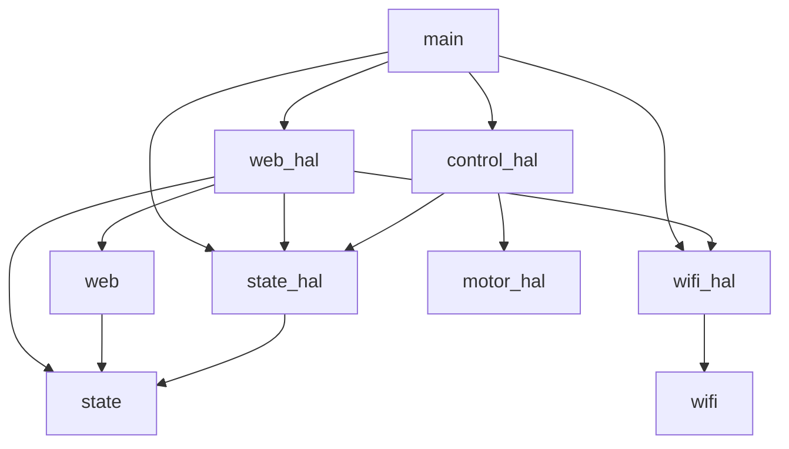
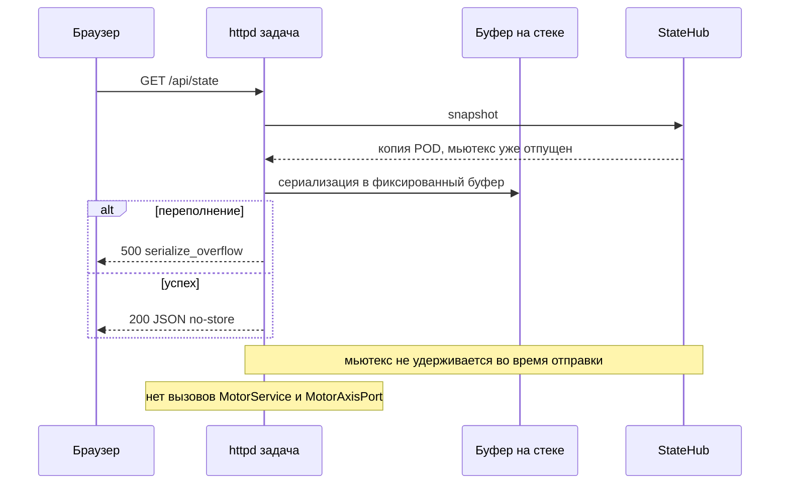
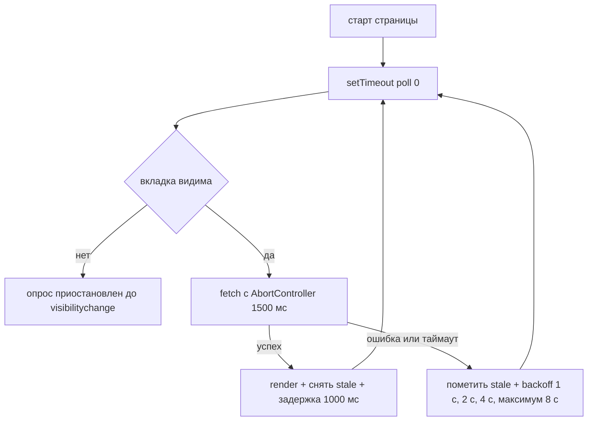
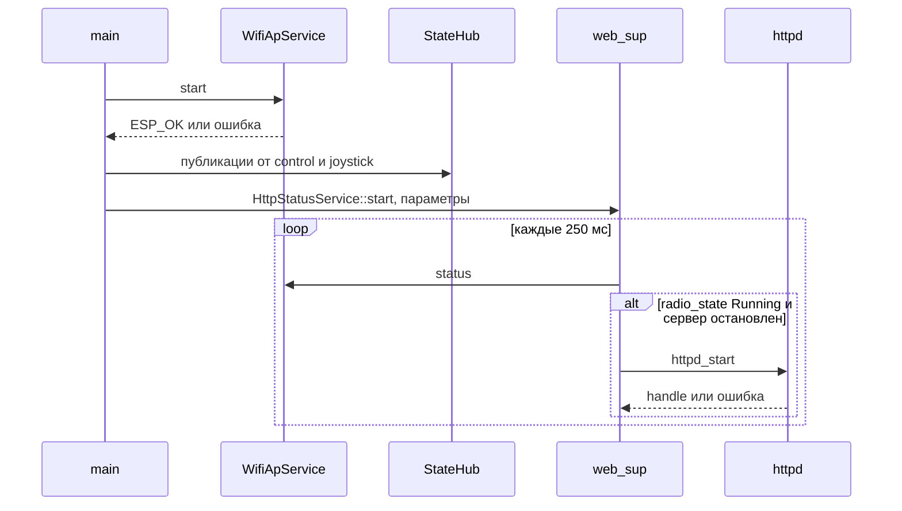
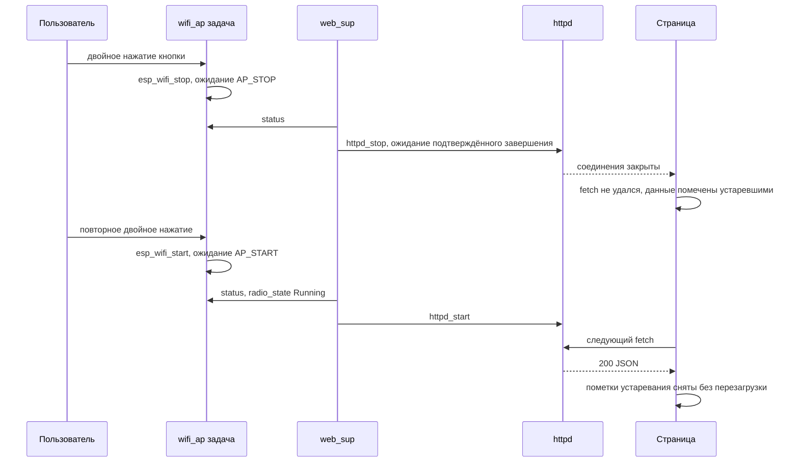

# Веб-этап 1 — локальный HTTP-сервер и базовая страница состояния

- Статус: **проект плана, реализация не выполнялась**
- Дата: 2026-11-15
- Анализируемый коммит: `c6ee7d983578b2ed57a37ff09aa44cb5c35886fa`
  (`refs/heads/main`, прочитан из `.git/refs/heads/main`)
- Стек: **ESP-IDF 6.1.0** + CMake, C++17, FreeRTOS, классический ESP32
  (ESP32-WROOM-32)
- Предыдущие этапы: [0004](../docs/plans/0004-wifi-access-point.md)
  (SoftAP), [0005](../docs/plans/0005-state-layer-and-joystick-control.md)
  (слой состояния и управление от джойстика)
- Связанный документ: [memory-stack-flash-plan.md](memory-stack-flash-plan.md)
  (память, стеки, flash; решения не пересматриваются этим планом)
- Код, конфигурация, `sdkconfig.defaults`, разметка flash, NVS-политика,
  пины, GPTimer, тикеты, эпохи, защёлки и recovery **не изменяются** до
  утверждения плана. Коммиты и push — только по отдельному разрешению.

> Нумерация: файл создан в `plans/` по правилу рабочего каталога. Номер
> `0006` предварительно занят планом памяти; окончательный номер и перенос в
> `docs/plans/` — решение владельца (раздел 10).

---

## 1. Вердикт и границы MVP

### 1.1 Вердикт

1. Добавление локального HTTP-сервера **не требует** изменения согласованной
   архитектуры: `StateHub` уже публикует согласованные копии наблюдаемого
   состояния, `WifiApService` уже публикует подтверждённое состояние радио.
   Веб-слой читает только эти две вещи и больше ничего.
2. Сервер реализуется штатным `esp_http_server` и **не становится** новым
   исполнителем моторных операций: в HTTP-слое нет ни `MotorAxisPort`, ни
   `MotorService`, ни `ControlService`, и в MVP нет ни одного маршрута,
   который что-либо меняет.
3. Двух маршрутов достаточно: `GET /` (встроенная страница) и
   `GET /api/state` (ограниченный JSON, собранный вручную в буфер
   фиксированного размера). WebSocket/SSE не нужны: поллинг 1 Гц решает
   задачу и не требует новых протоколов.
4. Главные риски — не HTTP-код, а **стек задачи `httpd`**, **блокирующая
   отправка медленному клиенту** и **lifecycle при переключении SoftAP**.
   Все три закрываются конфигурацией (`task_stack_size`, `send_wait_timeout`,
   `max_open_sockets`, `lru_purge`) и отдельной задачей-супервизором, а не
   «низким приоритетом» HTTP.
5. Переполнение стека `main`, размер flash и разметка разделов остаются
   **отдельными работами**. Новый сервис создаётся статическим объектом в
   `app_main()` — по уже действующему образцу `access_point` и `hub`, — и
   поэтому не увеличивает кадр стека `main`.

### 1.2 Обязательный MVP

| № | Что входит |
|---|---|
| 1 | `esp_http_server` поднимается на SoftAP-интерфейсе, порт 80 |
| 2 | Одна адаптивная страница с локальными HTML/CSS/JS, встроенными в образ |
| 3 | `GET /api/state` — ограниченный read-only JSON |
| 4 | Обновление страницы `fetch`-поллингом ~1 Гц без перезагрузки |
| 5 | Корректный lifecycle: старт после подтверждённого AP_START, останов при уходе радио из Running, восстановление после повторного включения AP |
| 6 | Ограниченные соединения, таймауты приёма/отправки, фиксированный размер JSON |
| 7 | Диагностика (счётчики сервера) и проверяемые критерии готовности |

### 1.3 Вне границ (не входит и не «попутно» добавляется)

Команды движения и экранный джойстик; `arm`/`disarm`/`stop`/
`acknowledgeFault` из браузера; источник `Browser`, lease и передача
владения; настройка Wi-Fi из браузера; OTA, загрузка файлов, запись
конфигурации; файловая система и SPIFFS/LittleFS; captive portal, mDNS,
режим STA; WebSocket/SSE; доступ через интернет; TLS; CSS/JS-фреймворки,
CDN и любые внешние ресурсы; преобразование полушагов в градусы,
калибровка, `homed`; изменение разметки flash; перенос объектов в `static`
(шаг 2 плана памяти) и уменьшение стека `main`.

---

## 2. Факты актуального кода

Классы доказательств: **(И)** исходники этого коммита, **(Л)** артефакты
сборки, **(ИЗМ)** измерено на ESP32, **(О)** оценка.

### 2.1 Что подтверждено исходниками (И)

| № | Факт | Где |
|---|---|---|
| 1 | `StateHub::snapshot()` берёт мьютекс один раз, копирует POD, отпускает мьютекс и только потом выставляет `generated_us = nowUs()` | [`state_hub.cpp:99`](../components/state_hal/src/state_hub.cpp:99) |
| 2 | Публикация блоков — короткая критическая секция без логирования и вызовов HAL | [`state_hub.cpp:33`](../components/state_hal/src/state_hub.cpp:33), [:63](../components/state_hal/src/state_hub.cpp:63) |
| 3 | `SystemSnapshot` содержит метаданные с тремя раздельными временами (`measured_us`, `polled_us`, `published_us`), `sequence` и `valid` | [`observation.hpp:25`](../components/state/include/state/observation.hpp:25), [:95](../components/state/include/state/observation.hpp:95) |
| 4 | Блоки осей опрашиваются управляющей задачей и могут иметь разное время опроса; `ControlObservation.meta.measured_us` всегда `kNever` | [`observation.hpp:34`](../components/state/include/state/observation.hpp:34), [:55](../components/state/include/state/observation.hpp:55) |
| 5 | Правила свежести и здоровья уже реализованы и покрыты host-тестом: `ageUs`, `freshness`, `axisHealth`, `joyHealth` | [`health.cpp:10`](../components/state/src/health.cpp:10), [:26](../components/state/src/health.cpp:26), [:45](../components/state/src/health.cpp:45) |
| 6 | `axisHealth` возвращает `Unknown/Ok/Stale/Fault/Disabled`; для осей свежесть считается по `polled_us`, а не по времени публикации | [`health.cpp:26`](../components/state/src/health.cpp:26) |
| 7 | `joyHealth` различает `Unknown/Fault/Invalid/Stale/Ok` и учитывает `output_valid` | [`health.cpp:45`](../components/state/src/health.cpp:45) |
| 8 | Словарь фаз, защёлок, источников и причин отказа с текстовыми именами уже существует | [`channels.hpp:18`](../components/state/include/state/channels.hpp:18), [`channels.cpp:10`](../components/state/src/channels.cpp:10) |
| 9 | `motion::AxisState` — 8 значений (`Disabled…Fault`), `FaultReason` — 4 значения; текстовых имён для них нет | [`types.hpp:41`](../components/motion/include/motion/types.hpp:41), [:73](../components/motion/include/motion/types.hpp:73) |
| 10 | `AxisStatus` содержит `position_step` (int64, полушаги), `rate_steps_s` (float, полушаги/с), `energized`, `position_trusted`, `has_fault`, `late_corrections`, `late_replans`, `stale_events`, `rejected_commands` | [`axis_planner.hpp:33`](../components/motion/include/motion/axis_planner.hpp:33) |
| 11 | `ControlService::publishControl()` публикует фазу, защёлку, владельца, поколение, `permit`, `deny`, счётчики доставки/останова | [`control_service.cpp:1000`](../components/control_hal/src/control_service.cpp:1000) |
| 12 | `ControlService::stop()` инвалидирует блоки осей и джойстика в хабе | [`control_service.cpp:298`](../components/control_hal/src/control_service.cpp:298) |
| 13 | `WifiApService::status()` публикует `Lifecycle`, `RadioState`, `Operation`, счётчики; `radio_state` подтверждается событиями `AP_START`/`AP_STOP` | [`wifi_ap_service.hpp:35`](../components/wifi_hal/include/wifi_hal/wifi_ap_service.hpp:35), [`wifi_ap_service.cpp:401`](../components/wifi_hal/src/wifi_ap_service.cpp:401) |
| 14 | `Lifecycle` и `RadioState` — разные понятия; таймаут события переводит радио в `Unknown`, а не в `Stopped` | [`ap_lifecycle.hpp:22`](../components/wifi/include/wifi/ap_lifecycle.hpp:22) |
| 15 | При переключении AP (toggle) драйвер запускается/останавливается, но `netif_` не уничтожается: `teardown()` вызывается только из `stop()` | [`wifi_ap_service.cpp:668`](../components/wifi_hal/src/wifi_ap_service.cpp:668), [:765](../components/wifi_hal/src/wifi_ap_service.cpp:765) |
| 16 | `httpd`-кода в проекте нет: поиск `httpd`, `esp_http_server`, `HTTPD_` по отслеживаемым файлам даёт совпадения только в тексте плана памяти | (И, поиск по репозиторию) |
| 17 | Порядок запуска в `app_main()`: `board::init` → `access_point.start()` → `MotorService::start` → self-test → `StateHub` → `JoystickService` → `ControlService::start`/`arm` → heartbeat каждые `CONFIG_APP_STATUS_PERIOD_MS` (5000 мс) | [`main.cpp:499`](../main/main.cpp:499), [:566](../main/main.cpp:566) |
| 18 | Долгоживущие объекты `MotorService`, `JoystickService`, `ControlService` и `ButtonStatsListener` — **по-прежнему автоматические переменные** `app_main()`; статическими являются только `WifiApService` и `StateHub` | [`main.cpp:511`](../main/main.cpp:511), [:518](../main/main.cpp:518), [:533](../main/main.cpp:533), [:535](../main/main.cpp:535), [:543](../main/main.cpp:543) |
| 19 | Приоритеты и ядра задач: `motor_axis` 10 (ядро 1), `control` 6 (ядро 0), `joystick` 5 (ядро 0), `wifi_ap` 4 (ядро 0) | [`motor_hal/Kconfig.projbuild:7`](../components/motor_hal/Kconfig.projbuild:7), [`control_hal/Kconfig.projbuild:17`](../components/control_hal/Kconfig.projbuild:17), [`input_hal/Kconfig.projbuild:16`](../components/input_hal/Kconfig.projbuild:16), [`wifi_hal/Kconfig.projbuild:64`](../components/wifi_hal/Kconfig.projbuild:64) |
| 20 | Wi-Fi-задача драйвера закреплена на ядре 0, tcpip-задача без привязки; `CONFIG_LWIP_MAX_SOCKETS=10`, `LWIP_MAX_ACTIVE_TCP=16`, `FREERTOS_HZ=100`, task WDT 5 с (без panic) | `sdkconfig:1996`, `:2820`, `:2652`, `:2754`, `:2395`, `:1874` (локальный, неотслеживаемый) |
| 21 | Умолчания `esp_http_server` в текущем `sdkconfig`: `HTTPD_MAX_REQ_HDR_LEN=1024`, `HTTPD_MAX_URI_LEN=512`, `HTTPD_PURGE_BUF_LEN=32`, `HTTPD_WS_SUPPORT` выключен | `sdkconfig:1405`, `:1407`, `:1411`, `:1415` |
| 22 | Заголовок образа объявляет 2 МБ, таблица разделов — штатная single-app, `factory` 0x10000 / 1 МиБ; файла `partitions.csv` в репозитории нет | `sdkconfig:676`, `:713`, `:725`; (И) листинг корня |
| 23 | В отслеживаемой конфигурации только два значения: PHY-калибровка и стек `main` 8192 | [`sdkconfig.defaults:10`](../sdkconfig.defaults:10), [:17](../sdkconfig.defaults:17) |
| 24 | Каталогов `build/` и `build-host/` в рабочем дереве нет: артефактов линковки для этого коммита не существует | (И) листинг корня |
| 25 | `publishControl()` заполняет `meta.polled_us` в каждой публикации, а `measured_us` остаётся `kNever`: возраст блока управления вычисляется по времени опроса без изменения управляющей логики | [`control_service.cpp:1040`](../components/control_hal/src/control_service.cpp:1040) |

### 2.2 Что не подтверждено / не выполнялось

1. **Сборка и размеры для `c6ee7d9`.** Каталога `build/` нет, поэтому
   `idf.py size`, карта линковки, `.bin` и свободное место в разделе
   **не измерялись**. Числа из плана памяти относятся к коммиту `fd6f167` и
   здесь цитируются только как ориентир.
2. **Измерения на устройстве (ИЗМ): отсутствуют полностью** — ни heap, ни
   HWM стеков, ни `sizeof`, ни времени отклика.
3. ~~Точный состав `httpd_config_t` и контракт `httpd_stop()`~~
   **Проверено** по локальной установке ESP-IDF v6.1
   (`/Users/avakym/.espressif/v6.1/esp-idf`); результаты и ссылки — раздел 11.
4. **Однозадачность `esp_http_server` и влияние медленного клиента**: не
   подтверждено, обслуживаются ли сессии одной задачей `httpd` и как именно
   медленный клиент влияет на остальных. Ограничение «задержка не более
   `send_wait_timeout`» не выдвигается: таймаут одной операции отправки не
   равен общему времени обслуживания клиента. Проверяется реализацией IDF
   6.1 и интеграционным тестом.
5. **Фактическое влияние HTTP-нагрузки на `late_*` и Fault осей.** Без
   стендового прогона не заявляется ни наличие, ни отсутствие влияния.

### 2.3 Что из перекрёстных планов уже сделано, а что нет

- Шаг 1 плана памяти (стек `main` 8192 в [`sdkconfig.defaults`](../sdkconfig.defaults:17), опция [`CONFIG_APP_MEMORY_DIAGNOSTICS`](../main/Kconfig.projbuild:33), диагностика в [`main.cpp:323`](../main/main.cpp:323)) — **выполнен**.
- Шаг 2 (перенос долгоживущих объектов в `static`) — **не выполнен**, см.
  факт 18.
- Согласование flash с 4 МиБ и `partitions.csv` — **не выполнено**; этот
  план его не трогает и не блокируется им.

---

## 3. Архитектура, зависимости и владельцы ресурсов

### 3.1 Компоненты

| Компонент | Тип | Содержимое | Зависимости |
|---|---|---|---|
| `web` (новый) | чистая логика C++17, без ESP-IDF | `web::stateJson()` — сериализация снимка в буфер; `web::ServerLifecycle` — автомат запуска/останова; имена enum-значений HTTP-контракта | `state`, `motion`, `input` (только типы) |
| `web_hal` (новый) | ESP-IDF | `HttpStatusService`: владелец `httpd_handle_t`, задача-супервизор, обработчики, встроенные ресурсы страницы, счётчики | `web`, `state`, `state_hal`, `wifi_hal`, `esp_http_server`, `esp_timer` |
| `state` | существующий | **дополняется** двумя функциями имён: `axisStateName()`, `faultReasonName()` (аддитивно, без зависимости от HTTP) | без изменений |
| `main` | существующий | создаёт статический `HttpStatusService` и связывает его с `StateHub` и `WifiApService` | `web_hal` добавляется в `REQUIRES` |

Обоснование двух компонентов вместо одного: host-тесты сериализации,
контракта и автомата жизненного цикла **обязательны** (раздел 9), а
`test/host` собирает только код, свободный от ESP-IDF. Это ровно та же
парадигма, что уже принята в проекте (`motion`/`motor_hal`, `wifi`/`wifi_hal`,
`state`/`state_hal`, `control`/`control_hal`). Второго «слоя» сверх этого не
добавляется: нет event bus, нет универсального router, нет реестра сервисов,
нет шаблонизатора.

### 3.2 Граф зависимостей и разрешённые направления



Разрешено и обязательно:

- `web_hal` читает `StateHub::snapshot()` и `WifiApService::status()`;
- `web_hal` **не** зависит от `motor_hal`, `control_hal`, `control`,
  `input_hal`, `board` и не вызывает ни одного моторного метода;
- `state`, `control`, `wifi`, `wifi_hal` **не** получают зависимости от
  `web`/`web_hal`; в `wifi_hal` не добавляется ни одного упоминания HTTP;
- `main` остаётся единственным местом связывания и запуска.

### 3.3 Точка связывания с SoftAP и её обоснование

`wifi_hal` не знает про HTTP. Связывание выполняет `main`:

```cpp
static web_hal::HttpStatusService web(hub, access_point);
const esp_err_t web_err = web.start();
```

`web_hal` читает **только** `access_point.status()` — уже существующий
публичный read-only снимок, который сегодня читает и heartbeat `main`
([`main.cpp:573`](../main/main.cpp:573)). Обратной зависимости нет: `wifi_hal`
не получает ни callback, ни заголовка HTTP. Альтернатива — узкий интерфейс
`bool apRunning()` в `web` и адаптер в `main` — отвергается как лишняя
абстракция на один вызов; владелец может выбрать её отдельно (раздел 10).

Признак «HTTP разрешено запускать» — **`AccessPointStatus.radio_state ==
RadioState::Running`**, то есть состояние, подтверждённое событием
`WIFI_EVENT_AP_START`, а не `lifecycle` и не успешный возврат
`esp_wifi_start()`. Признак останова — `radio_state != Running`; признак
раннего останова (до фактического выключения радио) — `operation ==
Operation::Stopping`, чтобы страница получила закрытие соединения, а не
таймаут.

### 3.4 Владельцы ресурсов

| Ресурс | Владелец | Правило |
|---|---|---|
| `httpd_handle_t` | `web_hal::HttpStatusService` (единственный, статический объект) | создаётся только в задаче-супервизоре; забывается **только** при подтверждённом завершении, иначе сохраняется как непрозрачная запись без разыменования (раздел 6.1) |
| задача-супервизор `web_sup` | `HttpStatusService` | единственное место вызова `httpd_start`/`httpd_stop` |
| задача `httpd` | `esp_http_server` | создаётся/уничтожается только через `httpd_start`/`httpd_stop` |
| страница (HTML/CSS/JS) | линкер, `.flash.rodata` | доступна только на чтение, без копирования в heap |
| буфер JSON | кадр обработчика на стеке задачи `httpd` | фиксированный размер, без динамических строк |
| копия снимка | кадр обработчика | получается один раз за запрос |
| мьютекс хаба | `StateHub` | удерживается только внутри `snapshot()` |

---

## 4. HTTP- и JSON-контракты

### 4.1 Маршруты

| Метод и путь | Ответ | Назначение |
|---|---|---|
| `GET /` | 200, `text/html; charset=utf-8` | единственная страница, ресурсы внутри неё |
| `GET /api/state` | 200, `application/json; charset=utf-8` | снимок наблюдаемого состояния |
| любой другой путь | 404 | библиотека сама отвечает 404 сообщением и `text/html`; собственный обработчик ошибок выставляет `text/plain; charset=utf-8` и тело `not found` |
| неподдерживаемый метод на известном пути | 405 | URI найден, метод нет — библиотека сама выбирает 405; собственный обработчик ошибок выставляет `text/plain; charset=utf-8` и тело `method not allowed` |

Обязательные заголовки обоих успешных ответов:
`Cache-Control: no-store`, `Content-Length` выставляется одним вызовом
`httpd_resp_send`. `Connection` не задаётся вручную. Сжатие не включается
(раздел 7). Query-строка не разбирается и игнорируется; параметров в MVP нет.
`HEAD` не поддерживается (проверяется в интеграционном тесте, ответ не
должен быть 200 с телом).

Ответы 404/405 завершают соединение: обработчик ошибок по умолчанию
возвращает признак закрытия сокета, поэтому клиент открывает новое
соединение. Это ожидаемое поведение и проверяется интеграционным тестом.

### 4.2 Код ответа и состояния ошибок

| Ситуация | Код | Тело |
|---|---|---|
| Снимок никогда не публиковался | **200** | корректный JSON с `"valid": false` у блоков; отсутствие данных — это данные, а не ошибка сервера |
| Блок опубликован, но данные устарели | 200 | последние значения **сохраняются**, `health: "stale"` и фактический `age_ms` |
| Блок инвалидирован (`meta.valid == false`) | 200 | значения `null`, `valid: false`, `health: "unknown"` |
| Отдельное число непригодно (NaN/Inf/вне диапазона) | 200 | `null` только для этого поля, остальной блок сохраняется |
| Переполнение буфера сериализации | 500 | `{"error":"serialize_overflow"}` — **никогда** частичный 200 |
| Любая другая внутренняя ошибка обработчика | 500 | `{"error":"internal"}` |
| Неизвестный путь | 404 | `not found` |
| Неподдерживаемый метод | 405 | `method not allowed` |
| `httpd` не запущен (AP выключен) | — | соединение отклоняется; страница помечает данные устаревшими |

`503` не используется: «сервер не готов» неотличим от «сети нет», а страница
и так различает эти состояния по факту получения ответа.

Единая политика значений — одна и та же в JSON, в интерфейсе и в тестах:

| Случай | Значение поля | `valid` | `health` | `age_ms` |
|---|---|---|---|---|
| Никогда не публиковалось | `null` | `false` | `"unknown"` | `null` |
| Инвалидировано (`invalidateAxis`/`invalidateJoystick`) | `null` | `false` | `"unknown"` | `null` |
| Опубликовано и устарело | последнее значение | `true` | `"stale"` | фактический |
| Опубликовано и свежо | значение | `true` | `"ok"`/`"fault"`/`"disabled"`/`"invalid"` | фактический |
| NaN/Inf/вне диапазона в одном числе | `null` только в этом поле | по блоку | по блоку | по блоку |

Устаревание **не** обнуляет значения: `null` означает «достоверного значения
не было», а не «данные давно не обновлялись».

### 4.3 JSON-контракт

Один плоский документ, версия контракта фиксирована полем `schema`.
Согласованность: **один** вызов `hub_.snapshot()`, все блоки — из одной
копии. Время устройства: `generated_ms` = `snapshot.generated_us / 1000`.

```json
{
  "schema": 1,
  "generated_ms": 123456,
  "control": {
    "valid": true, "health": "ok", "age_ms": 40,
    "phase": "waiting_neutral",
    "latch": "none",
    "deny": "stale_input",
    "permit": false,
    "owner": "joystick",
    "generation": 3,
    "recovery": false
  },
  "axes": {
    "azimuth": {
      "valid": true, "health": "ok", "age_ms": 12,
      "state": "idle",
      "position_half_steps": "4096",
      "rate_half_steps_s": 0.0,
      "energized": false, "trusted": true,
      "fault": false, "fault_reason": null,
      "read_failures": 0,
      "late_corrections": "0", "late_replans": "0",
      "stale_events": "0", "rejected_commands": "0"
    },
    "altitude": { "...": "тот же набор полей" }
  },
  "joystick": {
    "valid": true, "health": "ok", "age_ms": 8,
    "calibrated": true, "output_valid": true,
    "neutral": true, "fault": false, "read_errors": 0
  },
  "diag": {
    "stop_timeouts": 0, "escalations": 0, "ack_mismatches": 0,
    "delivery_failures": [0, 0], "rejected_intents": 0,
    "notify_failures": 0, "emergency_slot_busy": 0
  }
}
```

Правила полей:

| Поле | Тип | Единица / значения | Если данных нет |
|---|---|---|---|
| `schema` | number | `1` | всегда есть |
| `generated_ms` | number | мс монотонного времени ESP32 (`esp_timer`) | всегда есть |
| `control.health` | string \| null | `unknown`, `ok`, `stale` — по возрасту `meta.polled_us` | `null` |
| `control.age_ms` | number \| null | мс от `meta.polled_us` до `generated_ms` | `null` при `kNever`/обратном времени |
| `control.phase` | string \| null | `disarmed`, `waiting_neutral`, `enabling`, `active`, `stopping` | `null` при `valid=false` |
| `control.latch` | string \| null | `none`, `motor_fault`, `delivery_failed`, `stop_unconfirmed`, `config_invalid` | `null` |
| `control.deny` | string \| null | `state::denyName()` | `null` |
| `control.owner` | string \| null | `none`, `joystick`, `browser`, `automation` | `null` |
| `control.generation` | number | uint32, беззнаковый счётчик | `null` |
| `axes.<id>.health` | string \| null | `unknown`, `ok`, `stale`, `fault`, `disabled` | `null` |
| `axes.<id>.age_ms` | number \| null | мс от `meta.polled_us` до `generated_ms` | `null` при `kNever`/обратном времени |
| `axes.<id>.state` | string \| null | `disabled`, `idle`, `accelerating`, `cruising`, `decelerating`, `holding`, `released`, `fault` | `null` |
| `axes.<id>.position_half_steps` | **string** \| null | int64 полушагов; строка, чтобы не зависеть от точности `Number` | `null` |
| `axes.<id>.rate_half_steps_s` | number \| null | полушаги/с, один знак после точки; допускается только `abs(rate) <= 10000.0`, иначе `null`; `null` также для NaN/Inf | `null` |
| `axes.<id>.energized`, `trusted`, `fault` | bool \| null | из `AxisStatus` | `null` |
| `axes.<id>.fault_reason` | string \| null | `deadline_miss`, `arm_failure`, `watchdog_timeout`, `invalid_state`; только при `fault=true`, иначе `null` | `null` |
| `axes.<id>.late_corrections`, `late_replans`, `stale_events`, `rejected_commands` | **string** | uint64 счётчики | `null` |
| `axes.<id>.read_failures` | number | uint32 | `null` |
| `joystick.health` | string \| null | `unknown`, `ok`, `invalid`, `fault`, `stale` | `null` |
| `joystick.age_ms` | number \| null | мс от `meta.measured_us` | `null` |
| `joystick.calibrated`, `output_valid`, `neutral`, `fault` | bool \| null | из `JoystickObservation` | `null` |
| `diag.*` | number / array[2] | uint32 счётчики `ControlObservation` | всегда числа (0 при отсутствии публикации не выдаётся: при `control.valid=false` значения `null`) |

Явные запреты контракта:

1. `position_half_steps` **не называется** углом; преобразование в градусы,
   калибровка и `homed` в API отсутствуют.
2. Скорость — в полушагах/с, не в об/мин и не в градусах/с.
3. NaN/Inf никогда не попадают в JSON: значение заменяется `null`.
4. Биты внутренней структуры (`last_ticket_id`, `command_epoch`,
   `stop_reason`, `unmet_ready`, `sequence` и т. п.) в MVP не публикуются.
5. Идентификаторы и счётчики uint64 передаются строками; uint32 — числами
   (максимум 4 294 967 295 < 2^53, точность `Number` достаточна).
6. Неизвестное значение enum (испорченная копия, новое значение без
   обновления контракта) публикуется как `"unknown"`, а не как вымышленная
   фаза.
7. Устаревание не обнуляет поля: оно выражается `health: "stale"` и
   `age_ms`. Обнуление зарезервировано за «значения никогда не было».
8. `control` получает возраст по `meta.polled_us`, потому что `measured_us`
   у него всегда `kNever`; управляющая логика не меняется.

### 4.4 Бюджет размера и сериализация

- Константа `web::kMaxStateJsonBytes = 2048`, буфер — на стеке обработчика,
  без `malloc`, без `std::string`.
- `web::stateJson(snapshot, options, char* out, size_t capacity, size_t* written)`
  возвращает `SerializeResult::Ok` или `SerializeResult::Overflow` и **не
  пишет** частично валидный документ: при переполнении обработчик отвечает
  500.
- Ручная ограниченная сериализация выбрана вместо `cJSON`. Причины:
  отсутствие динамических выделений и фрагментации в обработчике; явный
  бюджет размера; детерминированный порядок полей; host-тестируемость;
  полный контроль над NaN/Inf и над форматом чисел. `cJSON` (компонент
  `json` в IDF) пришлось бы дополнять проверкой результата и подсчётом
  размера, а ручной писатель для 40 коротких полей проще и меньше.
- Дробные значения формируются целочисленной арифметикой, чтобы не зависеть
  от поддержки `%f` в newlib и от локали. Порядок обработки скорости:
  1. `std::isfinite(rate)` — иначе `null`;
  2. проверка диапазона **до** умножения: `abs(rate) <= 10000.0f` (предел
     конфигурации осей — 1600 полушагов/с, поэтому 10000 заведомо выше любой
     допустимой уставки); иначе `null`, а не насыщение;
  3. знак и модуль разделяются до округления: `-0.0f` печатается как `0.0`,
     для отрицательных значений печатается `'-'` и модуль;
  4. `mag_x10 = (int32_t)(mag * 10.0f + 0.5f)`, затем целая часть и ровно
     один десятичный знак: максимум модуля — 100000, переполнение `int32`
     недостижимо;
  5. каждая запись проверяет остаток ёмкости и учитывает завершающий `'\0'`:
     `Ok` возвращается только при полностью записанном документе и нуле.

  `null` для скорости означает «значение непригодно», а не «скорость ноль».
- Тест максимального заполнения (раздел 9) доказывает, что худший случай
  (int64 min, uint64 max, самые длинные имена) укладывается в 2048 байт с
  запасом.

### 4.5 Обработчик `/api/state`: порядок действий



Обязательные свойства обработчика:

- ровно один `snapshot()` на запрос;
- ни одного обращения к `MotorService`, `MotorAxisPort`, `ControlService`;
- ни одного удержания мьютекса хаба дольше копирования;
- ни одного `ESP_LOGI` на каждый запрос (счётчики вместо логов);
- время получения снимка и сериализации измеряется отдельно; socket timeout
  ограничивает отдельную операцию отправки, общий дедлайн ответа в MVP не
  гарантируется.

---

## 5. Макет страницы и состояния интерфейса

### 5.1 Состав

Один файл `components/web_hal/www/index.html` со встроенными `<style>` и
`<script>`. Внешних шрифтов, скриптов, CSS, CDN и сетевых запросов, кроме
`/api/state`, нет. `viewport` для телефона, одна колоночная раскладка до
`760 px`, две колонки выше.

| Блок | Содержимое |
|---|---|
| Заголовок | «Telescope mount»; бейдж HTTP: `ответ получен` / `таймаут` / `ошибка` |
| Время | «на устройстве обновлено N мс назад» (по `age_ms`/`generated_ms`) и «получено N с назад» (часы браузера), раздельно |
| Управление | фаза, защёлка, `permit`, владелец, причина отказа, возраст и свежесть блока управления отдельной пометкой |
| Ось азимута / высоты | состояние, позиция в полушагах, скорость в полушагах/с, `energized`, `position_trusted`, `health` |
| Джойстик | валидность, свежесть, калибровка, нейтраль, fault |
| Свёрнутый блок «Диагностика» (`<details>`) | счётчики ошибок: остановы, эскалации, несовпадения ack, отказы доставки, отклонённые намерения, `late_*`, `stale_events`, `rejected_commands` |

Отображаемые состояния:

| Состояние | Как выглядит |
|---|---|
| нет данных (`valid=false` или `null`) | прочерк «—» и явная пометка «нет данных»; **никаких нулей вместо неизвестного** |
| источник устарел (`health = stale`), HTTP отвечает | блок получает класс `stale` и пометку «устарело»; бейдж HTTP остаётся «ответ получен» — это разные диагнозы |
| последний `fetch` не удался дольше 3 с | бейдж HTTP «нет ответа»/«таймаут», все значения дополнительно помечаются устаревшими, но не стираются |
| ошибка устройства (500) | бейдж HTTP «ошибка устройства», данные помечаются устаревшими |
| связь восстановлена | на следующем успешном ответе пометки снимаются сами, перезагрузка не нужна |

Запрещено на странице: пароль SoftAP и любые секреты; активные кнопки
управления; надпись «всё исправно» на основании лишь успешного HTTP-ответа
(здоровье показывается по `health`, фазе и защёлке); фиктивные значения
вместо неизвестных. Подключение к странице **не даёт** никаких прав на
моторы — это написано в подвале страницы.

Доступность HTTP и здоровье источника показываются **независимо**: сервер
может отвечать, пока управляющая задача уже не публикует состояние.
«Нет ответа» означает только отсутствие HTTP-ответа и никогда не выводится
из `health`.

### 5.2 Обновление данных



Обязательные свойства: не более одного незавершённого запроса (флаг
`inFlight`); повтор только через `setTimeout` и только после завершения
предыдущего; `AbortController` с таймаутом 1.5 с; экспоненциальный backoff до
8 с; при `document.hidden` опрос приостанавливается и возобновляется по
`visibilitychange`; таймеры не накапливаются; через 3 с без успеха старые
значения помечаются устаревшими; сравнение часов браузера и `esp_timer` не
выполняется вовсе — устройство само сообщает `age_ms` и `health`.

---

## 6. Последовательности запуска, останова и ошибок

### 6.1 Автомат жизненного цикла (чистая логика `web::ServerLifecycle`)

Состояния: `Stopped`, `Starting`, `Running`, `Stopping`, `StopFailed`,
`StartFailed`. Входы: `apRunning`, `apStopping`, подтверждённый результат
запуска, подтверждённый результат останова, номер тика. Выходы — действия
`None/Start/Stop`, счётчики `starts`, `stops`, `start_failures`,
`stop_unconfirmed`, `last_error`.

**Ключевое правило:** `Stopped` и «забывание» handle допустимы только при
**подтверждённом** завершении сервера. Ненулевой результат `httpd_stop()` сам
по себе не доказывает, что серверная задача завершилась и ресурсы
освобождены; документированный успешный вызов — блокирующий и доказывает это.
Реальные коды и пути `httpd_stop()` в используемой версии ESP-IDF 6.1
разбираются до реализации автомата (шаг 1 раздела 8.3), а автомат строится по
проверенному контракту, а не по предположению.

Правила:

1. `Stopped` + `apRunning` + разрешённая повторная попытка → `Start`.
2. `Starting` + подтверждённый успех → `Running`; ошибка старта →
   `StartFailed`, повтор не раньше `WEB_START_RETRY_MS`.
3. `Running` + (`!apRunning` или `apStopping`) → `Stop`.
4. `Stopping` + **подтверждённое** завершение → `Stopped`, handle
   забывается.
5. `Stopping` + завершение **не подтверждено** → `StopFailed`: действие
   `Start` запрещено безусловно, handle не передаётся в `httpd_start`.
   Проверенный контракт v6.1 (раздел 11): `ESP_ERR_INVALID_ARG` возвращается
   только для `NULL` handle; `ESP_FAIL` — при неудаче отправки управляющего
   сообщения, причём сервер продолжает работать, а handle остаётся валидным;
   `ESP_OK` — единственный код, доказывающий останов и освобождение. Поэтому
   при `ESP_FAIL` повтор останова разрешён и является штатным путём
   восстановления (с интервалом и ограничением числа попыток); при
   `ESP_ERR_INVALID_ARG` и любом неизвестном коде handle больше не
   разыменовывается, сервис остаётся в `StopFailed`, пишет в лог один раз и
   увеличивает `stop_unconfirmed`.
6. Повторные одинаковые события AP не порождают повторных действий.
7. Второй экземпляр невозможен: один объект, один handle, действие `Start`
   выдаётся только из `Stopped`/`StartFailed`.

**Откат частичного старта.** `httpd_start()` может вернуть handle, а
`httpd_register_uri_handler()` для одного из маршрутов — ошибку. Порядок:
зарегистрированные маршруты помечаются к удалению (они всё равно
освобождаются при остановке сервера), затем вызывается `httpd_stop()`.
Подтверждённое завершение → `StartFailed` с `start_failures++` и повтором по
таймауту; неподтверждённое → `StopFailed` по правилу 5. Сервис не публикует
состояние `Running`, пока все маршруты не зарегистрированы.

### 6.2 Запуск прошивки



`HttpStatusService::start()` **не блокирует** ожидание Wi-Fi: он запускает
задачу-супервизор и возвращает `ESP_OK`. Отказ запуска задачи — ошибка
`ESP_ERR_NO_MEM`, `main` только логирует её и продолжает работу.
Если `access_point.start()` завершился ошибкой, HTTP не поднимается: без
`netif` серверу нечего слушать, и супервизор сам останется в `Stopped`.

### 6.3 Переключение SoftAP при открытой странице



Ключевые факты, делающие схему возможной: `netif` при toggle не
уничтожается (факт 15), поэтому повторный `httpd_start` безопасен;
`radio_state` подтверждается событиями (факт 13), поэтому старт не гоняется
с драйвером.

Длительность самого останова не обещается: она измеряется (сценарий 6
раздела 9.2) и ограничена только тем временем, которое сервер реально тратит
на закрытие сессий.

### 6.4 Ошибка запуска httpd и повторные события

- `httpd_start` вернул ошибку → состояние `StartFailed`,
  `start_failures++`, `last_error` сохраняется, `ESP_LOGE` один раз на серию.
  Повтор не чаще `WEB_START_RETRY_MS` (5000 мс), без busy-loop.
- `httpd_stop` вернул ошибку → состояние `StopFailed`,
  `stop_unconfirmed++`, предупреждение в лог. Handle не обнуляется и не
  разыменовывается, `Start` запрещён; повтор останова — только если контракт
  IDF для этого кода допускает его безопасно (проверяется на шаге 1).
  Правило «любая ошибка останова = сервер уничтожен» не применяется.
- Быстрое переключение AP: супервизор последователен, `Stopping` не
  прерывается; пришедший во время остановки `apRunning` обрабатывается на
  следующей итерации после `Stopped`.
- Запрос во время останова: соединение закрывается, страница помечает данные
  устаревшими; повторный запрос после восстановления AP обслуживается новым
  сервером.
- Отказ HTTP **не влияет** на управление: нет общих мьютексов, нет вызовов в
  моторный порт, задача-супервизор имеет приоритет ниже `wifi_ap`.

### 6.5 Запреты жизненного цикла (обязательные)

Никаких `httpd_start`/`httpd_stop` в ISR, в callback кнопки, в обработчике
системных событий `esp_event` и в `esp_timer`-callback. Никакого второго
экземпляра сервера. Никакого использования освобождённого handle. Никакой
блокирующей остановки из задачи `control` или из heartbeat `main`.

---

## 7. Оценка flash/RAM и способ измерения

### 7.1 Конфигурация сервера (предлагаемые значения)

| Параметр | Значение | Обоснование |
|---|---|---|
| `stack_size` | 8192 | поле v6.1 называется `stack_size` (не `task_stack_size`); буфер JSON 2048 + кадры обработчика + внутренние вызовы `httpd_resp_send`; уменьшение до 6144 — только после измерения HWM |
| `task_priority` | 3 | ниже `wifi_ap` (4), `joystick` (5), `control` (6); отправка блокирующая и уступает CPU |
| `core_id` | 0 | привязка задачи `httpd`; рядом с Wi-Fi/lwIP, задачи осей остаются на ядре 1 с приоритетом 10 |
| `max_open_sockets` | 3 | страница + запас + один «зависший» клиент; v6.1 требует `max_open_sockets + 3 <= CONFIG_LWIP_MAX_SOCKETS` (локально 10), то есть допустимо не более 7 |
| `backlog_conn` | 2 | короткая очередь accept |
| `max_uri_handlers` | 4 | два реальных маршрута и запас |
| `max_resp_headers` | 4 | `Content-Type`, `Content-Length`, `Cache-Control`, запас |
| `recv_wait_timeout` | 2 с | таймаут **одной** операции приёма, а не всего запроса |
| `send_wait_timeout` | 2 с | таймаут **одной** операции отправки, а не всего ответа |
| `lru_purge_enable` | включён | при исчерпании сокетов закрывается самый старый |
| `keep_alive_enable` | включён | на принятом сокете включается `SO_KEEPALIVE` и задаются `TCP_KEEPIDLE`, `TCP_KEEPINTVL`, `TCP_KEEPCNT`; нуль в `keep_alive_*` означает умолчание 5/5/3 с; переключателем HTTP persistent connections не является |
| задача-супервизор | стек 3072, приоритет 2, ядро 0, период 250 мс | только чтение статуса и lifecycle |

`socket`-таймауты — единственный обещанный предел. В v6.1 они применяются
как `SO_RCVTIMEO` и `SO_SNDTIMEO` на каждом принятом сокете, то есть
ограничивают **отдельный** вызов `recv()`/`send()`. Один ответ выполняет
несколько вызовов `send()` (строка статуса, каждый дополнительный заголовок,
пустая строка, тело), поэтому суммарное время ответа этими настройками не
ограничено, и общий дедлайн ответа в MVP не обещается.

`keep_alive_enable` управляет **TCP keepalive** и не является переключателем
HTTP persistent connections. Возможность обслуживать несколько
HTTP-запросов в одном TCP-соединении по исходнику v6.1 выглядит
поддержанной (сессия не удаляется после успешного запроса), но обработки
заголовка `Connection: close` в компоненте не найдено; поведение
подтверждается интеграционным тестом. Настройка TCP keepalive **не**
используется как доказательство общего дедлайна запроса или гарантированного
быстрого закрытия соединения.

Имена полей и значения по умолчанию сверены с локальной установкой ESP-IDF
v6.1; результаты — раздел 11.

### 7.2 Оценка прироста (О, до измерения)

| Статья | Оценка | Примечание |
|---|---|---|
| Код `esp_http_server` + зависимости | 20–35 КиБ flash | ориентир из плана памяти, не приёмка |
| Страница (HTML+CSS+JS) | 16 615 Б flash (измерено) | один файл в `.flash.rodata`; сжатие не включено. Оценка 6–9 КиБ оказалась заниженной |
| Строки контракта и имена enum | < 1 КиБ flash | статические литералы |
| Стек задачи `httpd` | 8192 Б из heap | постоянное выделение на время работы сервера |
| Стек супервизора | 3072 Б из heap | постоянно |
| Буфер JSON | 2048 Б на стеке обработчика | без heap |
| Сессия TCP | не фиксированная величина | `TCP_SND_BUF` 5760 и `TCP_WND` 5760 — верхние ориентиры окна/буфера, а не доказанный расход соединения; реальный расход зависит от MSS и нагрузки и измеряется |
| Заголовки запроса | `HTTPD_MAX_REQ_HDR_LEN` 1024 на запрос | это **не** весь расход запроса: буфер заголовков — только часть |
| Временные выделения в обработчике | 0 | сериализация и копия — на стеке; структуры сессии выделяются при accept |
| Временные выделения самой библиотеки | `malloc`/`free` буфера заголовков ответа на каждый `httpd_resp_send` | подтверждено по исходнику v6.1; размер ограничен строкой статуса и заголовками, влияние на фрагментацию измеряется |

Измеренный итог (раздел 12): **+73 008 Б `.bin`**, из них Flash Code
+44 500 Б и Flash Data +28 464 Б; `.bss` +200 Б. Стеки задач (8192 + 3072)
выделяются из heap во время работы сервера. Свободное место в разделе
`factory` (1 МиБ) после включения сервера — **134 400 Б (13%)**. Запас
достаточен для ресурсов страницы, но сессионные буферы на каждое соединение
по-прежнему не измерялись на устройстве.

### 7.3 Как измерять

До и после реализации, на одном и том же коммите и конфигурации:

```sh
idf.py size
idf.py size-components      # дельта esp_http_server и web_hal
idf.py size-files           # размер index.html в образе
ls -l build/telescope_mount.bin
```

Runtime — через уже существующую диагностику
[`CONFIG_APP_MEMORY_DIAGNOSTICS`](../main/Kconfig.projbuild:33):
`logHeapSummary("boot")`, `logHeapSummary("periodic")`, `HWM` задач.
Дополнительно сервис публикует свои счётчики (`requests_served`,
`requests_failed`, `serialize_overflows`, `starts`, `stops`,
`start_failures`, `stop_errors`, `client_timeouts`) в существующий
heartbeat-лог `main` (без нового маршрута API и без логов на каждый запрос).

Сценарии измерения: пустой старт без браузера; 10 минут поллинга 1 Гц;
два клиента; медленный клиент; 10 переключений AP; сравнение `free`,
`min_free`, `largest_free_block` и HWM до/после.

---

## 8. Список файлов и порядок реализации

### 8.1 Новые файлы

| Файл | Назначение |
|---|---|
| [`components/web/CMakeLists.txt`](../components/web/CMakeLists.txt) | чистый компонент, `REQUIRES state motion input` |
| [`components/web/include/web/state_json.hpp`](../components/web/include/web/state_json.hpp) | `kMaxStateJsonBytes`, `SerializeOptions`, `SerializeResult`, `stateJson()` |
| [`components/web/src/state_json.cpp`](../components/web/src/state_json.cpp) | ограниченный писатель JSON, имена enum контракта |
| [`components/web/include/web/server_lifecycle.hpp`](../components/web/include/web/server_lifecycle.hpp) | автомат `ServerLifecycle` и его счётчики |
| [`components/web/src/server_lifecycle.cpp`](../components/web/src/server_lifecycle.cpp) | переходы, защита от повторного старта |
| [`components/web_hal/Kconfig.projbuild`](../components/web_hal/Kconfig.projbuild) | `WEB_*`: включение, стек, приоритет, ядро, сокеты, таймауты, период супервизора |
| [`components/web_hal/CMakeLists.txt`](../components/web_hal/CMakeLists.txt) | `REQUIRES web state state_hal wifi_hal esp_http_server esp_timer` + `EMBED_FILES www/index.html` |
| [`components/web_hal/include/web_hal/http_status_service.hpp`](../components/web_hal/include/web_hal/http_status_service.hpp) | публичный API сервиса и снимок его счётчиков |
| [`components/web_hal/src/http_status_service.cpp`](../components/web_hal/src/http_status_service.cpp) | супервизор, обработчики, регистрация маршрутов, ошибки |
| [`components/web_hal/www/index.html`](../components/web_hal/www/index.html) | страница целиком |
| `test/host/test_state_json.cpp` | host-тесты сериализации и контракта |
| `test/host/test_server_lifecycle.cpp` | host-тесты автомата жизненного цикла |

### 8.2 Изменяемые файлы

| Файл | Изменение |
|---|---|
| [`main/CMakeLists.txt`](../main/CMakeLists.txt:12) | `web_hal` в `REQUIRES` |
| [`main/main.cpp`](../main/main.cpp:533) | статический `HttpStatusService`, вызов `start()` после запуска служб, публикация счётчиков в heartbeat |
| [`components/state/include/state/channels.hpp`](../components/state/include/state/channels.hpp:59), [`channels.cpp`](../components/state/src/channels.cpp:10) | аддитивно: `axisStateName()`, `faultReasonName()` |
| [`test/host/CMakeLists.txt`](../test/host/CMakeLists.txt:82) | библиотека `web_host` и два новых теста |
| [`README.md`](../README.md:30) | абзац о веб-этапе и ссылка на план |
| `docs/plans/0006-…` | перенос/нумерация после согласования |

Ни `sdkconfig.defaults`, ни разметка, ни `wifi_hal`, ни `motion`,
`motor_hal`, `control`, `control_hal`, `input`, `input_hal`, `board` не
меняются.

### 8.3 Порядок работ

1. **Сверка API IDF.** Проверить по `esp_http_server.h` и исходнику
   компонента `esp_http_server` версии 6.1: поля `httpd_config_t`;
   сигнатуру `httpd_start`; поведение кодов при неподдерживаемом методе; все
   пути и коды возврата `httpd_stop()` и что каждый из них доказывает о
   завершении серверной задачи и освобождении ресурсов. Результат
   фиксируется в журнале таблицей «код → освобождение доказано → разрешённое
   действие».
2. **Чистый компонент `web` + host-тесты.** Контракт и автомат без железа.
3. **Каркас `web_hal`: `GET /`.** Встроенная страница через `EMBED_FILES`,
   сборка, открытие страницы без API (данные «—»).
4. **`GET /api/state`.** Копия снимка, сериализация, коды, заголовки,
   отсутствие логов на запрос.
5. **Lifecycle-супервизор и связывание в `main`.** Старт после AP_START,
   останов при выключении AP, восстановление, повтор при ошибке запуска.
6. **Настройка ресурсов по измерениям.** Стек, таймауты, число сокетов,
   включение/выключение keep-alive — только по результатам HWM и heap.
7. **Документация и журнал.** Обновить `README`, записать измерения и
   невыполненные проверки.

Каждый шаг завершается сборкой; шаги 3–5 — без питания моторов.

---

## 9. Host-, интеграционные и стендовые тесты

### 9.1 Host-тесты (`test/host`, без ESP-IDF)

`test_state_json.cpp`:

1. Нормальный снимок: поля, единицы, имена enum, отсутствие лишних ключей.
2. Пустой снимок (`valid=false` у всех блоков): все измеряемые поля `null`,
   документ валиден.
3. `rate_steps_s` = NaN, +Inf, −Inf → `null`, остальной документ валиден.
4. Максимальные значения: `position_step` = INT64_MIN/MAX, `uint64` =
   UINT64_MAX, `uint32` = UINT32_MAX — точное совпадение строк, отсутствие
   округления.
5. `polled_us`/`measured_us` = `kNever` → `age_ms` null, `health` =
   `unknown`; обратное время (`polled_us > now`) → `null`, не отрицательный
   возраст.
6. Пороговые значения свежести: возраст ровно `max_age` и `max_age + 1` →
   `ok` и `stale`.
7. Испорченные enum (приведение за границу диапазона) → `"unknown"`, без UB.
8. Нехватка выходного буфера: `capacity` на 1 байт меньше нужного →
   `Overflow`, буфер не содержит валидного документа; `capacity` ровно по
   размеру (с завершающим нулём) → `Ok`.
9. Худший случай заполнения укладывается в `kMaxStateJsonBytes`; проверяются
   три ёмкости: ровно по размеру, на один байт меньше, заведомо большая.
10. Формат скорости: `-0.0` → `0.0`; `-0.1` → `-0.1` с сохранённым знаком;
    `0.05`, `0.049999`, `-0.05` — фиксированные ожидаемые строки округления;
    `10000.0` и `-10000.0` допустимы, `10000.1` и `-10000.1` → `null`;
    `1e30f`, `FLT_MAX`, `-FLT_MAX` → `null` без переполнения `int32`;
    `FLT_MIN` → `0.0`.
11. Политика null: блок опубликован и устарел → значения сохраняются,
    `health: "stale"`, `age_ms` фактический; блок инвалидирован → все
    значения `null`, `valid: false`; NaN в одном поле → `null` только в нём,
    остальной блок сохраняется.
12. `control` публикует `health`/`age_ms` по `meta.polled_us`: различаются
    свежий, устаревший и `kNever` случаи; при устаревании `phase`, `latch` и
    `permit` не обнуляются.

`test_server_lifecycle.cpp`:

1. `apRunning=false` → сервер не запускается.
2. `apRunning=true` → ровно одно действие `Start`, затем `Running`.
3. Повторный `apRunning=true` не даёт второго `Start`.
4. `apRunning=false` в `Running` → `Stop`, затем `Stopped`.
5. Ошибка старта → `StartFailed`, повтор не раньше `retry_ms`; успех после
   неудачи → `Running`.
6. **Подтверждённое** завершение останова → `Stopped`, handle забывается,
   новый `Start` при `apRunning` разрешён.
7. `ESP_FAIL` от останова (сервер по контракту жив) → `StopFailed`,
   `Start` запрещён, повтор `Stop` выполняется с интервалом и ограничением
   числа попыток; `ESP_ERR_INVALID_ARG` или неизвестный код → терминальное
   `StopFailed` без дальнейшего разыменования handle.
8. Откат частичного старта: `Start` + ошибка регистрации маршрута +
   подтверждённый `Stop` → `StartFailed`, сервер не считается работающим;
   тот же сценарий с неподтверждённым `Stop` → `StopFailed`.
9. `apStopping=true` в `Running` → ранний `Stop`.
10. Быстрая последовательность вкл/выкл/вкл: не более одного активного
    перехода, счётчики согласованы, второй `Start` не выдаётся.

### 9.2 Интеграционные проверки на устройстве

1. Загрузка без подключённого браузера: сервер поднят, heap и HWM сняты.
2. Открытие страницы с телефона: значения соответствуют heartbeat-логу
   `main` на тот же момент.
3. Два клиента одновременно: оба получают ответ, соединений не больше
   настроенного предела.
4. 30 минут поллинга 1 Гц: `free`/`min_free`/`largest_free_block` и HWM
   стабилизируются, роста числа задач нет.
5. Медленный/оборванный клиент: измеряются длительность ответа, задержка
   второго клиента и момент закрытия соединения. Общий предел «не больше
   `send_wait_timeout`» не проверяется как контракт, потому что таймаут
   относится к одной операции; результат записывается числами.
6. Выключение и включение AP при открытой странице: страница помечает данные
   устаревшими, после включения обновляется сама; второго сервера нет.
7. Ошибка запуска HTTP (искусственно: недоступный netif либо ошибка
   регистрации маршрута): `start_failures` растёт с интервалом повтора,
   состояние не публикуется как `Running`, управление джойстиком работает,
   страница недоступна.
8. Восстановление страницы после потери связи: без ручной перезагрузки.
9. Сравнение heap и HWM до/после запуска сервера (одна и та же сборка,
   с включённым и выключенным `WEB_ENABLED`).
10. Отсутствие записи в NVS/flash от HTTP: сервис не пишет ничего;
    проверяется по коду и по логу.
11. Неподтверждённый останов (инъекция ошибки в обёртке остановки): сервис
    переходит в `StopFailed`, новый `Start` не выполняется, второй экземпляр
    сервера не создаётся, состояние видно в диагностике.
12. Длительность останова измеряется отдельно для простаивающего сервера,
    сервера с активным запросом и сервера с медленным клиентом.

### 9.3 Стендовой прогон

Отдельный контролируемый прогон **с питанием моторов**: движение от
джойстика при открытой странице с поллингом 1 Гц. Фиксируются `late_*`,
`stale_events`, `rejected_commands`, Fault осей, минимальный свободный heap и
HWM `httpd`/`web_sup`. Первый аппаратный запуск веб-этапа выполняется **без
питания моторов**; наличие страницы не считается доказательством
безопасности движения.

---

## 10. Критерии готовности и решения владельца

### 10.1 Критерии готовности

1. `idf.py build` без ошибок; новых предупреждений нет.
2. `GET /` → 200, `text/html`, страница открывается на телефоне и ноутбуке
   без внешних запросов.
3. `GET /api/state` → 200, `application/json`, документ разбирается
   `python -m json.tool`; при `valid=false` нет ни одного вымышленного нуля.
4. Неизвестный путь → 404, неподдерживаемый метод → 405 (фактический код
   подтверждён тестом).
5. `Cache-Control: no-store` присутствует в обоих ответах.
6. Переполнение сериализации невозможно: host-тест худшего случая проходит,
   при искусственном уменьшении буфера ответ 500 без частичного тела.
7. В обработчиках нет вызовов моторного слоя; `nm`/`grep` по компоненту
   `web_hal` не содержит символов `MotorService`, `MotorAxisPort`,
   `ControlService`.
8. `wifi_hal` не содержит ни одного упоминания HTTP; `state`/`control` не
   зависят от `web`.
9. Десять переключений AP с открытой страницей: сервер поднимается и
   опускается, счётчики согласованы, второй экземпляр не создаётся.
10. 30 минут поллинга: нет накопительного роста занятой памяти, нет роста
    числа задач; HWM `httpd` ≥ 1536 Б, `web_sup` ≥ 1024 Б.
11. Длительность ответа, влияние медленного клиента на второго и
    длительность останова **измерены и записаны числами**; общий предел
    «не больше двух секунд» не заявляется.
12. Наличие/отсутствие влияния на `late_*` и Fault **измерено** на стенде и
    записано в отчёт; без измерения утверждение не делается.
13. В отчёте раздельно указаны: изменения файлов, результаты сборки, размеры
    flash/RAM до и после, измерения на устройстве, невыполненные проверки.
14. Останов считается завершённым только при подтверждении;
    неподтверждённый останов не приводит ни к `Stopped`, ни к новому
    `Start`.
15. HTTP-доступность и свежесть источников показываются независимо:
    работающий сервер с устаревшим `control` не помечается как «нет ответа».
16. Единая политика значений соблюдена в JSON, интерфейсе и тестах:
    устаревшие значения не обнуляются.

### 10.2 Решения, требующие подтверждения владельца

| № | Вопрос | Предложение плана |
|---|---|---|
| 1 | Разделение `web` + `web_hal` против одного `web_hal` | два компонента: обязательны host-тесты, а `test/host` не собирает код с ESP-IDF |
| 2 | Связывание с SoftAP: прямой read-only вызов `access_point.status()` из `web_hal` или узкий интерфейс в `web` | прямой вызов: меньше кода, `wifi_hal` не получает обратной зависимости |
| 3 | Обязательность API `deny` и `fault_reason` в MVP | включены: страница должна объяснять, почему движения нет, не выдавая фиктивных значений |
| 4 | Размер стека `httpd` 8192 против 6144 | 8192 по умолчанию, снижение — только после измерения HWM |
| 5 | keep-alive и число сокетов | включён, `max_open_sockets` = 3, LRU-purge |
| 6 | Наличие `CONFIG_APP_WEB_ENABLED` (default y) для сборки без сервера | включить: нужна для A/B-измерения и как аварийный откат |
| 7 | Добавление `axisStateName()`/`faultReasonName()` в компонент `state` | аддитивно в `state`, рядом с существующим словарём |
| 8 | Страница раз в 3 с считает данные устаревшими; скрытая вкладка приостанавливает опрос | принято как поведение по умолчанию |
| 9 | Отсутствие TLS и аутентификации; тестовый пароль `12345678` подлежит смене | риск принят для локального MVP, ограничения описаны в README |
| 10 | Имя и номер документа (`plans/…` сейчас, `docs/plans/0006/0007` после переноса плана памяти) | номер `0006` предварительно занят планом памяти |
| 11 | Политика при неподтверждённом останове: оставаться в `StopFailed` до перезагрузки или разрешить одну проверенную повторную попытку | оставаться в `StopFailed`; повтор — только если контракт IDF это допускает |

### 10.3 Ограничения, которые план фиксирует явно

- Локальный HTTP без TLS: любой клиент в SoftAP с паролем читает состояние.
  Запись запрещена архитектурно (нет маршрутов), но шифрования трафика нет.
- Один МБ раздела `factory` и 2 МБ в заголовке образа не меняются; при
  будущем согласовании flash этот план не требует новых разделов.
- Файловая система не добавляется: страница встроена в образ.
- Сжатие ресурсов не включается; включать только при измеренной пользе.
- Если измерения покажут нехватку heap или влияние на оси, ответ на это —
  отдельное решение владельца (уменьшение поллинга, отключение keep-alive,
  перенос `httpd` на ядро 1, согласование буферов Wi-Fi/lwIP), а не «попутная
  правка» этого этапа.

---

## 11. Журнал шага 1: сверка с ESP-IDF 6.1

Источник: локальная установка `/Users/avakym/.espressif/v6.1/esp-idf`,
`version.txt` = `v6.1`. Ниже — только то, что прочитано в этой установке.

### 11.1 `httpd_config_t`

| Поле | Тип | Значение по умолчанию | Примечание |
|---|---|---|---|
| `task_priority` | unsigned | `tskIDLE_PRIORITY+5` | приоритет задачи `httpd` |
| `stack_size` | size_t | 4096 | **имя поля — `stack_size`**, не `task_stack_size` |
| `core_id` | BaseType_t | `tskNO_AFFINITY` | можно закрепить на ядре 0 |
| `task_caps` | uint32_t | `MALLOC_CAP_INTERNAL \| MALLOC_CAP_8BIT` | память стека задачи |
| `max_req_hdr_len` | size_t | `CONFIG_HTTPD_MAX_REQ_HDR_LEN` (1024) | можно переопределить |
| `max_uri_len` | size_t | `CONFIG_HTTPD_MAX_URI_LEN` (512) | можно переопределить |
| `server_port` / `ctrl_port` | uint16_t | 80 / `ESP_HTTPD_DEF_CTRL_PORT` | управляющий UDP-порт отдельный |
| `max_open_sockets` | uint16_t | 7 | требует `+3 <= CONFIG_LWIP_MAX_SOCKETS` |
| `max_uri_handlers` | uint16_t | 8 | |
| `max_resp_headers` | uint16_t | 8 | |
| `backlog_conn` | uint16_t | 5 | |
| `lru_purge_enable` | bool | `false` | поле существует в v6.1 |
| `recv_wait_timeout` / `send_wait_timeout` | uint16_t, с | 5 / 5 | `SO_RCVTIMEO` / `SO_SNDTIMEO` |
| `enable_so_linger` / `linger_timeout` | bool / int | `false` / 0 | |
| `keep_alive_enable` | bool | `false` | TCP keepalive |
| `keep_alive_idle` / `_interval` / `_count` | int | 0 / 0 / 0 | нуль = умолчания 5 / 5 / 3 |
| `if_name` | `struct ifreq *` | NULL | можно привязать сервер к интерфейсу |

Проверка числа сокетов (`httpd_main.c`): `HTTPD_MAX_SOCKETS` = `CONFIG_LWIP_MAX_SOCKETS`;
при `max_open_sockets + 3 > HTTPD_MAX_SOCKETS` возвращается
`ESP_ERR_INVALID_ARG`. Локально `CONFIG_LWIP_MAX_SOCKETS=10`, значит
`max_open_sockets` не больше 7. Три сокета резервируются библиотекой
(прослушивание и два управляющих UDP).

### 11.2 Контракт `httpd_stop()` (v6.1, `httpd_main.c`)

| Код возврата | Что сделано | Доказано ли освобождение | Разрешённое действие |
|---|---|---|---|
| `ESP_OK` | задача дождалась `THREAD_STOPPED`, контексты освобождены, `httpd_delete(hd)`, событие STOP | **да** | `Stopped`, handle забывается |
| `ESP_FAIL` (не взят управляющий семафор) | ничего не изменено | нет, сервер жив | повтор с интервалом, `Start` запрещён |
| `ESP_FAIL` (не отправлено управляющее сообщение) | семафор возвращён, сервер жив | нет | повтор с интервалом, `Start` запрещён |
| `ESP_ERR_INVALID_ARG` | handle `NULL` | неприменимо | терминальное `StopFailed`, в лог |

Дополнительно: на пути успеха `httpd_stop()` **не имеет таймаута** —
ожидание `THREAD_STOPPED` выполняется циклом с задержкой 100 мс. Поэтому
длительность останова не гарантируется и измеряется. При завершении задача
`httpd` закрывает управляющие сокеты, вызывает `httpd_sess_close_all()` и
закрывает прослушивающий сокет, то есть клиентские соединения закрываются.

### 11.3 Таймауты, отправка и keepalive

1. `SO_RCVTIMEO` и `SO_SNDTIMEO` выставляются на **каждом принятом сокете**
   из `recv_wait_timeout`/`send_wait_timeout` (`httpd_main.c`).
2. `httpd_send_all()` отправляет буфер циклом `send()` до полной отправки;
   ошибка или таймаут возвращают `ESP_FAIL`, обработчик получает
   `ESP_ERR_HTTPD_RESP_SEND`, сессия удаляется. Один ответ — это несколько
   вызовов `send()`: строка статуса, каждый дополнительный заголовок
   (поле, `": "`, значение, CRLF), пустая строка, тело.
3. `httpd_resp_send()` выделяет через `malloc` временный буфер под блок
   заголовков ответа и освобождает его после отправки.
4. `keep_alive_enable` приводит к `setsockopt(SO_KEEPALIVE)`,
   `TCP_KEEPIDLE`, `TCP_KEEPINTVL`, `TCP_KEEPCNT` на принятом сокете;
   нулевые значения заменяются умолчаниями 5 / 5 / 3 с.
5. Успешно обработанный запрос не удаляет сессию: `httpd_sess_process()`
   только обновляет LRU-счётчик, поэтому несколько запросов в одном
   TCP-соединении структурно поддерживаются. Обработки заголовка
   `Connection: close` в исходниках компонента не найдено — поведение
   подтверждается интеграционным тестом.

### 11.4 Коды 404 и 405

`httpd_find_uri_handler()` выставляет 404, если URI не найден, и 405, если
URI найден, а метод не совпал. Обработчик ошибок по умолчанию отправляет
ответ с типом `HTTPD_TYPE_TEXT`, который в v6.1 равен `"text/html"`, и
возвращает признак закрытия сокета. Собственный обработчик ошибок в
`web_hal` заменит тип на `text/plain; charset=utf-8`.

### 11.5 Что изменилось в плане по итогам сверки

1. Конфигурация использует `stack_size` и `core_id`; добавлено ограничение
   `max_open_sockets + 3 <= CONFIG_LWIP_MAX_SOCKETS`.
2. Политика `StopFailed` уточнена: `ESP_FAIL` оставляет сервер живым, поэтому
   повтор останова — штатный путь; `ESP_OK` — единственное доказательство
   освобождения; ожидание останова не имеет таймаута.
3. Для 404/405 зафиксировано фактическое поведение библиотеки и роль
   собственного обработчика ошибок.
4. В бюджет RAM добавлены временные `malloc`/`free` на каждый ответ.
5. Проверка «persistent connections» и влияния `Connection: close` остаётся
   задачей интеграционного теста.

---

## 12. Журнал реализации

- Статус: **код реализован, сборка и host-тесты выполнены**; стендовые и
  интеграционные проверки не выполнялись (устройство недоступно)
- Коммиты и push не выполнялись

### 12.1 Изменения по файлам

| Файл | Изменение |
|---|---|
| [`components/state/include/state/channels.hpp`](../components/state/include/state/channels.hpp), [`src/channels.cpp`](../components/state/src/channels.cpp) | аддитивно: `axisStateName()`, `faultReasonName()` |
| [`components/state/include/state/health.hpp`](../components/state/include/state/health.hpp), [`src/health.cpp`](../components/state/src/health.cpp) | аддитивно: `freshnessName()`, `axisHealthName()`, `joyHealthName()` |
| [`components/web/`](../components/web) | новый компонент: `web/state_json.hpp`, `src/state_json.cpp`, `web/server_lifecycle.hpp`, `src/server_lifecycle.cpp`, `CMakeLists.txt` |
| [`components/web_hal/`](../components/web_hal) | новый компонент: `Kconfig.projbuild`, `CMakeLists.txt`, `include/web_hal/http_status_service.hpp`, `src/http_status_service.cpp`, `www/index.html` |
| [`main/CMakeLists.txt`](../main/CMakeLists.txt) | `web_hal` в `REQUIRES` |
| [`main/main.cpp`](../main/main.cpp) | статический `HttpStatusService`, запуск после служб, строка `web:` в heartbeat |
| [`test/host/CMakeLists.txt`](../test/host/CMakeLists.txt) | библиотека `web_host`, тесты `test_state_json`, `test_server_lifecycle` |
| [`test/host/test_state_json.cpp`](../test/host/test_state_json.cpp), [`test/host/test_server_lifecycle.cpp`](../test/host/test_server_lifecycle.cpp) | новые host-тесты |
| [`README.md`](../README.md) | статус этапа, структура, тесты, ссылка на план |

Не изменялись: `sdkconfig.defaults`, разметка flash, `wifi`/`wifi_hal`,
`motion`/`motor_hal`, `control`/`control_hal`, `input`/`input_hal`, `board`,
пины, GPTimer, тикеты, эпохи, защёлки и recovery.

### 12.2 Сборка (локальная установка ESP-IDF v6.1)

Команды: `. /Users/avakym/.espressif/tools/activate_idf_v6.1.sh` затем
`idf.py build`. Целевой чип `esp32`, конфигурация — существующий локальный
`sdkconfig` (неотслеживаемый).

| Конфигурация | `.bin` | Total image | Flash Code | Flash Data | DRAM | `.bss` |
|---|---|---|---|---|---|---|
| `WEB_ENABLED=n` | 841 168 Б | 841 052 Б | 615 618 Б | 117 484 Б | 39 019 Б | 20 936 Б |
| `WEB_ENABLED=y` | 914 176 Б | 914 052 Б | 660 118 Б | 145 948 Б | 39 219 Б | 21 136 Б |
| **Разница** | **+73 008 Б** | +73 000 Б | +44 500 Б | +28 464 Б | +200 Б | +200 Б |

Компоненты при включённой опции: `libweb_hal.a` — 19 164 Б (Flash Code
2 421, Flash Data 16 743), `libesp_http_server.a` — 10 182 Б (Flash Code
9 782, Flash Data 400). Остальное приращение кода — связанные с HTTP
компоненты IDF.

Свободное место в разделе `factory` (1 МиБ): 207 408 Б до включения,
**134 400 Б (13%)** после.

Предупреждения сборки: `-Wunused-function` для `waitForMoveCompletion` в
`main.cpp` — существовало до изменений. Файлы `web`, `web_hal`, `state` и
изменённые строки `main.cpp` собираются без предупреждений.

### 12.3 Host-тесты

`cmake -S test/host -B build-host && cmake --build build-host && ctest --test-dir build-host`:
**24 из 24 тестов проходят**, включая `test_state_json` и
`test_server_lifecycle`. Напечатанный тестом худший документ:
**1 484 Б из 2 048 Б** (`kMaxStateJsonBytes`), то есть запас 564 Б.

Покрыто тестами: имена enum и неизвестные значения, единицы, политика null
(невалидированный блок, устаревший блок, отдельное непригодное число),
NaN/±Inf, `-0.0`, `-0.1`, границы округления, `±10000.0` и значения вне
допуска, `FLT_MAX`, INT64/uint64/uint32 максимумы, `kNever` и обратное
время, порог свежести ровно и на 1 мкс больше, три ёмкости буфера,
подтверждённый и неподтверждённый останов, откат частичного старта,
быстрое переключение AP.

### 12.4 Что не выполнено

1. Прошивка и измерения на устройстве: heap до/после, HWM задач `httpd` и
   `web_sup`, длительность ответа и останова — не сняты.
2. Интеграционные проверки из раздела 9.2 не выполнялись: телефон,
   два клиента, медленный клиент, переключение AP при открытой странице,
   ошибка запуска HTTP, восстановление после потери связи.
3. Стендовой прогон с питанием моторов и контролем `late_*`/Fault не
   выполнялся.
4. HTTP persistent connections и реакция на `Connection: close` не
   проверены на практике.
5. Сжатие страницы не включалось: 16 615 Б в образе, польза сжатия не
   измерялась.
